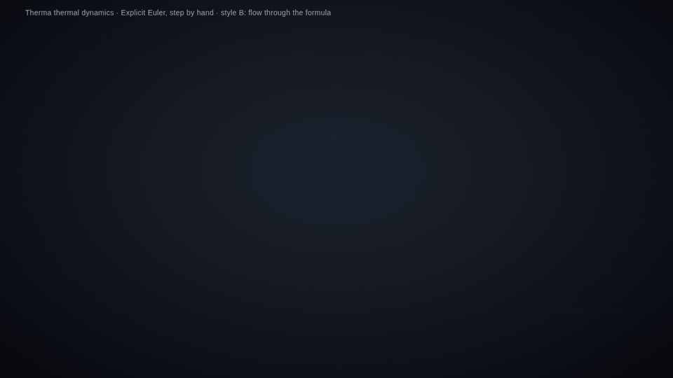
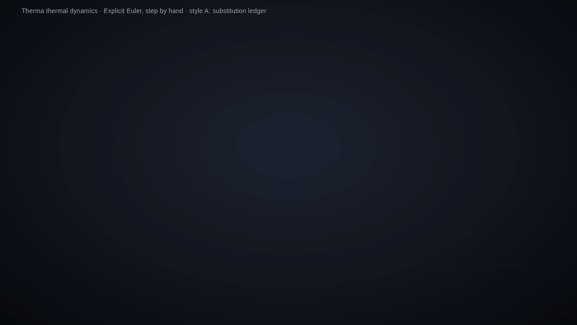

# Animation Style Register: Substitution Ledger (A) and Flow Through the Formula (B)

This page fixes how the animated concept figures in this repository look, so that a new animation can be built the same way on any machine. Two choreographies were tried for the scene "numbers go into the formula and come out as the next state". **Style B is the one in use** (chosen 2026-10-16 after both were seen with the slot rule applied). Style A is kept as the alternative.

**Style B, flow through the formula (in use):**

**Style A, substitution ledger (alternative):**

Both demos show the same thing: explicit Euler on a falling ball, step $n = 0 \to 1$ and then $n = 1 \to 2$ with $\Delta t = 0.8\ \mathrm{s}$ , $g = 9.81\ \mathrm{m/s^2}$ , $\beta = 0.1\ \mathrm{s^{-1}}$ , start $y^0 = 100\ \mathrm{m}$ , $v^0 = 0$ . Every number on screen is computed by the page, none is typed in. Video files: [style-B-flow.mp4](media/style-B-flow.mp4), [style-A-ledger.mp4](media/style-A-ledger.mp4). Page sources: [style-B-flow.html](media/style-B-flow.html), [style-A-ledger.html](media/style-A-ledger.html). The style B demo runs at the registered pace (31 s); the style A demo is at the first, faster pace (24 s).

## Base look (both styles)

| Element | Rule |
|---|---|
| Stage | 1280 × 720, scaled to the window, nothing outside it |
| Background | radial gradient, centre `#1c2230`, mid `#11151d`, edge `#07090d` (near black with a soft vignette) |
| Text | `#ECECEC`; secondary text `#9AA0A6`; rules and table lines `#3a4150` |
| Colours of meaning | explicit / first method `#FC6255` (red), implicit / second method `#58C4DD` (blue), exact or reference `#FFFFFF`, highlight `#FFFF00`, finished result `#83C167` (green) |
| Boxes | border only, no filled white cards; a formula card is a 2 px border in the colour of its method, radius 8 to 10 px |
| Math | KaTeX for every formula; 28 px in the formula card, 26 px in worked lines, 22 px in tables, 19 to 20 px body text |
| Series line | 14 px grey line at the top left: series, title, variant |
| Figure panel | the right third of the stage shows the physical picture (here the falling ball with a height axis, landing ticks "n = k" and a clock), so each computed number is also seen as motion |
| Motion | every frame is a pure function of time; scene fades 0.6 s (1.0 s for a step-by-hand scene); the pace of the number motion is fixed by the table below |

## Style B, flow through the formula (in use)

1. The current state is three chips at the top ( $t^n$ , $v^n$ , $y^n$ ) under a large step label "n = k".
2. The formula is a fixed machine below, with dashed slots where the state enters. Constants stay symbolic inside the machine and are listed under it.
3. For one step: copies of the chips travel along curved paths into the slots, the slots turn solid, the machine pulses, and two green result chips emerge from its right edge.
4. The result chips fly up and replace the state chips, which flash. The old state shrinks into a history strip under the chips. The figure on the right moves to the new value. The machine resets to its empty slots.
5. When a line needs a value computed in the same step (implicit Euler: the position line uses $v^{n+1}$ ), a copy of that result chip travels into the slot before the line fills.

Character: more motion, emphasises "state in, state out", close to how the loop runs in code.

## Style A, substitution ledger (alternative)

1. A state table on top: columns $n$ , $t^n$ , $v^n$ , $y^n$ . Row $n = 0$ is present from the start; later rows are empty lines waiting to be filled.
2. The update formula in symbols sits in a bordered card below the table and never moves.
3. For one step: the cells of the current row and the matching symbols in the formula light up. A worked copy of the formula appears under the card in symbols, with reserved gaps. The numbers glide from the table cells into those gaps. The right-hand side then collapses in beats, one operation per beat, until a single green result remains.
4. The green result slides up into the next row of the state table, and the figure on the right moves to the new value.
5. The next step repeats the same motions from the new row. Worked lines of a finished step dim to a ghost so the page stays readable.

Character: calm, textbook, readable when paused.

## Pace of the number motion (both styles)

Set on 2026-10-16: 35 % slower than the first demos, so that the eye can follow one number from its chip to its slot before the next one leaves.

| Motion | Duration |
|---|---|
| a number copy travels from the state to a slot | 1.35 s, launches 0.4 s apart |
| the formula switches from symbols to the filled copy | 0.55 s crossfade |
| the formula pulses while it evaluates | 0.9 s |
| a result chip grows out of the formula | 0.8 s |
| a result chip travels to the state | 1.6 s |
| the old state shrinks into the history strip | 1.1 s |
| the state chips switch to the new values | 0.55 s, with a 0.3 s flash |
| the figure moves to the new value | 1.1 s |
| the formula resets to symbols | 0.8 s |
| one explicit step ( $n \to n+1$ ) | about 12.5 s; an implicit step, whose velocity result feeds the position line, about 15 s |

## The slot rule (both styles)

When a number replaces a symbol, the rest of the line must not move. A symbol such as $v^n$ is narrower than $-7.848$ , so a naive replacement shifts every operator to the right, and the audience cannot tell which number went where.

The rule: render every version of the line first (symbolic, with numbers, each collapse beat), measure the width of each slot in every version, set each slot to the widest content it will ever hold, and only then show the first version. The slots are centred, the numbers land in the centre of their slot, and the `=` , `+` , `-` and brackets stay exactly where they were. In the demos the symbolic line shows these reserved gaps on purpose.

## Page contract (to rebuild the pipeline elsewhere)

- One HTML page, KaTeX from a CDN, a fixed `#stage` of 1280 × 720.
- Scenes are blocks with a start and an end time; elements carry the second at which they fade in; the last scene holds.
- The page exposes `renderAt(t)` (draws the whole picture for time `t` , no timers, no CSS transitions), `TOTAL` (length in seconds) and sets a ready flag after the fonts are loaded and the slot widths are measured.
- Opened normally the page plays once and holds (click replays). Opened with the `#manual` hash it waits for a renderer.
- The renderer is a headless browser that steps `t` at 30 frames per second, screenshots each frame, and encodes H.264 1280 × 720. The GIF is the same frames at 960 px and 10 frames per second, played once.

## Taste rules for the notes and animations

- No slogans. A plain closing sentence instead.
- Every number is written out and computed in the page. Vector and matrix products are shown as a row times a column with every element visible.
- Skip inner-method details that the viewer does not need for the concept.
- A note has the sections What happens, Concept and Summary, with the Summary also in 繁體中文, Français, Deutsch and Русский.
