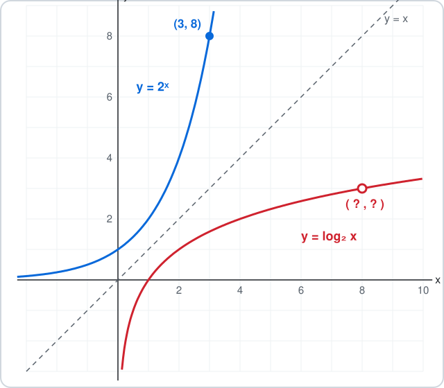

# AP Precalculus 2.10 — Inverses of Exponential Functions

**Quick recap:**

- $f(x)=\log_b x$ and $g(x)=b^{x}$ are **inverse functions**:

$$
b^{\log_b x}=x \qquad \log_b\!\left(b^{x}\right)=x
$$

- If $(s,t)$ is on $b^{x}$, then $(t,s)$ is on $\log_b x$.
- The graph of $\log_b x$ is the graph of $b^{x}$ reflected over the line $y=x$.
- Domain and range swap: $\log_b x$ takes $x>0$ and gives every real number.
- Exponential: inputs **add**, outputs **multiply**. Logarithmic: inputs **multiply**, outputs **add**.
- A logarithm is the inverse, **not** the reciprocal.

**A calculator is allowed. Show your calculation before choosing A–D.**

---

## 1. Swap the pair

The graph of $g(x)=4^{x}$ contains the point $(2.5,\,32)$.

Which point is on the graph of $f(x)=\log_4 x$?

- **A.** $(2.5,\,32)$
- **B.** $(-2.5,\,32)$
- **C.** $(32,\,2.5)$
- **D.** $(32,\,-2.5)$

## 2. Compose to x

Simplify both expressions:

$$
5^{\log_5 7} \qquad\text{and}\qquad \log_3\!\left(3^{4}\right)
$$

- **A.** $7$ and $4$
- **B.** $35$ and $12$
- **C.** $7$ and $81$
- **D.** $\log_5 7$ and $12$

## 3. Match the table

$$
\begin{array}{c|cccc}
x & 1 & 5 & 25 & 125\\
\hline
f(x) & 0 & 3 & 6 & 9
\end{array}
$$

Which function fits the table?

- **A.** $f(x)=5\log_3 x$
- **B.** $f(x)=3\log_5 x$
- **C.** $f(x)=3\cdot5^{x}$
- **D.** $f(x)=\log_5(3x)$

## 4. Domain and range

$f(x)=\log_6 x$ is the inverse of $g(x)=6^{x}$.

What are the domain and range of $f$?

| Option | Domain | Range |
|---|---|---|
| A | all real numbers | $y>0$ |
| B | $x>0$ | $y>0$ |
| C | all real numbers | all real numbers |
| D | $x>0$ | all real numbers |

## 5. Reflection, not reciprocal

The figure shows $y=2^{x}$, $y=\log_2 x$ and the dashed line $y=x$. The point $(3,\,8)$ is marked on $y=2^{x}$.

Which statement is **false**?

- **A.** $\log_2 x$ is the inverse function of $2^{x}$
- **B.** $\log_2 x$ is the graph of $2^{x}$ reflected over $y=x$
- **C.** $\log_2 x$ is the reciprocal: $\log_2 x=\dfrac{1}{2^{x}}$
- **D.** $(8,\,3)$ is on the graph of $\log_2 x$

---

<b>Answers</b>

**1. C — Inverse functions swap input and output**

- $4^{2.5}=32$ means the exponential takes $2.5$ to $32$.
- The logarithm runs it backwards: it takes $32$ to $2.5$.

$$
\begin{aligned}
\log_4 32 &= 2.5 \\
\text{so } (s,t)=(2.5,32) &\to (t,s)=\boxed{(32,\,2.5)}
\end{aligned}
$$

Check: $4^{2.5}=4^{2}\cdot4^{0.5}=16\cdot2=32$.

- Not $(2.5,32)$: that is the same point; swapping changes which number is the input.
- Not $(32,-2.5)$: $32>1$, so $\log_4 32$ is positive. A negative output would need an input below $1$.

**2. A — An exponential and a logarithm with the same base undo each other**

$$
b^{\log_b x}=x \qquad\text{and}\qquad \log_b\!\left(b^{x}\right)=x
$$

- $\log_5 7$ is *the exponent that turns 5 into 7*. Raising $5$ to it gives $7$.
- $\log_3(3^4)$ asks *which exponent turns 3 into $3^4$*. The answer is $4$.

$$
\begin{aligned}
5^{\log_5 7} &= \boxed{7} \\
\log_3\!\left(3^{4}\right) &= \boxed{4}
\end{aligned}
$$

- Not $35$: the $5$ and the $7$ are not multiplied; the log is an exponent.
- Not $81$: $3^4=81$ is the *input* of the log, not its value.
- Not $12$: $3\cdot4$ multiplies base and exponent, which has no meaning here.

**3. B — Inputs multiply, outputs add: a logarithm**

- Inputs go $1\to5\to25\to125$: each time **times 5**.
- Outputs go $0\to3\to6\to9$: each time **plus 3**.
- Multiply in, add out: that is $a\log_b x$ with base $b=5$. Each $\times5$ adds $a$, so $a=3$.

Check two entries:

$$
\begin{aligned}
3\log_5 25 &= 3\cdot2 \\
&= 6 \\
3\log_5 125 &= 3\cdot3 \\
&= \boxed{9}
\end{aligned}
$$

- Not $5\log_3 x$: base and factor swapped; $5\log_3 25\approx14.6$, not $6$.
- Not $3\cdot5^{x}$: an exponential would give $3\cdot5^{1}=15$ at $x=1$, not $3$.
- Not $\log_5(3x)$: $\log_5 3\ne0$ at $x=1$.

**4. D — The inverse swaps domain and range**

For the exponential $g(x)=6^{x}$:

- Domain: any real $x$.
- Range: outputs are always positive, $y>0$.

The inverse swaps them. For $f(x)=\log_6 x$:

- Domain: $x>0$ (the old range).
- Range: all real numbers (the old domain).

$$
\boxed{\text{domain } x>0,\quad \text{range all reals}}
$$

Two values show the range goes both ways:

$$
\begin{aligned}
\log_6 36 &= 2 \\
\log_6 \tfrac{1}{36} &= -2
\end{aligned}
$$

- Not choice A: that is the exponential's own domain and range, unswapped.
- Not $y>0$: a log of an input between $0$ and $1$ is negative.

**5. C — Inverse means undo, not divide**

- **Inverse** (true): $\log_2 x$ undoes $2^{x}$, so $\log_2(2^{x})=x$.
- **Reflection** (true): swapping $(s,t)\to(t,s)$ for every point is a reflection over $y=x$.
- **$(8,3)$** (true): $(3,8)$ on $2^{x}$ swaps to $(8,3)$ on $\log_2 x$.
- **Reciprocal** (false): test it at $x=8$.

$$
\begin{aligned}
\log_2 8 &= 3 \\
\frac{1}{2^{8}} &= \frac{1}{256}
\end{aligned}
$$

$$
\boxed{\log_2 x \ne \frac{1}{2^{x}}}
$$

- The notation $f^{-1}$ means the inverse function, not $\dfrac{1}{f}$.

A logarithm runs the exponential backwards: swap every (input, output) pair, swap the domain and range, reflect the graph over y = x.

