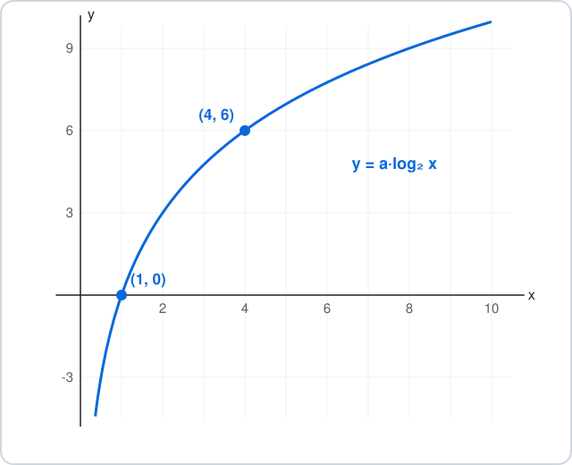

# AP Precalculus 2.11 — Logarithmic Functions

**Quick recap:**

- For $f(x)=a\log_b x$: domain $x>0$, range all real numbers, vertical asymptote $x=0$.
- A shift $\log_b(x+k)$ moves the domain and the asymptote: $x+k>0$.
- $b>1$ and $a>0$: increasing, concave down. A log with base below $1$ is decreasing, concave up.
- A negative $a$ reflects the graph over the $x$-axis.
- No horizontal asymptote: $a\log_b x\to\pm\infty$ as $x\to\infty$.
- Inputs **multiply**, outputs **add**: that pattern means a log.

**A calculator is allowed. Show your calculation before choosing A–D.**

---

## 1. Domain and asymptote

$$
f(x)=\log_3(x+4)-1
$$

What are the domain and the vertical asymptote of $f$?

| Option | Domain | Vertical asymptote |
|---|---|---|
| A | $x>0$ | $x=0$ |
| B | $x>-4$ | $x=-4$ |
| C | $x>4$ | $x=4$ |
| D | $x>-4$ | $y=-1$ |

## 2. Direction and concavity

$$
g(x)=3\log_{0.5} x
$$

Which statement describes $g$?

- **A.** increasing and concave down
- **B.** increasing and concave up
- **C.** decreasing and concave down
- **D.** decreasing and concave up

## 3. End behaviour

$$
h(x)=-2\log_5 x+1
$$

What is $\displaystyle\lim_{x\to\infty} h(x)$?

- **A.** $-\infty$
- **B.** $\infty$
- **C.** $1$
- **D.** $0$

## 4. Spot the log in a table

$$
\begin{array}{c|cccc}
x & -1 & 1 & 5 & 13\\
\hline
f(x) & 0 & 2 & 4 & 6
\end{array}
$$

Which function fits the table?

- **A.** $f(x)=x+1$
- **B.** $f(x)=2\log_2(x+3)-2$
- **C.** $f(x)=2\log_2(x-3)-2$
- **D.** $f(x)=2^{x+3}-2$

## 5. Read the formula from the graph

The graph shows $y=a\log_2 x$. It passes through the marked points $(1,\,0)$ and $(4,\,6)$.

Which function is graphed?

- **A.** $y=6\log_2 x$
- **B.** $y=2\log_3 x$
- **C.** $y=3\log_2 x$
- **D.** $y=\log_2(3x)$

---

<b>Answers</b>

**1. B — The argument of a log must be positive**

- Only the inside of the log, $x+4$, sets the domain.
- The $-1$ outside moves the graph down; it does not change the domain.

$$
\begin{aligned}
x+4 &> 0 \\
x &> -4
\end{aligned}
$$

The graph runs down along the line where the argument reaches $0$:

$$
\boxed{\text{domain } x>-4,\quad \text{asymptote } x=-4}
$$

Check: $f(-3)=\log_3 1-1=-1$, a real value.

- Not $x>4$: that solves $x-4>0$; the sign is the wrong way.
- Not $y=-1$: a log has a **vertical** asymptote, never a horizontal one.

**2. D — Base below 1: decreasing; a positive factor keeps the shape**

- Base $b=0.5$ is between $0$ and $1$, so $\log_{0.5} x$ is **decreasing**.
- $a=3$ is positive: it stretches the graph but does not flip it.
- A decreasing log is **concave up**: it falls quickly, then more and more slowly.

Check with values:

$$
\begin{aligned}
g(1) &= 0 \\
g(2) &= -3 \\
g(3) &\approx -4.75
\end{aligned}
$$

- The drops are $3$, then about $1.75$: falling, but less each step, so concave up.

$$
\boxed{\text{decreasing and concave up}}
$$

- Not concave down: that is the shape of an **increasing** log such as $3\log_2 x$.

**3. A — A log never levels off**

- $\log_5 x$ grows without bound as $x\to\infty$, only slowly.
- Multiplying by $-2$ turns that into falling without bound.
- The $+1$ only moves the graph up one unit.

Two large inputs:

$$
\begin{aligned}
h\!\left(5^{10}\right) &= -2(10)+1 \\
&= -19 \\
h\!\left(5^{20}\right) &= -2(20)+1 \\
&= -39
\end{aligned}
$$

$$
\boxed{\lim_{x\to\infty} h(x)=-\infty}
$$

- Not $1$: a log has **no horizontal asymptote**; $1$ is only the value at $x=1$.
- Not $\infty$: the factor $-2$ is negative, so the graph goes down.

**4. B — Look at x + 3: it doubles while the outputs add 2**

- The $x$-values $-1,1,5,13$ do not multiply by one factor.
- Add $3$: $x+3$ gives $2,4,8,16$. Each one **doubles**.
- The outputs add $2$ each time: inputs multiply, outputs add. That is a log of $x+3$.

Check two entries:

$$
\begin{aligned}
f(5) &= 2\log_2 8-2 \\
&= 2(3)-2 \\
&= 4 \\
f(13) &= 2\log_2 16-2 \\
&= 2(4)-2 \\
&= \boxed{6}
\end{aligned}
$$

- Not $x+1$: it fits the first two entries, but $f(5)$ would be $6$, not $4$.
- Not $\log_2(x-3)$: at $x=-1$ the argument is $-4$, which is not allowed.
- Not $2^{x+3}-2$: an exponential gives $2^{2}-2=2$ at $x=-1$, not $0$.

**5. C — Use the point that is not (1, 0)**

- Every $a\log_2 x$ passes through $(1,0)$, so that point cannot decide.
- Use $(4,6)$:

$$
\begin{aligned}
a\log_2 4 &= 6 \\
2a &= 6 \\
a &= 3
\end{aligned}
$$

$$
\boxed{y=3\log_2 x}
$$

Check: $x=8$ gives $3\cdot3=9$, on the same curve.

- Not $6\log_2 x$: $6$ is the $y$-value, not $a$; it gives $12$ at $x=4$.
- Not $\log_2(3x)$: at $x=1$ it gives $\log_2 3\approx1.58$, not $0$.

A log function lives on x > 0 (or on x + k > 0 after a shift), has a vertical asymptote, never levels off, and turns multiplying inputs into adding outputs.

