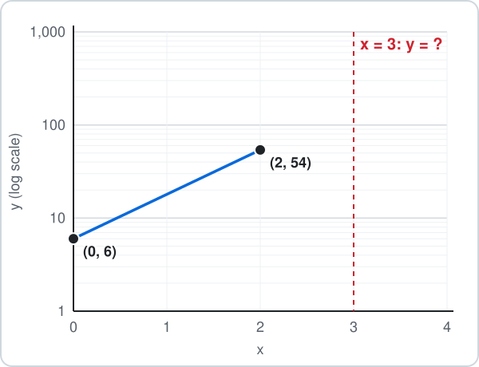

# AP Precalculus 2.15 — Semi-log Plots

**Quick recap:**

$$
\begin{aligned}
y &= a\cdot b^{x} \\
\log y &= \log a+x\log b
\end{aligned}
$$

- On a semi-log plot exponential data is a **straight line**.
- Slope $=\log b$, intercept $=\log a$.
- Equal gaps on the log axis are equal factors.

**A calculator is allowed. Show your calculation before choosing A–D.**

---

## 1. Read a log scale

On the log-scale $y$-axis of a semi-log plot, a point sits exactly halfway between the gridlines $10$ and $100$. What is its $y$-value?

- **A.** $55$
- **B.** about $31.6$
- **C.** $50$
- **D.** $15$

## 2. Which data is straight?

Each set has $x=0,1,2,3$. Which set of $y$-values lies on a **straight line** on a semi-log plot?

- **A.** $2,\ 4,\ 6,\ 8$
- **B.** $1,\ 4,\ 9,\ 16$
- **C.** $7,\ 21,\ 63,\ 189$
- **D.** $10,\ 20,\ 40,\ 70$

## 3. From the line to the model

On a semi-log plot ($\log$ base $10$) the data lie on the line

$$
\log y=0.3+0.6x
$$

Which model fits, to one decimal place?

- **A.** $y\approx2.0\cdot(4.0)^{x}$
- **B.** $y\approx4.0\cdot(2.0)^{x}$
- **C.** $y=0.3+0.6x$
- **D.** $y=0.3\cdot(0.6)^{x}$

## 4. Predict from two points

The figure shows a semi-log plot. The data lie on a straight line through $(0,\,6)$ and $(2,\,54)$. Predict $y$ at $x=3$.

- **A.** $78$
- **B.** $108$
- **C.** $486$
- **D.** $162$

## 5. Growth rate from the slope

An app's monthly downloads lie on a straight line on a semi-log plot ($\log$ base $10$). The slope of the line is $0.0792$ per month. By what percent do the downloads grow each month?

- **A.** about $7.92\%$
- **B.** about $20\%$
- **C.** about $0.0792\%$
- **D.** about $120\%$

---

<b>Answers</b>

**1. B — Halfway in height is halfway in log y**

- The height on a log scale is $\log y$.
- $\log10=1$ and $\log100=2$, so halfway is $1.5$.

$$
\begin{aligned}
\log y &= 1.5 \\
y &= 10^{1.5} \\
&\approx 31.6
\end{aligned}
$$

$$
\boxed{y\approx31.6}
$$

- Not $55$: that is halfway on an ordinary scale.
- Not $50$ or $15$: the gap from $10$ to $100$ is a factor of $10$, so halfway is a factor of $\sqrt{10}\approx3.16$.

**2. C — Look for the same ratio each step**

$$
\begin{aligned}
21\div7 &= 3 \\
63\div21 &= 3 \\
189\div63 &= 3
\end{aligned}
$$

- Same ratio $3$ every step: exponential, so straight on a semi-log plot.

$$
\boxed{7,\ 21,\ 63,\ 189}
$$

- Not $2,4,6,8$: adds $2$ each step (linear).
- Not $1,4,9,16$: $y=x^{2}$, the ratios $4,\ 2.25,\ 1.78$ change.
- Not $10,20,40,70$: $\times2,\ \times2,$ then $\times1.75$. One different ratio is enough to bend.

**3. A — Intercept is log a, slope is log b**

$$
\begin{aligned}
\log a &= 0.3 \\
a &= 10^{0.3} \\
&\approx 2.0 \\
\log b &= 0.6 \\
b &= 10^{0.6} \\
&\approx 4.0
\end{aligned}
$$

$$
\boxed{y\approx2.0\cdot(4.0)^{x}}
$$

- Not $4.0\cdot(2.0)^{x}$: intercept and slope swapped.
- Not $0.3+0.6x$ or $0.3\cdot0.6^{x}$: the line is for $\log y$; undo the $\log$ with $10^{(\ )}$.

**4. D — Straight on semi-log means exponential**

$$
\begin{aligned}
y &= a\cdot b^{x} \\
a &= 6 \\
54 &= 6\cdot b^{2} \\
b^{2} &= 9 \\
b &= 3 \\
y(3) &= 6\cdot3^{3} \\
&= 162
\end{aligned}
$$

$$
\boxed{162}
$$

- Not $78$: a straight line on an ordinary graph ($6+24x$) is the wrong model here.
- Not $108$: one step multiplies by $3$, not by $2$.
- Not $486$: $54\cdot9$ jumps two steps; $x=3$ is one step after $x=2$.

**5. B — Slope is log b; b - 1 is the rate**

$$
\begin{aligned}
\log b &= 0.0792 \\
b &= 10^{0.0792} \\
&\approx 1.20
\end{aligned}
$$

- $b=1.20$ means $\times1.20$ each month: $+20\%$.

$$
\boxed{\text{about }20\%}
$$

- Not $7.92\%$ or $0.0792\%$: the slope is $\log b$, not the rate.
- Not $120\%$: $1.20$ is the factor; the growth is the part above $1$.

Straight on a semi-log plot means exponential: slope = log b, intercept = log a.

