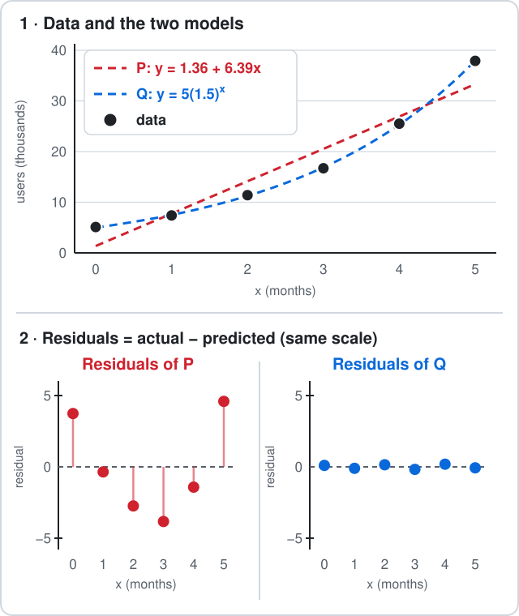

# AP Precalculus 2.6 — Competing Function Model Validation

**Quick recap:**

- Residual:

$$
\text{residual}=\text{actual}-\text{predicted}
$$

- Residual $>0$: the model underestimates.
- Residual $<0$: the model overestimates.
- Residual plot with no pattern: the model is appropriate.
- Equal input steps:
  - constant first differences: linear;
  - constant second differences: quadratic;
  - constant ratios: exponential.

**A calculator is allowed. Show your calculation before choosing A–D.**

---

## 1. Weather · Residual sign

A weather model predicts a top temperature of $31^\circ\text{C}$ for Saturday.

The actual top temperature is $28^\circ\text{C}$.

What is the residual, and what does it say about the model?

- **A.** $3$; the model underestimates
- **B.** $3$; the model overestimates
- **C.** $-3$; the model underestimates
- **D.** $-3$; the model overestimates

## 2. Table · Choose the model type

$$
\begin{array}{c|ccccc}
x & 0 & 1 & 2 & 3 & 4\\
\hline
y & 4 & 6 & 9 & 13.5 & 20.25
\end{array}
$$

The inputs go up in equal steps.

Which type of model fits the table exactly?

- **A.** linear
- **B.** quadratic
- **C.** exponential
- **D.** none of these

## 3. Residual plots · Which model?

An app counts its users (in thousands) for the first $6$ months after launch.

Two models are fitted to the data:

- Model P (linear):

$$
y=1.36+6.39x
$$

- Model Q (exponential):

$$
y=5(1.5)^x
$$

Plot 1 shows the data and both models (dashed).

Plot 2 shows the residuals of each model, on the same scale.

Which model is appropriate for the data?

- **A.** Model P: its residuals are above and below 0
- **B.** Model Q: its residuals are small and show no pattern
- **C.** Model P: a straight line is the simplest model
- **D.** Both models: each has residuals above and below 0

## 4. Birds · Compute the residual

The number of birds on an island, in thousands, $x$ years from now is modeled by

$$
f(x)=2(1.3)^x
$$

After $3$ years, $4.6$ thousand birds are counted.

What is the residual at $x=3$, to two decimal places?

- **A.** $0.21$
- **B.** $-0.21$
- **C.** $-3.2$
- **D.** $-12.98$

## 5. Festival food · Which error is safer?

Two models predict how many people come to a street festival, to decide how much food to order.

- Model A: all residuals from past years are small and **negative**.
- Model B: all residuals from past years are small and **positive**.

The food must not run out.

Which model should be used?

- **A.** Model B: it underestimates, so less food is wasted
- **B.** Model A: it underestimates, so less food is wasted
- **C.** Model A: it overestimates, so the food is enough
- **D.** Model B: it overestimates, so the food is enough

---

<b>Answers</b>

**1. D — Residual = actual − predicted**

$$
\begin{aligned}
\text{residual} &= 28-31 \\
&= \boxed{-3}
\end{aligned}
$$

- The residual is negative: the actual value is **lower** than the prediction.
- So the model **overestimates**.
- Not $3$: $31-28$ is predicted − actual, the wrong order.

**2. C — Check the ratios**

$$
\begin{aligned}
\frac{6}{4} &= 1.5 \\
\frac{9}{6} &= 1.5 \\
\frac{13.5}{9} &= 1.5 \\
\frac{20.25}{13.5} &= 1.5
\end{aligned}
$$

The ratio is constant, so the model is

$$
\boxed{\text{exponential: } y=4(1.5)^x}
$$

- Not linear: the first differences are $2,\ 3,\ 4.5,\ 6.75$, not constant.
- Not quadratic: the second differences are $1,\ 1.5,\ 2.25$, not constant either.

**3. B — A pattern in the residuals means the wrong model type**

Each residual is actual − predicted ($y$ is the actual number of users):

$$
\begin{array}{c|c|c|c}
x & y & \text{P} & \text{Q}\\
\hline
0 & 5.1 & 3.74 & 0.10 \\
1 & 7.4 & -0.35 & -0.10 \\
2 & 11.4 & -2.74 & 0.15 \\
3 & 16.7 & -3.83 & -0.18 \\
4 & 25.5 & -1.42 & 0.19 \\
5 & 37.9 & 4.59 & -0.07
\end{array}
$$

- **Model P** (the straight line):
  - The data curves upward, but a line cannot bend.
  - The line is too low at both ends: residuals $+$.
  - The line is too high in the middle: residuals $-$.
  - That is a **U-shape**, so a linear model is the wrong type.
- **Model Q** (the curve):
  - Every residual is smaller than $0.2$, so the dots sit on the $0$ line.
  - The dots switch between above and below $0$ with no pattern.

$$
\boxed{\text{Model Q}}
$$

- Not A or D: residuals above and below $0$ are not enough. Look for a **pattern**, and Model P has one.
- Not C: the simplest model is not the test. The residuals decide.

**4. A — Predict first, then subtract**

$$
\begin{aligned}
f(3) &= 2(1.3)^3 \\
&= 2(2.197) \\
&= 4.394
\end{aligned}
$$

$$
\begin{aligned}
\text{residual} &= 4.6-4.394 \\
&\approx \boxed{0.21}
\end{aligned}
$$

- The residual is positive, so the model **underestimates** a little.
- Not $-3.2$: $2(1.3)(3)=7.8$ multiplies by $3$ instead of using the power.
- Not $-12.98$: $(2\cdot1.3)^3$ cubes the $2$ as well. The power belongs to $1.3$ only.

**5. C — Negative residual means overestimate**

- Model A: residual $<0$, so actual $<$ predicted. It **overestimates** the crowd.
- Ordering for more people than come means the food does not run out.

$$
\boxed{\text{Model A}}
$$

- Not Model B: positive residuals mean more people come than predicted, so the food could run out.
- The context decides which error is safer, not only the size of the residuals.

A model is appropriate when its residuals are small and show no pattern; the context decides which error is safer.

