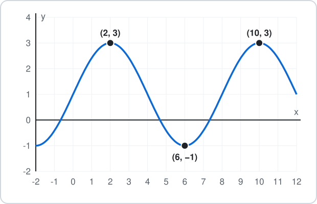

# AP Precalculus 3.1 — Periodic Phenomena

**Quick recap:**

$$
\begin{aligned}
f(x+P) &= f(x) \\
\text{midline} &= \frac{\max+\min}{2} \\
\text{amplitude} &= \frac{\max-\min}{2}
\end{aligned}
$$

- The period $P$ is the length of one full cycle.
- To predict a later value, take away whole periods first.

**Show your calculation before choosing A–D.**

---

## 1. Find the period

A function takes these values at $x=0,1,2,3,\dots$

$$
0,\ 2,\ 2,\ 0,\ -2,\ -2,\ 0,\ 2,\ 2,\ 0,\ -2,\ -2,\ \dots
$$

What is its period?

- **A.** $3$
- **B.** $6$
- **C.** $2$
- **D.** $4$

## 2. Midline and amplitude

On a summer day in Valletta the temperature goes up to $31^\circ\text{C}$ in the afternoon and down to $23^\circ\text{C}$ at night, day after day. Which pair is correct?

- **A.** midline $27^\circ\text{C}$, amplitude $8^\circ\text{C}$
- **B.** midline $4^\circ\text{C}$, amplitude $27^\circ\text{C}$
- **C.** midline $8^\circ\text{C}$, amplitude $4^\circ\text{C}$
- **D.** midline $27^\circ\text{C}$, amplitude $4^\circ\text{C}$

## 3. Predict with the period

A periodic function $f$ has period $5$ and $f(2)=7$. What is $f(17)$?

- **A.** $7$
- **B.** $17$
- **C.** $2$
- **D.** $35$

## 4. A Ferris wheel later

A Ferris wheel has diameter $30$ m and its centre is $18$ m above the ground. It turns once every $10$ minutes. A seat is at the bottom ($3$ m) at $t=0$. How high is the seat at $t=25$ minutes?

- **A.** $3$ m
- **B.** $18$ m
- **C.** $33$ m
- **D.** $25$ m

## 5. Where is it decreasing?

The figure shows a periodic function $g$ with high points $(2,\,3)$ and $(10,\,3)$ and a low point $(6,\,-1)$. On which interval is $g$ **decreasing**?

- **A.** $-2<x<2$
- **B.** $2<x<6$
- **C.** $6<x<10$
- **D.** $0<x<4$

---

<b>Answers</b>

**1. B — Find where the whole pattern starts again**

- One full cycle: $0,\ 2,\ 2,\ 0,\ -2,\ -2$, then it starts again.

$$
\begin{aligned}
f(x+6) &= f(x)
\end{aligned}
$$

$$
\boxed{P=6}
$$

- Not $3$: $0$ comes back after $3$ steps, but then the values go down, not up.
- Not $2$ or $4$: $f(2)=2$ but $f(4)=-2$; the pattern does not repeat there.

**2. D — Average for the midline, half the range for the amplitude**

$$
\begin{aligned}
\text{midline} &= \frac{31+23}{2} \\
&= 27 \\
\text{amplitude} &= \frac{31-23}{2} \\
&= 4
\end{aligned}
$$

$$
\boxed{27\,^\circ\text{C and }4\,^\circ\text{C}}
$$

- Not amplitude $8$: that is $\max-\min$; the amplitude is half of it.
- Not midline $4$ or $8$: the midline is a temperature level between $23$ and $31$.

**3. A — Take away whole periods**

$$
\begin{aligned}
17-3\cdot5 &= 2 \\
f(17) &= f(2) \\
&= 7
\end{aligned}
$$

$$
\boxed{f(17)=7}
$$

- Not $17$ or $2$: those are inputs, not outputs.
- Not $35$: $7\cdot5$; the period moves the input, it never multiplies the output.

**4. C — Back to the first turn, then half a turn**

$$
\begin{aligned}
25-2\cdot10 &= 5 \\
h(25) &= h(5)
\end{aligned}
$$

- $t=5$ is half a turn after the bottom: the top.

$$
\begin{aligned}
\text{top} &= 18+15 \\
&= 33
\end{aligned}
$$

$$
\boxed{33\text{ m}}
$$

- Not $3$ m: that is the bottom, at $t=0,\ 10,\ 20,\ 30$.
- Not $18$ m: the centre height is passed at $t=2.5$ and $7.5$ in each turn.
- Not $25$ m: the time is not the height.

**5. B — High point to the next low point**

- From the high point at $x=2$ down to the low point at $x=6$, $g$ falls the whole time.

$$
\boxed{2<x<6}
$$

- Not $-2<x<2$ or $6<x<10$: low to high, so $g$ is increasing.
- Not $0<x<4$: $g$ rises until $x=2$, then falls. Mixed.

One full cycle tells you everything: period, midline, amplitude, and every later value.

