# Malta Year 8 Math — All 19 Chapters: Basic Extended

**Basic Extended:** 5 more versions of each of the 38 Basic questions, 190 questions in all, grouped by question.

---

## Ch 1 Directed Numbers · Warmer by 8

### 1. Ch 1 Directed Numbers · Car park lift

In a Valletta car park, floor 0 is the street.

Floor $-2$ means 2 floors below the street.

A lift starts on floor $-2$ and goes up 6 floors.

Which floor does it stop at?

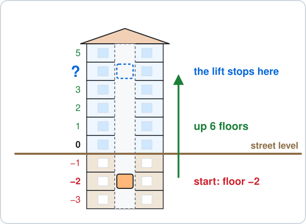

Answer: ______

### 2. Ch 1 Directed Numbers · Kinnie on the table

A bottle of Kinnie comes out of the freezer at $-5\,^\circ\text{C}$ (5 degrees below zero).

On the table it gets 7 degrees warmer.

What is its temperature now?

Answer: ______

### 3. Ch 1 Directed Numbers · Diver swims up

Sea level is 0 m, and $-9$ m means 9 m under the water.

A diver at Ċirkewwa is at $-9$ m.

The diver swims up 5 m.

What is the diver's depth now?

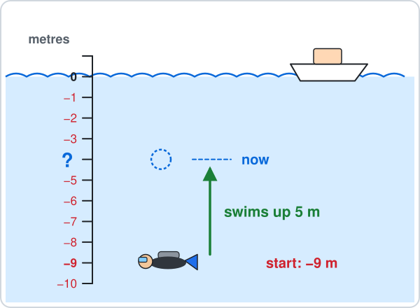

Answer: ______

### 4. Ch 1 Directed Numbers · Bank balance

A bank balance of −€15 means you owe the bank €15.

Your balance is −€15 and you pay in €40.

What is your balance now?

Answer: ______

### 5. Ch 1 Directed Numbers · Rocket countdown

A rocket clock counts seconds.

It shows $-8$, which means 8 seconds before lift-off (lift-off is 0).

Then 11 seconds pass.

What does the clock show now?

Answer: ______

## Ch 1 Directed Numbers · Below zero

### 6. Ch 1 Directed Numbers · Colder freezer

A freezer is at $-6\,^\circ\text{C}$ (6 degrees below zero).

You turn it down and it gets 8 degrees colder.

What is the temperature now?

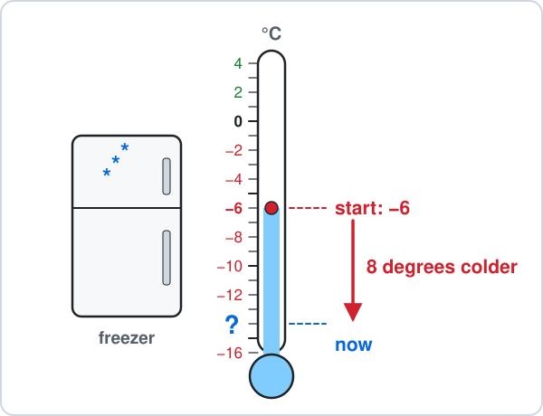

Answer: ______

### 7. Ch 1 Directed Numbers · Hotel lift down

In a hotel in St Julian's, floor 0 is the street and floor $-1$ is 1 floor below it.

A lift starts on floor $-1$ and goes down 3 floors.

Which floor does it stop at?

Answer: ______

### 8. Ch 1 Directed Numbers · Spending in debt

Your bank balance is −€20, which means you owe the bank €20.

You spend €15 more with your card.

What is your balance now?

Answer: ______

### 9. Ch 1 Directed Numbers · Anchor goes down

Sea level is 0 m, and $-4$ m means 4 m under the water.

A boat's anchor hangs at $-4$ m.

It is let down 7 m more.

How deep is the anchor now?

Answer: ______

### 10. Ch 1 Directed Numbers · Quiz points

In a quiz game your score is $-3$ points (3 points below zero).

A wrong answer loses 6 points.

What is your score now?

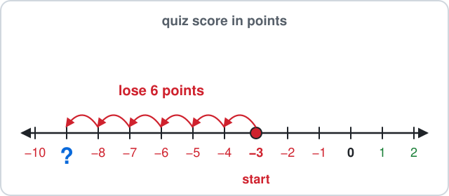

Answer: ______

## Ch 2 Number Work · Multiply before adding

### 11. Ch 2 Number Work · Pastizzi boxes

A tray has 5 loose pastizzi and 3 boxes with 4 pastizzi in each box.

The total is $5 + 3\times4$.

How many pastizzi are there?

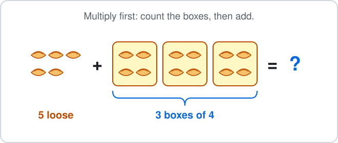

Answer: ______

### 12. Ch 2 Number Work · Kinnie crates

You have 4 bottles of Kinnie and 2 crates with 6 bottles in each crate.

The total is $4 + 2\times6$.

How many bottles are there?

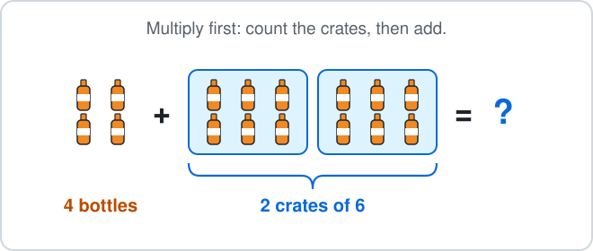

Answer: ______

### 13. Ch 2 Number Work · Egg boxes

A kitchen has 5 loose eggs and 3 boxes with 6 eggs in each box.

The total is $5 + 3\times6$.

How many eggs are there?

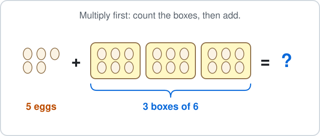

Answer: ______

### 14. Ch 2 Number Work · Festa fireworks

For the village festa, a club has 6 single fireworks and 4 packs with 3 fireworks in each pack.

The total is $6 + 4\times3$.

How many fireworks are there?

Answer: ______

### 15. Ch 2 Number Work · Gozo ferry deck

The Gozo ferry carries 2 vans and 4 rows of cars, with 5 cars in each row.

The total is $2 + 4\times5$.

How many vehicles are there?

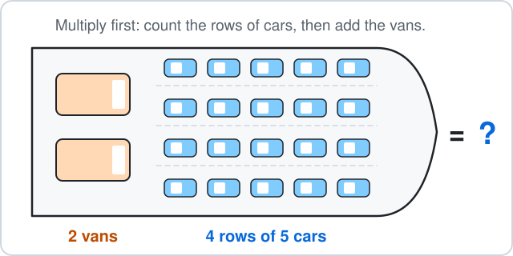

Answer: ______

## Ch 2 Number Work · Square number

### 16. Ch 2 Number Work · Square patio

A square patio is 7 tiles long and 7 tiles wide.

The number of tiles is $7^2$ (the small 2 means 7 times itself).

How many tiles are there?

Answer: ______

### 17. Ch 2 Number Work · Square cake

A square birthday cake is cut into 5 rows with 5 pieces in each row.

The number of pieces is $5^2$ (the small 2 means 5 times itself).

How many pieces are there?

Answer: ______

### 18. Ch 2 Number Work · Festa band

A festa band marches in a square: 8 rows with 8 players in each row.

The number of players is $8^2$ (the small 2 means 8 times itself).

How many players are in the band?

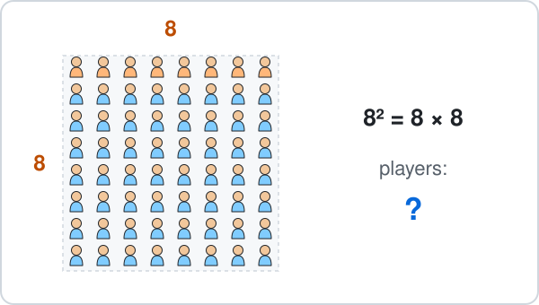

Answer: ______

### 19. Ch 2 Number Work · Window panes

A square window has 4 rows with 4 glass panes in each row.

The number of panes is $4^2$ (the small 2 means 4 times itself).

How many panes are there?

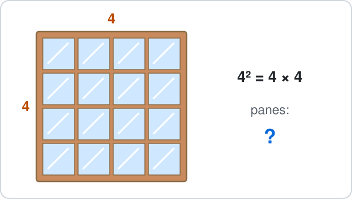

Answer: ______

### 20. Ch 2 Number Work · Sticker sheet

A square sheet of star stickers has 9 rows with 9 stickers in each row.

The number of stickers is $9^2$ (the small 2 means 9 times itself).

How many stickers are there?

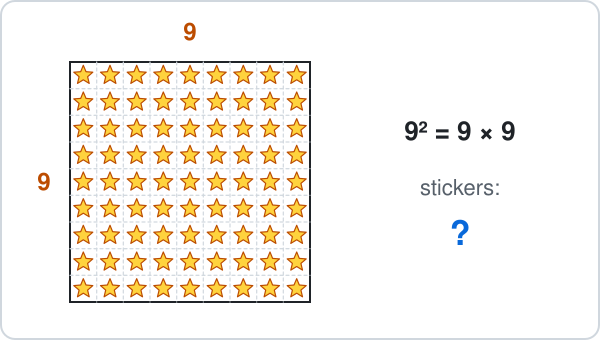

Answer: ______

## Ch 3 Angles · Straight line

### 21. Ch 3 Angles · Road junction

A side road meets a straight main road.

The two angles at the corner sit on a straight line.

One angle is $72^\circ$.

Find the other angle.

Answer: ______

### 22. Ch 3 Angles · Ladder on a wall

A ladder leans on a wall and stands on flat ground.

On the wall side, the ladder makes $65^\circ$ with the ground.

Find the angle between the ladder and the ground on the other side.

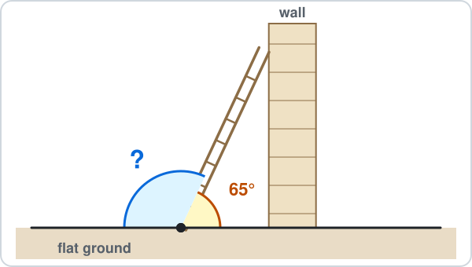

Answer: ______

### 23. Ch 3 Angles · Kite string

A kite string is tied to a peg on a flat beach at Għajn Tuffieħa.

On one side, the string makes $40^\circ$ with the sand.

Find the angle between the string and the sand on the other side.

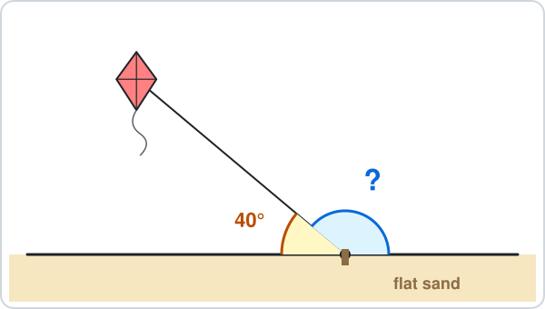

Answer: ______

### 24. Ch 3 Angles · Bus ramp

A ramp goes from the flat pavement up to a bus door.

The ramp makes $20^\circ$ with the pavement on the bus side.

Find the angle between the ramp and the pavement on the other side.

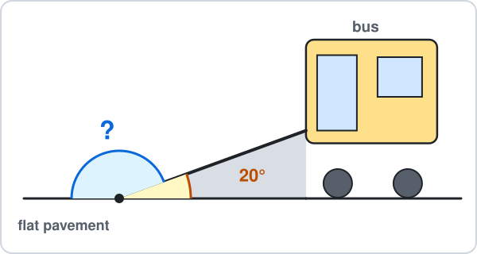

Answer: ______

### 25. Ch 3 Angles · Car park barrier

A car park barrier arm lifts up from a straight road.

On one side, the arm makes $55^\circ$ with the road.

Find the angle between the arm and the road on the other side.

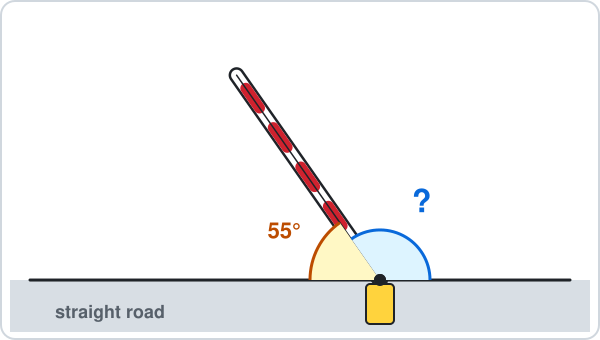

Answer: ______

## Ch 3 Angles · Triangle

### 26. Ch 3 Angles · Luzzu sail

The sail of a luzzu (a Maltese fishing boat) is a triangle.

The mast and the bottom of the sail make a right angle ($90^\circ$).

Another corner is $50^\circ$.

Find the top angle.

Answer: ______

### 27. Ch 3 Angles · House roof

The roof of a house is a triangle.

The two bottom angles are $35^\circ$ each.

Find the top angle.

Answer: ______

### 28. Ch 3 Angles · Festa flag

A festa flag is a triangle hanging from a string.

The two top angles are $75^\circ$ each.

Find the angle at the bottom point.

Answer: ______

### 29. Ch 3 Angles · Triangle park

A small park in Sliema is a triangle.

Two of its corners are $65^\circ$ and $50^\circ$.

Find the third corner.

Answer: ______

### 30. Ch 3 Angles · Buoy triangle

At the Blue Lagoon, a swim route goes round 3 buoys and makes a triangle.

Two of its angles are $45^\circ$ and $100^\circ$.

Find the third angle.

Answer: ______

## Ch 4 Fractions · Slices of pizza

### 31. Ch 4 Fractions · Birthday cake

A round cake is cut into 6 equal slices.

A fraction like $\frac{1}{6}$ means 1 slice out of the 6.

You eat 2 slices and a friend eats 3 slices.

What fraction of the cake is eaten?

- **A.** $\frac{2}{6}$
- **B.** $\frac{5}{6}$
- **C.** $\frac{5}{12}$
- **D.** $\frac{1}{6}$

### 32. Ch 4 Fractions · Chocolate bar

A chocolate bar has 12 equal pieces.

A fraction like $\frac{1}{12}$ means 1 piece out of the 12.

You eat 4 pieces and a friend eats 3 pieces.

What fraction of the bar is eaten?

- **A.** $\frac{7}{24}$
- **B.** $\frac{4}{12}$
- **C.** $\frac{7}{12}$
- **D.** $\frac{5}{12}$

### 33. Ch 4 Fractions · Apple pie

An apple pie is cut into 10 equal slices.

A fraction like $\frac{1}{10}$ means 1 slice out of the 10.

You eat 2 slices and a friend eats 5 slices.

What fraction of the pie is eaten?

- **A.** $\frac{7}{20}$
- **B.** $\frac{3}{10}$
- **C.** $\frac{2}{10}$
- **D.** $\frac{7}{10}$

### 34. Ch 4 Fractions · Pastizzi tray

A tray has 9 pastizzi, all the same size.

A fraction like $\frac{1}{9}$ means 1 pastizz out of the 9.

You eat 4 and a friend eats 3.

What fraction of the tray is eaten?

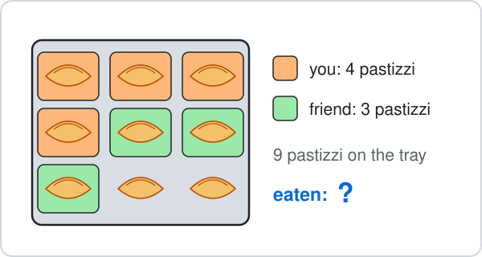

- **A.** $\frac{7}{9}$
- **B.** $\frac{7}{18}$
- **C.** $\frac{4}{9}$
- **D.** $\frac{2}{9}$

### 35. Ch 4 Fractions · Festa nougat

A bar of qubbajt (festa nougat) is cut into 7 equal pieces.

A fraction like $\frac{1}{7}$ means 1 piece out of the 7.

You eat 2 pieces and a friend eats 4 pieces.

What fraction of the bar is eaten?

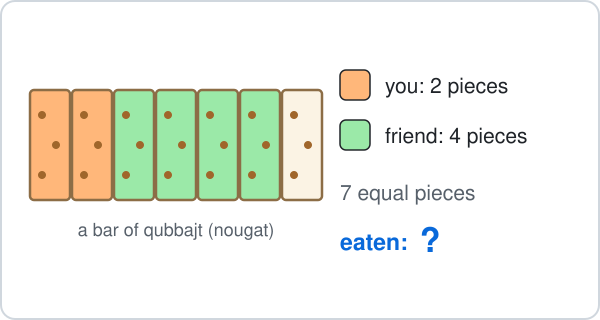

- **A.** $\frac{2}{7}$
- **B.** $\frac{6}{14}$
- **C.** $\frac{6}{7}$
- **D.** $\frac{1}{7}$

## Ch 4 Fractions · Fraction of an amount

### 36. Ch 4 Fractions · Cheese pastizzi

A tray holds 30 pastizzi.

$\frac{2}{5}$ of them are cheese pastizzi ($\frac{2}{5}$ means 2 out of every 5 equal parts).

How many cheese pastizzi are there?

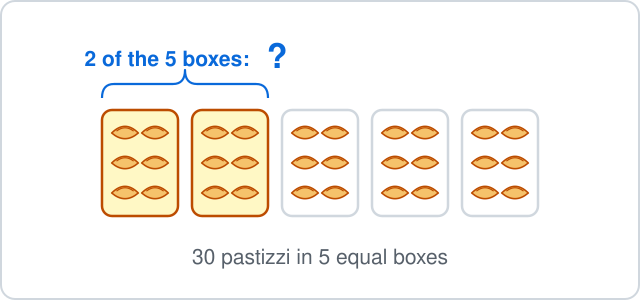

Answer: ______

### 37. Ch 4 Fractions · Bus seats

A Valletta bus has 24 seats.

$\frac{3}{4}$ of the seats are taken ($\frac{3}{4}$ means 3 out of every 4 equal parts).

How many seats are taken?

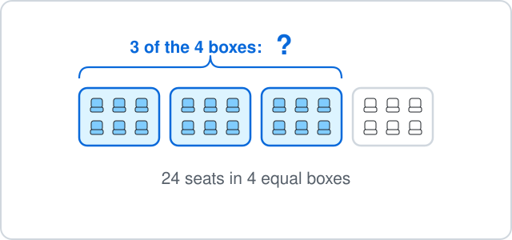

Answer: ______

### 38. Ch 4 Fractions · Festa balloons

A festa stall has 21 balloons.

$\frac{2}{3}$ of them are red ($\frac{2}{3}$ means 2 out of every 3 equal parts).

How many red balloons are there?

Answer: ______

### 39. Ch 4 Fractions · Ferry savings

You have saved €36 in one-euro coins.

You spend $\frac{5}{6}$ of it on a day trip to Gozo ($\frac{5}{6}$ means 5 out of every 6 equal parts).

How much do you spend?

Answer: ______

### 40. Ch 4 Fractions · Beach trip

A class has 25 students.

$\frac{4}{5}$ of them go on the beach trip ($\frac{4}{5}$ means 4 out of every 5 equal parts).

How many students go?

Answer: ______

## Ch 5 Decimals · Adding money

### 41. Ch 5 Decimals · Ftira and Kinnie

At a kiosk a ftira costs €3.40 and a Kinnie costs €1.50.

How much do they cost together?

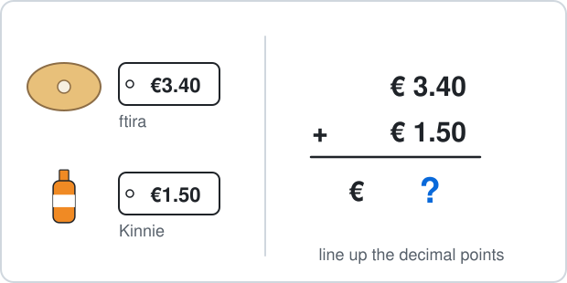

Answer: ______

### 42. Ch 5 Decimals · Ice cream and water

An ice cream costs €2.20 and a bottle of water costs €1.75.

How much do they cost together?

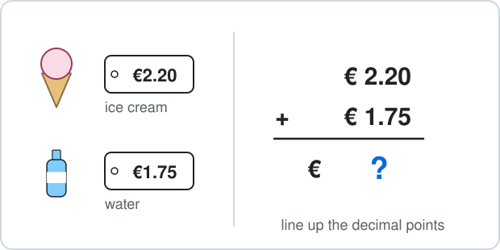

Answer: ______

### 43. Ch 5 Decimals · Notebook and pen

A notebook costs €3.25 and a pen costs €0.60.

How much do they cost together?

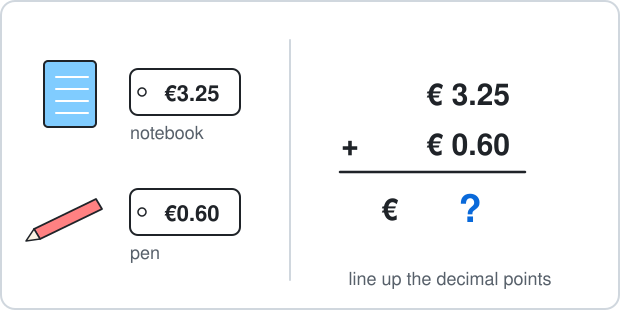

Answer: ______

### 44. Ch 5 Decimals · Nougat and balloon

At the festa a bar of nougat costs €5.30 and a balloon costs €2.45.

How much do they cost together?

Answer: ______

### 45. Ch 5 Decimals · Beach umbrella and sunbed

At Golden Bay an umbrella costs €6.50 to hire and a sunbed costs €4.20.

How much do they cost together?

Answer: ______

## Ch 5 Decimals · Times 10

### 46. Ch 5 Decimals · Ten pastizzi

One pastizz costs €0.45.

You buy 10 pastizzi, so the cost is $0.45\times10$ euros.

How much do 10 pastizzi cost?

Answer: ______

### 47. Ch 5 Decimals · Cans of drink

One can holds 0.33 litres of drink.

A pack has 10 cans, so it holds $0.33\times10$ litres.

How many litres are in the pack?

Answer: ______

### 48. Ch 5 Decimals · Festa ribbons

For the festa you cut 10 pieces of ribbon, each 0.28 m long.

The total length is $0.28\times10$ metres.

How many metres of ribbon is that?

Answer: ______

### 49. Ch 5 Decimals · Stack of coins

One coin is 0.23 cm thick.

A stack of 10 coins is $0.23\times10$ cm tall.

How tall is the stack?

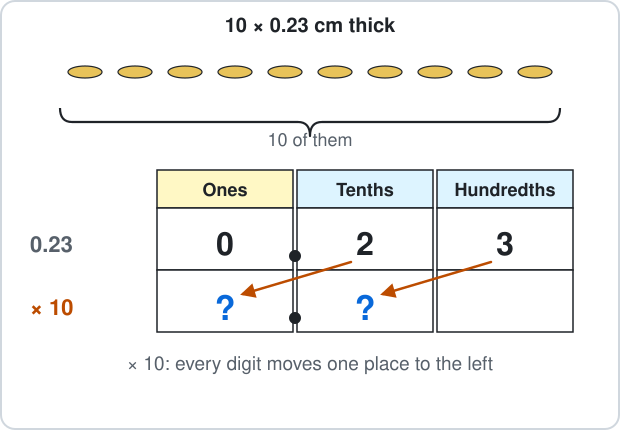

Answer: ______

### 50. Ch 5 Decimals · Ten steps

Each of your steps is 0.75 m long.

You walk 10 steps, which is $0.75\times10$ metres.

How far do you walk?

Answer: ______

## Ch 6 Percentages · Ten percent

### 51. Ch 6 Percentages · Shoe sale

Shoes cost €90.

In a sale you get $10\%$ off ($10\%$ means 10 out of every 100, the same as one tenth).

How much money do you save?

Answer: ______

### 52. Ch 6 Percentages · Walk to school

A class has 30 students.

$10\%$ of them walk to school ($10\%$ means 10 out of every 100, the same as one tenth).

How many students walk to school?

Answer: ______

### 53. Ch 6 Percentages · Ferry cyclists

A Gozo ferry carries 600 passengers.

$10\%$ of them bring a bicycle ($10\%$ means 10 out of every 100, the same as one tenth).

How many passengers bring a bicycle?

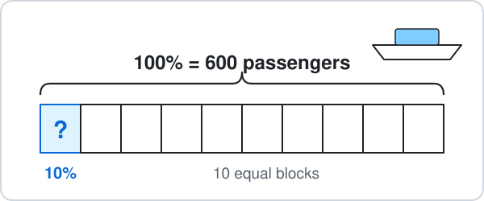

Answer: ______

### 54. Ch 6 Percentages · Restaurant tip

A meal in Marsaxlokk costs €45.

You leave a $10\%$ tip ($10\%$ means 10 out of every 100, the same as one tenth).

How much is the tip?

Answer: ______

### 55. Ch 6 Percentages · Film adverts

A film on TV lasts 80 minutes.

$10\%$ of that time is adverts ($10\%$ means 10 out of every 100, the same as one tenth).

How many minutes of adverts are there?

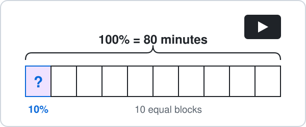

Answer: ______

## Ch 6 Percentages · Percent of a grid

### 56. Ch 6 Percentages · Cinema seats

A small cinema has 100 seats in 10 rows of 10.

The red seats are taken.

Per cent means out of 100.

What percentage of the seats is taken?

Answer: ______

### 57. Ch 6 Percentages · Blue floor tiles

A floor has 100 equal tiles in a 10 by 10 square.

Some tiles are blue.

Per cent means out of 100.

What percentage of the floor is blue?

Answer: ______

### 58. Ch 6 Percentages · Gold stickers

A sheet has 100 round stickers in 10 rows of 10.

Some stickers are gold.

Per cent means out of 100.

What percentage of the stickers is gold?

Answer: ______

### 59. Ch 6 Percentages · Seedling tray

A garden tray has 100 seedlings in 10 rows of 10.

Some of them have a flower.

Per cent means out of 100.

What percentage of the seedlings has a flower?

Answer: ______

### 60. Ch 6 Percentages · Beach umbrellas

At Golden Bay there are 100 beach umbrellas in 10 rows of 10.

Some umbrellas are open.

Per cent means out of 100.

What percentage of the umbrellas is open?

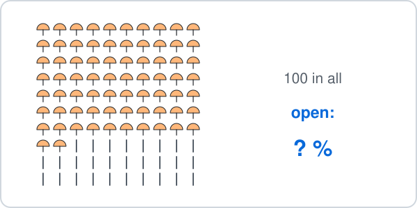

Answer: ______

## Ch 7 Ratio · Sharing

### 61. Ch 7 Ratio · Football cards

You and a friend share 18 football cards in the ratio $1 : 2$.

Your friend gets the bigger share.

How many cards does your friend get?

Answer: ______

### 62. Ch 7 Ratio · Pocket money

You and your brother share €30 in the ratio $2 : 3$.

Your brother gets the bigger share.

How many euros does he get?

Answer: ______

### 63. Ch 7 Ratio · Pastizzi tray

A bakery bakes 40 pastizzi.

Cheese pastizzi and pea pastizzi are in the ratio $1 : 4$.

How many pea pastizzi are there?

Answer: ______

### 64. Ch 7 Ratio · Bus passengers

There are 35 passengers on a Valletta bus.

Sitting and standing passengers are in the ratio $5 : 2$.

How many passengers are sitting?

Answer: ______

### 65. Ch 7 Ratio · Beach shells

You collect 27 shells at Golden Bay.

White shells and pink shells are in the ratio $4 : 5$.

How many pink shells are there?

Answer: ______

## Ch 7 Ratio · Simplest form

### 66. Ch 7 Ratio · Fruit stall

A fruit stall has 16 apples and 24 oranges.

Write the ratio apples : oranges, $16 : 24$, in its simplest form.

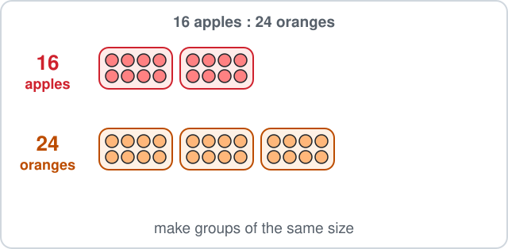

- **A.** $2 : 3$
- **B.** $4 : 6$
- **C.** $3 : 2$
- **D.** $8 : 12$

### 67. Ch 7 Ratio · Ferry cars and vans

On the Gozo ferry there are 30 cars and 12 vans.

Write the ratio cars : vans, $30 : 12$, in its simplest form.

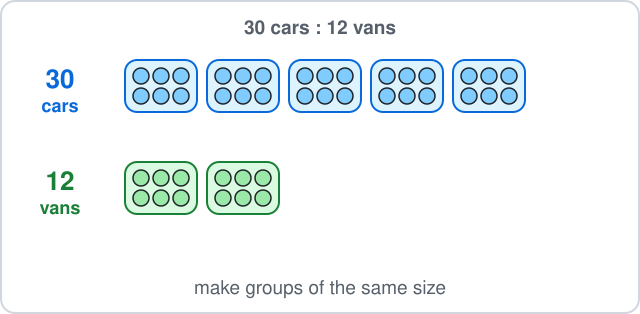

- **A.** $15 : 6$
- **B.** $2 : 5$
- **C.** $5 : 2$
- **D.** $10 : 4$

### 68. Ch 7 Ratio · Festa band

A festa band has 9 drummers and 27 trumpet players.

Write the ratio drummers : trumpets, $9 : 27$, in its simplest form.

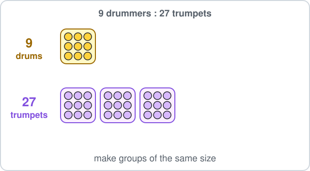

- **A.** $3 : 9$
- **B.** $3 : 1$
- **C.** $1 : 18$
- **D.** $1 : 3$

### 69. Ch 7 Ratio · Shell colours

You find 28 white shells and 20 pink shells.

Write the ratio white : pink, $28 : 20$, in its simplest form.

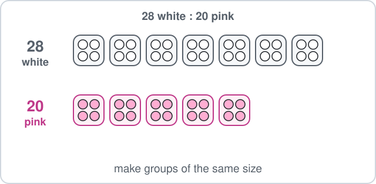

- **A.** $14 : 10$
- **B.** $7 : 5$
- **C.** $5 : 7$
- **D.** $7 : 4$

### 70. Ch 7 Ratio · Coins in a jar

A money jar holds 8 one-euro coins and 32 ten-cent coins.

Write the ratio one-euro : ten-cent, $8 : 32$, in its simplest form.

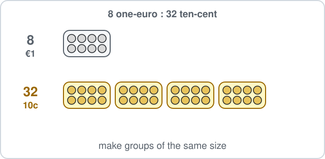

- **A.** $2 : 8$
- **B.** $4 : 1$
- **C.** $1 : 4$
- **D.** $4 : 16$

## Ch 8 Algebra · Solve

### 71. Ch 8 Algebra · Parcel on a scale

A parcel weighs $x$ kg.

The parcel and 4 kg of blocks balance 13 kg of blocks, so $x + 4 = 13$.

Solve to find $x$.

Answer: ______

### 72. Ch 8 Algebra · Bus stop

There are $x$ passengers on a bus.

At the next stop 6 more get on, and now there are 17 passengers, so $x + 6 = 17$.

Solve to find $x$.

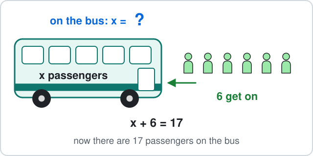

Answer: ______

### 73. Ch 8 Algebra · Purse money

You have $x$ euros in your purse.

A friend gives you €8, and now you have €20, so $x + 8 = 20$.

Solve to find $x$.

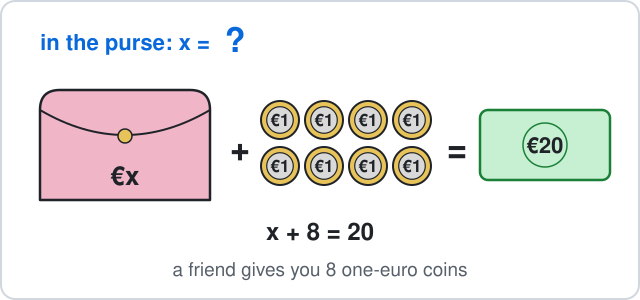

Answer: ______

### 74. Ch 8 Algebra · Two ropes

A rope $x$ m long is tied to a rope 5 m long.

Together they are 18 m long, so $x + 5 = 18$.

Solve to find $x$.

Answer: ______

### 75. Ch 8 Algebra · Bag of marbles

A bag holds $x$ marbles.

You tip the bag and 9 more marbles into a jar, and the jar has 25 marbles, so $x + 9 = 25$.

Solve to find $x$.

Answer: ______

## Ch 8 Algebra · Substitute

### 76. Ch 8 Algebra · Taxi fare

A taxi charges $2k + 3$ euros for a trip of $k$ km.

Here $2k + 3$ means $2\times k + 3$.

How many euros is a 6 km trip?

Answer: ______

### 77. Ch 8 Algebra · Chairs at tables

Long tables are pushed together in a row for a festa dinner, with 2 chairs on each long side of a table and 1 chair at each end of the row.

For $t$ tables you need $4t + 2$ chairs, where $4t + 2$ means $4\times t + 2$.

How many chairs do 5 tables need?

Answer: ______

### 78. Ch 8 Algebra · Ferry tickets

A group trip on the Gozo ferry costs $5n + 10$ euros for $n$ people.

Here $5n + 10$ means $5\times n + 10$.

How many euros does it cost for 3 people?

Answer: ______

### 79. Ch 8 Algebra · Money box

You start with €7 in a money box and add €3 every week.

After $w$ weeks the box holds $3w + 7$ euros, where $3w + 7$ means $3\times w + 7$.

How many euros are in the box after 8 weeks?

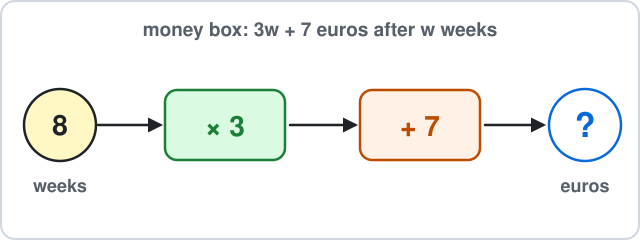

Answer: ______

### 80. Ch 8 Algebra · Stack of cups

A stack of $c$ paper cups is $2c + 9$ cm tall, where $2c + 9$ means $2\times c + 9$.

How tall is a stack of 7 cups?

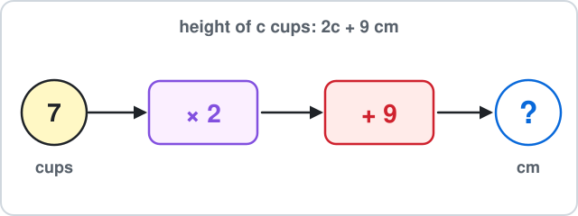

Answer: ______

## Ch 9 Sequences · Matchstick pattern

### 81. Ch 9 Sequences · Matchstick triangles

Matchsticks make triangles in a row.

Pattern 1 uses 3 matchsticks, pattern 2 uses 5 and pattern 3 uses 7.

How many matchsticks does pattern 4 use?

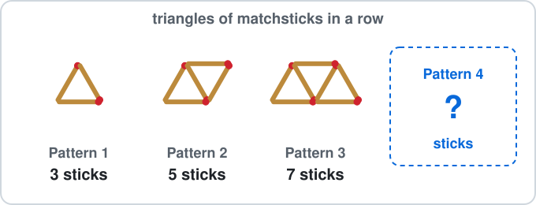

Answer: ______

### 82. Ch 9 Sequences · Tables and chairs

Square tables are pushed together in a row, with chairs all round.

1 table has 4 chairs, 2 tables have 6 chairs and 3 tables have 8 chairs.

How many chairs fit round 4 tables?

Answer: ______

### 83. Ch 9 Sequences · Garden path

A garden path has green tiles in a row with white tiles all round it.

Pattern 1 uses 8 white tiles, pattern 2 uses 10 and pattern 3 uses 12.

How many white tiles does pattern 4 use?

Answer: ______

### 84. Ch 9 Sequences · Matchstick hexagons

Matchsticks make hexagons in a row.

Pattern 1 uses 6 matchsticks, pattern 2 uses 11 and pattern 3 uses 16.

How many matchsticks does pattern 4 use?

Answer: ______

### 85. Ch 9 Sequences · Plus-sign tiles

Square tiles make a plus sign that grows.

Pattern 1 uses 1 tile, pattern 2 uses 5 and pattern 3 uses 9.

How many tiles does pattern 4 use?

Answer: ______

## Ch 9 Sequences · Term rule

### 86. Ch 9 Sequences · Theatre seats

In an open-air theatre, row number $n$ has $3n + 2$ seats.

Here $3n + 2$ means $3\times n + 2$.

How many seats are in row 10?

Answer: ______

### 87. Ch 9 Sequences · Festa arches

Each festa arch has light bulbs.

Arch number $n$ has $4n + 1$ bulbs, where $4n + 1$ means $4\times n + 1$.

How many bulbs are on arch 5?

Answer: ______

### 88. Ch 9 Sequences · Growing plant

A plant is $5n + 3$ cm tall after $n$ weeks, where $5n + 3$ means $5\times n + 3$.

How tall is it after 6 weeks?

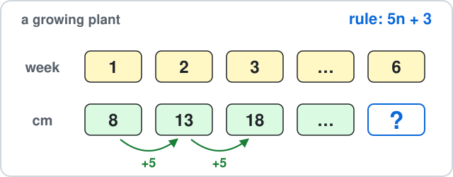

Answer: ______

### 89. Ch 9 Sequences · Stacked chairs

A stack of $n$ plastic chairs is $2n + 80$ cm tall, where $2n + 80$ means $2\times n + 80$.

How tall is a stack of 20 chairs?

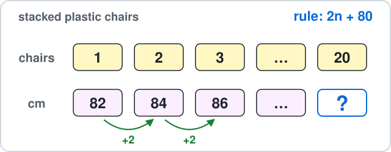

Answer: ______

### 90. Ch 9 Sequences · Savings

You save money each week.

After week number $n$ your money box holds $10n + 4$ euros, where $10n + 4$ means $10\times n + 4$.

How many euros are in it after week 7?

Answer: ______

## Ch 10 Circles · Diameter

### 91. Ch 10 Circles · Bicycle wheel

A bicycle wheel has radius 35 cm.

Find its diameter.

Answer: ______

### 92. Ch 10 Circles · Dinner plate

A round dinner plate has radius 13 cm.

Find its diameter.

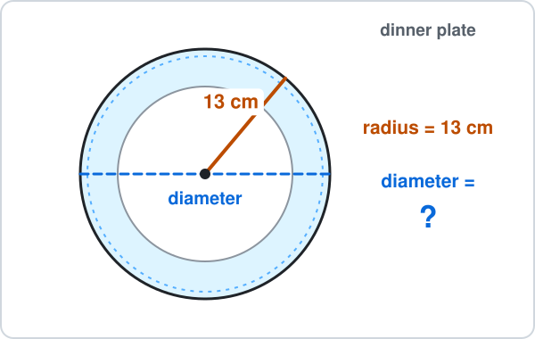

Answer: ______

### 93. Ch 10 Circles · Clock face

A kitchen clock has a round face with radius 16 cm.

Find its diameter.

Answer: ______

### 94. Ch 10 Circles · Round pool

A round paddling pool has radius 3 m.

Find its diameter.

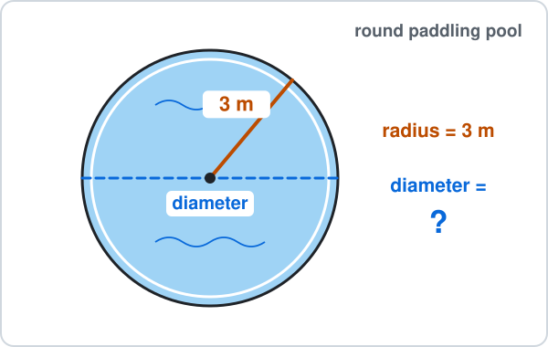

Answer: ______

### 95. Ch 10 Circles · Round table

A round dining table has radius 60 cm.

Find its diameter.

Answer: ______

## Ch 10 Circles · Circumference

### 96. Ch 10 Circles · Coin edge

A coin has diameter 2 cm.

Use $\pi \approx 3.14$ to find its circumference (the distance round its edge).

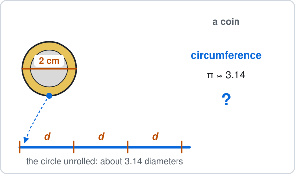

Answer: ______

### 97. Ch 10 Circles · Cake tin

A round cake tin has diameter 20 cm.

You tie a ribbon once round it.

Use $\pi \approx 3.14$ to find the length of ribbon (the circumference).

Answer: ______

### 98. Ch 10 Circles · Hula hoop

A hula hoop has diameter 70 cm.

Use $\pi \approx 3.14$ to find its circumference.

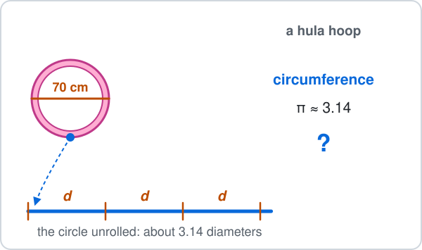

Answer: ______

### 99. Ch 10 Circles · Trampoline

A round trampoline has diameter 3 m.

Use $\pi \approx 3.14$ to find the length of padding round its edge (the circumference).

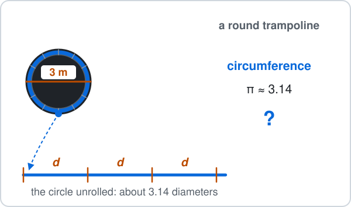

Answer: ______

### 100. Ch 10 Circles · Roundabout

A roundabout has diameter 40 m.

Use $\pi \approx 3.14$ to find the distance once round it (the circumference).

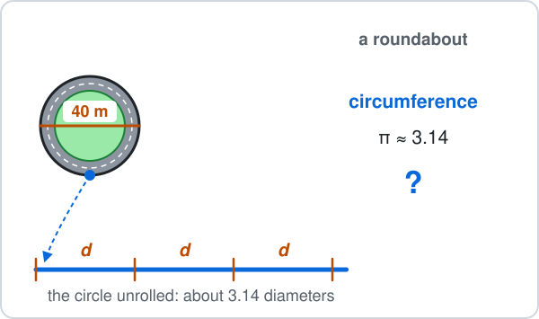

Answer: ______

## Ch 11 Perimeter & Area · Rectangle area

### 101. Ch 11 Perimeter & Area · Garden lawn

A rectangular garden lawn is 9 m long and 5 m wide.

Find its area.

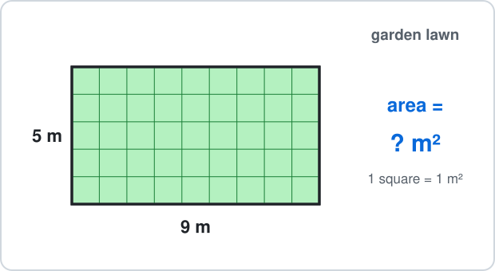

Answer: ______

### 102. Ch 11 Perimeter & Area · Classroom floor

A classroom floor is 7 m long and 6 m wide.

Find its area.

Answer: ______

### 103. Ch 11 Perimeter & Area · Phone screen

A phone screen is 14 cm tall and 7 cm wide.

Find its area.

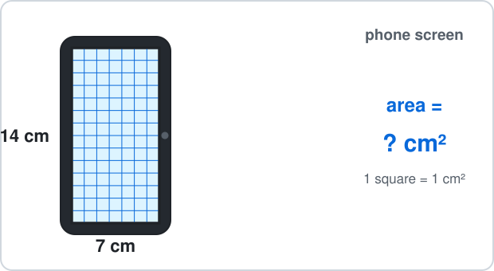

Answer: ______

### 104. Ch 11 Perimeter & Area · Football card

A football card is 9 cm long and 6 cm wide.

Find its area.

Answer: ______

### 105. Ch 11 Perimeter & Area · Pool floor

The floor of a small swimming pool is 10 m long and 4 m wide.

Find its area.

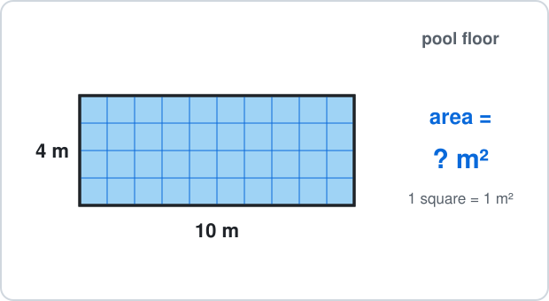

Answer: ______

## Ch 11 Perimeter & Area · Triangle area

### 106. Ch 11 Perimeter & Area · Festa pennant

A festa pennant is a triangle hanging from a string.

Its base (along the string) is 8 cm and its height is 5 cm.

Find its area.

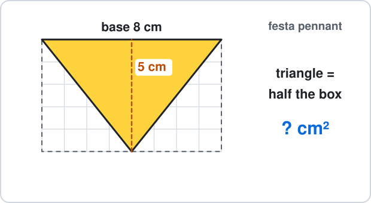

Answer: ______

### 107. Ch 11 Perimeter & Area · Boat sail

A boat sail is a right-angled triangle.

Its base is 6 m and its height up the mast is 9 m.

Find its area.

Answer: ______

### 108. Ch 11 Perimeter & Area · Sandwich

A sandwich is cut into a triangle with base 10 cm and height 7 cm.

Find its area.

Answer: ______

### 109. Ch 11 Perimeter & Area · Flower bed

A flower bed is a triangle with base 12 m and height 5 m.

Find its area.

Answer: ______

### 110. Ch 11 Perimeter & Area · House gable

The end wall of a house roof (the gable) is a triangle with base 8 m and height 7 m.

Find its area.

Answer: ______

## Ch 12 Surface Area & Nets · Cube surface area

### 111. Ch 12 Surface Area & Nets · Dice

A dice is a cube with edges of 3 cm.

Find its surface area.

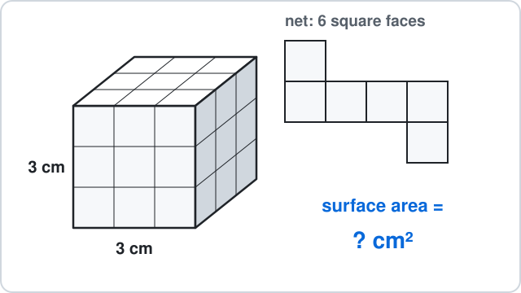

Answer: ______

### 112. Ch 12 Surface Area & Nets · Ice cube

A large ice cube has edges of 4 cm.

Find its surface area.

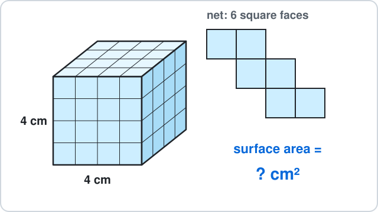

Answer: ______

### 113. Ch 12 Surface Area & Nets · Building block

A wooden building block is a cube with edges of 5 cm.

Find its surface area.

Answer: ______

### 114. Ch 12 Surface Area & Nets · Puzzle cube

A puzzle cube has edges of 7 cm.

Find its surface area.

Answer: ______

### 115. Ch 12 Surface Area & Nets · Storage cube

A cube-shaped storage box has edges of 10 cm.

Find its surface area.

Answer: ______

## Ch 12 Surface Area & Nets · Cuboid volume

### 116. Ch 12 Surface Area & Nets · Gift box

A gift box is 4 cm long, 3 cm wide and 2 cm high.

Find its volume.

Answer: ______

### 117. Ch 12 Surface Area & Nets · Water tank

A water tank on a roof is 3 m long, 2 m wide and 2 m high.

Find its volume.

Answer: ______

### 118. Ch 12 Surface Area & Nets · Toy brick

A toy brick is 8 cm long, 2 cm wide and 3 cm high.

Find its volume.

Answer: ______

### 119. Ch 12 Surface Area & Nets · Chocolate box

A box of chocolates is 7 cm long, 5 cm wide and 2 cm high.

Find its volume.

Answer: ______

### 120. Ch 12 Surface Area & Nets · Ferry container

A container on the Gozo ferry is 6 m long, 2 m wide and 3 m high.

Find its volume.

Answer: ______

## Ch 13 Graphs · Coordinates

### 121. Ch 13 Graphs · Treasure map

A treasure map is drawn on a grid.

The treasure chest is buried at point T.

What are the coordinates of T?

- **A.** $(1, 4)$
- **B.** $(4, 1)$
- **C.** $(5, 2)$
- **D.** $(-4, 1)$

### 122. Ch 13 Graphs · Cinema seat

A cinema seating plan is drawn on a grid.

Your seat is at point S.

What are the coordinates of S?

- **A.** $(4, 2)$
- **B.** $(3, 5)$
- **C.** $(-2, 4)$
- **D.** $(2, 4)$

### 123. Ch 13 Graphs · Village square

A map of a village square is drawn on a grid.

The fountain is at point F.

What are the coordinates of F?

- **A.** $(3, 5)$
- **B.** $(6, 4)$
- **C.** $(5, 3)$
- **D.** $(5, -3)$

### 124. Ch 13 Graphs · Garden plan

A garden plan is drawn on a grid.

A tomato plant grows at point P.

What are the coordinates of P?

- **A.** $(1, 3)$
- **B.** $(3, 1)$
- **C.** $(2, 4)$
- **D.** $(-1, 3)$

### 125. Ch 13 Graphs · Bus stop

A street map of a town is drawn on a grid.

The bus stop is at point B.

What are the coordinates of B?

- **A.** $(7, 5)$
- **B.** $(6, 4)$
- **C.** $(4, 6)$
- **D.** $(6, -4)$

## Ch 13 Graphs · Line value

### 126. Ch 13 Graphs · Plant height

A sunflower is 3 cm tall and grows 2 cm each week.

Its height is $y = 2x + 3$ centimetres after $x$ weeks.

Find $y$ when $x = 4$.

Answer: ______

### 127. Ch 13 Graphs · Taxi fare

A taxi costs €2 to start plus €3 for each kilometre.

The cost is $y = 3x + 2$ euros for $x$ km.

Find $y$ when $x = 2$.

Answer: ______

### 128. Ch 13 Graphs · Candle

A candle is 10 cm tall and burns down 2 cm each hour.

Its height is $y = 10 - 2x$ centimetres after $x$ hours.

Find $y$ when $x = 3$.

Answer: ______

### 129. Ch 13 Graphs · Water tank

A tank has 1 litre of water in it.

A tap adds 4 litres each minute, so it holds $y = 4x + 1$ litres after $x$ minutes.

Find $y$ when $x = 2$.

Answer: ______

### 130. Ch 13 Graphs · Bowling

At a bowling alley, shoe hire is €4 and each game is €2.

The cost is $y = 2x + 4$ euros for $x$ games.

Find $y$ when $x = 3$.

Answer: ______

## Ch 14 Statistics · Mode

### 131. Ch 14 Statistics · Goals scored

A football team scored these goals in 7 matches: $1, 2, 0, 2, 3, 2, 1$.

Find the mode.

Answer: ______

### 132. Ch 14 Statistics · Shoe sizes

A group of friends wear these shoe sizes: $37, 38, 38, 36, 38, 39, 37$.

Find the mode.

Answer: ______

### 133. Ch 14 Statistics · Temperatures

The noon temperature in Valletta (°C) on 7 days was: $24, 26, 25, 26, 27, 26, 24$.

Find the mode.

Answer: ______

### 134. Ch 14 Statistics · Dice rolls

You roll a dice 7 times and get: $4, 6, 4, 2, 6, 4, 1$.

Find the mode.

Answer: ______

### 135. Ch 14 Statistics · Pets at home

Eight classmates say how many pets they have at home: $0, 1, 1, 2, 1, 0, 3, 1$.

Find the mode.

Answer: ______

## Ch 14 Statistics · Mean

### 136. Ch 14 Statistics · Pages read

You read 12, 8, 10 and 14 pages of a book on four days.

Find the mean number of pages per day.

Answer: ______

### 137. Ch 14 Statistics · Cycling

You cycle 5 km, 9 km and 7 km on three days.

Find the mean distance per day.

Answer: ______

### 138. Ch 14 Statistics · Water polo goals

A water polo team scored 7, 4, 9, 5 and 10 goals in five matches.

Find the mean number of goals per match.

Answer: ______

### 139. Ch 14 Statistics · Ice creams sold

A beach kiosk sold 18, 25, 30 and 23 ice creams in four hours.

Find the mean number sold per hour.

Answer: ______

### 140. Ch 14 Statistics · Seedlings

Four seedlings are 5 cm, 9 cm, 8 cm and 10 cm tall.

Find their mean height.

Answer: ______

## Ch 15 Probability · Bag of counters

### 141. Ch 15 Probability · Box of chocolates

A box has 3 dark and 7 milk chocolates.

You pick one without looking.

What is the probability that it is dark?

- **A.** $\frac{3}{7}$
- **B.** $\frac{3}{10}$
- **C.** $\frac{7}{10}$
- **D.** $\frac{1}{3}$

### 142. Ch 15 Probability · Jar of marbles

A jar holds 5 green and 4 yellow marbles.

One marble is taken without looking.

What is the probability that it is green?

- **A.** $\frac{5}{4}$
- **B.** $\frac{4}{9}$
- **C.** $\frac{5}{9}$
- **D.** $\frac{1}{5}$

### 143. Ch 15 Probability · Festa raffle

At a village festa, 15 raffle tickets are sold and you bought 2 of them.

One ticket is drawn for the prize.

What is the probability that it is one of yours?

- **A.** $\frac{2}{13}$
- **B.** $\frac{13}{15}$
- **C.** $\frac{1}{2}$
- **D.** $\frac{2}{15}$

### 144. Ch 15 Probability · Bag of sweets

A bag has 4 strawberry and 3 lemon sweets.

One sweet is taken without looking.

What is the probability that it is strawberry?

- **A.** $\frac{4}{7}$
- **B.** $\frac{4}{3}$
- **C.** $\frac{3}{7}$
- **D.** $\frac{1}{4}$

### 145. Ch 15 Probability · Pencil case

A pencil case holds 5 black and 6 blue pens.

You take one pen without looking.

What is the probability that it is black?

- **A.** $\frac{5}{6}$
- **B.** $\frac{5}{11}$
- **C.** $\frac{6}{11}$
- **D.** $\frac{1}{5}$

## Ch 15 Probability · Not blue

### 146. Ch 15 Probability · Not a six

You roll a fair dice once.

What is the probability that you do **not** get a 6?

- **A.** $\frac{1}{6}$
- **B.** $\frac{6}{5}$
- **C.** $\frac{1}{5}$
- **D.** $\frac{5}{6}$

### 147. Ch 15 Probability · Coloured cards

Ten cards are shuffled face down: 3 are green and 7 are red.

You turn over one card.

What is the probability that it is **not** green?

- **A.** $\frac{3}{10}$
- **B.** $\frac{7}{10}$
- **C.** $\frac{10}{7}$
- **D.** $\frac{1}{10}$

### 148. Ch 15 Probability · Spinner

A spinner has 5 equal parts: 2 orange and 3 green.

You spin it once.

What is the probability that it does **not** land on orange?

- **A.** $\frac{3}{5}$
- **B.** $\frac{2}{5}$
- **C.** $\frac{5}{3}$
- **D.** $\frac{1}{5}$

### 149. Ch 15 Probability · Ferry on time

The probability that the Gozo ferry is late is $\frac{1}{8}$.

What is the probability that it is **not** late?

- **A.** $\frac{1}{8}$
- **B.** $\frac{8}{7}$
- **C.** $\frac{7}{8}$
- **D.** $\frac{1}{7}$

### 150. Ch 15 Probability · Box of doughnuts

A box has 12 doughnuts: 5 are chocolate and the rest are strawberry.

You take one without looking.

What is the probability that it is **not** chocolate?

- **A.** $\frac{5}{12}$
- **B.** $\frac{12}{7}$
- **C.** $\frac{1}{12}$
- **D.** $\frac{7}{12}$

## Ch 16 Constructions · Can it be a triangle?

### 151. Ch 16 Constructions · Drinking straws

You cut drinking straws to make a triangle.

Which three lengths can make a triangle?

- **A.** 2 cm, 3 cm, 7 cm
- **B.** 3 cm, 4 cm, 5 cm
- **C.** 1 cm, 4 cm, 6 cm
- **D.** 2 cm, 5 cm, 8 cm

### 152. Ch 16 Constructions · Wooden sticks

You glue three wooden sticks into a triangle.

Which three lengths can make a triangle?

- **A.** 2 cm, 2 cm, 5 cm
- **B.** 3 cm, 5 cm, 9 cm
- **C.** 1 cm, 6 cm, 8 cm
- **D.** 5 cm, 6 cm, 9 cm

### 153. Ch 16 Constructions · Fence planks

A farmer wants a triangle-shaped pen made of three fence planks.

Which three lengths can make a triangle?

- **A.** 2 m, 3 m, 6 m
- **B.** 1 m, 5 m, 7 m
- **C.** 4 m, 4 m, 6 m
- **D.** 3 m, 3 m, 7 m

### 154. Ch 16 Constructions · Pencils

You lay three pencils end to end to make a triangle.

Which three lengths can make a triangle?

- **A.** 6 cm, 7 cm, 8 cm
- **B.** 3 cm, 4 cm, 9 cm
- **C.** 2 cm, 6 cm, 9 cm
- **D.** 4 cm, 4 cm, 9 cm

### 155. Ch 16 Constructions · Climbing frame

A playground climbing frame has a triangle made of three metal bars.

Which three lengths can make a triangle?

- **A.** 2 m, 4 m, 7 m
- **B.** 5 m, 5 m, 8 m
- **C.** 3 m, 6 m, 10 m
- **D.** 1 m, 7 m, 9 m

## Ch 16 Constructions · Angle bisector

### 156. Ch 16 Constructions · Pizza slice

A slice of pizza has a corner angle of $80^\circ$.

You cut it in half with a straight cut through the corner.

What is the angle of each smaller slice?

Answer: ______

### 157. Ch 16 Constructions · Folded page

The corner of a page is a right angle, $90^\circ$.

You fold the corner so the fold line bisects the angle.

What is each smaller angle?

Answer: ______

### 158. Ch 16 Constructions · Kite

The top angle of a kite is $110^\circ$.

The kite's middle stick bisects this angle.

What is each half of the top angle?

Answer: ______

### 159. Ch 16 Constructions · Field path

Two walls meet at a corner of a field at $120^\circ$.

A path from the corner bisects the angle.

What angle does the path make with each wall?

Answer: ______

### 160. Ch 16 Constructions · Two roads

Two roads meet at an angle of $100^\circ$.

A new footpath bisects the angle between them.

What angle does the footpath make with each road?

Answer: ______

## Ch 17 Transformations · Reflection

### 161. Ch 17 Transformations · Butterfly wing

A butterfly picture is symmetric: the $y$-axis is its mirror line.

A spot on the right wing is at $(2, 3)$.

Where is the matching spot on the left wing?

- **A.** $(2, -3)$
- **B.** $(-2, -3)$
- **C.** $(-2, 3)$
- **D.** $(3, 2)$

### 162. Ch 17 Transformations · Lake reflection

The calm surface of a lake is the $x$-axis.

The top of a tree is at $(4, 3)$.

Where is the top of its reflection in the water?

- **A.** $(4, -3)$
- **B.** $(-4, 3)$
- **C.** $(-4, -3)$
- **D.** $(3, 4)$

### 163. Ch 17 Transformations · Dance mirror

A dance studio has a mirror along the $y$-axis.

You stand at $(-3, 1)$.

Where is your image in the mirror?

- **A.** $(-3, -1)$
- **B.** $(1, -3)$
- **C.** $(3, -1)$
- **D.** $(3, 1)$

### 164. Ch 17 Transformations · Garden pattern

A garden is planted symmetric about the $x$-axis.

A lemon tree is at $(2, -1)$.

Where is the matching lemon tree?

- **A.** $(-2, -1)$
- **B.** $(2, 1)$
- **C.** $(-2, 1)$
- **D.** $(-1, 2)$

### 165. Ch 17 Transformations · Window pattern

A window pattern is symmetric about the $x$-axis.

A star is at $(-2, 3)$.

Where is the matching star?

- **A.** $(2, 3)$
- **B.** $(2, -3)$
- **C.** $(-2, -3)$
- **D.** $(3, -2)$

## Ch 17 Transformations · Translation

### 166. Ch 17 Transformations · Board game

A counter on a board game is at $(1, 1)$.

It moves by $\binom{3}{2}$: 3 right and 2 up.

Where does it land?

- **A.** $(3, 2)$
- **B.** $(4, 3)$
- **C.** $(4, 1)$
- **D.** $(-2, -1)$

### 167. Ch 17 Transformations · Warehouse robot

A robot in a warehouse is at $(5, 3)$.

It moves by $\binom{-2}{1}$: 2 left and 1 up.

Where does it stop?

- **A.** $(7, 4)$
- **B.** $(-2, 1)$
- **C.** $(3, 4)$
- **D.** $(3, 2)$

### 168. Ch 17 Transformations · Harbour boat

On a harbour map a boat is at $(2, 4)$.

It sails by $\binom{4}{-3}$: 4 right and 3 down.

Where does it end up?

- **A.** $(6, 1)$
- **B.** $(6, 7)$
- **C.** $(4, -3)$
- **D.** $(-2, 7)$

### 169. Ch 17 Transformations · Sticker

A sticker on a grid is at $(2, 1)$.

You slide it by $\binom{3}{4}$: 3 right and 4 up.

Where is it now?

- **A.** $(3, 4)$
- **B.** $(5, 1)$
- **C.** $(-1, -3)$
- **D.** $(5, 5)$

### 170. Ch 17 Transformations · Town bus

On a town map a bus is at $(4, 3)$.

It drives by $\binom{-3}{-2}$: 3 left and 2 down.

Where does it arrive?

- **A.** $(7, 5)$
- **B.** $(1, 1)$
- **C.** $(-3, -2)$
- **D.** $(1, 5)$

## Ch 18 Real-life Problems · Change

### 171. Ch 18 Real-life Problems · Gozo ferry

The Gozo ferry ticket for a car and 2 passengers costs €15.75.

You pay with a €20 note.

How much change do you get?

Answer: ______

### 172. Ch 18 Real-life Problems · Beach kiosk

At a beach kiosk the bill is €4.55.

You pay with a €10 note.

How much change do you get?

Answer: ______

### 173. Ch 18 Real-life Problems · Stationery shop

At a stationery shop the bill is €5.20.

You pay with a €20 note.

How much change do you get?

Answer: ______

### 174. Ch 18 Real-life Problems · Cinema snacks

At the cinema, popcorn and a drink cost €6.25.

You pay with a €10 note.

How much change do you get?

Answer: ______

### 175. Ch 18 Real-life Problems · Bakery

At a bakery the bill is €7.85.

You pay with a €20 note.

How much change do you get?

Answer: ______

## Ch 18 Real-life Problems · Journey time

### 176. Ch 18 Real-life Problems · Gozo ferry queue

You join the queue for the Gozo ferry at 10:45 and drive off in Mġarr at 11:30.

How many minutes does it take?

Answer: ______

### 177. Ch 18 Real-life Problems · Lunch break

The school lunch break starts at 12:50 and lessons start again at 13:20.

How many minutes is the break?

Answer: ______

### 178. Ch 18 Real-life Problems · Cartoon

A cartoon starts at 16:45 and ends at 17:10.

How many minutes long is it?

Answer: ______

### 179. Ch 18 Real-life Problems · Baking bread

Bread goes into the oven at 08:40 and comes out at 09:30.

How many minutes does it bake?

Answer: ______

### 180. Ch 18 Real-life Problems · Swimming lesson

A swimming lesson starts at 15:25 and ends at 16:05.

How many minutes is the lesson?

Answer: ______

## Ch 19 Logo · Square turn

### 181. Ch 19 Logo · Hexagon rug

A robot vacuum cleans around the edge of a rug shaped like a regular hexagon.

Every inside angle is 120°.

The robot vacuum moves forward 15 steps and turns right, 6 times.

In Logo this is `REPEAT 6 [FD 15 RT ?]`.

- `FD 15` means move forward 15 steps (a length).
- `RT ?` means turn right by ? degrees (an angle).

How many degrees is each turn?

Answer: ______

### 182. Ch 19 Logo · Triangle track

A toy car drives around a track shaped like an equilateral triangle.

Every inside angle is 60°.

The toy car moves forward 25 steps and turns right, 3 times.

In Logo this is `REPEAT 3 [FD 25 RT ?]`.

- `FD 25` means move forward 25 steps (a length).
- `RT ?` means turn right by ? degrees (an angle).

How many degrees is each turn?

Answer: ______

### 183. Ch 19 Logo · Pentagon flight

A delivery drone flies around a field shaped like a regular pentagon.

Every inside angle is 108°.

The drone moves forward 20 steps and turns right, 5 times.

In Logo this is `REPEAT 5 [FD 20 RT ?]`.

- `FD 20` means move forward 20 steps (a length).
- `RT ?` means turn right by ? degrees (an angle).

How many degrees is each turn?

Answer: ______

### 184. Ch 19 Logo · Octagon harbour

A boat sails around the buoys of a harbour race shaped like a regular octagon.

Every inside angle is 135°.

The boat moves forward 10 steps and turns right, 8 times.

In Logo this is `REPEAT 8 [FD 10 RT ?]`.

- `FD 10` means move forward 10 steps (a length).
- `RT ?` means turn right by ? degrees (an angle).

How many degrees is each turn?

Answer: ______

### 185. Ch 19 Logo · Square lawn

A robot mower cuts the edge of a square lawn.

Every inside angle is 90°.

The robot mower moves forward 20 steps and turns right, 4 times.

In Logo this is `REPEAT 4 [FD 20 RT ?]`.

- `FD 20` means move forward 20 steps (a length).
- `RT ?` means turn right by ? degrees (an angle).

How many degrees is each turn?

Answer: ______

## Ch 19 Logo · Triangle commands

### 186. Ch 19 Logo · Hexagon flight

A drone flies around a garden shaped like a regular hexagon (every inside angle is 120°).

The drone moves forward 20 steps and turns right at each corner, all the way round.

- `FD 20` means move forward 20 steps (a length).
- `RT` means turn right by that many degrees (an angle).

Which commands draw it?

- **A.** `REPEAT 6 [FD 20 RT 120]`
- **B.** `REPEAT 6 [FD 20 RT 60]`
- **C.** `REPEAT 6 [FD 20 RT 90]`
- **D.** `REPEAT 3 [FD 20 RT 60]`

### 187. Ch 19 Logo · Pentagon room

A robot vacuum cleans around a room shaped like a regular pentagon (every inside angle is 108°).

The robot vacuum moves forward 15 steps and turns right at each corner, all the way round.

- `FD 15` means move forward 15 steps (a length).
- `RT` means turn right by that many degrees (an angle).

Which commands draw it?

- **A.** `REPEAT 5 [FD 15 RT 72]`
- **B.** `REPEAT 5 [FD 15 RT 108]`
- **C.** `REPEAT 4 [FD 15 RT 72]`
- **D.** `REPEAT 5 [FD 15 RT 90]`

### 188. Ch 19 Logo · Octagon track

A toy car drives around a track shaped like a regular octagon (every inside angle is 135°).

The toy car moves forward 10 steps and turns right at each corner, all the way round.

- `FD 10` means move forward 10 steps (a length).
- `RT` means turn right by that many degrees (an angle).

Which commands draw it?

- **A.** `REPEAT 8 [FD 10 RT 135]`
- **B.** `REPEAT 6 [FD 10 RT 45]`
- **C.** `REPEAT 8 [FD 10 RT 90]`
- **D.** `REPEAT 8 [FD 10 RT 45]`

### 189. Ch 19 Logo · Triangle of buoys

A boat sails around three buoys that make an equilateral triangle (every inside angle is 60°).

The boat moves forward 25 steps and turns right at each corner, all the way round.

- `FD 25` means move forward 25 steps (a length).
- `RT` means turn right by that many degrees (an angle).

Which commands draw it?

- **A.** `REPEAT 3 [FD 25 RT 60]`
- **B.** `REPEAT 2 [FD 25 RT 120]`
- **C.** `REPEAT 3 [FD 25 RT 120]`
- **D.** `REPEAT 3 [FD 25 RT 90]`

### 190. Ch 19 Logo · Square tile

A turtle walks around the edge of a square tile (every inside angle is 90°).

The turtle moves forward 15 steps and turns right at each corner, all the way round.

- `FD 15` means move forward 15 steps (a length).
- `RT` means turn right by that many degrees (an angle).

Which commands draw it?

- **A.** `REPEAT 4 [FD 15 RT 360]`
- **B.** `REPEAT 4 [FD 15 RT 90]`
- **C.** `REPEAT 3 [FD 15 RT 90]`
- **D.** `REPEAT 4 [FD 15 RT 120]`

---

<b>Answers</b>

**1. floor 4** — Up means add:

$$
-2 + 6 = \boxed{4}
$$

$-8$ moves 6 floors down instead of up.

**2. 2 °C** — Warmer means move **up** the thermometer:

$$
-5 + 7 = \boxed{2}
$$

$-12$ moves 7 degrees colder instead of warmer; $12$ forgets the minus sign on $-5$.

**3. −4 m** — Up means add:

$$
-9 + 5 = \boxed{-4}
$$

- The diver is at −4 m.
- $-14$ swims 5 m deeper instead of up.

**4. €25** — Paying in moves **up** (to the right on the line):

$$
-15 + 40 = \boxed{25}
$$

- The balance is €25.
- $55$ adds 15 to 40 and forgets that −€15 is money you owe.

**5. 3 seconds** — Time passing moves **right** on the number line:

$$
-8 + 11 = \boxed{3}
$$

$19$ adds 8 and 11 and forgets that $-8$ is before lift-off.

**6. −14 °C** — Colder means move **down** the thermometer:

$$
-6 - 8 = \boxed{-14}
$$

$-2$ takes 6 from 8 and forgets that both moves go below zero.

**7. floor −4** — Down means subtract:

$$
-1 - 3 = \boxed{-4}
$$

$2$ moves 3 floors up instead of down.

**8. −€35** — Spending moves **left** on the line:

$$
-20 - 15 = \boxed{-35}
$$

- The balance is −€35.
- $-5$ adds 15 instead of taking it away.

**9. −11 m** — Down means subtract:

$$
-4 - 7 = \boxed{-11}
$$

- The anchor is at −11 m.
- $3$ moves 7 m up instead of down.

**10. −9 points** — Losing points moves **left** on the number line:

$$
-3 - 6 = \boxed{-9}
$$

$3$ adds 6 to $-3$ instead of taking it away.

**11. $17$** — BIDMAS: multiply first (the boxes), then add.

$$
3\times4 = 12
$$

$$
5 + 12 = \boxed{17}
$$

$32$ adds first, as if it were $(5 + 3)\times4$.

**12. $16$** — BIDMAS: multiply first (the crates), then add.

$$
2\times6 = 12
$$

$$
4 + 12 = \boxed{16}
$$

$36$ adds first, as if it were $(4 + 2)\times6$.

**13. $23$** — BIDMAS: multiply first (the boxes), then add.

$$
3\times6 = 18
$$

$$
5 + 18 = \boxed{23}
$$

$48$ adds first, as if it were $(5 + 3)\times6$.

**14. $18$** — BIDMAS: multiply first (the packs), then add.

$$
4\times3 = 12
$$

$$
6 + 12 = \boxed{18}
$$

$30$ adds first, as if it were $(6 + 4)\times3$.

**15. $22$** — BIDMAS: multiply first (the rows), then add.

$$
4\times5 = 20
$$

$$
2 + 20 = \boxed{22}
$$

$30$ adds first, as if it were $(2 + 4)\times5$.

**16. $49$** — A square number is rows times columns:

$$
7^2 = 7\times7
$$

$$
7\times7 = \boxed{49}
$$

$14$ is $7\times2$, not $7\times7$.

**17. $25$** — A square number is rows times columns:

$$
5^2 = 5\times5
$$

$$
5\times5 = \boxed{25}
$$

$10$ is $5\times2$, not $5\times5$.

**18. $64$** — A square number is rows times columns:

$$
8^2 = 8\times8
$$

$$
8\times8 = \boxed{64}
$$

$16$ is $8\times2$, not $8\times8$.

**19. $16$** — A square number is rows times columns:

$$
4^2 = 4\times4
$$

$$
4\times4 = \boxed{16}
$$

$8$ is $4\times2$, not $4\times4$.

**20. $81$** — A square number is rows times columns:

$$
9^2 = 9\times9
$$

$$
9\times9 = \boxed{81}
$$

$18$ is $9\times2$, not $9\times9$.

**21. 108°** — Angles on a straight line add up to $180^\circ$:

$$
180^\circ - 72^\circ = \boxed{108^\circ}
$$

$288^\circ$ uses $360^\circ$, which is for angles around a point.

**22. 115°** — The ground is a straight line, so the two angles add up to $180^\circ$:

$$
180^\circ - 65^\circ = \boxed{115^\circ}
$$

$25^\circ$ uses $90^\circ$, which is for a right angle, not a straight line.

**23. 140°** — The sand is a straight line, so the two angles add up to $180^\circ$:

$$
180^\circ - 40^\circ = \boxed{140^\circ}
$$

$320^\circ$ uses $360^\circ$, which is for angles around a point.

**24. 160°** — The pavement is a straight line, so the two angles add up to $180^\circ$:

$$
180^\circ - 20^\circ = \boxed{160^\circ}
$$

$70^\circ$ uses $90^\circ$, which is for a right angle, not a straight line.

**25. 125°** — The road is a straight line, so the two angles add up to $180^\circ$:

$$
180^\circ - 55^\circ = \boxed{125^\circ}
$$

$305^\circ$ uses $360^\circ$, which is for angles around a point.

**26. 40°** — The angles in a triangle add up to $180^\circ$:

$$
180^\circ - 90^\circ - 50^\circ = \boxed{40^\circ}
$$

$130^\circ$ forgets the right angle and takes only $50^\circ$ from $180^\circ$.

**27. 110°** — The angles in a triangle add up to $180^\circ$:

$$
180^\circ - 35^\circ - 35^\circ = \boxed{110^\circ}
$$

$145^\circ$ takes away only one of the two $35^\circ$ angles.

**28. 30°** — The angles in a triangle add up to $180^\circ$:

$$
180^\circ - 75^\circ - 75^\circ = \boxed{30^\circ}
$$

$105^\circ$ takes away only one of the two $75^\circ$ angles.

**29. 65°** — The angles in a triangle add up to $180^\circ$:

$$
180^\circ - 65^\circ - 50^\circ = \boxed{65^\circ}
$$

$245^\circ$ takes the angles from $360^\circ$; a triangle uses $180^\circ$.

**30. 35°** — The angles in a triangle add up to $180^\circ$:

$$
180^\circ - 45^\circ - 100^\circ = \boxed{35^\circ}
$$

$215^\circ$ takes the angles from $360^\circ$; a triangle uses $180^\circ$.

**31. B — Count the slices**

Same size slices, so add the tops:

$$
\frac{2}{6} + \frac{3}{6} = \boxed{\frac{5}{6}}
$$

$\frac{5}{12}$ adds the bottoms too, but there are still 6 slices, not 12.

**32. C — Count the pieces**

Same size pieces, so add the tops:

$$
\frac{4}{12} + \frac{3}{12} = \boxed{\frac{7}{12}}
$$

$\frac{7}{24}$ adds the bottoms too, but there are still 12 pieces, not 24.

**33. D — Count the slices**

Same size slices, so add the tops:

$$
\frac{2}{10} + \frac{5}{10} = \boxed{\frac{7}{10}}
$$

$\frac{7}{20}$ adds the bottoms too, but there are still 10 slices, not 20.

**34. A — Count the pastizzi**

Same size pastizzi, so add the tops:

$$
\frac{4}{9} + \frac{3}{9} = \boxed{\frac{7}{9}}
$$

$\frac{7}{18}$ adds the bottoms too, but there are still 9 pastizzi, not 18.

**35. C — Count the pieces**

Same size pieces, so add the tops:

$$
\frac{2}{7} + \frac{4}{7} = \boxed{\frac{6}{7}}
$$

$\frac{6}{14}$ adds the bottoms too, but there are still 7 pieces, not 14.

**36. $12$** — Split 30 into 5 equal boxes, then take 2 of them:

$$
30\div5 = 6
$$

$$
6\times2 = \boxed{12}
$$

$6$ is only one box; you need 2 of the 5 boxes.

**37. $18$** — Split 24 into 4 equal boxes, then take 3 of them:

$$
24\div4 = 6
$$

$$
6\times3 = \boxed{18}
$$

$6$ is only one box; you need 3 of the 4 boxes.

**38. $14$** — Split 21 into 3 equal boxes, then take 2 of them:

$$
21\div3 = 7
$$

$$
7\times2 = \boxed{14}
$$

$7$ is only one box; you need 2 of the 3 boxes.

**39. €30** — Split 36 into 6 equal boxes, then take 5 of them:

$$
36\div6 = 6
$$

$$
6\times5 = \boxed{30}
$$

- You spend €30.
- $6$ is only one box; you need 5 of the 6 boxes.

**40. $20$** — Split 25 into 5 equal boxes, then take 4 of them:

$$
25\div5 = 5
$$

$$
5\times4 = \boxed{20}
$$

$5$ is only one box; you need 4 of the 5 boxes.

**41. €4.90** — Line up the decimal points:

$$
3.40 + 1.50 = \boxed{4.90}
$$

- The answer is €4.90.
- $3.55$ puts the 15 in 1.5 under the cents of 3.40 ($3.40 + 0.15$) instead of lining up the decimal points.

**42. €3.95** — Line up the decimal points:

$$
2.20 + 1.75 = \boxed{3.95}
$$

- The answer is €3.95.
- $1.97$ writes 2.20 as 0.22 ($0.22 + 1.75$) instead of lining up the decimal points.

**43. €3.85** — Line up the decimal points:

$$
3.25 + 0.60 = \boxed{3.85}
$$

- The answer is €3.85.
- $3.31$ reads 60 cents as 6 cents ($3.25 + 0.06$) instead of lining up the decimal points.

**44. €7.75** — Line up the decimal points:

$$
5.30 + 2.45 = \boxed{7.75}
$$

- The answer is €7.75.
- $7.48$ puts the 3 tenths of 5.30 under the hundredths ($5.03 + 2.45$) instead of lining up the decimal points.

**45. €10.70** — Line up the decimal points:

$$
6.50 + 4.20 = \boxed{10.70}
$$

- The answer is €10.70.
- $0.70$ forgets to carry the 1 ten when $6 + 4 = 10$ euros.

**46. €4.50** — Every digit moves one place to the left:

$$
0.45\times10 = \boxed{4.5}
$$

- The cost is €4.50.
- $0.450$ only adds a zero; the value does not change, so it cannot be ten times bigger.

**47. 3.3 litres** — Every digit moves one place to the left:

$$
0.33\times10 = \boxed{3.3}
$$

$0.033$ moves the digits to the right, which is dividing by 10.

**48. 2.8 m** — Every digit moves one place to the left:

$$
0.28\times10 = \boxed{2.8}
$$

$0.280$ only adds a zero; the value does not change, so it cannot be ten times bigger.

**49. 2.3 cm** — Every digit moves one place to the left:

$$
0.23\times10 = \boxed{2.3}
$$

$23$ moves the digits two places, which is multiplying by 100, not 10.

**50. 7.5 m** — Every digit moves one place to the left:

$$
0.75\times10 = \boxed{7.5}
$$

$75$ moves the digits two places, which is multiplying by 100, not 10.

**51. €9** — $10\%$ is one block out of 10:

$$
90\div10 = \boxed{9}
$$

- So $10\%$ of €90 is €9.
- $80$ takes 10 away; a percentage is a part, not a subtraction.

**52. 3 students** — $10\%$ is one block out of 10:

$$
30\div10 = \boxed{3}
$$

- So $10\%$ of 30 students is 3 students.
- $20$ takes 10 away; a percentage is a part, not a subtraction.

**53. 60 passengers** — $10\%$ is one block out of 10:

$$
600\div10 = \boxed{60}
$$

- So $10\%$ of 600 passengers is 60 passengers.
- $590$ takes 10 away; a percentage is a part, not a subtraction.

**54. €4.50** — $10\%$ is one block out of 10:

$$
45\div10 = \boxed{4.5}
$$

- So $10\%$ of €45 is €4.50.
- $35$ takes 10 away; a percentage is a part, not a subtraction.

**55. 8 minutes** — $10\%$ is one block out of 10:

$$
80\div10 = \boxed{8}
$$

- So $10\%$ of 80 minutes is 8 minutes.
- $70$ takes 10 away; a percentage is a part, not a subtraction.

**56. 45%** — - Per cent means out of 100.
- Count: 4 full rows and 5 more.

$$
40 + 5 = 45
$$

$$
\frac{45}{100} = \boxed{45\%}
$$

$55\%$ counts the empty seats.

**57. 23%** — - Per cent means out of 100.
- Count: 2 full columns and 3 more.

$$
20 + 3 = 23
$$

$$
\frac{23}{100} = \boxed{23\%}
$$

$77\%$ counts the white tiles.

**58. 58%** — - Per cent means out of 100.
- Count: 5 full rows and 8 more.

$$
50 + 8 = 58
$$

$$
\frac{58}{100} = \boxed{58\%}
$$

$42\%$ counts the white stickers.

**59. 64%** — - Per cent means out of 100.
- Count: 6 full columns and 4 more.

$$
60 + 4 = 64
$$

$$
\frac{64}{100} = \boxed{64\%}
$$

$36\%$ counts the seedlings with no flower.

**60. 72%** — - Per cent means out of 100.
- Count: 7 full rows and 2 more.

$$
70 + 2 = 72
$$

$$
\frac{72}{100} = \boxed{72\%}
$$

$28\%$ counts the closed umbrellas.

**61. $12$** — There are $1 + 2 = 3$ equal parts:

$$
18\div3 = 6
$$

$$
6\times2 = \boxed{12}
$$

6 is the smaller share; 9 splits 18 into 2 halves, but the ratio has 3 parts, not 2.

**62. €18** — There are $2 + 3 = 5$ equal parts:

$$
30\div5 = 6
$$

$$
6\times3 = \boxed{18}
$$

So the bigger share is €18.

€12 is the smaller share; €15 splits €30 into 2 halves, but the ratio has 5 parts, not 2.

**63. $32$** — There are $1 + 4 = 5$ equal parts:

$$
40\div5 = 8
$$

$$
8\times4 = \boxed{32}
$$

8 is the smaller share; 20 splits 40 into 2 halves, but the ratio has 5 parts, not 2.

**64. $25$** — There are $5 + 2 = 7$ equal parts:

$$
35\div7 = 5
$$

$$
5\times5 = \boxed{25}
$$

10 is the smaller share; 17.5 splits 35 into 2 halves, but the ratio has 7 parts, not 2.

**65. $15$** — There are $4 + 5 = 9$ equal parts:

$$
27\div9 = 3
$$

$$
3\times5 = \boxed{15}
$$

12 is the smaller share; 13.5 splits 27 into 2 halves, but the ratio has 9 parts, not 2.

**66. A — Divide both by 8**

The HCF of 16 and 24 is 8:

$$
16\div8 = 2
$$

$$
24\div8 = 3
$$

$$
\boxed{2 : 3}
$$

- $4 : 6$ and $8 : 12$ are the same ratio, but both numbers can still be divided by 2.
- $3 : 2$ swaps the order: apples come first.

**67. C — Divide both by 6**

The HCF of 30 and 12 is 6:

$$
30\div6 = 5
$$

$$
12\div6 = 2
$$

$$
\boxed{5 : 2}
$$

- $15 : 6$ and $10 : 4$ are the same ratio, but they can still be divided by 3 or by 2.
- $2 : 5$ swaps the order: cars come first.

**68. D — Divide both by 9**

The HCF of 9 and 27 is 9:

$$
9\div9 = 1
$$

$$
27\div9 = 3
$$

$$
\boxed{1 : 3}
$$

- $3 : 9$ is the same ratio, but both numbers can still be divided by 3.
- $3 : 1$ swaps the order, and $1 : 18$ takes 9 away from 27 instead of dividing.

**69. B — Divide both by 4**

The HCF of 28 and 20 is 4:

$$
28\div4 = 7
$$

$$
20\div4 = 5
$$

$$
\boxed{7 : 5}
$$

- $14 : 10$ is the same ratio, but both numbers can still be halved.
- $5 : 7$ swaps the order: white comes first.

**70. C — Divide both by 8**

The HCF of 8 and 32 is 8:

$$
8\div8 = 1
$$

$$
32\div8 = 4
$$

$$
\boxed{1 : 4}
$$

- $2 : 8$ and $4 : 16$ are the same ratio, but both numbers can still be divided again.
- $4 : 1$ swaps the order: the one-euro coins come first.

**71. 9 kg** — Take 4 from both sides, so the scale stays balanced:

$$
x + 4 = 13
$$

$$
x = 13 - 4
$$

$$
x = \boxed{9}
$$

17 adds 4 instead of taking it away.

**72. $11$** — Take 6 from both sides:

$$
x + 6 = 17
$$

$$
x = 17 - 6
$$

$$
x = \boxed{11}
$$

23 adds 6 instead of taking it away.

**73. €12** — Take 8 from both sides:

$$
x + 8 = 20
$$

$$
x = 20 - 8
$$

$$
x = \boxed{12}
$$

So you had €12 at the start.

28 adds 8 instead of taking it away.

**74. 13 m** — Take 5 from both sides:

$$
x + 5 = 18
$$

$$
x = 18 - 5
$$

$$
x = \boxed{13}
$$

23 m adds 5 instead of taking it away.

**75. $16$** — Take 9 from both sides:

$$
x + 9 = 25
$$

$$
x = 25 - 9
$$

$$
x = \boxed{16}
$$

34 adds 9 instead of taking it away.

**76. €15** — Put 6 in place of $k$, multiply first, then add:

$$
2\times6 = 12
$$

$$
12 + 3 = \boxed{15}
$$

€29 reads $2k$ as 26, but $2k$ means $2\times k$.

**77. $22$** — Put 5 in place of $t$, multiply first, then add:

$$
4\times5 = 20
$$

$$
20 + 2 = \boxed{22}
$$

47 reads $4t$ as 45, but $4t$ means $4\times t$.

**78. €25** — Put 3 in place of $n$, multiply first, then add:

$$
5\times3 = 15
$$

$$
15 + 10 = \boxed{25}
$$

€63 reads $5n$ as 53, but $5n$ means $5\times n$.

**79. €31** — Put 8 in place of $w$, multiply first, then add:

$$
3\times8 = 24
$$

$$
24 + 7 = \boxed{31}
$$

€45 reads $3w$ as 38, but $3w$ means $3\times w$.

**80. 23 cm** — Put 7 in place of $c$, multiply first, then add:

$$
2\times7 = 14
$$

$$
14 + 9 = \boxed{23}
$$

36 cm reads $2c$ as 27, but $2c$ means $2\times c$.

**81. $9$** — Each new pattern adds 2 sticks:

$$
7 + 2 = \boxed{9}
$$

10 counts 3 sticks for the new triangle, but it shares one side with the triangle before.

**82. $10$** — Each new pattern adds 2 chairs:

$$
8 + 2 = \boxed{10}
$$

12 adds 4 chairs for the new table, but the chair at the join moves to the end, so only 2 are new.

**83. $14$** — Each new pattern adds 2 white tiles:

$$
12 + 2 = \boxed{14}
$$

16 adds 4 white tiles each time, but each new green tile only needs 1 white tile above and 1 below.

**84. $21$** — Each new pattern adds 5 sticks:

$$
16 + 5 = \boxed{21}
$$

22 counts 6 sticks for the new hexagon, but it shares one side with the hexagon before.

**85. $13$** — Each new pattern adds 4 tiles:

$$
9 + 4 = \boxed{13}
$$

10 adds 1 tile, but each pattern adds one tile on each of the 4 arms, so 4 tiles.

**86. $32$** — Put $n = 10$ into the rule, multiply first, then add:

$$
3\times10 = 30
$$

$$
30 + 2 = \boxed{32}
$$

15 reads $3n$ as 3 + 10, but $3n$ means $3\times n$.

**87. $21$** — Put $n = 5$ into the rule, multiply first, then add:

$$
4\times5 = 20
$$

$$
20 + 1 = \boxed{21}
$$

10 reads $4n$ as 4 + 5, but $4n$ means $4\times n$.

**88. 33 cm** — Put $n = 6$ into the rule, multiply first, then add:

$$
5\times6 = 30
$$

$$
30 + 3 = \boxed{33}
$$

14 cm reads $5n$ as 5 + 6, but $5n$ means $5\times n$.

**89. 120 cm** — Put $n = 20$ into the rule, multiply first, then add:

$$
2\times20 = 40
$$

$$
40 + 80 = \boxed{120}
$$

102 cm reads $2n$ as 2 + 20, but $2n$ means $2\times n$.

**90. €74** — Put $n = 7$ into the rule, multiply first, then add:

$$
10\times7 = 70
$$

$$
70 + 4 = \boxed{74}
$$

€21 reads $10n$ as 10 + 7, but $10n$ means $10\times n$.

**91. 70 cm** — The diameter goes right across, so it is two radii:

$$
d = 2r
$$

$$
d = 2\times35
$$

$$
d = \boxed{70 \text{ cm}}
$$

17.5 cm halves the radius; the diameter is double, not half.

**92. 26 cm** — The diameter goes right across, so it is two radii:

$$
d = 2r
$$

$$
d = 2\times13
$$

$$
d = \boxed{26 \text{ cm}}
$$

6.5 cm halves the radius; the diameter is double, not half.

**93. 32 cm** — The diameter goes right across, so it is two radii:

$$
d = 2r
$$

$$
d = 2\times16
$$

$$
d = \boxed{32 \text{ cm}}
$$

8 cm halves the radius; the diameter is double, not half.

**94. 6 m** — The diameter goes right across, so it is two radii:

$$
d = 2r
$$

$$
d = 2\times3
$$

$$
d = \boxed{6 \text{ m}}
$$

1.5 m halves the radius; the diameter is double, not half.

**95. 120 cm** — The diameter goes right across, so it is two radii:

$$
d = 2r
$$

$$
d = 2\times60
$$

$$
d = \boxed{120 \text{ cm}}
$$

30 cm halves the radius; the diameter is double, not half.

**96. 6.28 cm** — The circumference is about 3.14 diameters:

$$
C = \pi d
$$

$$
C \approx 3.14\times2
$$

$$
C \approx \boxed{6.28 \text{ cm}}
$$

3.14 cm uses the radius (1 cm) instead of the diameter, so it is only half way round.

**97. 62.8 cm** — The circumference is about 3.14 diameters:

$$
C = \pi d
$$

$$
C \approx 3.14\times20
$$

$$
C \approx \boxed{62.8 \text{ cm}}
$$

31.4 cm uses the radius (10 cm) instead of the diameter, so it is only half way round.

**98. 219.8 cm** — The circumference is about 3.14 diameters:

$$
C = \pi d
$$

$$
C \approx 3.14\times70
$$

$$
C \approx \boxed{219.8 \text{ cm}}
$$

109.9 cm uses the radius (35 cm) instead of the diameter, so it is only half way round.

**99. 9.42 m** — The circumference is about 3.14 diameters:

$$
C = \pi d
$$

$$
C \approx 3.14\times3
$$

$$
C \approx \boxed{9.42 \text{ m}}
$$

4.71 m uses the radius (1.5 m) instead of the diameter, so it is only half way round.

**100. 125.6 m** — The circumference is about 3.14 diameters:

$$
C = \pi d
$$

$$
C \approx 3.14\times40
$$

$$
C \approx \boxed{125.6 \text{ m}}
$$

62.8 m uses the radius (20 m) instead of the diameter, so it is only half way round.

**101. 45 m²** — Rows of squares:

$$
A = l\times w
$$

$$
A = 9\times5
$$

$$
A = \boxed{45 \text{ m}^2}
$$

28 m is the perimeter (the distance round), not the area.

**102. 42 m²** — Rows of squares:

$$
A = l\times w
$$

$$
A = 7\times6
$$

$$
A = \boxed{42 \text{ m}^2}
$$

26 m is the perimeter (the distance round), not the area.

**103. 98 cm²** — Rows of squares:

$$
A = l\times w
$$

$$
A = 7\times14
$$

$$
A = \boxed{98 \text{ cm}^2}
$$

42 cm is the perimeter (the distance round), not the area.

**104. 54 cm²** — Rows of squares:

$$
A = l\times w
$$

$$
A = 9\times6
$$

$$
A = \boxed{54 \text{ cm}^2}
$$

30 cm is the perimeter (the distance round), not the area.

**105. 40 m²** — Rows of squares:

$$
A = l\times w
$$

$$
A = 10\times4
$$

$$
A = \boxed{40 \text{ m}^2}
$$

28 m is the perimeter (the distance round), not the area.

**106. 20 cm²** — A triangle is half of its rectangle:

$$
A = \tfrac{1}{2}bh
$$

$$
A = \tfrac{1}{2}\times8\times5
$$

$$
A = \boxed{20 \text{ cm}^2}
$$

40 cm² forgets the half.

**107. 27 m²** — A triangle is half of its rectangle:

$$
A = \tfrac{1}{2}bh
$$

$$
A = \tfrac{1}{2}\times6\times9
$$

$$
A = \boxed{27 \text{ m}^2}
$$

54 m² forgets the half.

**108. 35 cm²** — A triangle is half of its rectangle:

$$
A = \tfrac{1}{2}bh
$$

$$
A = \tfrac{1}{2}\times10\times7
$$

$$
A = \boxed{35 \text{ cm}^2}
$$

70 cm² forgets the half.

**109. 30 m²** — A triangle is half of its rectangle:

$$
A = \tfrac{1}{2}bh
$$

$$
A = \tfrac{1}{2}\times12\times5
$$

$$
A = \boxed{30 \text{ m}^2}
$$

60 m² forgets the half.

**110. 28 m²** — A triangle is half of its rectangle:

$$
A = \tfrac{1}{2}bh
$$

$$
A = \tfrac{1}{2}\times8\times7
$$

$$
A = \boxed{28 \text{ m}^2}
$$

56 m² forgets the half.

**111. 54 cm²** — 6 square faces, each:

$$
\begin{aligned} 3\times3 &= 9 \text{ cm}^2 \\ SA &= 6a^2 \end{aligned}
$$

$$
SA = 6\times9
$$

$$
SA = \boxed{54 \text{ cm}^2}
$$

27 cm³ is the volume 3 × 3 × 3; surface area covers the outside.

**112. 96 cm²** — 6 square faces, each:

$$
\begin{aligned} 4\times4 &= 16 \text{ cm}^2 \\ SA &= 6a^2 \end{aligned}
$$

$$
SA = 6\times16
$$

$$
SA = \boxed{96 \text{ cm}^2}
$$

64 cm³ is the volume 4 × 4 × 4; surface area covers the outside.

**113. 150 cm²** — 6 square faces, each:

$$
\begin{aligned} 5\times5 &= 25 \text{ cm}^2 \\ SA &= 6a^2 \end{aligned}
$$

$$
SA = 6\times25
$$

$$
SA = \boxed{150 \text{ cm}^2}
$$

125 cm³ is the volume 5 × 5 × 5; surface area covers the outside.

**114. 294 cm²** — 6 square faces, each:

$$
\begin{aligned} 7\times7 &= 49 \text{ cm}^2 \\ SA &= 6a^2 \end{aligned}
$$

$$
SA = 6\times49
$$

$$
SA = \boxed{294 \text{ cm}^2}
$$

343 cm³ is the volume 7 × 7 × 7; surface area covers the outside.

**115. 600 cm²** — 6 square faces, each:

$$
\begin{aligned} 10\times10 &= 100 \text{ cm}^2 \\ SA &= 6a^2 \end{aligned}
$$

$$
SA = 6\times100
$$

$$
SA = \boxed{600 \text{ cm}^2}
$$

1000 cm³ is the volume 10 × 10 × 10; surface area covers the outside.

**116. 24 cm³** — Count the cubes, layer by layer:

$$
V = lwh
$$

$$
V = 4\times3\times2
$$

$$
V = \boxed{24 \text{ cm}^3}
$$

9 cm³ adds the three lengths; volume multiplies them.

**117. 12 m³** — Count the cubes, layer by layer:

$$
V = lwh
$$

$$
V = 3\times2\times2
$$

$$
V = \boxed{12 \text{ m}^3}
$$

7 m³ adds the three lengths; volume multiplies them.

**118. 48 cm³** — Count the cubes, layer by layer:

$$
V = lwh
$$

$$
V = 8\times2\times3
$$

$$
V = \boxed{48 \text{ cm}^3}
$$

13 cm³ adds the three lengths; volume multiplies them.

**119. 70 cm³** — Count the cubes, layer by layer:

$$
V = lwh
$$

$$
V = 7\times5\times2
$$

$$
V = \boxed{70 \text{ cm}^3}
$$

14 cm³ adds the three lengths; volume multiplies them.

**120. 36 m³** — Count the cubes, layer by layer:

$$
V = lwh
$$

$$
V = 6\times2\times3
$$

$$
V = \boxed{36 \text{ m}^3}
$$

11 m³ adds the three lengths; volume multiplies them.

**121. B — Across first, then up**

From 0 go 4 across, then 1 up:

$$
\boxed{(4, 1)}
$$

$(1, 4)$ reads up before across.

**122. D — Across first, then up**

From 0 go 2 across, then 4 up:

$$
\boxed{(2, 4)}
$$

$(4, 2)$ reads up before across.

**123. C — Across first, then up**

From 0 go 5 across, then 3 up:

$$
\boxed{(5, 3)}
$$

$(3, 5)$ reads up before across.

**124. A — Across first, then up**

From 0 go 1 across, then 3 up:

$$
\boxed{(1, 3)}
$$

$(3, 1)$ reads up before across.

**125. B — Across first, then up**

From 0 go 6 across, then 4 up:

$$
\boxed{(6, 4)}
$$

$(4, 6)$ reads up before across.

**126. 11 cm** — Put $x = 4$ into the rule:

$$
y = 2\times4 + 3
$$

$$
y = 8 + 3
$$

$$
y = \boxed{11}
$$

- The answer is 11 cm.
- $20$ adds $2 + 3$ first and then multiplies by 4: multiply first.

**127. €8** — Put $x = 2$ into the rule:

$$
y = 3\times2 + 2
$$

$$
y = 6 + 2
$$

$$
y = \boxed{8}
$$

- The answer is €8.
- $10$ adds $3 + 2$ first and then multiplies by 2: multiply first.

**128. 4 cm** — Put $x = 3$ into the rule:

$$
y = 10 - 2\times3
$$

$$
y = 10 - 6
$$

$$
y = \boxed{4}
$$

- The answer is 4 cm.
- $24$ works out $10 - 2$ first and then multiplies by 3, but a burning candle cannot grow taller.

**129. 9 litres** — Put $x = 2$ into the rule:

$$
y = 4\times2 + 1
$$

$$
y = 8 + 1
$$

$$
y = \boxed{9}
$$

- The answer is 9 litres.
- $10$ adds $4 + 1$ first and then multiplies by 2: multiply first.

**130. €10** — Put $x = 3$ into the rule:

$$
y = 2\times3 + 4
$$

$$
y = 6 + 4
$$

$$
y = \boxed{10}
$$

- The answer is €10.
- $18$ adds $2 + 4$ first and then multiplies by 3: multiply first.

**131. $2$** — The mode is the value that appears most often: 2 appears 3 times.

$$
\text{mode} = \boxed{2}
$$

$3$ is how many times 2 appears, not the value itself.

**132. $38$** — The mode is the value that appears most often: 38 appears 3 times.

$$
\text{mode} = \boxed{38}
$$

$3$ is how many times 38 appears, not the value itself.

**133. $26$** — The mode is the value that appears most often: 26 appears 3 times.

$$
\text{mode} = \boxed{26}
$$

$3$ is how many times 26 appears, not the value itself.

**134. $4$** — The mode is the value that appears most often: 4 appears 3 times.

$$
\text{mode} = \boxed{4}
$$

$3$ is how many times 4 appears, not the value itself.

**135. $1$** — The mode is the value that appears most often: 1 appears 4 times.

$$
\text{mode} = \boxed{1}
$$

$4$ is how many times 1 appears, not the value itself.

**136. $11$** — Add them, then share equally between the 4 values:

$$
12 + 8 + 10 + 14 = 44
$$

$$
44\div4 = \boxed{11}
$$

$44$ is the total; the mean shares it out.

**137. 7 km** — Add them, then share equally between the 3 values:

$$
5 + 9 + 7 = 21
$$

$$
21\div3 = \boxed{7}
$$

$21$ is the total; the mean shares it out.

**138. $7$** — Add them, then share equally between the 5 values:

$$
7 + 4 + 9 + 5 + 10 = 35
$$

$$
35\div5 = \boxed{7}
$$

$35$ is the total; the mean shares it out.

**139. $24$** — Add them, then share equally between the 4 values:

$$
18 + 25 + 30 + 23 = 96
$$

$$
96\div4 = \boxed{24}
$$

$96$ is the total; the mean shares it out.

**140. 8 cm** — Add them, then share equally between the 4 values:

$$
5 + 9 + 8 + 10 = 32
$$

$$
32\div4 = \boxed{8}
$$

$32$ is the total; the mean shares it out.

**141. B — Dark out of all**

3 dark out of:

$$
\begin{aligned} 3 + 7 &= 10 \\ P(\text{dark}) &= \boxed{\frac{3}{10}} \end{aligned}
$$

$\frac{3}{7}$ compares dark with milk; a probability compares with **all** 10 chocolates.

**142. C — Green out of all**

5 green out of:

$$
\begin{aligned} 5 + 4 &= 9 \\ P(\text{green}) &= \boxed{\frac{5}{9}} \end{aligned}
$$

$\frac{5}{4}$ compares green with yellow; a probability compares with **all** 9 marbles.

**143. D — Yours out of all**

2 of the $2 + 13 = 15$ tickets are yours:

$$
P(\text{yours}) = \boxed{\frac{2}{15}}
$$

$\frac{2}{13}$ compares yours with others; a probability compares with **all** 15 tickets.

**144. A — Strawberry out of all**

4 strawberry out of:

$$
\begin{aligned} 4 + 3 &= 7 \\ P(\text{strawberry}) &= \boxed{\frac{4}{7}} \end{aligned}
$$

$\frac{4}{3}$ compares strawberry with lemon; a probability compares with **all** 7 sweets.

**145. B — Black out of all**

5 black out of:

$$
\begin{aligned} 5 + 6 &= 11 \\ P(\text{black}) &= \boxed{\frac{5}{11}} \end{aligned}
$$

$\frac{5}{6}$ compares black with blue; a probability compares with **all** 11 pens.

**146. D — 1 minus P(6)**

$$
P(\text{not 6}) = 1 - \frac{1}{6}
$$

$$
P(\text{not 6}) = \boxed{\frac{5}{6}}
$$

- $\frac{1}{6}$ is P(6) itself.
- $\frac{6}{5}$ is more than 1, and no probability is more than 1.

**147. B — 1 minus P(green)**

$$
P(\text{not green}) = 1 - \frac{3}{10}
$$

$$
P(\text{not green}) = \boxed{\frac{7}{10}}
$$

- $\frac{3}{10}$ is P(green) itself.
- $\frac{10}{7}$ is more than 1, and no probability is more than 1.

**148. A — 1 minus P(orange)**

$$
P(\text{not orange}) = 1 - \frac{2}{5}
$$

$$
P(\text{not orange}) = \boxed{\frac{3}{5}}
$$

- $\frac{2}{5}$ is P(orange) itself.
- $\frac{5}{3}$ is more than 1, and no probability is more than 1.

**149. C — 1 minus P(late)**

$$
P(\text{not late}) = 1 - \frac{1}{8}
$$

$$
P(\text{not late}) = \boxed{\frac{7}{8}}
$$

- $\frac{1}{8}$ is P(late) itself.
- $\frac{8}{7}$ is more than 1, and no probability is more than 1.

**150. D — 1 minus P(chocolate)**

$$
P(\text{not chocolate}) = 1 - \frac{5}{12}
$$

$$
P(\text{not chocolate}) = \boxed{\frac{7}{12}}
$$

- $\frac{5}{12}$ is P(chocolate) itself.
- $\frac{12}{7}$ is more than 1, and no probability is more than 1.

**151. B — The two short sides must reach**

The two shorter sides together must be longer than the longest:

$$
3 + 4 = 7
$$

$$
7 > 5
$$

- So $\boxed{3 \text{ cm}, 4 \text{ cm}, 5 \text{ cm}}$ works.
- In the others the short sides are too short: $2 + 3 = 5$, $1 + 4 = 5$ and $2 + 5 = 7$, each less than the longest side.

**152. D — The two short sides must reach**

The two shorter sides together must be longer than the longest:

$$
5 + 6 = 11
$$

$$
11 > 9
$$

- So $\boxed{5 \text{ cm}, 6 \text{ cm}, 9 \text{ cm}}$ works.
- In the others the short sides are too short: $2 + 2 = 4$, $3 + 5 = 8$ and $1 + 6 = 7$, each less than the longest side.

**153. C — The two short sides must reach**

The two shorter sides together must be longer than the longest:

$$
4 + 4 = 8
$$

$$
8 > 6
$$

- So $\boxed{4 \text{ m}, 4 \text{ m}, 6 \text{ m}}$ works.
- In the others the short sides are too short: $2 + 3 = 5$, $1 + 5 = 6$ and $3 + 3 = 6$, each less than the longest side.

**154. A — The two short sides must reach**

The two shorter sides together must be longer than the longest:

$$
6 + 7 = 13
$$

$$
13 > 8
$$

- So $\boxed{6 \text{ cm}, 7 \text{ cm}, 8 \text{ cm}}$ works.
- In the others the short sides are too short: $3 + 4 = 7$, $2 + 6 = 8$ and $4 + 4 = 8$, each less than the longest side.

**155. B — The two short sides must reach**

The two shorter sides together must be longer than the longest:

$$
5 + 5 = 10
$$

$$
10 > 8
$$

- So $\boxed{5 \text{ m}, 5 \text{ m}, 8 \text{ m}}$ works.
- In the others the short sides are too short: $2 + 4 = 6$, $3 + 6 = 9$ and $1 + 7 = 8$, each less than the longest side.

**156. 40°** — Bisect means cut into two equal halves:

$$
80^\circ\div2 = \boxed{40^\circ}
$$

$160^\circ$ doubles instead of halving.

**157. 45°** — Bisect means cut into two equal halves:

$$
90^\circ\div2 = \boxed{45^\circ}
$$

$180^\circ$ doubles instead of halving.

**158. 55°** — Bisect means cut into two equal halves:

$$
110^\circ\div2 = \boxed{55^\circ}
$$

$220^\circ$ doubles instead of halving.

**159. 60°** — Bisect means cut into two equal halves:

$$
120^\circ\div2 = \boxed{60^\circ}
$$

$240^\circ$ doubles instead of halving.

**160. 50°** — Bisect means cut into two equal halves:

$$
100^\circ\div2 = \boxed{50^\circ}
$$

$200^\circ$ doubles instead of halving.

**161. C — Same distance, other side**

The $y$-axis is the mirror: $x$ changes sign, $y$ stays.

$$
(2, 3) \to \boxed{(-2, 3)}
$$

$(2, -3)$ reflects in the $x$-axis instead.

**162. A — Same distance, other side**

The $x$-axis is the mirror: $y$ changes sign, $x$ stays.

$$
(4, 3) \to \boxed{(4, -3)}
$$

$(-4, 3)$ reflects in the $y$-axis instead.

**163. D — Same distance, other side**

The $y$-axis is the mirror: $x$ changes sign, $y$ stays.

$$
(-3, 1) \to \boxed{(3, 1)}
$$

$(-3, -1)$ reflects in the $x$-axis instead.

**164. B — Same distance, other side**

The $x$-axis is the mirror: $y$ changes sign, $x$ stays.

$$
(2, -1) \to \boxed{(2, 1)}
$$

$(-2, -1)$ reflects in the $y$-axis instead.

**165. C — Same distance, other side**

The $x$-axis is the mirror: $y$ changes sign, $x$ stays.

$$
(-2, 3) \to \boxed{(-2, -3)}
$$

$(2, 3)$ reflects in the $y$-axis instead.

**166. B — Add the moves**

Add the moves to the coordinates:

$$
(1 + 3,\ 1 + 2) = \boxed{(4, 3)}
$$

$(3, 2)$ is the move itself, not where the point lands.

**167. C — Add the moves**

Add the moves to the coordinates:

$$
(5 - 2,\ 3 + 1) = \boxed{(3, 4)}
$$

$(-2, 1)$ is the move itself, not where the point lands.

**168. A — Add the moves**

Add the moves to the coordinates:

$$
(2 + 4,\ 4 - 3) = \boxed{(6, 1)}
$$

$(4, -3)$ is the move itself, not where the point lands.

**169. D — Add the moves**

Add the moves to the coordinates:

$$
(2 + 3,\ 1 + 4) = \boxed{(5, 5)}
$$

$(3, 4)$ is the move itself, not where the point lands.

**170. B — Add the moves**

Add the moves to the coordinates:

$$
(4 - 3,\ 3 - 2) = \boxed{(1, 1)}
$$

$(-3, -2)$ is the move itself, not where the point lands.

**171. €4.25** — Change = money paid − cost:

$$
20.00 - 15.75 = \boxed{4.25}
$$

- The change is €4.25.
- $5.75$ takes away only the 15 euros and copies the cents instead of taking them away too.

**172. €5.45** — Change = money paid − cost:

$$
10.00 - 4.55 = \boxed{5.45}
$$

- The change is €5.45.
- $6.55$ takes away only the 4 euros and copies the cents instead of taking them away too.

**173. €14.80** — Change = money paid − cost:

$$
20.00 - 5.20 = \boxed{14.80}
$$

- The change is €14.80.
- $15.20$ takes away only the 5 euros and copies the cents instead of taking them away too.

**174. €3.75** — Change = money paid − cost:

$$
10.00 - 6.25 = \boxed{3.75}
$$

- The change is €3.75.
- $4.25$ takes away only the 6 euros and copies the cents instead of taking them away too.

**175. €12.15** — Change = money paid − cost:

$$
20.00 - 7.85 = \boxed{12.15}
$$

- The change is €12.15.
- $13.85$ takes away only the 7 euros and copies the cents instead of taking them away too.

**176. 45 minutes** — Count up to the hour, then on:

$$
10{:}45 \to 11{:}00 = 15 \text{ min}
$$

$$
11{:}00 \to 11{:}30 = 30 \text{ min}
$$

$$
15 + 30 = \boxed{45 \text{ min}}
$$

$85$ subtracts 1130 − 1045 as ordinary numbers, but an hour has 60 minutes, not 100.

**177. 30 minutes** — Count up to the hour, then on:

$$
12{:}50 \to 13{:}00 = 10 \text{ min}
$$

$$
13{:}00 \to 13{:}20 = 20 \text{ min}
$$

$$
10 + 20 = \boxed{30 \text{ min}}
$$

$70$ subtracts 1320 − 1250 as ordinary numbers, but an hour has 60 minutes, not 100.

**178. 25 minutes** — Count up to the hour, then on:

$$
16{:}45 \to 17{:}00 = 15 \text{ min}
$$

$$
17{:}00 \to 17{:}10 = 10 \text{ min}
$$

$$
15 + 10 = \boxed{25 \text{ min}}
$$

$65$ subtracts 1710 − 1645 as ordinary numbers, but an hour has 60 minutes, not 100.

**179. 50 minutes** — Count up to the hour, then on:

$$
08{:}40 \to 09{:}00 = 20 \text{ min}
$$

$$
09{:}00 \to 09{:}30 = 30 \text{ min}
$$

$$
20 + 30 = \boxed{50 \text{ min}}
$$

$90$ subtracts 930 − 840 as ordinary numbers, but an hour has 60 minutes, not 100.

**180. 40 minutes** — Count up to the hour, then on:

$$
15{:}25 \to 16{:}00 = 35 \text{ min}
$$

$$
16{:}00 \to 16{:}05 = 5 \text{ min}
$$

$$
35 + 5 = \boxed{40 \text{ min}}
$$

$80$ subtracts 1605 − 1525 as ordinary numbers, but an hour has 60 minutes, not 100.

**181. 60°** — The robot vacuum turns by how much its direction changes:

- Straight on is a turn of $0^\circ$.
- Turning round to go back is $180^\circ$.
- The regular hexagon's inside angle is $120^\circ$, so the turn is

$$
180^\circ - 120^\circ = \boxed{60^\circ}
$$

Check: 6 turns make one full spin, $6\times60^\circ = 360^\circ$, so the robot vacuum ends facing up again.

$120^\circ$ is the inside angle, not the turn: the turn is measured from the dashed straight-on line.

**182. 120°** — The toy car turns by how much its direction changes:

- Straight on is a turn of $0^\circ$.
- Turning round to go back is $180^\circ$.
- The equilateral triangle's inside angle is $60^\circ$, so the turn is

$$
180^\circ - 60^\circ = \boxed{120^\circ}
$$

Check: 3 turns make one full spin, $3\times120^\circ = 360^\circ$, so the toy car ends facing right again.

$60^\circ$ is the inside angle, not the turn: the turn is measured from the dashed straight-on line.

**183. 72°** — The drone turns by how much its direction changes:

- Straight on is a turn of $0^\circ$.
- Turning round to go back is $180^\circ$.
- The regular pentagon's inside angle is $108^\circ$, so the turn is

$$
180^\circ - 108^\circ = \boxed{72^\circ}
$$

Check: 5 turns make one full spin, $5\times72^\circ = 360^\circ$, so the drone ends facing right again.

$108^\circ$ is the inside angle, not the turn: the turn is measured from the dashed straight-on line.

**184. 45°** — The boat turns by how much its direction changes:

- Straight on is a turn of $0^\circ$.
- Turning round to go back is $180^\circ$.
- The regular octagon's inside angle is $135^\circ$, so the turn is

$$
180^\circ - 135^\circ = \boxed{45^\circ}
$$

Check: 8 turns make one full spin, $8\times45^\circ = 360^\circ$, so the boat ends facing left again.

$135^\circ$ is the inside angle, not the turn: the turn is measured from the dashed straight-on line.

**185. 90°** — The robot mower turns by how much its direction changes:

- Straight on is a turn of $0^\circ$.
- Turning round to go back is $180^\circ$.
- The square's inside angle is $90^\circ$, so the turn is

$$
180^\circ - 90^\circ = \boxed{90^\circ}
$$

Check: 4 turns make one full spin, $4\times90^\circ = 360^\circ$, so the robot mower ends facing right again.

$4$ is the number of sides and $20$ is the number of steps; neither is the angle.

**186. B — Turn = 180° − inside angle**

Count the sides and look at one corner:

- The shape has 6 sides, so the commands repeat $6$ times.
- Straight on (the dashed line) is a turn of $0^\circ$.
- Turning round to go back is $180^\circ$.
- The inside angle is $120^\circ$, so the turn is

$$
180^\circ - 120^\circ = 60^\circ
$$

Check: $6\times60^\circ = 360^\circ$, one full spin, so the drone is back at the start, facing right.

$$
\boxed{\texttt{REPEAT 6 [FD 20 RT 60]}}
$$

`REPEAT 6 [FD 20 RT 120]` uses the inside angle: the drone turns the wrong amount, $6\times120^\circ = 720^\circ$, so it does not draw a regular hexagon. `REPEAT 6 [FD 20 RT 90]` uses the turn for a square: $6\times90^\circ = 540^\circ$, not one full spin of $360^\circ$. `REPEAT 3 [FD 20 RT 60]` repeats only 3 times: $3\times60^\circ = 180^\circ$, less than a full spin, so the shape does not close.

**187. A — Turn = 180° − inside angle**

Count the sides and look at one corner:

- The shape has 5 sides, so the commands repeat $5$ times.
- Straight on (the dashed line) is a turn of $0^\circ$.
- Turning round to go back is $180^\circ$.
- The inside angle is $108^\circ$, so the turn is

$$
180^\circ - 108^\circ = 72^\circ
$$

Check: $5\times72^\circ = 360^\circ$, one full spin, so the robot vacuum is back at the start, facing down to the right.

$$
\boxed{\texttt{REPEAT 5 [FD 15 RT 72]}}
$$

`REPEAT 5 [FD 15 RT 108]` uses the inside angle: the robot vacuum turns the wrong amount, $5\times108^\circ = 540^\circ$, so it does not draw a regular pentagon. `REPEAT 4 [FD 15 RT 72]` repeats only 4 times: $4\times72^\circ = 288^\circ$, less than a full spin, so the shape does not close. `REPEAT 5 [FD 15 RT 90]` uses the turn for a square: $5\times90^\circ = 450^\circ$, not one full spin of $360^\circ$.

**188. D — Turn = 180° − inside angle**

Count the sides and look at one corner:

- The shape has 8 sides, so the commands repeat $8$ times.
- Straight on (the dashed line) is a turn of $0^\circ$.
- Turning round to go back is $180^\circ$.
- The inside angle is $135^\circ$, so the turn is

$$
180^\circ - 135^\circ = 45^\circ
$$

Check: $8\times45^\circ = 360^\circ$, one full spin, so the toy car is back at the start, facing right.

$$
\boxed{\texttt{REPEAT 8 [FD 10 RT 45]}}
$$

`REPEAT 8 [FD 10 RT 135]` uses the inside angle: the toy car turns the wrong amount, $8\times135^\circ = 1080^\circ$, so it does not draw a regular octagon. `REPEAT 6 [FD 10 RT 45]` repeats only 6 times: $6\times45^\circ = 270^\circ$, less than a full spin, so the shape does not close. `REPEAT 8 [FD 10 RT 90]` uses the turn for a square: $8\times90^\circ = 720^\circ$, not one full spin of $360^\circ$.

**189. C — Turn = 180° − inside angle**

Count the sides and look at one corner:

- The shape has 3 sides, so the commands repeat $3$ times.
- Straight on (the dashed line) is a turn of $0^\circ$.
- Turning round to go back is $180^\circ$.
- The inside angle is $60^\circ$, so the turn is

$$
180^\circ - 60^\circ = 120^\circ
$$

Check: $3\times120^\circ = 360^\circ$, one full spin, so the boat is back at the start, facing down to the right.

$$
\boxed{\texttt{REPEAT 3 [FD 25 RT 120]}}
$$

`REPEAT 3 [FD 25 RT 60]` uses the inside angle: the boat turns the wrong amount, $3\times60^\circ = 180^\circ$, so it does not draw an equilateral triangle. `REPEAT 2 [FD 25 RT 120]` repeats only 2 times: $2\times120^\circ = 240^\circ$, less than a full spin, so the shape does not close. `REPEAT 3 [FD 25 RT 90]` uses the turn for a square: $3\times90^\circ = 270^\circ$, not one full spin of $360^\circ$.

**190. B — Turn = 180° − inside angle**

Count the sides and look at one corner:

- The shape has 4 sides, so the commands repeat $4$ times.
- Straight on (the dashed line) is a turn of $0^\circ$.
- Turning round to go back is $180^\circ$.
- The inside angle is $90^\circ$, so the turn is

$$
180^\circ - 90^\circ = 90^\circ
$$

Check: $4\times90^\circ = 360^\circ$, one full spin, so the turtle is back at the start, facing left.

$$
\boxed{\texttt{REPEAT 4 [FD 15 RT 90]}}
$$

`REPEAT 4 [FD 15 RT 360]` uses the full spin for every corner, so the turtle never changes direction and walks in a straight line. `REPEAT 3 [FD 15 RT 90]` repeats only 3 times: $3\times90^\circ = 270^\circ$, less than a full spin, so the shape does not close. `REPEAT 4 [FD 15 RT 120]` uses the turn for a triangle: $4\times120^\circ = 480^\circ$, not one full spin of $360^\circ$.

- Same idea, new numbers: draw it, then use the same rule.

