# Malta Year 8 Math — All 19 Chapters: Basic Set A

**Set A:** the same 38 steps as Basic, new questions, two per chapter.

---

## 1. Ch 1 Directed Numbers · Car park lift

In a Valletta car park, floor 0 is the street.

Floor $-2$ means 2 floors below the street.

A lift starts on floor $-2$ and goes up 6 floors.

Which floor does it stop at?

Answer: ______

## 2. Ch 1 Directed Numbers · Colder freezer

A freezer is at $-6\,^\circ\text{C}$ (6 degrees below zero).

You turn it down and it gets 8 degrees colder.

What is the temperature now?

Answer: ______

## 3. Ch 2 Number Work · Pastizzi boxes

A tray has 5 loose pastizzi and 3 boxes with 4 pastizzi in each box.

The total is $5 + 3\times4$.

How many pastizzi are there?

Answer: ______

## 4. Ch 2 Number Work · Square patio

A square patio is 7 tiles long and 7 tiles wide.

The number of tiles is $7^2$ (the small 2 means 7 times itself).

How many tiles are there?

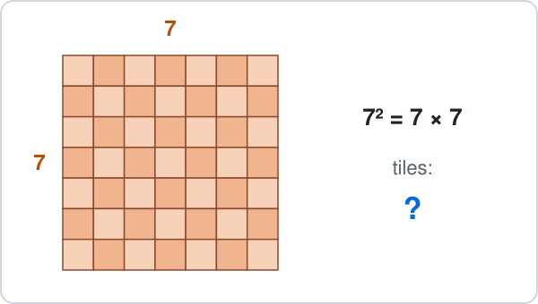

Answer: ______

## 5. Ch 3 Angles · Road junction

A side road meets a straight main road.

The two angles at the corner sit on a straight line.

One angle is $72^\circ$.

Find the other angle.

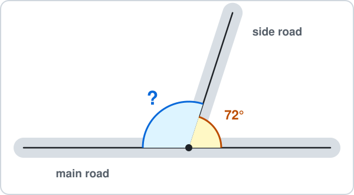

Answer: ______

## 6. Ch 3 Angles · Luzzu sail

The sail of a luzzu (a Maltese fishing boat) is a triangle.

The mast and the bottom of the sail make a right angle ($90^\circ$).

Another corner is $50^\circ$.

Find the top angle.

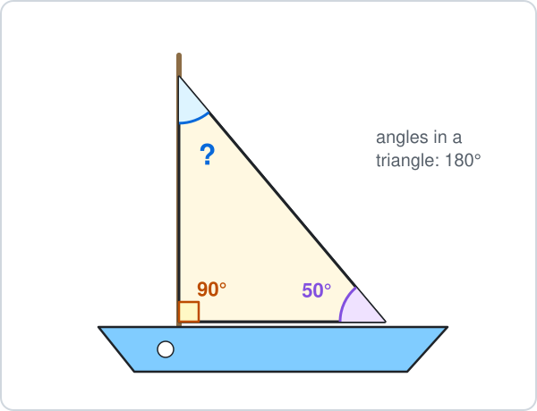

Answer: ______

## 7. Ch 4 Fractions · Birthday cake

A round cake is cut into 6 equal slices.

A fraction like $\frac{1}{6}$ means 1 slice out of the 6.

You eat 2 slices and a friend eats 3 slices.

What fraction of the cake is eaten?

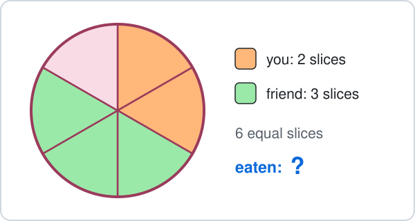

- **A.** $\frac{2}{6}$
- **B.** $\frac{5}{6}$
- **C.** $\frac{5}{12}$
- **D.** $\frac{1}{6}$

## 8. Ch 4 Fractions · Cheese pastizzi

A tray holds 30 pastizzi.

$\frac{2}{5}$ of them are cheese pastizzi ($\frac{2}{5}$ means 2 out of every 5 equal parts).

How many cheese pastizzi are there?

Answer: ______

## 9. Ch 5 Decimals · Ftira and Kinnie

At a kiosk a ftira costs €3.40 and a Kinnie costs €1.50.

How much do they cost together?

Answer: ______

## 10. Ch 5 Decimals · Ten pastizzi

One pastizz costs €0.45.

You buy 10 pastizzi, so the cost is $0.45\times10$ euros.

How much do 10 pastizzi cost?

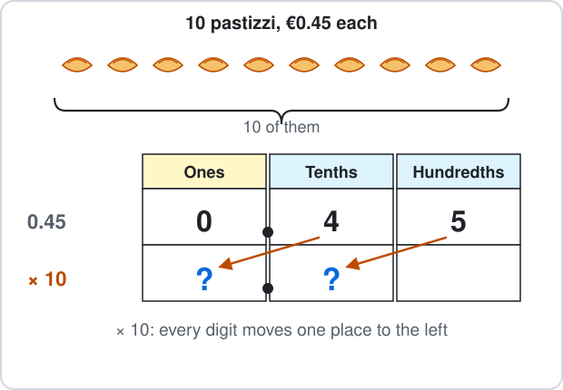

Answer: ______

## 11. Ch 6 Percentages · Shoe sale

Shoes cost €90.

In a sale you get $10\%$ off ($10\%$ means 10 out of every 100, the same as one tenth).

How much money do you save?

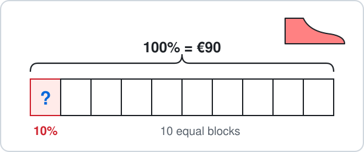

Answer: ______

## 12. Ch 6 Percentages · Cinema seats

A small cinema has 100 seats in 10 rows of 10.

The red seats are taken.

Per cent means out of 100.

What percentage of the seats is taken?

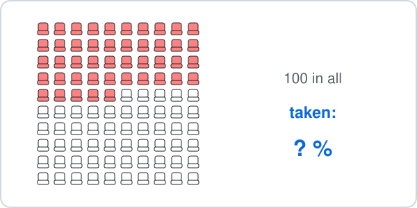

Answer: ______

## 13. Ch 7 Ratio · Football cards

You and a friend share 18 football cards in the ratio $1 : 2$.

Your friend gets the bigger share.

How many cards does your friend get?

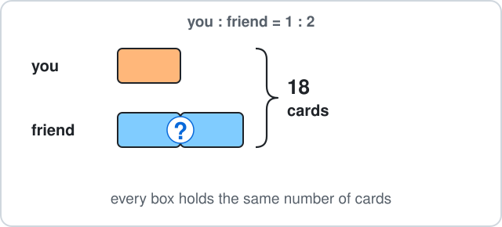

Answer: ______

## 14. Ch 7 Ratio · Fruit stall

A fruit stall has 16 apples and 24 oranges.

Write the ratio apples : oranges, $16 : 24$, in its simplest form.

- **A.** $2 : 3$
- **B.** $4 : 6$
- **C.** $3 : 2$
- **D.** $8 : 12$

## 15. Ch 8 Algebra · Parcel on a scale

A parcel weighs $x$ kg.

The parcel and 4 kg of blocks balance 13 kg of blocks, so $x + 4 = 13$.

Solve to find $x$.

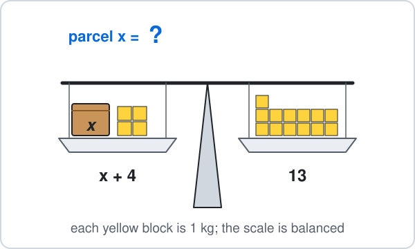

Answer: ______

## 16. Ch 8 Algebra · Taxi fare

A taxi charges $2k + 3$ euros for a trip of $k$ km.

Here $2k + 3$ means $2\times k + 3$.

How many euros is a 6 km trip?

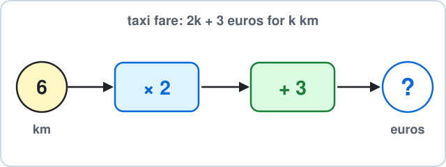

Answer: ______

## 17. Ch 9 Sequences · Matchstick triangles

Matchsticks make triangles in a row.

Pattern 1 uses 3 matchsticks, pattern 2 uses 5 and pattern 3 uses 7.

How many matchsticks does pattern 4 use?

Answer: ______

## 18. Ch 9 Sequences · Theatre seats

In an open-air theatre, row number $n$ has $3n + 2$ seats.

Here $3n + 2$ means $3\times n + 2$.

How many seats are in row 10?

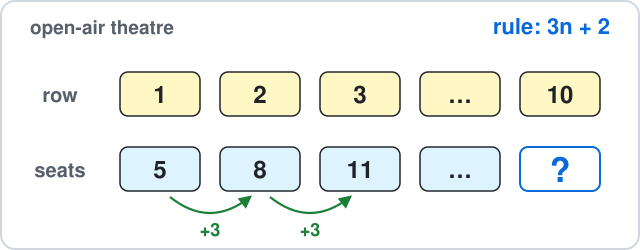

Answer: ______

## 19. Ch 10 Circles · Bicycle wheel

A bicycle wheel has radius 35 cm.

Find its diameter.

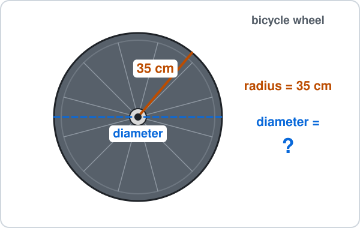

Answer: ______

## 20. Ch 10 Circles · Coin edge

A coin has diameter 2 cm.

Use $\pi \approx 3.14$ to find its circumference (the distance round its edge).

Answer: ______

## 21. Ch 11 Perimeter & Area · Garden lawn

A rectangular garden lawn is 9 m long and 5 m wide.

Find its area.

Answer: ______

## 22. Ch 11 Perimeter & Area · Festa pennant

A festa pennant is a triangle hanging from a string.

Its base (along the string) is 8 cm and its height is 5 cm.

Find its area.

Answer: ______

## 23. Ch 12 Surface Area & Nets · Dice

A dice is a cube with edges of 3 cm.

Find its surface area.

Answer: ______

## 24. Ch 12 Surface Area & Nets · Gift box

A gift box is 4 cm long, 3 cm wide and 2 cm high.

Find its volume.

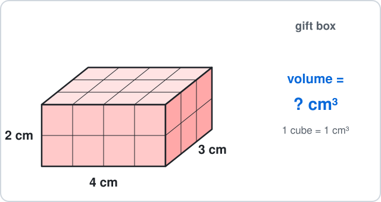

Answer: ______

## 25. Ch 13 Graphs · Treasure map

A treasure map is drawn on a grid.

The treasure chest is buried at point T.

What are the coordinates of T?

- **A.** $(1, 4)$
- **B.** $(4, 1)$
- **C.** $(5, 2)$
- **D.** $(-4, 1)$

## 26. Ch 13 Graphs · Plant height

A sunflower is 3 cm tall and grows 2 cm each week.

Its height is $y = 2x + 3$ centimetres after $x$ weeks.

Find $y$ when $x = 4$.

Answer: ______

## 27. Ch 14 Statistics · Goals scored

A football team scored these goals in 7 matches: $1, 2, 0, 2, 3, 2, 1$.

Find the mode.

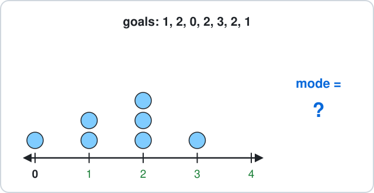

Answer: ______

## 28. Ch 14 Statistics · Pages read

You read 12, 8, 10 and 14 pages of a book on four days.

Find the mean number of pages per day.

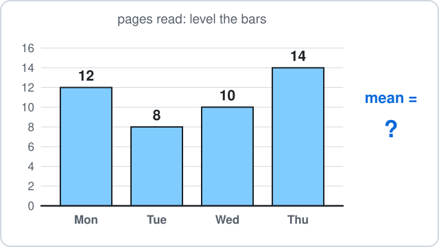

Answer: ______

## 29. Ch 15 Probability · Box of chocolates

A box has 3 dark and 7 milk chocolates.

You pick one without looking.

What is the probability that it is dark?

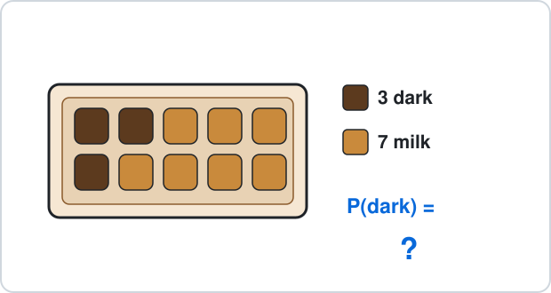

- **A.** $\frac{3}{7}$
- **B.** $\frac{3}{10}$
- **C.** $\frac{7}{10}$
- **D.** $\frac{1}{3}$

## 30. Ch 15 Probability · Not a six

You roll a fair dice once.

What is the probability that you do **not** get a 6?

- **A.** $\frac{1}{6}$
- **B.** $\frac{6}{5}$
- **C.** $\frac{1}{5}$
- **D.** $\frac{5}{6}$

## 31. Ch 16 Constructions · Drinking straws

You cut drinking straws to make a triangle.

Which three lengths can make a triangle?

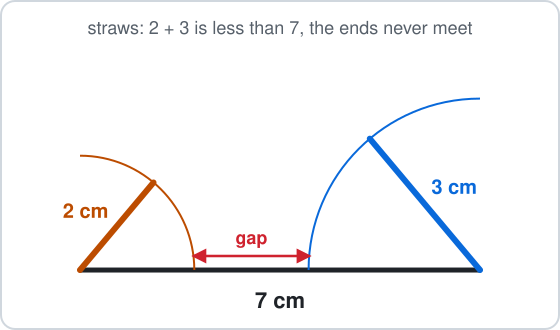

- **A.** 2 cm, 3 cm, 7 cm
- **B.** 3 cm, 4 cm, 5 cm
- **C.** 1 cm, 4 cm, 6 cm
- **D.** 2 cm, 5 cm, 8 cm

## 32. Ch 16 Constructions · Pizza slice

A slice of pizza has a corner angle of $80^\circ$.

You cut it in half with a straight cut through the corner.

What is the angle of each smaller slice?

Answer: ______

## 33. Ch 17 Transformations · Butterfly wing

A butterfly picture is symmetric: the $y$-axis is its mirror line.

A spot on the right wing is at $(2, 3)$.

Where is the matching spot on the left wing?

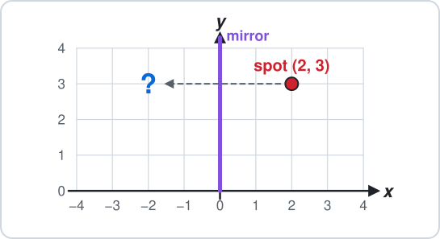

- **A.** $(2, -3)$
- **B.** $(-2, -3)$
- **C.** $(-2, 3)$
- **D.** $(3, 2)$

## 34. Ch 17 Transformations · Board game

A counter on a board game is at $(1, 1)$.

It moves by $\binom{3}{2}$: 3 right and 2 up.

Where does it land?

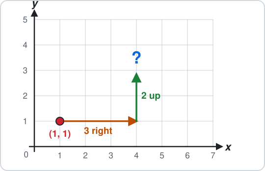

- **A.** $(3, 2)$
- **B.** $(4, 3)$
- **C.** $(4, 1)$
- **D.** $(-2, -1)$

## 35. Ch 18 Real-life Problems · Gozo ferry

The Gozo ferry ticket for a car and 2 passengers costs €15.75.

You pay with a €20 note.

How much change do you get?

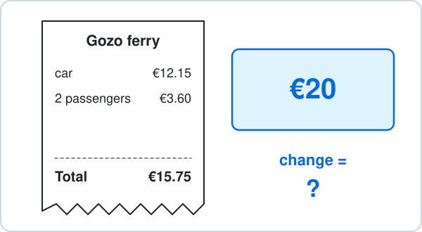

Answer: ______

## 36. Ch 18 Real-life Problems · Gozo ferry queue

You join the queue for the Gozo ferry at 10:45 and drive off in Mġarr at 11:30.

How many minutes does it take?

Answer: ______

## 37. Ch 19 Logo · Hexagon rug

A robot vacuum cleans around the edge of a rug shaped like a regular hexagon.

Every inside angle is 120°.

The robot vacuum moves forward 15 steps and turns right, 6 times.

In Logo this is `REPEAT 6 [FD 15 RT ?]`.

- `FD 15` means move forward 15 steps (a length).
- `RT ?` means turn right by ? degrees (an angle).

How many degrees is each turn?

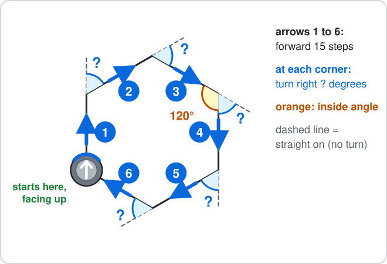

Answer: ______

## 38. Ch 19 Logo · Hexagon flight

A drone flies around a garden shaped like a regular hexagon (every inside angle is 120°).

The drone moves forward 20 steps and turns right at each corner, all the way round.

- `FD 20` means move forward 20 steps (a length).
- `RT` means turn right by that many degrees (an angle).

Which commands draw it?

- **A.** `REPEAT 6 [FD 20 RT 120]`
- **B.** `REPEAT 6 [FD 20 RT 60]`
- **C.** `REPEAT 6 [FD 20 RT 90]`
- **D.** `REPEAT 3 [FD 20 RT 60]`

---

<b>Answers</b>

**1. floor 4** — Up means add:

$$
-2 + 6 = \boxed{4}
$$

$-8$ moves 6 floors down instead of up.

**2. −14 °C** — Colder means move **down** the thermometer:

$$
-6 - 8 = \boxed{-14}
$$

$-2$ takes 6 from 8 and forgets that both moves go below zero.

**3. $17$** — BIDMAS: multiply first (the boxes), then add.

$$
3\times4 = 12
$$

$$
5 + 12 = \boxed{17}
$$

$32$ adds first, as if it were $(5 + 3)\times4$.

**4. $49$** — A square number is rows times columns:

$$
7^2 = 7\times7
$$

$$
7\times7 = \boxed{49}
$$

$14$ is $7\times2$, not $7\times7$.

**5. 108°** — Angles on a straight line add up to $180^\circ$:

$$
180^\circ - 72^\circ = \boxed{108^\circ}
$$

$288^\circ$ uses $360^\circ$, which is for angles around a point.

**6. 40°** — The angles in a triangle add up to $180^\circ$:

$$
180^\circ - 90^\circ - 50^\circ = \boxed{40^\circ}
$$

$130^\circ$ forgets the right angle and takes only $50^\circ$ from $180^\circ$.

**7. B — Count the slices**

Same size slices, so add the tops:

$$
\frac{2}{6} + \frac{3}{6} = \boxed{\frac{5}{6}}
$$

$\frac{5}{12}$ adds the bottoms too, but there are still 6 slices, not 12.

**8. $12$** — Split 30 into 5 equal boxes, then take 2 of them:

$$
30\div5 = 6
$$

$$
6\times2 = \boxed{12}
$$

$6$ is only one box; you need 2 of the 5 boxes.

**9. €4.90** — Line up the decimal points:

$$
3.40 + 1.50 = \boxed{4.90}
$$

- The answer is €4.90.
- $3.55$ puts the 15 in 1.5 under the cents of 3.40 ($3.40 + 0.15$) instead of lining up the decimal points.

**10. €4.50** — Every digit moves one place to the left:

$$
0.45\times10 = \boxed{4.5}
$$

- The cost is €4.50.
- $0.450$ only adds a zero; the value does not change, so it cannot be ten times bigger.

**11. €9** — $10\%$ is one block out of 10:

$$
90\div10 = \boxed{9}
$$

- So $10\%$ of €90 is €9.
- $80$ takes 10 away; a percentage is a part, not a subtraction.

**12. 45%** — - Per cent means out of 100.
- Count: 4 full rows and 5 more.

$$
40 + 5 = 45
$$

$$
\frac{45}{100} = \boxed{45\%}
$$

$55\%$ counts the empty seats.

**13. $12$** — There are $1 + 2 = 3$ equal parts:

$$
18\div3 = 6
$$

$$
6\times2 = \boxed{12}
$$

6 is the smaller share; 9 splits 18 into 2 halves, but the ratio has 3 parts, not 2.

**14. A — Divide both by 8**

The HCF of 16 and 24 is 8:

$$
16\div8 = 2
$$

$$
24\div8 = 3
$$

$$
\boxed{2 : 3}
$$

- $4 : 6$ and $8 : 12$ are the same ratio, but both numbers can still be divided by 2.
- $3 : 2$ swaps the order: apples come first.

**15. 9 kg** — Take 4 from both sides, so the scale stays balanced:

$$
x + 4 = 13
$$

$$
x = 13 - 4
$$

$$
x = \boxed{9}
$$

17 adds 4 instead of taking it away.

**16. €15** — Put 6 in place of $k$, multiply first, then add:

$$
2\times6 = 12
$$

$$
12 + 3 = \boxed{15}
$$

€29 reads $2k$ as 26, but $2k$ means $2\times k$.

**17. $9$** — Each new pattern adds 2 sticks:

$$
7 + 2 = \boxed{9}
$$

10 counts 3 sticks for the new triangle, but it shares one side with the triangle before.

**18. $32$** — Put $n = 10$ into the rule, multiply first, then add:

$$
3\times10 = 30
$$

$$
30 + 2 = \boxed{32}
$$

15 reads $3n$ as 3 + 10, but $3n$ means $3\times n$.

**19. 70 cm** — The diameter goes right across, so it is two radii:

$$
d = 2r
$$

$$
d = 2\times35
$$

$$
d = \boxed{70 \text{ cm}}
$$

17.5 cm halves the radius; the diameter is double, not half.

**20. 6.28 cm** — The circumference is about 3.14 diameters:

$$
C = \pi d
$$

$$
C \approx 3.14\times2
$$

$$
C \approx \boxed{6.28 \text{ cm}}
$$

3.14 cm uses the radius (1 cm) instead of the diameter, so it is only half way round.

**21. 45 m²** — Rows of squares:

$$
A = l\times w
$$

$$
A = 9\times5
$$

$$
A = \boxed{45 \text{ m}^2}
$$

28 m is the perimeter (the distance round), not the area.

**22. 20 cm²** — A triangle is half of its rectangle:

$$
A = \tfrac{1}{2}bh
$$

$$
A = \tfrac{1}{2}\times8\times5
$$

$$
A = \boxed{20 \text{ cm}^2}
$$

40 cm² forgets the half.

**23. 54 cm²** — 6 square faces, each:

$$
\begin{aligned} 3\times3 &= 9 \text{ cm}^2 \\ SA &= 6a^2 \end{aligned}
$$

$$
SA = 6\times9
$$

$$
SA = \boxed{54 \text{ cm}^2}
$$

27 cm³ is the volume 3 × 3 × 3; surface area covers the outside.

**24. 24 cm³** — Count the cubes, layer by layer:

$$
V = lwh
$$

$$
V = 4\times3\times2
$$

$$
V = \boxed{24 \text{ cm}^3}
$$

9 cm³ adds the three lengths; volume multiplies them.

**25. B — Across first, then up**

From 0 go 4 across, then 1 up:

$$
\boxed{(4, 1)}
$$

$(1, 4)$ reads up before across.

**26. 11 cm** — Put $x = 4$ into the rule:

$$
y = 2\times4 + 3
$$

$$
y = 8 + 3
$$

$$
y = \boxed{11}
$$

- The answer is 11 cm.
- $20$ adds $2 + 3$ first and then multiplies by 4: multiply first.

**27. $2$** — The mode is the value that appears most often: 2 appears 3 times.

$$
\text{mode} = \boxed{2}
$$

$3$ is how many times 2 appears, not the value itself.

**28. $11$** — Add them, then share equally between the 4 values:

$$
12 + 8 + 10 + 14 = 44
$$

$$
44\div4 = \boxed{11}
$$

$44$ is the total; the mean shares it out.

**29. B — Dark out of all**

3 dark out of:

$$
\begin{aligned} 3 + 7 &= 10 \\ P(\text{dark}) &= \boxed{\frac{3}{10}} \end{aligned}
$$

$\frac{3}{7}$ compares dark with milk; a probability compares with **all** 10 chocolates.

**30. D — 1 minus P(6)**

$$
P(\text{not 6}) = 1 - \frac{1}{6}
$$

$$
P(\text{not 6}) = \boxed{\frac{5}{6}}
$$

- $\frac{1}{6}$ is P(6) itself.
- $\frac{6}{5}$ is more than 1, and no probability is more than 1.

**31. B — The two short sides must reach**

The two shorter sides together must be longer than the longest:

$$
3 + 4 = 7
$$

$$
7 > 5
$$

- So $\boxed{3 \text{ cm}, 4 \text{ cm}, 5 \text{ cm}}$ works.
- In the others the short sides are too short: $2 + 3 = 5$, $1 + 4 = 5$ and $2 + 5 = 7$, each less than the longest side.

**32. 40°** — Bisect means cut into two equal halves:

$$
80^\circ\div2 = \boxed{40^\circ}
$$

$160^\circ$ doubles instead of halving.

**33. C — Same distance, other side**

The $y$-axis is the mirror: $x$ changes sign, $y$ stays.

$$
(2, 3) \to \boxed{(-2, 3)}
$$

$(2, -3)$ reflects in the $x$-axis instead.

**34. B — Add the moves**

Add the moves to the coordinates:

$$
(1 + 3,\ 1 + 2) = \boxed{(4, 3)}
$$

$(3, 2)$ is the move itself, not where the point lands.

**35. €4.25** — Change = money paid − cost:

$$
20.00 - 15.75 = \boxed{4.25}
$$

- The change is €4.25.
- $5.75$ takes away only the 15 euros and copies the cents instead of taking them away too.

**36. 45 minutes** — Count up to the hour, then on:

$$
10{:}45 \to 11{:}00 = 15 \text{ min}
$$

$$
11{:}00 \to 11{:}30 = 30 \text{ min}
$$

$$
15 + 30 = \boxed{45 \text{ min}}
$$

$85$ subtracts 1130 − 1045 as ordinary numbers, but an hour has 60 minutes, not 100.

**37. 60°** — The robot vacuum turns by how much its direction changes:

- Straight on is a turn of $0^\circ$.
- Turning round to go back is $180^\circ$.
- The regular hexagon's inside angle is $120^\circ$, so the turn is

$$
180^\circ - 120^\circ = \boxed{60^\circ}
$$

Check: 6 turns make one full spin, $6\times60^\circ = 360^\circ$, so the robot vacuum ends facing up again.

$120^\circ$ is the inside angle, not the turn: the turn is measured from the dashed straight-on line.

**38. B — Turn = 180° − inside angle**

Count the sides and look at one corner:

- The shape has 6 sides, so the commands repeat $6$ times.
- Straight on (the dashed line) is a turn of $0^\circ$.
- Turning round to go back is $180^\circ$.
- The inside angle is $120^\circ$, so the turn is

$$
180^\circ - 120^\circ = 60^\circ
$$

Check: $6\times60^\circ = 360^\circ$, one full spin, so the drone is back at the start, facing right.

$$
\boxed{\texttt{REPEAT 6 [FD 20 RT 60]}}
$$

`REPEAT 6 [FD 20 RT 120]` uses the inside angle: the drone turns the wrong amount, $6\times120^\circ = 720^\circ$, so it does not draw a regular hexagon. `REPEAT 6 [FD 20 RT 90]` uses the turn for a square: $6\times90^\circ = 540^\circ$, not one full spin of $360^\circ$. `REPEAT 3 [FD 20 RT 60]` repeats only 3 times: $3\times60^\circ = 180^\circ$, less than a full spin, so the shape does not close.

- Draw it first: a picture shows which rule to use.
- Check that the answer makes sense in the picture.

