# Malta Year 8 Math — All 19 Chapters: Basic Set B

**Set B:** the same 38 steps as Basic, new questions, two per chapter.

---

## 1. Ch 1 Directed Numbers · Kinnie on the table

A bottle of Kinnie comes out of the freezer at $-5\,^\circ\text{C}$ (5 degrees below zero).

On the table it gets 7 degrees warmer.

What is its temperature now?

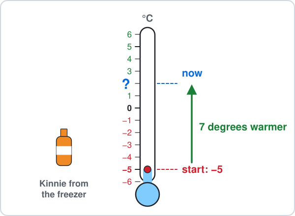

Answer: ______

## 2. Ch 1 Directed Numbers · Hotel lift down

In a hotel in St Julian's, floor 0 is the street and floor $-1$ is 1 floor below it.

A lift starts on floor $-1$ and goes down 3 floors.

Which floor does it stop at?

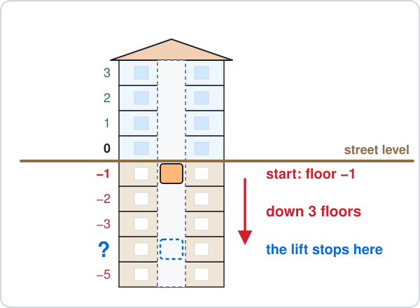

Answer: ______

## 3. Ch 2 Number Work · Kinnie crates

You have 4 bottles of Kinnie and 2 crates with 6 bottles in each crate.

The total is $4 + 2\times6$.

How many bottles are there?

Answer: ______

## 4. Ch 2 Number Work · Square cake

A square birthday cake is cut into 5 rows with 5 pieces in each row.

The number of pieces is $5^2$ (the small 2 means 5 times itself).

How many pieces are there?

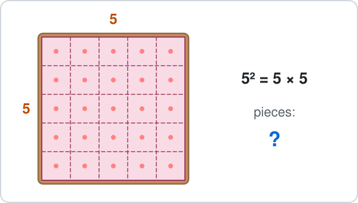

Answer: ______

## 5. Ch 3 Angles · Ladder on a wall

A ladder leans on a wall and stands on flat ground.

On the wall side, the ladder makes $65^\circ$ with the ground.

Find the angle between the ladder and the ground on the other side.

Answer: ______

## 6. Ch 3 Angles · House roof

The roof of a house is a triangle.

The two bottom angles are $35^\circ$ each.

Find the top angle.

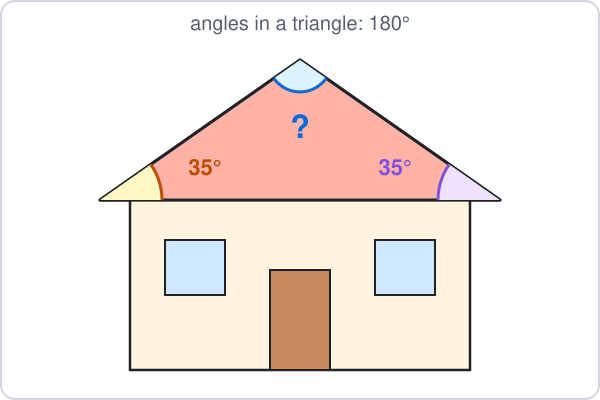

Answer: ______

## 7. Ch 4 Fractions · Chocolate bar

A chocolate bar has 12 equal pieces.

A fraction like $\frac{1}{12}$ means 1 piece out of the 12.

You eat 4 pieces and a friend eats 3 pieces.

What fraction of the bar is eaten?

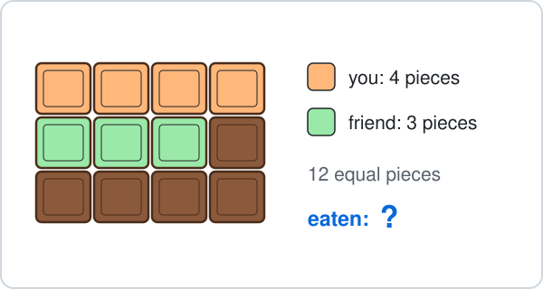

- **A.** $\frac{7}{24}$
- **B.** $\frac{4}{12}$
- **C.** $\frac{7}{12}$
- **D.** $\frac{5}{12}$

## 8. Ch 4 Fractions · Bus seats

A Valletta bus has 24 seats.

$\frac{3}{4}$ of the seats are taken ($\frac{3}{4}$ means 3 out of every 4 equal parts).

How many seats are taken?

Answer: ______

## 9. Ch 5 Decimals · Ice cream and water

An ice cream costs €2.20 and a bottle of water costs €1.75.

How much do they cost together?

Answer: ______

## 10. Ch 5 Decimals · Cans of drink

One can holds 0.33 litres of drink.

A pack has 10 cans, so it holds $0.33\times10$ litres.

How many litres are in the pack?

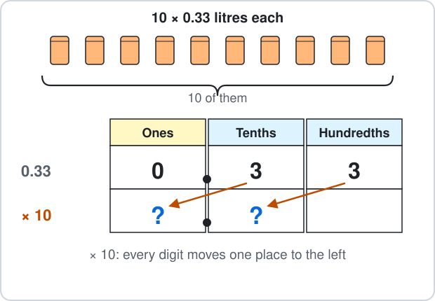

Answer: ______

## 11. Ch 6 Percentages · Walk to school

A class has 30 students.

$10\%$ of them walk to school ($10\%$ means 10 out of every 100, the same as one tenth).

How many students walk to school?

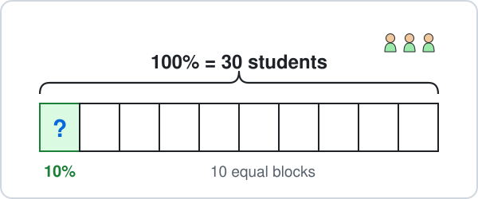

Answer: ______

## 12. Ch 6 Percentages · Blue floor tiles

A floor has 100 equal tiles in a 10 by 10 square.

Some tiles are blue.

Per cent means out of 100.

What percentage of the floor is blue?

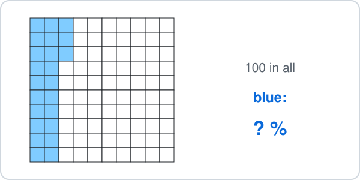

Answer: ______

## 13. Ch 7 Ratio · Pocket money

You and your brother share €30 in the ratio $2 : 3$.

Your brother gets the bigger share.

How many euros does he get?

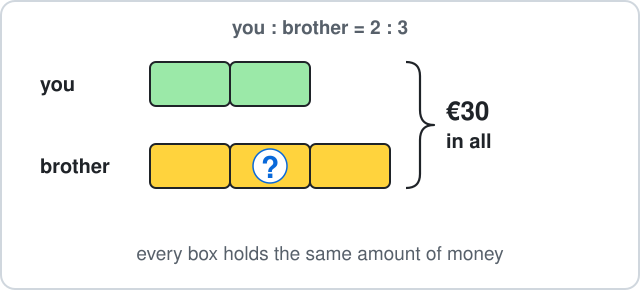

Answer: ______

## 14. Ch 7 Ratio · Ferry cars and vans

On the Gozo ferry there are 30 cars and 12 vans.

Write the ratio cars : vans, $30 : 12$, in its simplest form.

- **A.** $15 : 6$
- **B.** $2 : 5$
- **C.** $5 : 2$
- **D.** $10 : 4$

## 15. Ch 8 Algebra · Bus stop

There are $x$ passengers on a bus.

At the next stop 6 more get on, and now there are 17 passengers, so $x + 6 = 17$.

Solve to find $x$.

Answer: ______

## 16. Ch 8 Algebra · Chairs at tables

Long tables are pushed together in a row for a festa dinner, with 2 chairs on each long side of a table and 1 chair at each end of the row.

For $t$ tables you need $4t + 2$ chairs, where $4t + 2$ means $4\times t + 2$.

How many chairs do 5 tables need?

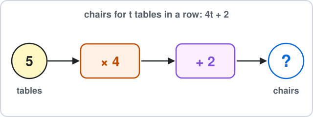

Answer: ______

## 17. Ch 9 Sequences · Tables and chairs

Square tables are pushed together in a row, with chairs all round.

1 table has 4 chairs, 2 tables have 6 chairs and 3 tables have 8 chairs.

How many chairs fit round 4 tables?

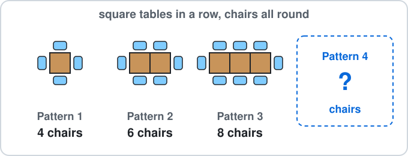

Answer: ______

## 18. Ch 9 Sequences · Festa arches

Each festa arch has light bulbs.

Arch number $n$ has $4n + 1$ bulbs, where $4n + 1$ means $4\times n + 1$.

How many bulbs are on arch 5?

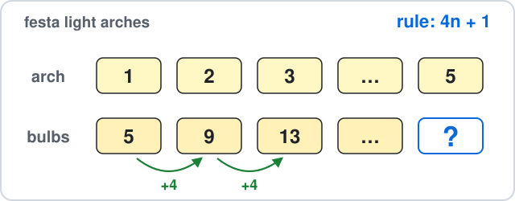

Answer: ______

## 19. Ch 10 Circles · Dinner plate

A round dinner plate has radius 13 cm.

Find its diameter.

Answer: ______

## 20. Ch 10 Circles · Cake tin

A round cake tin has diameter 20 cm.

You tie a ribbon once round it.

Use $\pi \approx 3.14$ to find the length of ribbon (the circumference).

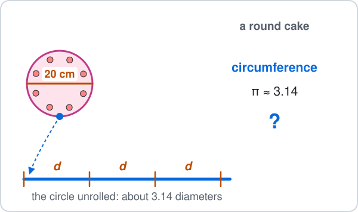

Answer: ______

## 21. Ch 11 Perimeter & Area · Classroom floor

A classroom floor is 7 m long and 6 m wide.

Find its area.

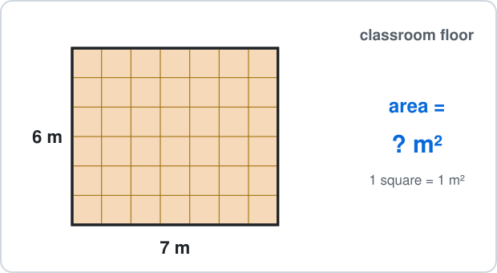

Answer: ______

## 22. Ch 11 Perimeter & Area · Boat sail

A boat sail is a right-angled triangle.

Its base is 6 m and its height up the mast is 9 m.

Find its area.

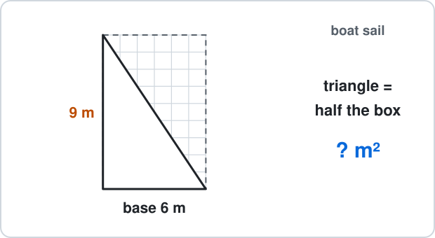

Answer: ______

## 23. Ch 12 Surface Area & Nets · Ice cube

A large ice cube has edges of 4 cm.

Find its surface area.

Answer: ______

## 24. Ch 12 Surface Area & Nets · Water tank

A water tank on a roof is 3 m long, 2 m wide and 2 m high.

Find its volume.

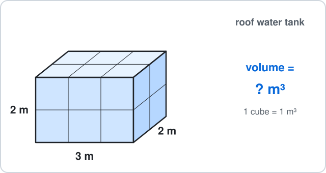

Answer: ______

## 25. Ch 13 Graphs · Cinema seat

A cinema seating plan is drawn on a grid.

Your seat is at point S.

What are the coordinates of S?

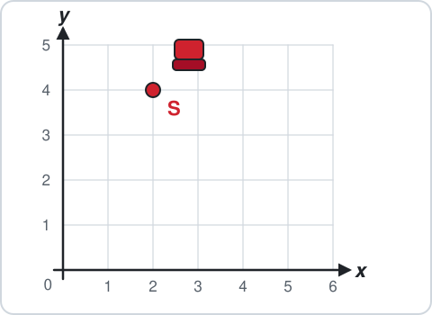

- **A.** $(4, 2)$
- **B.** $(3, 5)$
- **C.** $(-2, 4)$
- **D.** $(2, 4)$

## 26. Ch 13 Graphs · Taxi fare

A taxi costs €2 to start plus €3 for each kilometre.

The cost is $y = 3x + 2$ euros for $x$ km.

Find $y$ when $x = 2$.

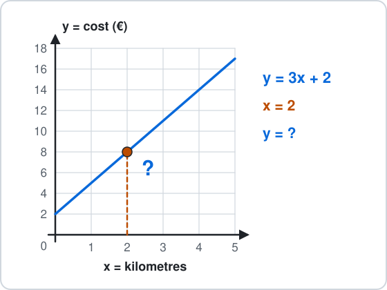

Answer: ______

## 27. Ch 14 Statistics · Shoe sizes

A group of friends wear these shoe sizes: $37, 38, 38, 36, 38, 39, 37$.

Find the mode.

Answer: ______

## 28. Ch 14 Statistics · Cycling

You cycle 5 km, 9 km and 7 km on three days.

Find the mean distance per day.

Answer: ______

## 29. Ch 15 Probability · Jar of marbles

A jar holds 5 green and 4 yellow marbles.

One marble is taken without looking.

What is the probability that it is green?

- **A.** $\frac{5}{4}$
- **B.** $\frac{4}{9}$
- **C.** $\frac{5}{9}$
- **D.** $\frac{1}{5}$

## 30. Ch 15 Probability · Coloured cards

Ten cards are shuffled face down: 3 are green and 7 are red.

You turn over one card.

What is the probability that it is **not** green?

- **A.** $\frac{3}{10}$
- **B.** $\frac{7}{10}$
- **C.** $\frac{10}{7}$
- **D.** $\frac{1}{10}$

## 31. Ch 16 Constructions · Wooden sticks

You glue three wooden sticks into a triangle.

Which three lengths can make a triangle?

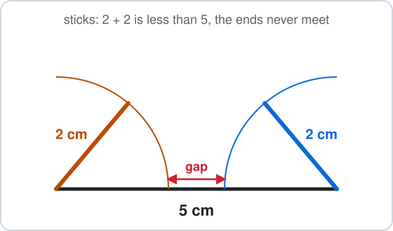

- **A.** 2 cm, 2 cm, 5 cm
- **B.** 3 cm, 5 cm, 9 cm
- **C.** 1 cm, 6 cm, 8 cm
- **D.** 5 cm, 6 cm, 9 cm

## 32. Ch 16 Constructions · Folded page

The corner of a page is a right angle, $90^\circ$.

You fold the corner so the fold line bisects the angle.

What is each smaller angle?

Answer: ______

## 33. Ch 17 Transformations · Lake reflection

The calm surface of a lake is the $x$-axis.

The top of a tree is at $(4, 3)$.

Where is the top of its reflection in the water?

- **A.** $(4, -3)$
- **B.** $(-4, 3)$
- **C.** $(-4, -3)$
- **D.** $(3, 4)$

## 34. Ch 17 Transformations · Warehouse robot

A robot in a warehouse is at $(5, 3)$.

It moves by $\binom{-2}{1}$: 2 left and 1 up.

Where does it stop?

- **A.** $(7, 4)$
- **B.** $(-2, 1)$
- **C.** $(3, 4)$
- **D.** $(3, 2)$

## 35. Ch 18 Real-life Problems · Beach kiosk

At a beach kiosk the bill is €4.55.

You pay with a €10 note.

How much change do you get?

Answer: ______

## 36. Ch 18 Real-life Problems · Lunch break

The school lunch break starts at 12:50 and lessons start again at 13:20.

How many minutes is the break?

Answer: ______

## 37. Ch 19 Logo · Triangle track

A toy car drives around a track shaped like an equilateral triangle.

Every inside angle is 60°.

The toy car moves forward 25 steps and turns right, 3 times.

In Logo this is `REPEAT 3 [FD 25 RT ?]`.

- `FD 25` means move forward 25 steps (a length).
- `RT ?` means turn right by ? degrees (an angle).

How many degrees is each turn?

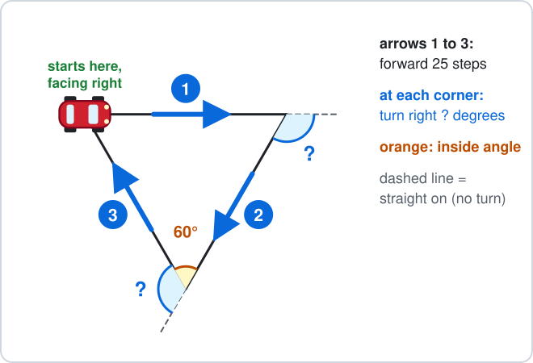

Answer: ______

## 38. Ch 19 Logo · Pentagon room

A robot vacuum cleans around a room shaped like a regular pentagon (every inside angle is 108°).

The robot vacuum moves forward 15 steps and turns right at each corner, all the way round.

- `FD 15` means move forward 15 steps (a length).
- `RT` means turn right by that many degrees (an angle).

Which commands draw it?

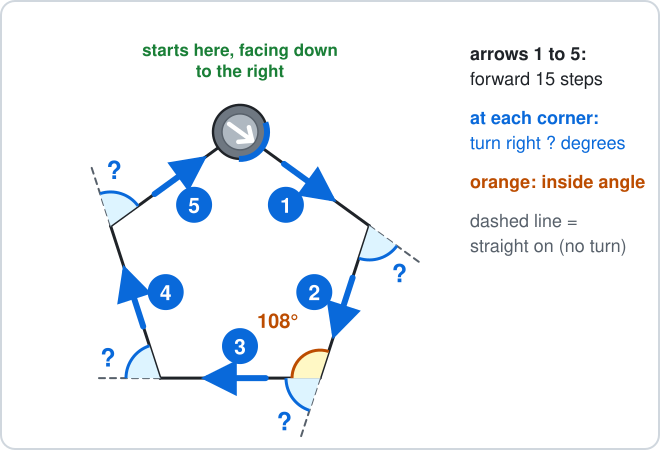

- **A.** `REPEAT 5 [FD 15 RT 72]`
- **B.** `REPEAT 5 [FD 15 RT 108]`
- **C.** `REPEAT 4 [FD 15 RT 72]`
- **D.** `REPEAT 5 [FD 15 RT 90]`

---

<b>Answers</b>

**1. 2 °C** — Warmer means move **up** the thermometer:

$$
-5 + 7 = \boxed{2}
$$

$-12$ moves 7 degrees colder instead of warmer; $12$ forgets the minus sign on $-5$.

**2. floor −4** — Down means subtract:

$$
-1 - 3 = \boxed{-4}
$$

$2$ moves 3 floors up instead of down.

**3. $16$** — BIDMAS: multiply first (the crates), then add.

$$
2\times6 = 12
$$

$$
4 + 12 = \boxed{16}
$$

$36$ adds first, as if it were $(4 + 2)\times6$.

**4. $25$** — A square number is rows times columns:

$$
5^2 = 5\times5
$$

$$
5\times5 = \boxed{25}
$$

$10$ is $5\times2$, not $5\times5$.

**5. 115°** — The ground is a straight line, so the two angles add up to $180^\circ$:

$$
180^\circ - 65^\circ = \boxed{115^\circ}
$$

$25^\circ$ uses $90^\circ$, which is for a right angle, not a straight line.

**6. 110°** — The angles in a triangle add up to $180^\circ$:

$$
180^\circ - 35^\circ - 35^\circ = \boxed{110^\circ}
$$

$145^\circ$ takes away only one of the two $35^\circ$ angles.

**7. C — Count the pieces**

Same size pieces, so add the tops:

$$
\frac{4}{12} + \frac{3}{12} = \boxed{\frac{7}{12}}
$$

$\frac{7}{24}$ adds the bottoms too, but there are still 12 pieces, not 24.

**8. $18$** — Split 24 into 4 equal boxes, then take 3 of them:

$$
24\div4 = 6
$$

$$
6\times3 = \boxed{18}
$$

$6$ is only one box; you need 3 of the 4 boxes.

**9. €3.95** — Line up the decimal points:

$$
2.20 + 1.75 = \boxed{3.95}
$$

- The answer is €3.95.
- $1.97$ writes 2.20 as 0.22 ($0.22 + 1.75$) instead of lining up the decimal points.

**10. 3.3 litres** — Every digit moves one place to the left:

$$
0.33\times10 = \boxed{3.3}
$$

$0.033$ moves the digits to the right, which is dividing by 10.

**11. 3 students** — $10\%$ is one block out of 10:

$$
30\div10 = \boxed{3}
$$

- So $10\%$ of 30 students is 3 students.
- $20$ takes 10 away; a percentage is a part, not a subtraction.

**12. 23%** — - Per cent means out of 100.
- Count: 2 full columns and 3 more.

$$
20 + 3 = 23
$$

$$
\frac{23}{100} = \boxed{23\%}
$$

$77\%$ counts the white tiles.

**13. €18** — There are $2 + 3 = 5$ equal parts:

$$
30\div5 = 6
$$

$$
6\times3 = \boxed{18}
$$

So the bigger share is €18.

€12 is the smaller share; €15 splits €30 into 2 halves, but the ratio has 5 parts, not 2.

**14. C — Divide both by 6**

The HCF of 30 and 12 is 6:

$$
30\div6 = 5
$$

$$
12\div6 = 2
$$

$$
\boxed{5 : 2}
$$

- $15 : 6$ and $10 : 4$ are the same ratio, but they can still be divided by 3 or by 2.
- $2 : 5$ swaps the order: cars come first.

**15. $11$** — Take 6 from both sides:

$$
x + 6 = 17
$$

$$
x = 17 - 6
$$

$$
x = \boxed{11}
$$

23 adds 6 instead of taking it away.

**16. $22$** — Put 5 in place of $t$, multiply first, then add:

$$
4\times5 = 20
$$

$$
20 + 2 = \boxed{22}
$$

47 reads $4t$ as 45, but $4t$ means $4\times t$.

**17. $10$** — Each new pattern adds 2 chairs:

$$
8 + 2 = \boxed{10}
$$

12 adds 4 chairs for the new table, but the chair at the join moves to the end, so only 2 are new.

**18. $21$** — Put $n = 5$ into the rule, multiply first, then add:

$$
4\times5 = 20
$$

$$
20 + 1 = \boxed{21}
$$

10 reads $4n$ as 4 + 5, but $4n$ means $4\times n$.

**19. 26 cm** — The diameter goes right across, so it is two radii:

$$
d = 2r
$$

$$
d = 2\times13
$$

$$
d = \boxed{26 \text{ cm}}
$$

6.5 cm halves the radius; the diameter is double, not half.

**20. 62.8 cm** — The circumference is about 3.14 diameters:

$$
C = \pi d
$$

$$
C \approx 3.14\times20
$$

$$
C \approx \boxed{62.8 \text{ cm}}
$$

31.4 cm uses the radius (10 cm) instead of the diameter, so it is only half way round.

**21. 42 m²** — Rows of squares:

$$
A = l\times w
$$

$$
A = 7\times6
$$

$$
A = \boxed{42 \text{ m}^2}
$$

26 m is the perimeter (the distance round), not the area.

**22. 27 m²** — A triangle is half of its rectangle:

$$
A = \tfrac{1}{2}bh
$$

$$
A = \tfrac{1}{2}\times6\times9
$$

$$
A = \boxed{27 \text{ m}^2}
$$

54 m² forgets the half.

**23. 96 cm²** — 6 square faces, each:

$$
\begin{aligned} 4\times4 &= 16 \text{ cm}^2 \\ SA &= 6a^2 \end{aligned}
$$

$$
SA = 6\times16
$$

$$
SA = \boxed{96 \text{ cm}^2}
$$

64 cm³ is the volume 4 × 4 × 4; surface area covers the outside.

**24. 12 m³** — Count the cubes, layer by layer:

$$
V = lwh
$$

$$
V = 3\times2\times2
$$

$$
V = \boxed{12 \text{ m}^3}
$$

7 m³ adds the three lengths; volume multiplies them.

**25. D — Across first, then up**

From 0 go 2 across, then 4 up:

$$
\boxed{(2, 4)}
$$

$(4, 2)$ reads up before across.

**26. €8** — Put $x = 2$ into the rule:

$$
y = 3\times2 + 2
$$

$$
y = 6 + 2
$$

$$
y = \boxed{8}
$$

- The answer is €8.
- $10$ adds $3 + 2$ first and then multiplies by 2: multiply first.

**27. $38$** — The mode is the value that appears most often: 38 appears 3 times.

$$
\text{mode} = \boxed{38}
$$

$3$ is how many times 38 appears, not the value itself.

**28. 7 km** — Add them, then share equally between the 3 values:

$$
5 + 9 + 7 = 21
$$

$$
21\div3 = \boxed{7}
$$

$21$ is the total; the mean shares it out.

**29. C — Green out of all**

5 green out of:

$$
\begin{aligned} 5 + 4 &= 9 \\ P(\text{green}) &= \boxed{\frac{5}{9}} \end{aligned}
$$

$\frac{5}{4}$ compares green with yellow; a probability compares with **all** 9 marbles.

**30. B — 1 minus P(green)**

$$
P(\text{not green}) = 1 - \frac{3}{10}
$$

$$
P(\text{not green}) = \boxed{\frac{7}{10}}
$$

- $\frac{3}{10}$ is P(green) itself.
- $\frac{10}{7}$ is more than 1, and no probability is more than 1.

**31. D — The two short sides must reach**

The two shorter sides together must be longer than the longest:

$$
5 + 6 = 11
$$

$$
11 > 9
$$

- So $\boxed{5 \text{ cm}, 6 \text{ cm}, 9 \text{ cm}}$ works.
- In the others the short sides are too short: $2 + 2 = 4$, $3 + 5 = 8$ and $1 + 6 = 7$, each less than the longest side.

**32. 45°** — Bisect means cut into two equal halves:

$$
90^\circ\div2 = \boxed{45^\circ}
$$

$180^\circ$ doubles instead of halving.

**33. A — Same distance, other side**

The $x$-axis is the mirror: $y$ changes sign, $x$ stays.

$$
(4, 3) \to \boxed{(4, -3)}
$$

$(-4, 3)$ reflects in the $y$-axis instead.

**34. C — Add the moves**

Add the moves to the coordinates:

$$
(5 - 2,\ 3 + 1) = \boxed{(3, 4)}
$$

$(-2, 1)$ is the move itself, not where the point lands.

**35. €5.45** — Change = money paid − cost:

$$
10.00 - 4.55 = \boxed{5.45}
$$

- The change is €5.45.
- $6.55$ takes away only the 4 euros and copies the cents instead of taking them away too.

**36. 30 minutes** — Count up to the hour, then on:

$$
12{:}50 \to 13{:}00 = 10 \text{ min}
$$

$$
13{:}00 \to 13{:}20 = 20 \text{ min}
$$

$$
10 + 20 = \boxed{30 \text{ min}}
$$

$70$ subtracts 1320 − 1250 as ordinary numbers, but an hour has 60 minutes, not 100.

**37. 120°** — The toy car turns by how much its direction changes:

- Straight on is a turn of $0^\circ$.
- Turning round to go back is $180^\circ$.
- The equilateral triangle's inside angle is $60^\circ$, so the turn is

$$
180^\circ - 60^\circ = \boxed{120^\circ}
$$

Check: 3 turns make one full spin, $3\times120^\circ = 360^\circ$, so the toy car ends facing right again.

$60^\circ$ is the inside angle, not the turn: the turn is measured from the dashed straight-on line.

**38. A — Turn = 180° − inside angle**

Count the sides and look at one corner:

- The shape has 5 sides, so the commands repeat $5$ times.
- Straight on (the dashed line) is a turn of $0^\circ$.
- Turning round to go back is $180^\circ$.
- The inside angle is $108^\circ$, so the turn is

$$
180^\circ - 108^\circ = 72^\circ
$$

Check: $5\times72^\circ = 360^\circ$, one full spin, so the robot vacuum is back at the start, facing down to the right.

$$
\boxed{\texttt{REPEAT 5 [FD 15 RT 72]}}
$$

`REPEAT 5 [FD 15 RT 108]` uses the inside angle: the robot vacuum turns the wrong amount, $5\times108^\circ = 540^\circ$, so it does not draw a regular pentagon. `REPEAT 4 [FD 15 RT 72]` repeats only 4 times: $4\times72^\circ = 288^\circ$, less than a full spin, so the shape does not close. `REPEAT 5 [FD 15 RT 90]` uses the turn for a square: $5\times90^\circ = 450^\circ$, not one full spin of $360^\circ$.

- Draw it first: a picture shows which rule to use.
- Check that the answer makes sense in the picture.

