# Malta Year 8 Math — All 19 Chapters: Basic Set C

**Set C:** the same 38 steps as Basic, new questions, two per chapter.

---

## 1. Ch 1 Directed Numbers · Diver swims up

Sea level is 0 m, and $-9$ m means 9 m under the water.

A diver at Ċirkewwa is at $-9$ m.

The diver swims up 5 m.

What is the diver's depth now?

Answer: ______

## 2. Ch 1 Directed Numbers · Spending in debt

Your bank balance is −€20, which means you owe the bank €20.

You spend €15 more with your card.

What is your balance now?

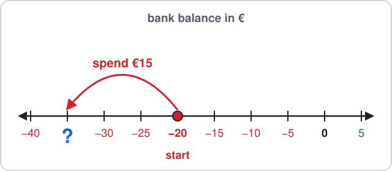

Answer: ______

## 3. Ch 2 Number Work · Egg boxes

A kitchen has 5 loose eggs and 3 boxes with 6 eggs in each box.

The total is $5 + 3\times6$.

How many eggs are there?

Answer: ______

## 4. Ch 2 Number Work · Festa band

A festa band marches in a square: 8 rows with 8 players in each row.

The number of players is $8^2$ (the small 2 means 8 times itself).

How many players are in the band?

Answer: ______

## 5. Ch 3 Angles · Kite string

A kite string is tied to a peg on a flat beach at Għajn Tuffieħa.

On one side, the string makes $40^\circ$ with the sand.

Find the angle between the string and the sand on the other side.

Answer: ______

## 6. Ch 3 Angles · Festa flag

A festa flag is a triangle hanging from a string.

The two top angles are $75^\circ$ each.

Find the angle at the bottom point.

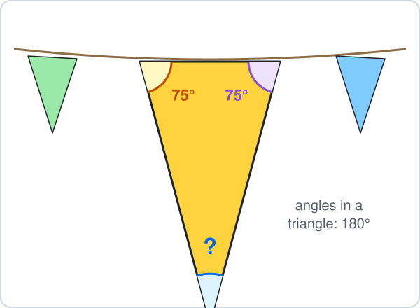

Answer: ______

## 7. Ch 4 Fractions · Apple pie

An apple pie is cut into 10 equal slices.

A fraction like $\frac{1}{10}$ means 1 slice out of the 10.

You eat 2 slices and a friend eats 5 slices.

What fraction of the pie is eaten?

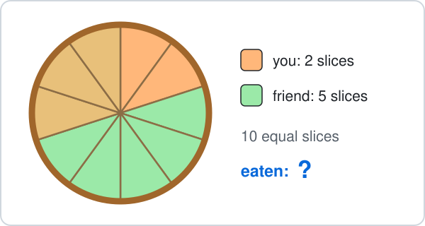

- **A.** $\frac{7}{20}$
- **B.** $\frac{3}{10}$
- **C.** $\frac{2}{10}$
- **D.** $\frac{7}{10}$

## 8. Ch 4 Fractions · Festa balloons

A festa stall has 21 balloons.

$\frac{2}{3}$ of them are red ($\frac{2}{3}$ means 2 out of every 3 equal parts).

How many red balloons are there?

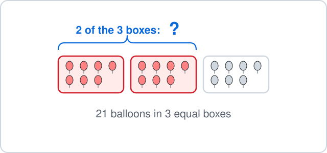

Answer: ______

## 9. Ch 5 Decimals · Notebook and pen

A notebook costs €3.25 and a pen costs €0.60.

How much do they cost together?

Answer: ______

## 10. Ch 5 Decimals · Festa ribbons

For the festa you cut 10 pieces of ribbon, each 0.28 m long.

The total length is $0.28\times10$ metres.

How many metres of ribbon is that?

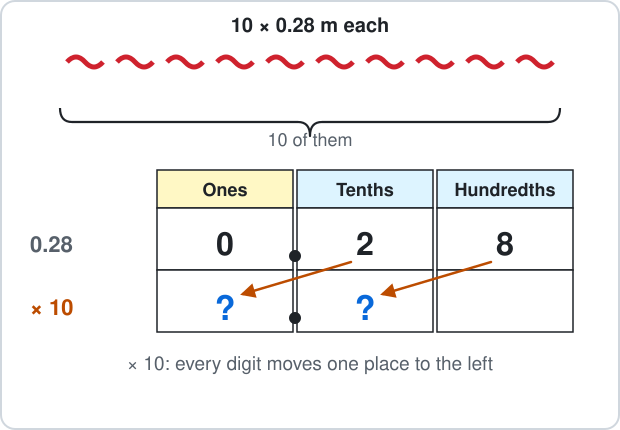

Answer: ______

## 11. Ch 6 Percentages · Ferry cyclists

A Gozo ferry carries 600 passengers.

$10\%$ of them bring a bicycle ($10\%$ means 10 out of every 100, the same as one tenth).

How many passengers bring a bicycle?

Answer: ______

## 12. Ch 6 Percentages · Gold stickers

A sheet has 100 round stickers in 10 rows of 10.

Some stickers are gold.

Per cent means out of 100.

What percentage of the stickers is gold?

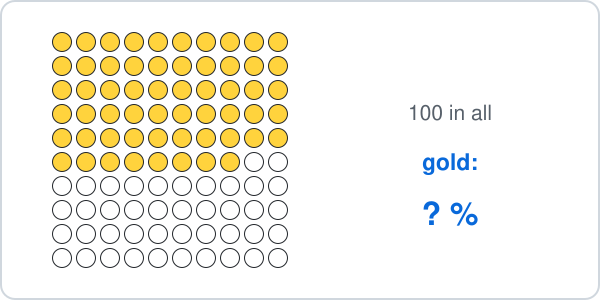

Answer: ______

## 13. Ch 7 Ratio · Pastizzi tray

A bakery bakes 40 pastizzi.

Cheese pastizzi and pea pastizzi are in the ratio $1 : 4$.

How many pea pastizzi are there?

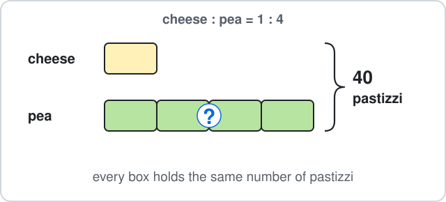

Answer: ______

## 14. Ch 7 Ratio · Festa band

A festa band has 9 drummers and 27 trumpet players.

Write the ratio drummers : trumpets, $9 : 27$, in its simplest form.

- **A.** $3 : 9$
- **B.** $3 : 1$
- **C.** $1 : 18$
- **D.** $1 : 3$

## 15. Ch 8 Algebra · Purse money

You have $x$ euros in your purse.

A friend gives you €8, and now you have €20, so $x + 8 = 20$.

Solve to find $x$.

Answer: ______

## 16. Ch 8 Algebra · Ferry tickets

A group trip on the Gozo ferry costs $5n + 10$ euros for $n$ people.

Here $5n + 10$ means $5\times n + 10$.

How many euros does it cost for 3 people?

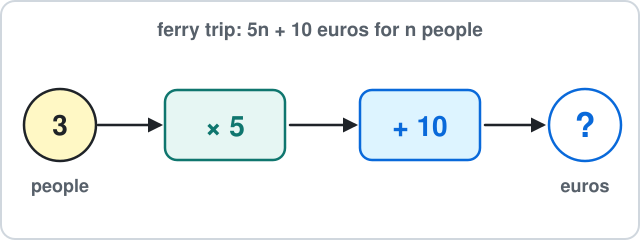

Answer: ______

## 17. Ch 9 Sequences · Garden path

A garden path has green tiles in a row with white tiles all round it.

Pattern 1 uses 8 white tiles, pattern 2 uses 10 and pattern 3 uses 12.

How many white tiles does pattern 4 use?

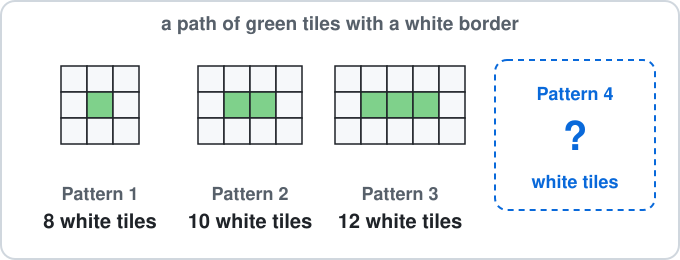

Answer: ______

## 18. Ch 9 Sequences · Growing plant

A plant is $5n + 3$ cm tall after $n$ weeks, where $5n + 3$ means $5\times n + 3$.

How tall is it after 6 weeks?

Answer: ______

## 19. Ch 10 Circles · Clock face

A kitchen clock has a round face with radius 16 cm.

Find its diameter.

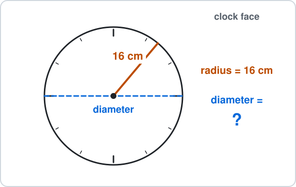

Answer: ______

## 20. Ch 10 Circles · Hula hoop

A hula hoop has diameter 70 cm.

Use $\pi \approx 3.14$ to find its circumference.

Answer: ______

## 21. Ch 11 Perimeter & Area · Phone screen

A phone screen is 14 cm tall and 7 cm wide.

Find its area.

Answer: ______

## 22. Ch 11 Perimeter & Area · Sandwich

A sandwich is cut into a triangle with base 10 cm and height 7 cm.

Find its area.

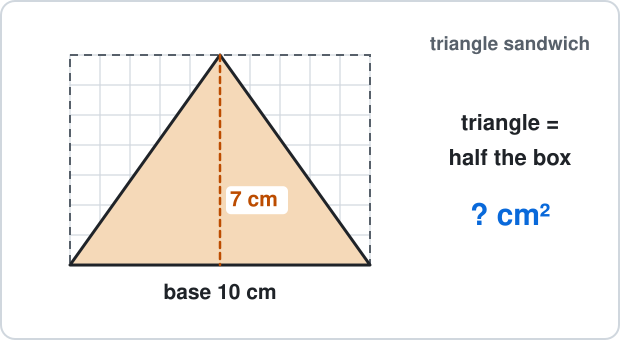

Answer: ______

## 23. Ch 12 Surface Area & Nets · Building block

A wooden building block is a cube with edges of 5 cm.

Find its surface area.

Answer: ______

## 24. Ch 12 Surface Area & Nets · Toy brick

A toy brick is 8 cm long, 2 cm wide and 3 cm high.

Find its volume.

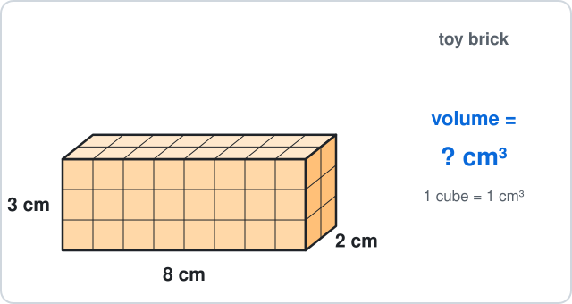

Answer: ______

## 25. Ch 13 Graphs · Village square

A map of a village square is drawn on a grid.

The fountain is at point F.

What are the coordinates of F?

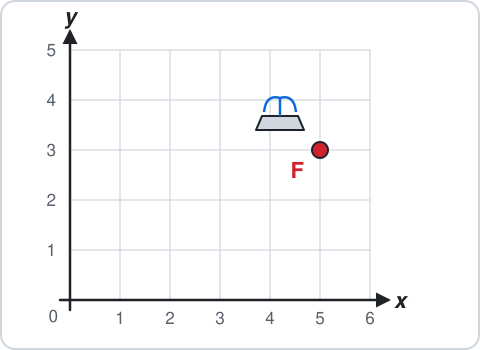

- **A.** $(3, 5)$
- **B.** $(6, 4)$
- **C.** $(5, 3)$
- **D.** $(5, -3)$

## 26. Ch 13 Graphs · Candle

A candle is 10 cm tall and burns down 2 cm each hour.

Its height is $y = 10 - 2x$ centimetres after $x$ hours.

Find $y$ when $x = 3$.

Answer: ______

## 27. Ch 14 Statistics · Temperatures

The noon temperature in Valletta (°C) on 7 days was: $24, 26, 25, 26, 27, 26, 24$.

Find the mode.

Answer: ______

## 28. Ch 14 Statistics · Water polo goals

A water polo team scored 7, 4, 9, 5 and 10 goals in five matches.

Find the mean number of goals per match.

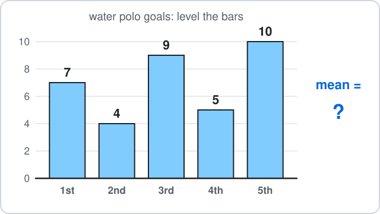

Answer: ______

## 29. Ch 15 Probability · Festa raffle

At a village festa, 15 raffle tickets are sold and you bought 2 of them.

One ticket is drawn for the prize.

What is the probability that it is one of yours?

- **A.** $\frac{2}{13}$
- **B.** $\frac{13}{15}$
- **C.** $\frac{1}{2}$
- **D.** $\frac{2}{15}$

## 30. Ch 15 Probability · Spinner

A spinner has 5 equal parts: 2 orange and 3 green.

You spin it once.

What is the probability that it does **not** land on orange?

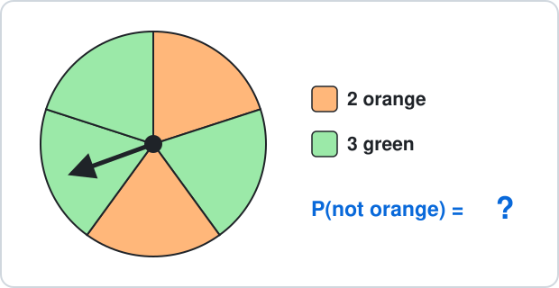

- **A.** $\frac{3}{5}$
- **B.** $\frac{2}{5}$
- **C.** $\frac{5}{3}$
- **D.** $\frac{1}{5}$

## 31. Ch 16 Constructions · Fence planks

A farmer wants a triangle-shaped pen made of three fence planks.

Which three lengths can make a triangle?

- **A.** 2 m, 3 m, 6 m
- **B.** 1 m, 5 m, 7 m
- **C.** 4 m, 4 m, 6 m
- **D.** 3 m, 3 m, 7 m

## 32. Ch 16 Constructions · Kite

The top angle of a kite is $110^\circ$.

The kite's middle stick bisects this angle.

What is each half of the top angle?

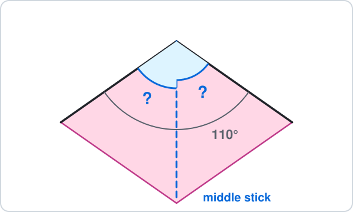

Answer: ______

## 33. Ch 17 Transformations · Dance mirror

A dance studio has a mirror along the $y$-axis.

You stand at $(-3, 1)$.

Where is your image in the mirror?

- **A.** $(-3, -1)$
- **B.** $(1, -3)$
- **C.** $(3, -1)$
- **D.** $(3, 1)$

## 34. Ch 17 Transformations · Harbour boat

On a harbour map a boat is at $(2, 4)$.

It sails by $\binom{4}{-3}$: 4 right and 3 down.

Where does it end up?

- **A.** $(6, 1)$
- **B.** $(6, 7)$
- **C.** $(4, -3)$
- **D.** $(-2, 7)$

## 35. Ch 18 Real-life Problems · Stationery shop

At a stationery shop the bill is €5.20.

You pay with a €20 note.

How much change do you get?

Answer: ______

## 36. Ch 18 Real-life Problems · Cartoon

A cartoon starts at 16:45 and ends at 17:10.

How many minutes long is it?

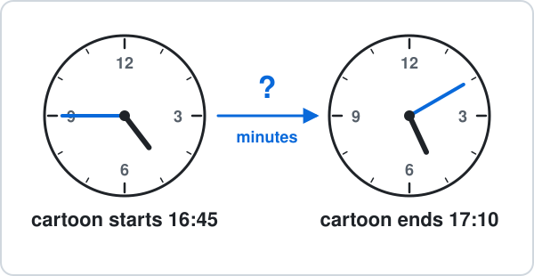

Answer: ______

## 37. Ch 19 Logo · Pentagon flight

A delivery drone flies around a field shaped like a regular pentagon.

Every inside angle is 108°.

The drone moves forward 20 steps and turns right, 5 times.

In Logo this is `REPEAT 5 [FD 20 RT ?]`.

- `FD 20` means move forward 20 steps (a length).
- `RT ?` means turn right by ? degrees (an angle).

How many degrees is each turn?

Answer: ______

## 38. Ch 19 Logo · Octagon track

A toy car drives around a track shaped like a regular octagon (every inside angle is 135°).

The toy car moves forward 10 steps and turns right at each corner, all the way round.

- `FD 10` means move forward 10 steps (a length).
- `RT` means turn right by that many degrees (an angle).

Which commands draw it?

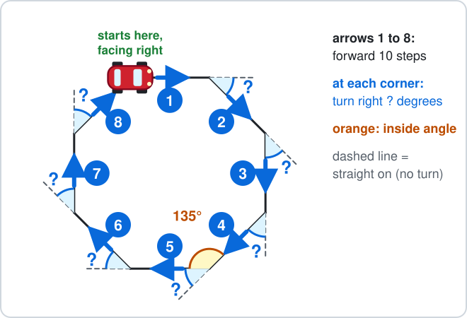

- **A.** `REPEAT 8 [FD 10 RT 135]`
- **B.** `REPEAT 6 [FD 10 RT 45]`
- **C.** `REPEAT 8 [FD 10 RT 90]`
- **D.** `REPEAT 8 [FD 10 RT 45]`

---

<b>Answers</b>

**1. −4 m** — Up means add:

$$
-9 + 5 = \boxed{-4}
$$

- The diver is at −4 m.
- $-14$ swims 5 m deeper instead of up.

**2. −€35** — Spending moves **left** on the line:

$$
-20 - 15 = \boxed{-35}
$$

- The balance is −€35.
- $-5$ adds 15 instead of taking it away.

**3. $23$** — BIDMAS: multiply first (the boxes), then add.

$$
3\times6 = 18
$$

$$
5 + 18 = \boxed{23}
$$

$48$ adds first, as if it were $(5 + 3)\times6$.

**4. $64$** — A square number is rows times columns:

$$
8^2 = 8\times8
$$

$$
8\times8 = \boxed{64}
$$

$16$ is $8\times2$, not $8\times8$.

**5. 140°** — The sand is a straight line, so the two angles add up to $180^\circ$:

$$
180^\circ - 40^\circ = \boxed{140^\circ}
$$

$320^\circ$ uses $360^\circ$, which is for angles around a point.

**6. 30°** — The angles in a triangle add up to $180^\circ$:

$$
180^\circ - 75^\circ - 75^\circ = \boxed{30^\circ}
$$

$105^\circ$ takes away only one of the two $75^\circ$ angles.

**7. D — Count the slices**

Same size slices, so add the tops:

$$
\frac{2}{10} + \frac{5}{10} = \boxed{\frac{7}{10}}
$$

$\frac{7}{20}$ adds the bottoms too, but there are still 10 slices, not 20.

**8. $14$** — Split 21 into 3 equal boxes, then take 2 of them:

$$
21\div3 = 7
$$

$$
7\times2 = \boxed{14}
$$

$7$ is only one box; you need 2 of the 3 boxes.

**9. €3.85** — Line up the decimal points:

$$
3.25 + 0.60 = \boxed{3.85}
$$

- The answer is €3.85.
- $3.31$ reads 60 cents as 6 cents ($3.25 + 0.06$) instead of lining up the decimal points.

**10. 2.8 m** — Every digit moves one place to the left:

$$
0.28\times10 = \boxed{2.8}
$$

$0.280$ only adds a zero; the value does not change, so it cannot be ten times bigger.

**11. 60 passengers** — $10\%$ is one block out of 10:

$$
600\div10 = \boxed{60}
$$

- So $10\%$ of 600 passengers is 60 passengers.
- $590$ takes 10 away; a percentage is a part, not a subtraction.

**12. 58%** — - Per cent means out of 100.
- Count: 5 full rows and 8 more.

$$
50 + 8 = 58
$$

$$
\frac{58}{100} = \boxed{58\%}
$$

$42\%$ counts the white stickers.

**13. $32$** — There are $1 + 4 = 5$ equal parts:

$$
40\div5 = 8
$$

$$
8\times4 = \boxed{32}
$$

8 is the smaller share; 20 splits 40 into 2 halves, but the ratio has 5 parts, not 2.

**14. D — Divide both by 9**

The HCF of 9 and 27 is 9:

$$
9\div9 = 1
$$

$$
27\div9 = 3
$$

$$
\boxed{1 : 3}
$$

- $3 : 9$ is the same ratio, but both numbers can still be divided by 3.
- $3 : 1$ swaps the order, and $1 : 18$ takes 9 away from 27 instead of dividing.

**15. €12** — Take 8 from both sides:

$$
x + 8 = 20
$$

$$
x = 20 - 8
$$

$$
x = \boxed{12}
$$

So you had €12 at the start.

28 adds 8 instead of taking it away.

**16. €25** — Put 3 in place of $n$, multiply first, then add:

$$
5\times3 = 15
$$

$$
15 + 10 = \boxed{25}
$$

€63 reads $5n$ as 53, but $5n$ means $5\times n$.

**17. $14$** — Each new pattern adds 2 white tiles:

$$
12 + 2 = \boxed{14}
$$

16 adds 4 white tiles each time, but each new green tile only needs 1 white tile above and 1 below.

**18. 33 cm** — Put $n = 6$ into the rule, multiply first, then add:

$$
5\times6 = 30
$$

$$
30 + 3 = \boxed{33}
$$

14 cm reads $5n$ as 5 + 6, but $5n$ means $5\times n$.

**19. 32 cm** — The diameter goes right across, so it is two radii:

$$
d = 2r
$$

$$
d = 2\times16
$$

$$
d = \boxed{32 \text{ cm}}
$$

8 cm halves the radius; the diameter is double, not half.

**20. 219.8 cm** — The circumference is about 3.14 diameters:

$$
C = \pi d
$$

$$
C \approx 3.14\times70
$$

$$
C \approx \boxed{219.8 \text{ cm}}
$$

109.9 cm uses the radius (35 cm) instead of the diameter, so it is only half way round.

**21. 98 cm²** — Rows of squares:

$$
A = l\times w
$$

$$
A = 7\times14
$$

$$
A = \boxed{98 \text{ cm}^2}
$$

42 cm is the perimeter (the distance round), not the area.

**22. 35 cm²** — A triangle is half of its rectangle:

$$
A = \tfrac{1}{2}bh
$$

$$
A = \tfrac{1}{2}\times10\times7
$$

$$
A = \boxed{35 \text{ cm}^2}
$$

70 cm² forgets the half.

**23. 150 cm²** — 6 square faces, each:

$$
\begin{aligned} 5\times5 &= 25 \text{ cm}^2 \\ SA &= 6a^2 \end{aligned}
$$

$$
SA = 6\times25
$$

$$
SA = \boxed{150 \text{ cm}^2}
$$

125 cm³ is the volume 5 × 5 × 5; surface area covers the outside.

**24. 48 cm³** — Count the cubes, layer by layer:

$$
V = lwh
$$

$$
V = 8\times2\times3
$$

$$
V = \boxed{48 \text{ cm}^3}
$$

13 cm³ adds the three lengths; volume multiplies them.

**25. C — Across first, then up**

From 0 go 5 across, then 3 up:

$$
\boxed{(5, 3)}
$$

$(3, 5)$ reads up before across.

**26. 4 cm** — Put $x = 3$ into the rule:

$$
y = 10 - 2\times3
$$

$$
y = 10 - 6
$$

$$
y = \boxed{4}
$$

- The answer is 4 cm.
- $24$ works out $10 - 2$ first and then multiplies by 3, but a burning candle cannot grow taller.

**27. $26$** — The mode is the value that appears most often: 26 appears 3 times.

$$
\text{mode} = \boxed{26}
$$

$3$ is how many times 26 appears, not the value itself.

**28. $7$** — Add them, then share equally between the 5 values:

$$
7 + 4 + 9 + 5 + 10 = 35
$$

$$
35\div5 = \boxed{7}
$$

$35$ is the total; the mean shares it out.

**29. D — Yours out of all**

2 of the $2 + 13 = 15$ tickets are yours:

$$
P(\text{yours}) = \boxed{\frac{2}{15}}
$$

$\frac{2}{13}$ compares yours with others; a probability compares with **all** 15 tickets.

**30. A — 1 minus P(orange)**

$$
P(\text{not orange}) = 1 - \frac{2}{5}
$$

$$
P(\text{not orange}) = \boxed{\frac{3}{5}}
$$

- $\frac{2}{5}$ is P(orange) itself.
- $\frac{5}{3}$ is more than 1, and no probability is more than 1.

**31. C — The two short sides must reach**

The two shorter sides together must be longer than the longest:

$$
4 + 4 = 8
$$

$$
8 > 6
$$

- So $\boxed{4 \text{ m}, 4 \text{ m}, 6 \text{ m}}$ works.
- In the others the short sides are too short: $2 + 3 = 5$, $1 + 5 = 6$ and $3 + 3 = 6$, each less than the longest side.

**32. 55°** — Bisect means cut into two equal halves:

$$
110^\circ\div2 = \boxed{55^\circ}
$$

$220^\circ$ doubles instead of halving.

**33. D — Same distance, other side**

The $y$-axis is the mirror: $x$ changes sign, $y$ stays.

$$
(-3, 1) \to \boxed{(3, 1)}
$$

$(-3, -1)$ reflects in the $x$-axis instead.

**34. A — Add the moves**

Add the moves to the coordinates:

$$
(2 + 4,\ 4 - 3) = \boxed{(6, 1)}
$$

$(4, -3)$ is the move itself, not where the point lands.

**35. €14.80** — Change = money paid − cost:

$$
20.00 - 5.20 = \boxed{14.80}
$$

- The change is €14.80.
- $15.20$ takes away only the 5 euros and copies the cents instead of taking them away too.

**36. 25 minutes** — Count up to the hour, then on:

$$
16{:}45 \to 17{:}00 = 15 \text{ min}
$$

$$
17{:}00 \to 17{:}10 = 10 \text{ min}
$$

$$
15 + 10 = \boxed{25 \text{ min}}
$$

$65$ subtracts 1710 − 1645 as ordinary numbers, but an hour has 60 minutes, not 100.

**37. 72°** — The drone turns by how much its direction changes:

- Straight on is a turn of $0^\circ$.
- Turning round to go back is $180^\circ$.
- The regular pentagon's inside angle is $108^\circ$, so the turn is

$$
180^\circ - 108^\circ = \boxed{72^\circ}
$$

Check: 5 turns make one full spin, $5\times72^\circ = 360^\circ$, so the drone ends facing right again.

$108^\circ$ is the inside angle, not the turn: the turn is measured from the dashed straight-on line.

**38. D — Turn = 180° − inside angle**

Count the sides and look at one corner:

- The shape has 8 sides, so the commands repeat $8$ times.
- Straight on (the dashed line) is a turn of $0^\circ$.
- Turning round to go back is $180^\circ$.
- The inside angle is $135^\circ$, so the turn is

$$
180^\circ - 135^\circ = 45^\circ
$$

Check: $8\times45^\circ = 360^\circ$, one full spin, so the toy car is back at the start, facing right.

$$
\boxed{\texttt{REPEAT 8 [FD 10 RT 45]}}
$$

`REPEAT 8 [FD 10 RT 135]` uses the inside angle: the toy car turns the wrong amount, $8\times135^\circ = 1080^\circ$, so it does not draw a regular octagon. `REPEAT 6 [FD 10 RT 45]` repeats only 6 times: $6\times45^\circ = 270^\circ$, less than a full spin, so the shape does not close. `REPEAT 8 [FD 10 RT 90]` uses the turn for a square: $8\times90^\circ = 720^\circ$, not one full spin of $360^\circ$.

- Draw it first: a picture shows which rule to use.
- Check that the answer makes sense in the picture.

