# Malta Year 8 Math — All 19 Chapters: Basic Set D

**Set D:** the same 38 steps as Basic, new questions, two per chapter.

---

## 1. Ch 1 Directed Numbers · Bank balance

A bank balance of −€15 means you owe the bank €15.

Your balance is −€15 and you pay in €40.

What is your balance now?

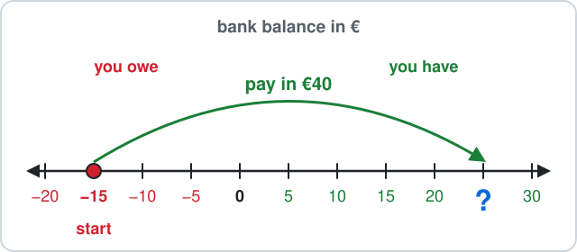

Answer: ______

## 2. Ch 1 Directed Numbers · Anchor goes down

Sea level is 0 m, and $-4$ m means 4 m under the water.

A boat's anchor hangs at $-4$ m.

It is let down 7 m more.

How deep is the anchor now?

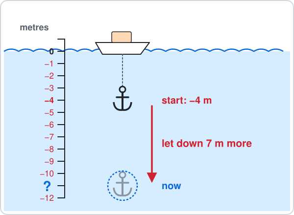

Answer: ______

## 3. Ch 2 Number Work · Festa fireworks

For the village festa, a club has 6 single fireworks and 4 packs with 3 fireworks in each pack.

The total is $6 + 4\times3$.

How many fireworks are there?

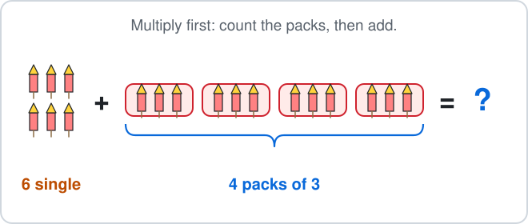

Answer: ______

## 4. Ch 2 Number Work · Window panes

A square window has 4 rows with 4 glass panes in each row.

The number of panes is $4^2$ (the small 2 means 4 times itself).

How many panes are there?

Answer: ______

## 5. Ch 3 Angles · Bus ramp

A ramp goes from the flat pavement up to a bus door.

The ramp makes $20^\circ$ with the pavement on the bus side.

Find the angle between the ramp and the pavement on the other side.

Answer: ______

## 6. Ch 3 Angles · Triangle park

A small park in Sliema is a triangle.

Two of its corners are $65^\circ$ and $50^\circ$.

Find the third corner.

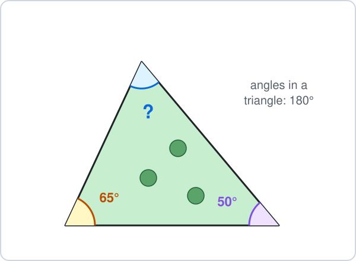

Answer: ______

## 7. Ch 4 Fractions · Pastizzi tray

A tray has 9 pastizzi, all the same size.

A fraction like $\frac{1}{9}$ means 1 pastizz out of the 9.

You eat 4 and a friend eats 3.

What fraction of the tray is eaten?

- **A.** $\frac{7}{9}$
- **B.** $\frac{7}{18}$
- **C.** $\frac{4}{9}$
- **D.** $\frac{2}{9}$

## 8. Ch 4 Fractions · Ferry savings

You have saved €36 in one-euro coins.

You spend $\frac{5}{6}$ of it on a day trip to Gozo ($\frac{5}{6}$ means 5 out of every 6 equal parts).

How much do you spend?

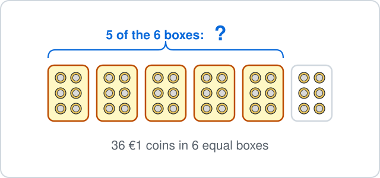

Answer: ______

## 9. Ch 5 Decimals · Nougat and balloon

At the festa a bar of nougat costs €5.30 and a balloon costs €2.45.

How much do they cost together?

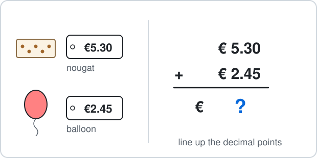

Answer: ______

## 10. Ch 5 Decimals · Stack of coins

One coin is 0.23 cm thick.

A stack of 10 coins is $0.23\times10$ cm tall.

How tall is the stack?

Answer: ______

## 11. Ch 6 Percentages · Restaurant tip

A meal in Marsaxlokk costs €45.

You leave a $10\%$ tip ($10\%$ means 10 out of every 100, the same as one tenth).

How much is the tip?

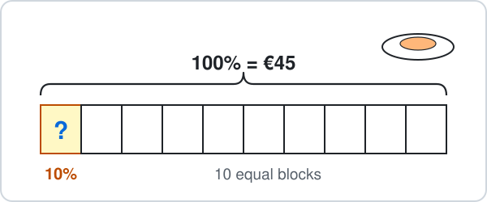

Answer: ______

## 12. Ch 6 Percentages · Seedling tray

A garden tray has 100 seedlings in 10 rows of 10.

Some of them have a flower.

Per cent means out of 100.

What percentage of the seedlings has a flower?

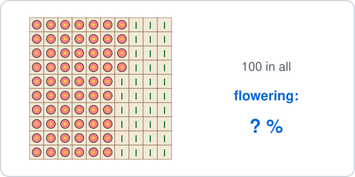

Answer: ______

## 13. Ch 7 Ratio · Bus passengers

There are 35 passengers on a Valletta bus.

Sitting and standing passengers are in the ratio $5 : 2$.

How many passengers are sitting?

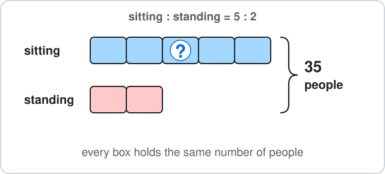

Answer: ______

## 14. Ch 7 Ratio · Shell colours

You find 28 white shells and 20 pink shells.

Write the ratio white : pink, $28 : 20$, in its simplest form.

- **A.** $14 : 10$
- **B.** $7 : 5$
- **C.** $5 : 7$
- **D.** $7 : 4$

## 15. Ch 8 Algebra · Two ropes

A rope $x$ m long is tied to a rope 5 m long.

Together they are 18 m long, so $x + 5 = 18$.

Solve to find $x$.

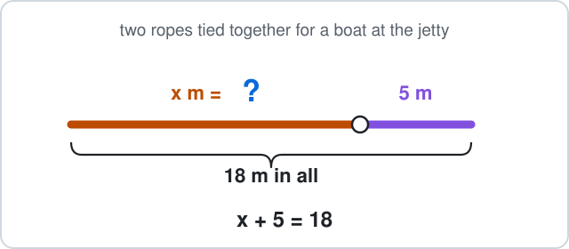

Answer: ______

## 16. Ch 8 Algebra · Money box

You start with €7 in a money box and add €3 every week.

After $w$ weeks the box holds $3w + 7$ euros, where $3w + 7$ means $3\times w + 7$.

How many euros are in the box after 8 weeks?

Answer: ______

## 17. Ch 9 Sequences · Matchstick hexagons

Matchsticks make hexagons in a row.

Pattern 1 uses 6 matchsticks, pattern 2 uses 11 and pattern 3 uses 16.

How many matchsticks does pattern 4 use?

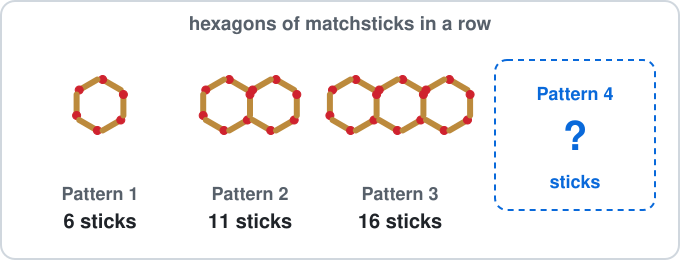

Answer: ______

## 18. Ch 9 Sequences · Stacked chairs

A stack of $n$ plastic chairs is $2n + 80$ cm tall, where $2n + 80$ means $2\times n + 80$.

How tall is a stack of 20 chairs?

Answer: ______

## 19. Ch 10 Circles · Round pool

A round paddling pool has radius 3 m.

Find its diameter.

Answer: ______

## 20. Ch 10 Circles · Trampoline

A round trampoline has diameter 3 m.

Use $\pi \approx 3.14$ to find the length of padding round its edge (the circumference).

Answer: ______

## 21. Ch 11 Perimeter & Area · Football card

A football card is 9 cm long and 6 cm wide.

Find its area.

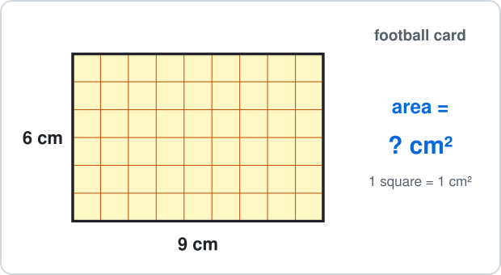

Answer: ______

## 22. Ch 11 Perimeter & Area · Flower bed

A flower bed is a triangle with base 12 m and height 5 m.

Find its area.

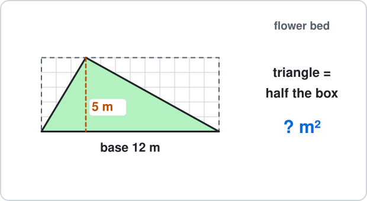

Answer: ______

## 23. Ch 12 Surface Area & Nets · Puzzle cube

A puzzle cube has edges of 7 cm.

Find its surface area.

Answer: ______

## 24. Ch 12 Surface Area & Nets · Chocolate box

A box of chocolates is 7 cm long, 5 cm wide and 2 cm high.

Find its volume.

Answer: ______

## 25. Ch 13 Graphs · Garden plan

A garden plan is drawn on a grid.

A tomato plant grows at point P.

What are the coordinates of P?

- **A.** $(1, 3)$
- **B.** $(3, 1)$
- **C.** $(2, 4)$
- **D.** $(-1, 3)$

## 26. Ch 13 Graphs · Water tank

A tank has 1 litre of water in it.

A tap adds 4 litres each minute, so it holds $y = 4x + 1$ litres after $x$ minutes.

Find $y$ when $x = 2$.

Answer: ______

## 27. Ch 14 Statistics · Dice rolls

You roll a dice 7 times and get: $4, 6, 4, 2, 6, 4, 1$.

Find the mode.

Answer: ______

## 28. Ch 14 Statistics · Ice creams sold

A beach kiosk sold 18, 25, 30 and 23 ice creams in four hours.

Find the mean number sold per hour.

Answer: ______

## 29. Ch 15 Probability · Bag of sweets

A bag has 4 strawberry and 3 lemon sweets.

One sweet is taken without looking.

What is the probability that it is strawberry?

- **A.** $\frac{4}{7}$
- **B.** $\frac{4}{3}$
- **C.** $\frac{3}{7}$
- **D.** $\frac{1}{4}$

## 30. Ch 15 Probability · Ferry on time

The probability that the Gozo ferry is late is $\frac{1}{8}$.

What is the probability that it is **not** late?

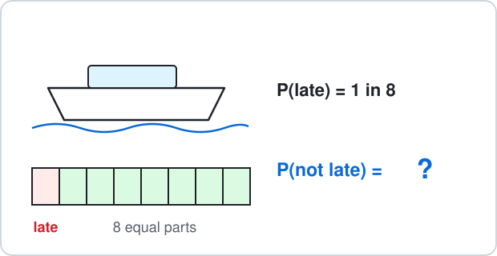

- **A.** $\frac{1}{8}$
- **B.** $\frac{8}{7}$
- **C.** $\frac{7}{8}$
- **D.** $\frac{1}{7}$

## 31. Ch 16 Constructions · Pencils

You lay three pencils end to end to make a triangle.

Which three lengths can make a triangle?

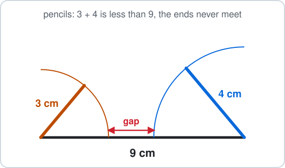

- **A.** 6 cm, 7 cm, 8 cm
- **B.** 3 cm, 4 cm, 9 cm
- **C.** 2 cm, 6 cm, 9 cm
- **D.** 4 cm, 4 cm, 9 cm

## 32. Ch 16 Constructions · Field path

Two walls meet at a corner of a field at $120^\circ$.

A path from the corner bisects the angle.

What angle does the path make with each wall?

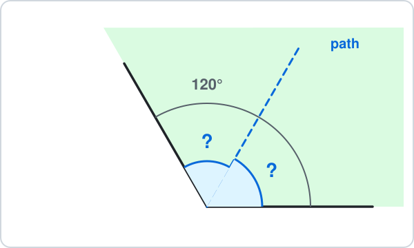

Answer: ______

## 33. Ch 17 Transformations · Garden pattern

A garden is planted symmetric about the $x$-axis.

A lemon tree is at $(2, -1)$.

Where is the matching lemon tree?

- **A.** $(-2, -1)$
- **B.** $(2, 1)$
- **C.** $(-2, 1)$
- **D.** $(-1, 2)$

## 34. Ch 17 Transformations · Sticker

A sticker on a grid is at $(2, 1)$.

You slide it by $\binom{3}{4}$: 3 right and 4 up.

Where is it now?

- **A.** $(3, 4)$
- **B.** $(5, 1)$
- **C.** $(-1, -3)$
- **D.** $(5, 5)$

## 35. Ch 18 Real-life Problems · Cinema snacks

At the cinema, popcorn and a drink cost €6.25.

You pay with a €10 note.

How much change do you get?

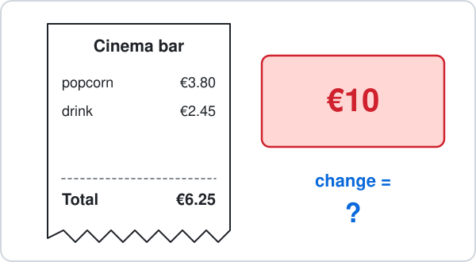

Answer: ______

## 36. Ch 18 Real-life Problems · Baking bread

Bread goes into the oven at 08:40 and comes out at 09:30.

How many minutes does it bake?

Answer: ______

## 37. Ch 19 Logo · Octagon harbour

A boat sails around the buoys of a harbour race shaped like a regular octagon.

Every inside angle is 135°.

The boat moves forward 10 steps and turns right, 8 times.

In Logo this is `REPEAT 8 [FD 10 RT ?]`.

- `FD 10` means move forward 10 steps (a length).
- `RT ?` means turn right by ? degrees (an angle).

How many degrees is each turn?

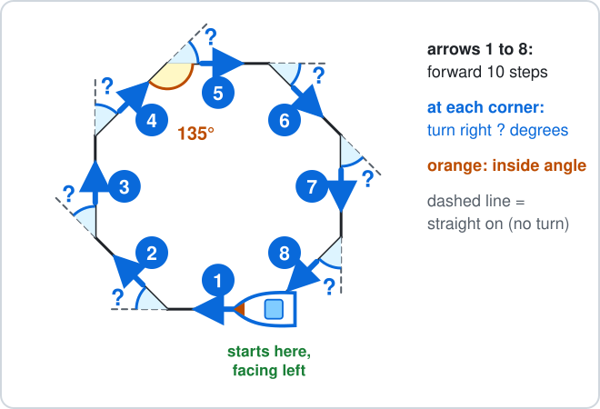

Answer: ______

## 38. Ch 19 Logo · Triangle of buoys

A boat sails around three buoys that make an equilateral triangle (every inside angle is 60°).

The boat moves forward 25 steps and turns right at each corner, all the way round.

- `FD 25` means move forward 25 steps (a length).
- `RT` means turn right by that many degrees (an angle).

Which commands draw it?

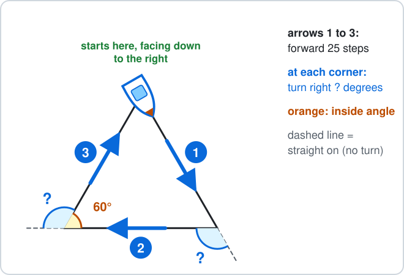

- **A.** `REPEAT 3 [FD 25 RT 60]`
- **B.** `REPEAT 2 [FD 25 RT 120]`
- **C.** `REPEAT 3 [FD 25 RT 120]`
- **D.** `REPEAT 3 [FD 25 RT 90]`

---

<b>Answers</b>

**1. €25** — Paying in moves **up** (to the right on the line):

$$
-15 + 40 = \boxed{25}
$$

- The balance is €25.
- $55$ adds 15 to 40 and forgets that −€15 is money you owe.

**2. −11 m** — Down means subtract:

$$
-4 - 7 = \boxed{-11}
$$

- The anchor is at −11 m.
- $3$ moves 7 m up instead of down.

**3. $18$** — BIDMAS: multiply first (the packs), then add.

$$
4\times3 = 12
$$

$$
6 + 12 = \boxed{18}
$$

$30$ adds first, as if it were $(6 + 4)\times3$.

**4. $16$** — A square number is rows times columns:

$$
4^2 = 4\times4
$$

$$
4\times4 = \boxed{16}
$$

$8$ is $4\times2$, not $4\times4$.

**5. 160°** — The pavement is a straight line, so the two angles add up to $180^\circ$:

$$
180^\circ - 20^\circ = \boxed{160^\circ}
$$

$70^\circ$ uses $90^\circ$, which is for a right angle, not a straight line.

**6. 65°** — The angles in a triangle add up to $180^\circ$:

$$
180^\circ - 65^\circ - 50^\circ = \boxed{65^\circ}
$$

$245^\circ$ takes the angles from $360^\circ$; a triangle uses $180^\circ$.

**7. A — Count the pastizzi**

Same size pastizzi, so add the tops:

$$
\frac{4}{9} + \frac{3}{9} = \boxed{\frac{7}{9}}
$$

$\frac{7}{18}$ adds the bottoms too, but there are still 9 pastizzi, not 18.

**8. €30** — Split 36 into 6 equal boxes, then take 5 of them:

$$
36\div6 = 6
$$

$$
6\times5 = \boxed{30}
$$

- You spend €30.
- $6$ is only one box; you need 5 of the 6 boxes.

**9. €7.75** — Line up the decimal points:

$$
5.30 + 2.45 = \boxed{7.75}
$$

- The answer is €7.75.
- $7.48$ puts the 3 tenths of 5.30 under the hundredths ($5.03 + 2.45$) instead of lining up the decimal points.

**10. 2.3 cm** — Every digit moves one place to the left:

$$
0.23\times10 = \boxed{2.3}
$$

$23$ moves the digits two places, which is multiplying by 100, not 10.

**11. €4.50** — $10\%$ is one block out of 10:

$$
45\div10 = \boxed{4.5}
$$

- So $10\%$ of €45 is €4.50.
- $35$ takes 10 away; a percentage is a part, not a subtraction.

**12. 64%** — - Per cent means out of 100.
- Count: 6 full columns and 4 more.

$$
60 + 4 = 64
$$

$$
\frac{64}{100} = \boxed{64\%}
$$

$36\%$ counts the seedlings with no flower.

**13. $25$** — There are $5 + 2 = 7$ equal parts:

$$
35\div7 = 5
$$

$$
5\times5 = \boxed{25}
$$

10 is the smaller share; 17.5 splits 35 into 2 halves, but the ratio has 7 parts, not 2.

**14. B — Divide both by 4**

The HCF of 28 and 20 is 4:

$$
28\div4 = 7
$$

$$
20\div4 = 5
$$

$$
\boxed{7 : 5}
$$

- $14 : 10$ is the same ratio, but both numbers can still be halved.
- $5 : 7$ swaps the order: white comes first.

**15. 13 m** — Take 5 from both sides:

$$
x + 5 = 18
$$

$$
x = 18 - 5
$$

$$
x = \boxed{13}
$$

23 m adds 5 instead of taking it away.

**16. €31** — Put 8 in place of $w$, multiply first, then add:

$$
3\times8 = 24
$$

$$
24 + 7 = \boxed{31}
$$

€45 reads $3w$ as 38, but $3w$ means $3\times w$.

**17. $21$** — Each new pattern adds 5 sticks:

$$
16 + 5 = \boxed{21}
$$

22 counts 6 sticks for the new hexagon, but it shares one side with the hexagon before.

**18. 120 cm** — Put $n = 20$ into the rule, multiply first, then add:

$$
2\times20 = 40
$$

$$
40 + 80 = \boxed{120}
$$

102 cm reads $2n$ as 2 + 20, but $2n$ means $2\times n$.

**19. 6 m** — The diameter goes right across, so it is two radii:

$$
d = 2r
$$

$$
d = 2\times3
$$

$$
d = \boxed{6 \text{ m}}
$$

1.5 m halves the radius; the diameter is double, not half.

**20. 9.42 m** — The circumference is about 3.14 diameters:

$$
C = \pi d
$$

$$
C \approx 3.14\times3
$$

$$
C \approx \boxed{9.42 \text{ m}}
$$

4.71 m uses the radius (1.5 m) instead of the diameter, so it is only half way round.

**21. 54 cm²** — Rows of squares:

$$
A = l\times w
$$

$$
A = 9\times6
$$

$$
A = \boxed{54 \text{ cm}^2}
$$

30 cm is the perimeter (the distance round), not the area.

**22. 30 m²** — A triangle is half of its rectangle:

$$
A = \tfrac{1}{2}bh
$$

$$
A = \tfrac{1}{2}\times12\times5
$$

$$
A = \boxed{30 \text{ m}^2}
$$

60 m² forgets the half.

**23. 294 cm²** — 6 square faces, each:

$$
\begin{aligned} 7\times7 &= 49 \text{ cm}^2 \\ SA &= 6a^2 \end{aligned}
$$

$$
SA = 6\times49
$$

$$
SA = \boxed{294 \text{ cm}^2}
$$

343 cm³ is the volume 7 × 7 × 7; surface area covers the outside.

**24. 70 cm³** — Count the cubes, layer by layer:

$$
V = lwh
$$

$$
V = 7\times5\times2
$$

$$
V = \boxed{70 \text{ cm}^3}
$$

14 cm³ adds the three lengths; volume multiplies them.

**25. A — Across first, then up**

From 0 go 1 across, then 3 up:

$$
\boxed{(1, 3)}
$$

$(3, 1)$ reads up before across.

**26. 9 litres** — Put $x = 2$ into the rule:

$$
y = 4\times2 + 1
$$

$$
y = 8 + 1
$$

$$
y = \boxed{9}
$$

- The answer is 9 litres.
- $10$ adds $4 + 1$ first and then multiplies by 2: multiply first.

**27. $4$** — The mode is the value that appears most often: 4 appears 3 times.

$$
\text{mode} = \boxed{4}
$$

$3$ is how many times 4 appears, not the value itself.

**28. $24$** — Add them, then share equally between the 4 values:

$$
18 + 25 + 30 + 23 = 96
$$

$$
96\div4 = \boxed{24}
$$

$96$ is the total; the mean shares it out.

**29. A — Strawberry out of all**

4 strawberry out of:

$$
\begin{aligned} 4 + 3 &= 7 \\ P(\text{strawberry}) &= \boxed{\frac{4}{7}} \end{aligned}
$$

$\frac{4}{3}$ compares strawberry with lemon; a probability compares with **all** 7 sweets.

**30. C — 1 minus P(late)**

$$
P(\text{not late}) = 1 - \frac{1}{8}
$$

$$
P(\text{not late}) = \boxed{\frac{7}{8}}
$$

- $\frac{1}{8}$ is P(late) itself.
- $\frac{8}{7}$ is more than 1, and no probability is more than 1.

**31. A — The two short sides must reach**

The two shorter sides together must be longer than the longest:

$$
6 + 7 = 13
$$

$$
13 > 8
$$

- So $\boxed{6 \text{ cm}, 7 \text{ cm}, 8 \text{ cm}}$ works.
- In the others the short sides are too short: $3 + 4 = 7$, $2 + 6 = 8$ and $4 + 4 = 8$, each less than the longest side.

**32. 60°** — Bisect means cut into two equal halves:

$$
120^\circ\div2 = \boxed{60^\circ}
$$

$240^\circ$ doubles instead of halving.

**33. B — Same distance, other side**

The $x$-axis is the mirror: $y$ changes sign, $x$ stays.

$$
(2, -1) \to \boxed{(2, 1)}
$$

$(-2, -1)$ reflects in the $y$-axis instead.

**34. D — Add the moves**

Add the moves to the coordinates:

$$
(2 + 3,\ 1 + 4) = \boxed{(5, 5)}
$$

$(3, 4)$ is the move itself, not where the point lands.

**35. €3.75** — Change = money paid − cost:

$$
10.00 - 6.25 = \boxed{3.75}
$$

- The change is €3.75.
- $4.25$ takes away only the 6 euros and copies the cents instead of taking them away too.

**36. 50 minutes** — Count up to the hour, then on:

$$
08{:}40 \to 09{:}00 = 20 \text{ min}
$$

$$
09{:}00 \to 09{:}30 = 30 \text{ min}
$$

$$
20 + 30 = \boxed{50 \text{ min}}
$$

$90$ subtracts 930 − 840 as ordinary numbers, but an hour has 60 minutes, not 100.

**37. 45°** — The boat turns by how much its direction changes:

- Straight on is a turn of $0^\circ$.
- Turning round to go back is $180^\circ$.
- The regular octagon's inside angle is $135^\circ$, so the turn is

$$
180^\circ - 135^\circ = \boxed{45^\circ}
$$

Check: 8 turns make one full spin, $8\times45^\circ = 360^\circ$, so the boat ends facing left again.

$135^\circ$ is the inside angle, not the turn: the turn is measured from the dashed straight-on line.

**38. C — Turn = 180° − inside angle**

Count the sides and look at one corner:

- The shape has 3 sides, so the commands repeat $3$ times.
- Straight on (the dashed line) is a turn of $0^\circ$.
- Turning round to go back is $180^\circ$.
- The inside angle is $60^\circ$, so the turn is

$$
180^\circ - 60^\circ = 120^\circ
$$

Check: $3\times120^\circ = 360^\circ$, one full spin, so the boat is back at the start, facing down to the right.

$$
\boxed{\texttt{REPEAT 3 [FD 25 RT 120]}}
$$

`REPEAT 3 [FD 25 RT 60]` uses the inside angle: the boat turns the wrong amount, $3\times60^\circ = 180^\circ$, so it does not draw an equilateral triangle. `REPEAT 2 [FD 25 RT 120]` repeats only 2 times: $2\times120^\circ = 240^\circ$, less than a full spin, so the shape does not close. `REPEAT 3 [FD 25 RT 90]` uses the turn for a square: $3\times90^\circ = 270^\circ$, not one full spin of $360^\circ$.

- Draw it first: a picture shows which rule to use.
- Check that the answer makes sense in the picture.

