# Malta Year 8 Math — All 19 Chapters: Basic Set E

**Set E:** the same 38 steps as Basic, new questions, two per chapter.

---

## 1. Ch 1 Directed Numbers · Rocket countdown

A rocket clock counts seconds.

It shows $-8$, which means 8 seconds before lift-off (lift-off is 0).

Then 11 seconds pass.

What does the clock show now?

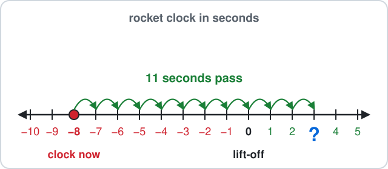

Answer: ______

## 2. Ch 1 Directed Numbers · Quiz points

In a quiz game your score is $-3$ points (3 points below zero).

A wrong answer loses 6 points.

What is your score now?

Answer: ______

## 3. Ch 2 Number Work · Gozo ferry deck

The Gozo ferry carries 2 vans and 4 rows of cars, with 5 cars in each row.

The total is $2 + 4\times5$.

How many vehicles are there?

Answer: ______

## 4. Ch 2 Number Work · Sticker sheet

A square sheet of star stickers has 9 rows with 9 stickers in each row.

The number of stickers is $9^2$ (the small 2 means 9 times itself).

How many stickers are there?

Answer: ______

## 5. Ch 3 Angles · Car park barrier

A car park barrier arm lifts up from a straight road.

On one side, the arm makes $55^\circ$ with the road.

Find the angle between the arm and the road on the other side.

Answer: ______

## 6. Ch 3 Angles · Buoy triangle

At the Blue Lagoon, a swim route goes round 3 buoys and makes a triangle.

Two of its angles are $45^\circ$ and $100^\circ$.

Find the third angle.

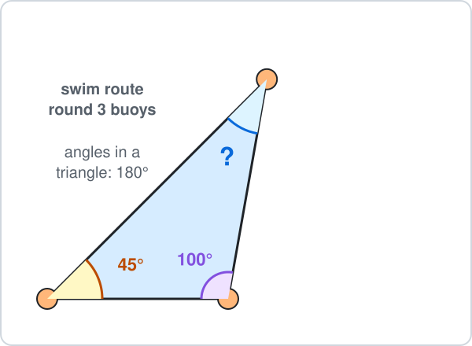

Answer: ______

## 7. Ch 4 Fractions · Festa nougat

A bar of qubbajt (festa nougat) is cut into 7 equal pieces.

A fraction like $\frac{1}{7}$ means 1 piece out of the 7.

You eat 2 pieces and a friend eats 4 pieces.

What fraction of the bar is eaten?

- **A.** $\frac{2}{7}$
- **B.** $\frac{6}{14}$
- **C.** $\frac{6}{7}$
- **D.** $\frac{1}{7}$

## 8. Ch 4 Fractions · Beach trip

A class has 25 students.

$\frac{4}{5}$ of them go on the beach trip ($\frac{4}{5}$ means 4 out of every 5 equal parts).

How many students go?

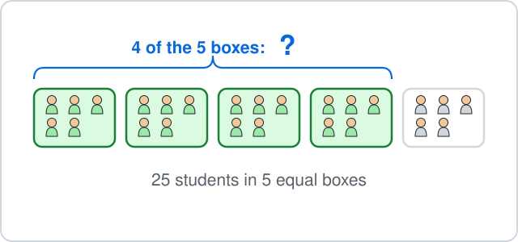

Answer: ______

## 9. Ch 5 Decimals · Beach umbrella and sunbed

At Golden Bay an umbrella costs €6.50 to hire and a sunbed costs €4.20.

How much do they cost together?

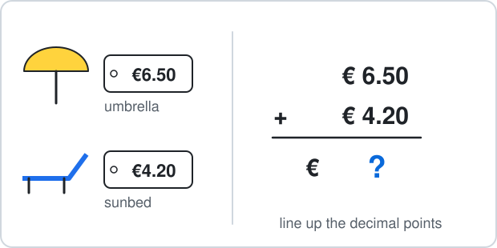

Answer: ______

## 10. Ch 5 Decimals · Ten steps

Each of your steps is 0.75 m long.

You walk 10 steps, which is $0.75\times10$ metres.

How far do you walk?

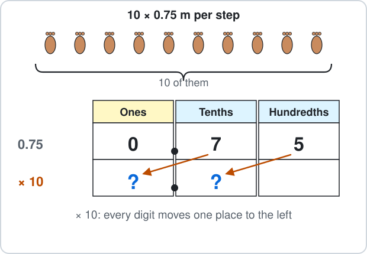

Answer: ______

## 11. Ch 6 Percentages · Film adverts

A film on TV lasts 80 minutes.

$10\%$ of that time is adverts ($10\%$ means 10 out of every 100, the same as one tenth).

How many minutes of adverts are there?

Answer: ______

## 12. Ch 6 Percentages · Beach umbrellas

At Golden Bay there are 100 beach umbrellas in 10 rows of 10.

Some umbrellas are open.

Per cent means out of 100.

What percentage of the umbrellas is open?

Answer: ______

## 13. Ch 7 Ratio · Beach shells

You collect 27 shells at Golden Bay.

White shells and pink shells are in the ratio $4 : 5$.

How many pink shells are there?

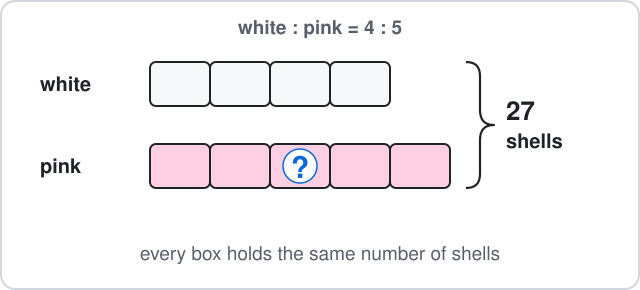

Answer: ______

## 14. Ch 7 Ratio · Coins in a jar

A money jar holds 8 one-euro coins and 32 ten-cent coins.

Write the ratio one-euro : ten-cent, $8 : 32$, in its simplest form.

- **A.** $2 : 8$
- **B.** $4 : 1$
- **C.** $1 : 4$
- **D.** $4 : 16$

## 15. Ch 8 Algebra · Bag of marbles

A bag holds $x$ marbles.

You tip the bag and 9 more marbles into a jar, and the jar has 25 marbles, so $x + 9 = 25$.

Solve to find $x$.

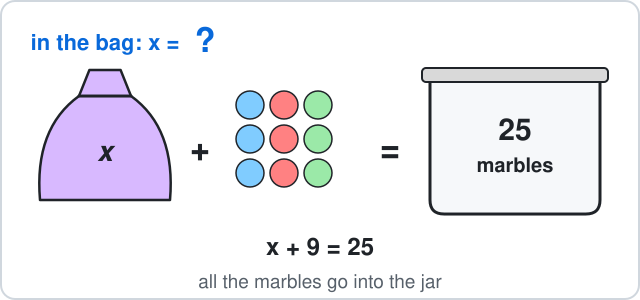

Answer: ______

## 16. Ch 8 Algebra · Stack of cups

A stack of $c$ paper cups is $2c + 9$ cm tall, where $2c + 9$ means $2\times c + 9$.

How tall is a stack of 7 cups?

Answer: ______

## 17. Ch 9 Sequences · Plus-sign tiles

Square tiles make a plus sign that grows.

Pattern 1 uses 1 tile, pattern 2 uses 5 and pattern 3 uses 9.

How many tiles does pattern 4 use?

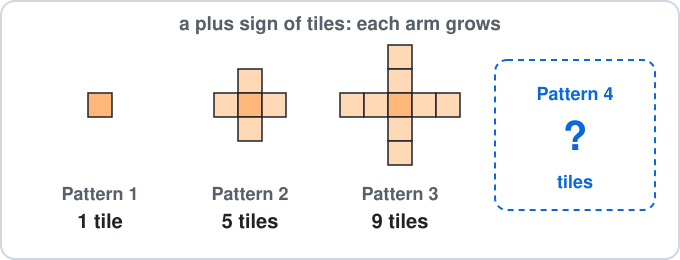

Answer: ______

## 18. Ch 9 Sequences · Savings

You save money each week.

After week number $n$ your money box holds $10n + 4$ euros, where $10n + 4$ means $10\times n + 4$.

How many euros are in it after week 7?

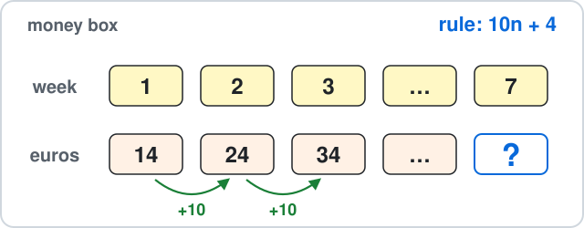

Answer: ______

## 19. Ch 10 Circles · Round table

A round dining table has radius 60 cm.

Find its diameter.

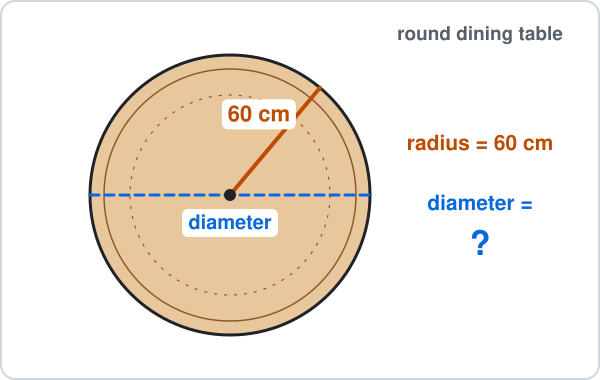

Answer: ______

## 20. Ch 10 Circles · Roundabout

A roundabout has diameter 40 m.

Use $\pi \approx 3.14$ to find the distance once round it (the circumference).

Answer: ______

## 21. Ch 11 Perimeter & Area · Pool floor

The floor of a small swimming pool is 10 m long and 4 m wide.

Find its area.

Answer: ______

## 22. Ch 11 Perimeter & Area · House gable

The end wall of a house roof (the gable) is a triangle with base 8 m and height 7 m.

Find its area.

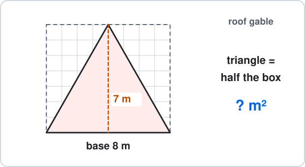

Answer: ______

## 23. Ch 12 Surface Area & Nets · Storage cube

A cube-shaped storage box has edges of 10 cm.

Find its surface area.

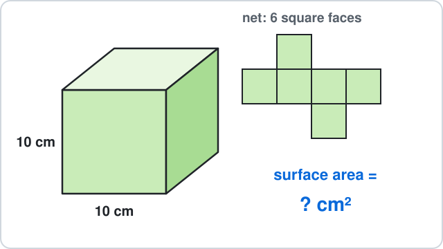

Answer: ______

## 24. Ch 12 Surface Area & Nets · Ferry container

A container on the Gozo ferry is 6 m long, 2 m wide and 3 m high.

Find its volume.

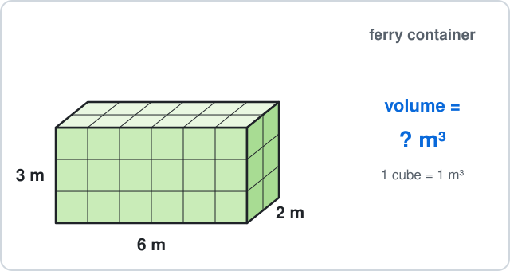

Answer: ______

## 25. Ch 13 Graphs · Bus stop

A street map of a town is drawn on a grid.

The bus stop is at point B.

What are the coordinates of B?

- **A.** $(7, 5)$
- **B.** $(6, 4)$
- **C.** $(4, 6)$
- **D.** $(6, -4)$

## 26. Ch 13 Graphs · Bowling

At a bowling alley, shoe hire is €4 and each game is €2.

The cost is $y = 2x + 4$ euros for $x$ games.

Find $y$ when $x = 3$.

Answer: ______

## 27. Ch 14 Statistics · Pets at home

Eight classmates say how many pets they have at home: $0, 1, 1, 2, 1, 0, 3, 1$.

Find the mode.

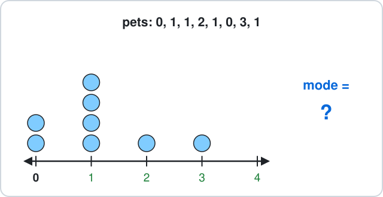

Answer: ______

## 28. Ch 14 Statistics · Seedlings

Four seedlings are 5 cm, 9 cm, 8 cm and 10 cm tall.

Find their mean height.

Answer: ______

## 29. Ch 15 Probability · Pencil case

A pencil case holds 5 black and 6 blue pens.

You take one pen without looking.

What is the probability that it is black?

- **A.** $\frac{5}{6}$
- **B.** $\frac{5}{11}$
- **C.** $\frac{6}{11}$
- **D.** $\frac{1}{5}$

## 30. Ch 15 Probability · Box of doughnuts

A box has 12 doughnuts: 5 are chocolate and the rest are strawberry.

You take one without looking.

What is the probability that it is **not** chocolate?

- **A.** $\frac{5}{12}$
- **B.** $\frac{12}{7}$
- **C.** $\frac{1}{12}$
- **D.** $\frac{7}{12}$

## 31. Ch 16 Constructions · Climbing frame

A playground climbing frame has a triangle made of three metal bars.

Which three lengths can make a triangle?

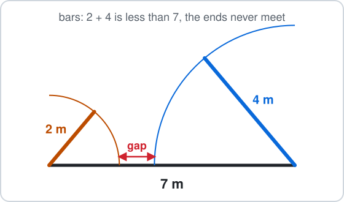

- **A.** 2 m, 4 m, 7 m
- **B.** 5 m, 5 m, 8 m
- **C.** 3 m, 6 m, 10 m
- **D.** 1 m, 7 m, 9 m

## 32. Ch 16 Constructions · Two roads

Two roads meet at an angle of $100^\circ$.

A new footpath bisects the angle between them.

What angle does the footpath make with each road?

Answer: ______

## 33. Ch 17 Transformations · Window pattern

A window pattern is symmetric about the $x$-axis.

A star is at $(-2, 3)$.

Where is the matching star?

- **A.** $(2, 3)$
- **B.** $(2, -3)$
- **C.** $(-2, -3)$
- **D.** $(3, -2)$

## 34. Ch 17 Transformations · Town bus

On a town map a bus is at $(4, 3)$.

It drives by $\binom{-3}{-2}$: 3 left and 2 down.

Where does it arrive?

- **A.** $(7, 5)$
- **B.** $(1, 1)$
- **C.** $(-3, -2)$
- **D.** $(1, 5)$

## 35. Ch 18 Real-life Problems · Bakery

At a bakery the bill is €7.85.

You pay with a €20 note.

How much change do you get?

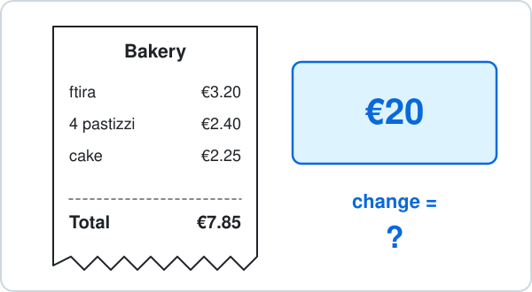

Answer: ______

## 36. Ch 18 Real-life Problems · Swimming lesson

A swimming lesson starts at 15:25 and ends at 16:05.

How many minutes is the lesson?

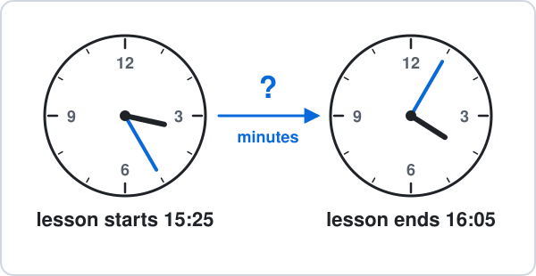

Answer: ______

## 37. Ch 19 Logo · Square lawn

A robot mower cuts the edge of a square lawn.

Every inside angle is 90°.

The robot mower moves forward 20 steps and turns right, 4 times.

In Logo this is `REPEAT 4 [FD 20 RT ?]`.

- `FD 20` means move forward 20 steps (a length).
- `RT ?` means turn right by ? degrees (an angle).

How many degrees is each turn?

Answer: ______

## 38. Ch 19 Logo · Square tile

A turtle walks around the edge of a square tile (every inside angle is 90°).

The turtle moves forward 15 steps and turns right at each corner, all the way round.

- `FD 15` means move forward 15 steps (a length).
- `RT` means turn right by that many degrees (an angle).

Which commands draw it?

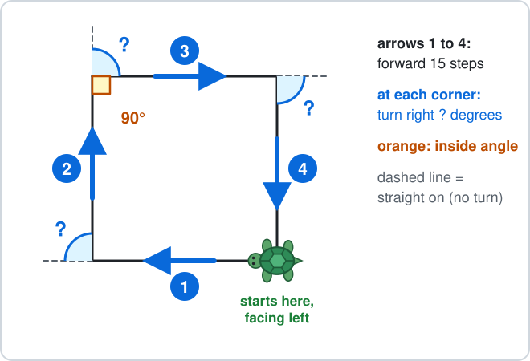

- **A.** `REPEAT 4 [FD 15 RT 360]`
- **B.** `REPEAT 4 [FD 15 RT 90]`
- **C.** `REPEAT 3 [FD 15 RT 90]`
- **D.** `REPEAT 4 [FD 15 RT 120]`

---

<b>Answers</b>

**1. 3 seconds** — Time passing moves **right** on the number line:

$$
-8 + 11 = \boxed{3}
$$

$19$ adds 8 and 11 and forgets that $-8$ is before lift-off.

**2. −9 points** — Losing points moves **left** on the number line:

$$
-3 - 6 = \boxed{-9}
$$

$3$ adds 6 to $-3$ instead of taking it away.

**3. $22$** — BIDMAS: multiply first (the rows), then add.

$$
4\times5 = 20
$$

$$
2 + 20 = \boxed{22}
$$

$30$ adds first, as if it were $(2 + 4)\times5$.

**4. $81$** — A square number is rows times columns:

$$
9^2 = 9\times9
$$

$$
9\times9 = \boxed{81}
$$

$18$ is $9\times2$, not $9\times9$.

**5. 125°** — The road is a straight line, so the two angles add up to $180^\circ$:

$$
180^\circ - 55^\circ = \boxed{125^\circ}
$$

$305^\circ$ uses $360^\circ$, which is for angles around a point.

**6. 35°** — The angles in a triangle add up to $180^\circ$:

$$
180^\circ - 45^\circ - 100^\circ = \boxed{35^\circ}
$$

$215^\circ$ takes the angles from $360^\circ$; a triangle uses $180^\circ$.

**7. C — Count the pieces**

Same size pieces, so add the tops:

$$
\frac{2}{7} + \frac{4}{7} = \boxed{\frac{6}{7}}
$$

$\frac{6}{14}$ adds the bottoms too, but there are still 7 pieces, not 14.

**8. $20$** — Split 25 into 5 equal boxes, then take 4 of them:

$$
25\div5 = 5
$$

$$
5\times4 = \boxed{20}
$$

$5$ is only one box; you need 4 of the 5 boxes.

**9. €10.70** — Line up the decimal points:

$$
6.50 + 4.20 = \boxed{10.70}
$$

- The answer is €10.70.
- $0.70$ forgets to carry the 1 ten when $6 + 4 = 10$ euros.

**10. 7.5 m** — Every digit moves one place to the left:

$$
0.75\times10 = \boxed{7.5}
$$

$75$ moves the digits two places, which is multiplying by 100, not 10.

**11. 8 minutes** — $10\%$ is one block out of 10:

$$
80\div10 = \boxed{8}
$$

- So $10\%$ of 80 minutes is 8 minutes.
- $70$ takes 10 away; a percentage is a part, not a subtraction.

**12. 72%** — - Per cent means out of 100.
- Count: 7 full rows and 2 more.

$$
70 + 2 = 72
$$

$$
\frac{72}{100} = \boxed{72\%}
$$

$28\%$ counts the closed umbrellas.

**13. $15$** — There are $4 + 5 = 9$ equal parts:

$$
27\div9 = 3
$$

$$
3\times5 = \boxed{15}
$$

12 is the smaller share; 13.5 splits 27 into 2 halves, but the ratio has 9 parts, not 2.

**14. C — Divide both by 8**

The HCF of 8 and 32 is 8:

$$
8\div8 = 1
$$

$$
32\div8 = 4
$$

$$
\boxed{1 : 4}
$$

- $2 : 8$ and $4 : 16$ are the same ratio, but both numbers can still be divided again.
- $4 : 1$ swaps the order: the one-euro coins come first.

**15. $16$** — Take 9 from both sides:

$$
x + 9 = 25
$$

$$
x = 25 - 9
$$

$$
x = \boxed{16}
$$

34 adds 9 instead of taking it away.

**16. 23 cm** — Put 7 in place of $c$, multiply first, then add:

$$
2\times7 = 14
$$

$$
14 + 9 = \boxed{23}
$$

36 cm reads $2c$ as 27, but $2c$ means $2\times c$.

**17. $13$** — Each new pattern adds 4 tiles:

$$
9 + 4 = \boxed{13}
$$

10 adds 1 tile, but each pattern adds one tile on each of the 4 arms, so 4 tiles.

**18. €74** — Put $n = 7$ into the rule, multiply first, then add:

$$
10\times7 = 70
$$

$$
70 + 4 = \boxed{74}
$$

€21 reads $10n$ as 10 + 7, but $10n$ means $10\times n$.

**19. 120 cm** — The diameter goes right across, so it is two radii:

$$
d = 2r
$$

$$
d = 2\times60
$$

$$
d = \boxed{120 \text{ cm}}
$$

30 cm halves the radius; the diameter is double, not half.

**20. 125.6 m** — The circumference is about 3.14 diameters:

$$
C = \pi d
$$

$$
C \approx 3.14\times40
$$

$$
C \approx \boxed{125.6 \text{ m}}
$$

62.8 m uses the radius (20 m) instead of the diameter, so it is only half way round.

**21. 40 m²** — Rows of squares:

$$
A = l\times w
$$

$$
A = 10\times4
$$

$$
A = \boxed{40 \text{ m}^2}
$$

28 m is the perimeter (the distance round), not the area.

**22. 28 m²** — A triangle is half of its rectangle:

$$
A = \tfrac{1}{2}bh
$$

$$
A = \tfrac{1}{2}\times8\times7
$$

$$
A = \boxed{28 \text{ m}^2}
$$

56 m² forgets the half.

**23. 600 cm²** — 6 square faces, each:

$$
\begin{aligned} 10\times10 &= 100 \text{ cm}^2 \\ SA &= 6a^2 \end{aligned}
$$

$$
SA = 6\times100
$$

$$
SA = \boxed{600 \text{ cm}^2}
$$

1000 cm³ is the volume 10 × 10 × 10; surface area covers the outside.

**24. 36 m³** — Count the cubes, layer by layer:

$$
V = lwh
$$

$$
V = 6\times2\times3
$$

$$
V = \boxed{36 \text{ m}^3}
$$

11 m³ adds the three lengths; volume multiplies them.

**25. B — Across first, then up**

From 0 go 6 across, then 4 up:

$$
\boxed{(6, 4)}
$$

$(4, 6)$ reads up before across.

**26. €10** — Put $x = 3$ into the rule:

$$
y = 2\times3 + 4
$$

$$
y = 6 + 4
$$

$$
y = \boxed{10}
$$

- The answer is €10.
- $18$ adds $2 + 4$ first and then multiplies by 3: multiply first.

**27. $1$** — The mode is the value that appears most often: 1 appears 4 times.

$$
\text{mode} = \boxed{1}
$$

$4$ is how many times 1 appears, not the value itself.

**28. 8 cm** — Add them, then share equally between the 4 values:

$$
5 + 9 + 8 + 10 = 32
$$

$$
32\div4 = \boxed{8}
$$

$32$ is the total; the mean shares it out.

**29. B — Black out of all**

5 black out of:

$$
\begin{aligned} 5 + 6 &= 11 \\ P(\text{black}) &= \boxed{\frac{5}{11}} \end{aligned}
$$

$\frac{5}{6}$ compares black with blue; a probability compares with **all** 11 pens.

**30. D — 1 minus P(chocolate)**

$$
P(\text{not chocolate}) = 1 - \frac{5}{12}
$$

$$
P(\text{not chocolate}) = \boxed{\frac{7}{12}}
$$

- $\frac{5}{12}$ is P(chocolate) itself.
- $\frac{12}{7}$ is more than 1, and no probability is more than 1.

**31. B — The two short sides must reach**

The two shorter sides together must be longer than the longest:

$$
5 + 5 = 10
$$

$$
10 > 8
$$

- So $\boxed{5 \text{ m}, 5 \text{ m}, 8 \text{ m}}$ works.
- In the others the short sides are too short: $2 + 4 = 6$, $3 + 6 = 9$ and $1 + 7 = 8$, each less than the longest side.

**32. 50°** — Bisect means cut into two equal halves:

$$
100^\circ\div2 = \boxed{50^\circ}
$$

$200^\circ$ doubles instead of halving.

**33. C — Same distance, other side**

The $x$-axis is the mirror: $y$ changes sign, $x$ stays.

$$
(-2, 3) \to \boxed{(-2, -3)}
$$

$(2, 3)$ reflects in the $y$-axis instead.

**34. B — Add the moves**

Add the moves to the coordinates:

$$
(4 - 3,\ 3 - 2) = \boxed{(1, 1)}
$$

$(-3, -2)$ is the move itself, not where the point lands.

**35. €12.15** — Change = money paid − cost:

$$
20.00 - 7.85 = \boxed{12.15}
$$

- The change is €12.15.
- $13.85$ takes away only the 7 euros and copies the cents instead of taking them away too.

**36. 40 minutes** — Count up to the hour, then on:

$$
15{:}25 \to 16{:}00 = 35 \text{ min}
$$

$$
16{:}00 \to 16{:}05 = 5 \text{ min}
$$

$$
35 + 5 = \boxed{40 \text{ min}}
$$

$80$ subtracts 1605 − 1525 as ordinary numbers, but an hour has 60 minutes, not 100.

**37. 90°** — The robot mower turns by how much its direction changes:

- Straight on is a turn of $0^\circ$.
- Turning round to go back is $180^\circ$.
- The square's inside angle is $90^\circ$, so the turn is

$$
180^\circ - 90^\circ = \boxed{90^\circ}
$$

Check: 4 turns make one full spin, $4\times90^\circ = 360^\circ$, so the robot mower ends facing right again.

$4$ is the number of sides and $20$ is the number of steps; neither is the angle.

**38. B — Turn = 180° − inside angle**

Count the sides and look at one corner:

- The shape has 4 sides, so the commands repeat $4$ times.
- Straight on (the dashed line) is a turn of $0^\circ$.
- Turning round to go back is $180^\circ$.
- The inside angle is $90^\circ$, so the turn is

$$
180^\circ - 90^\circ = 90^\circ
$$

Check: $4\times90^\circ = 360^\circ$, one full spin, so the turtle is back at the start, facing left.

$$
\boxed{\texttt{REPEAT 4 [FD 15 RT 90]}}
$$

`REPEAT 4 [FD 15 RT 360]` uses the full spin for every corner, so the turtle never changes direction and walks in a straight line. `REPEAT 3 [FD 15 RT 90]` repeats only 3 times: $3\times90^\circ = 270^\circ$, less than a full spin, so the shape does not close. `REPEAT 4 [FD 15 RT 120]` uses the turn for a triangle: $4\times120^\circ = 480^\circ$, not one full spin of $360^\circ$.

- Draw it first: a picture shows which rule to use.
- Check that the answer makes sense in the picture.

