# Malta Year 8 Math — All 19 Chapters: Basic

**Basic:** one step from each chapter, two questions per chapter.

**Chapters:**

- Q1–2: Chapter 1 Directed Numbers
- Q3–4: Chapter 2 Number Work
- Q5–6: Chapter 3 Angles
- Q7–8: Chapter 4 Fractions
- Q9–10: Chapter 5 Decimals
- Q11–12: Chapter 6 Percentages
- Q13–14: Chapter 7 Ratio
- Q15–16: Chapter 8 Algebra
- Q17–18: Chapter 9 Sequences
- Q19–20: Chapter 10 Circles
- Q21–22: Chapter 11 Perimeter & Area
- Q23–24: Chapter 12 Surface Area & Nets
- Q25–26: Chapter 13 Graphs
- Q27–28: Chapter 14 Statistics
- Q29–30: Chapter 15 Probability
- Q31–32: Chapter 16 Constructions
- Q33–34: Chapter 17 Transformations
- Q35–36: Chapter 18 Real-life Problems
- Q37–38: Chapter 19 Logo

---

## 1. Ch 1 Directed Numbers · Warmer by 8

At night the temperature is $-3\,^\circ\text{C}$.

By noon it is 8 degrees warmer.

What is the temperature at noon?

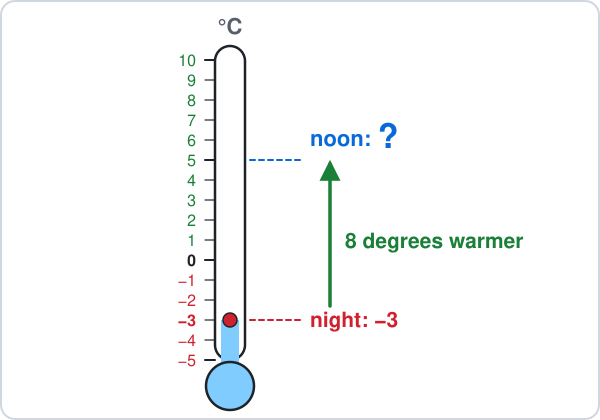

Answer: ______

## 2. Ch 1 Directed Numbers · Below zero

Work out $-4 - 5$.

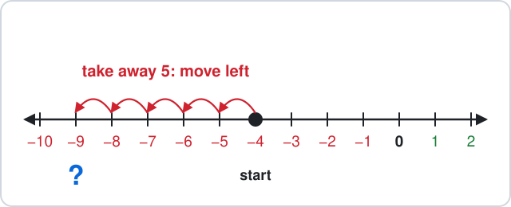

Answer: ______

## 3. Ch 2 Number Work · Multiply before adding

Work out $3 + 4\times2$.

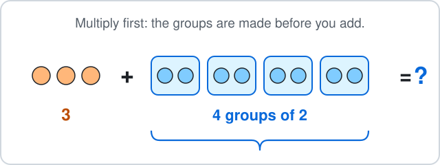

Answer: ______

## 4. Ch 2 Number Work · Square number

Work out $6^2$.

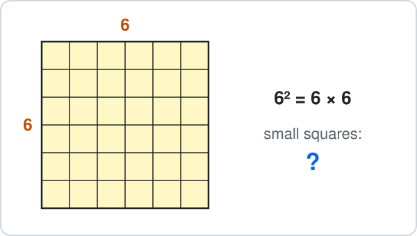

Answer: ______

## 5. Ch 3 Angles · Straight line

Two angles sit on a straight line.

One is $130^\circ$.

Find the other angle.

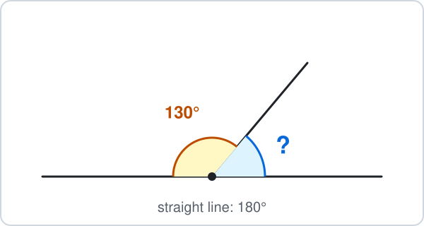

Answer: ______

## 6. Ch 3 Angles · Triangle

A triangle has angles $60^\circ$ and $75^\circ$.

Find the third angle.

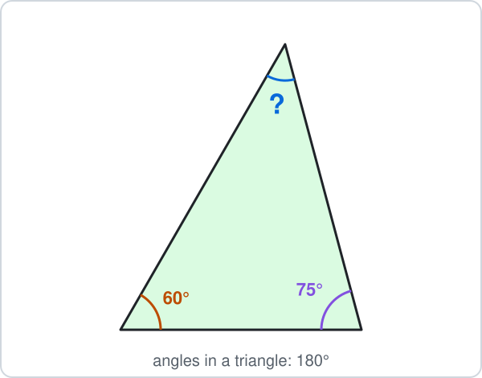

Answer: ______

## 7. Ch 4 Fractions · Slices of pizza

A pizza is cut into 8 equal slices.

You eat 3 slices and a friend eats 2 slices.

What fraction of the pizza is eaten?

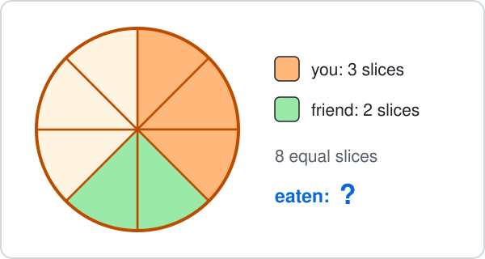

- **A.** $\frac{5}{8}$
- **B.** $\frac{5}{16}$
- **C.** $\frac{3}{8}$
- **D.** $\frac{6}{8}$

## 8. Ch 4 Fractions · Fraction of an amount

Find $\frac{3}{4}$ of $20$.

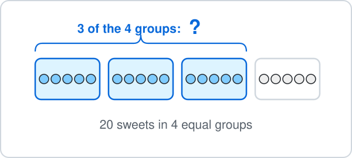

Answer: ______

## 9. Ch 5 Decimals · Adding money

Work out €2.50 + €1.30.

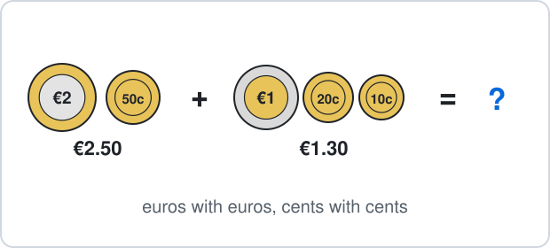

Answer: ______

## 10. Ch 5 Decimals · Times 10

Work out $0.36\times10$.

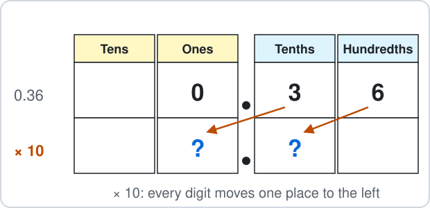

Answer: ______

## 11. Ch 6 Percentages · Ten percent

Find $10\%$ of €70.

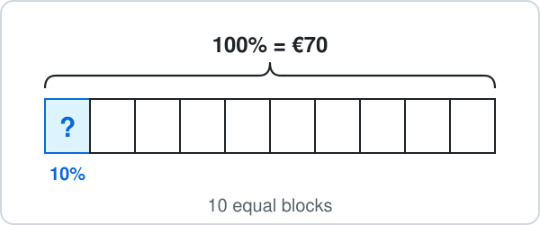

Answer: ______

## 12. Ch 6 Percentages · Percent of a grid

The grid has 100 equal squares.

What percentage of the grid is shaded?

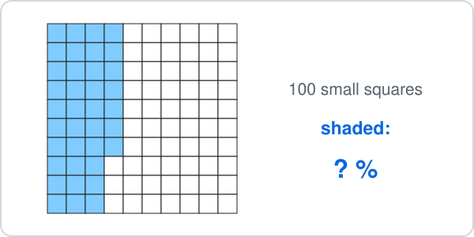

Answer: ______

## 13. Ch 7 Ratio · Sharing

Share 20 sweets in the ratio $1 : 3$.

How many sweets are in the bigger share?

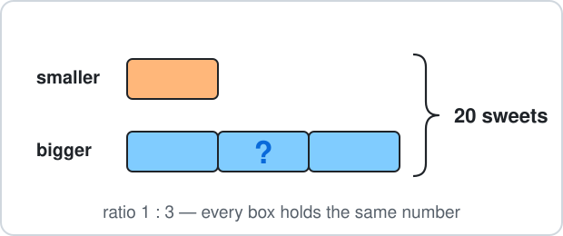

Answer: ______

## 14. Ch 7 Ratio · Simplest form

Write the ratio $12 : 8$ in its simplest form.

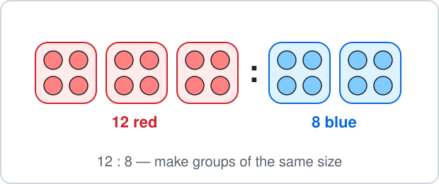

- **A.** $6 : 4$
- **B.** $3 : 2$
- **C.** $2 : 3$
- **D.** $4 : 3$

## 15. Ch 8 Algebra · Solve

Solve $x + 7 = 12$.

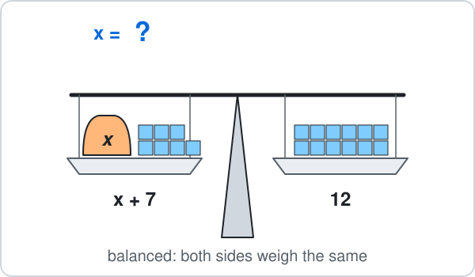

Answer: ______

## 16. Ch 8 Algebra · Substitute

Work out $3x + 2$ when $x = 4$.

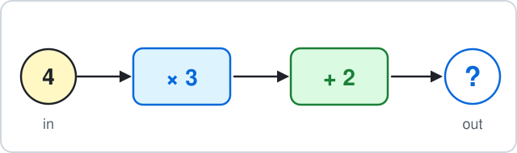

Answer: ______

## 17. Ch 9 Sequences · Matchstick pattern

Pattern 1 uses 4 matchsticks, pattern 2 uses 7 and pattern 3 uses 10.

How many matchsticks does pattern 4 use?

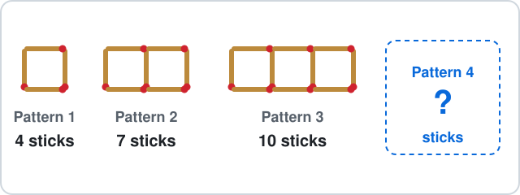

Answer: ______

## 18. Ch 9 Sequences · Term rule

The rule for term number $n$ is $2n + 1$.

Find the 10th term.

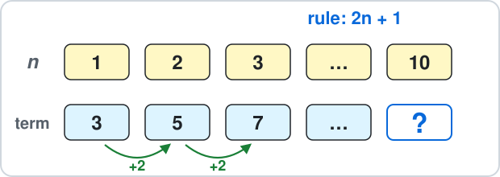

Answer: ______

## 19. Ch 10 Circles · Diameter

A circle has radius 7 cm.

Find its diameter.

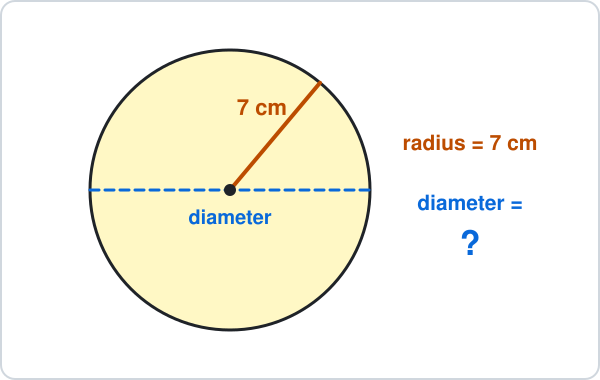

Answer: ______

## 20. Ch 10 Circles · Circumference

A circle has diameter 10 cm.

Use $\pi \approx 3.14$ to find its circumference.

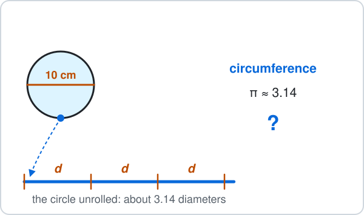

Answer: ______

## 21. Ch 11 Perimeter & Area · Rectangle area

A rectangle is 6 cm long and 4 cm wide.

Find its area.

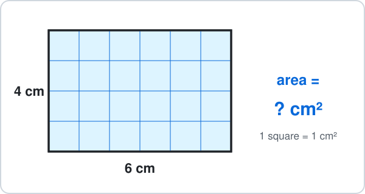

Answer: ______

## 22. Ch 11 Perimeter & Area · Triangle area

A triangle has base 6 cm and height 4 cm.

Find its area.

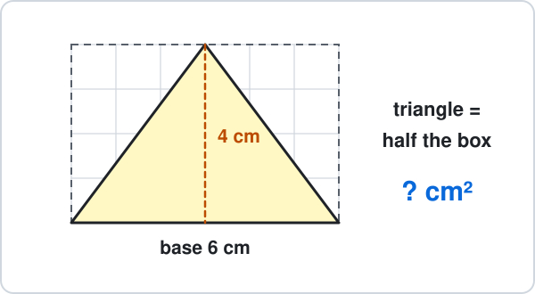

Answer: ______

## 23. Ch 12 Surface Area & Nets · Cube surface area

A cube has edges of 2 cm.

Find its surface area.

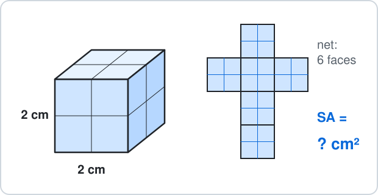

Answer: ______

## 24. Ch 12 Surface Area & Nets · Cuboid volume

A cuboid is 5 cm long, 3 cm wide and 2 cm high.

Find its volume.

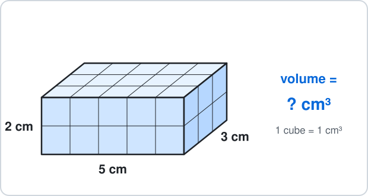

Answer: ______

## 25. Ch 13 Graphs · Coordinates

What are the coordinates of point A?

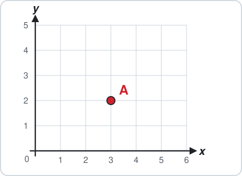

- **A.** $(2, 3)$
- **B.** $(3, 3)$
- **C.** $(3, 2)$
- **D.** $(-3, 2)$

## 26. Ch 13 Graphs · Line value

The line is $y = 2x + 1$.

Find $y$ when $x = 3$.

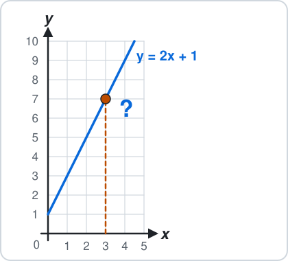

Answer: ______

## 27. Ch 14 Statistics · Mode

Find the mode of $3, 5, 5, 6, 5, 8$.

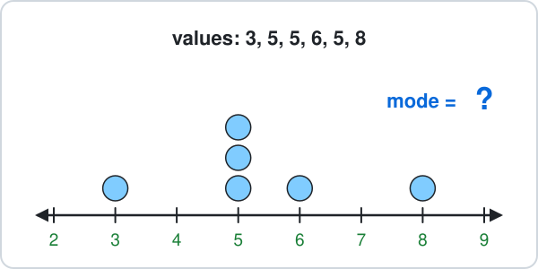

Answer: ______

## 28. Ch 14 Statistics · Mean

Find the mean of $3, 7, 8, 6$.

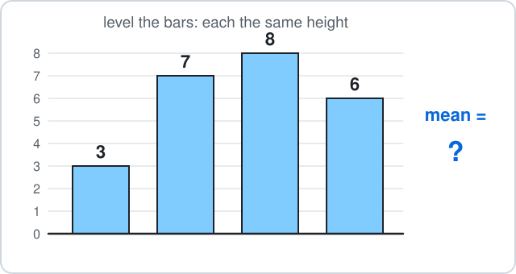

Answer: ______

## 29. Ch 15 Probability · Bag of counters

A bag has 3 red and 5 blue counters.

One counter is taken without looking.

What is the probability that it is red?

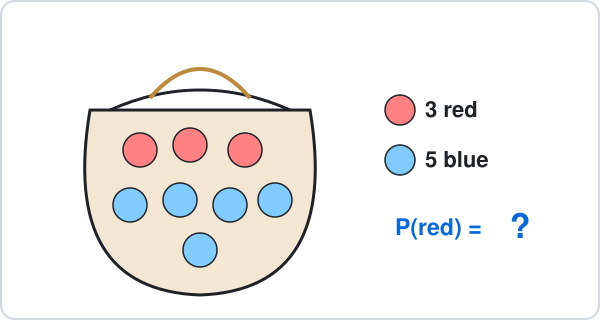

- **A.** $\frac{3}{8}$
- **B.** $\frac{3}{5}$
- **C.** $\frac{5}{8}$
- **D.** $\frac{1}{3}$

## 30. Ch 15 Probability · Not blue

A spinner has 8 equal parts: 3 blue and 5 yellow.

What is the probability that it does **not** land on blue?

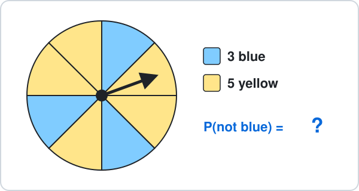

- **A.** $\frac{3}{8}$
- **B.** $\frac{5}{3}$
- **C.** $\frac{5}{8}$
- **D.** $\frac{1}{8}$

## 31. Ch 16 Constructions · Can it be a triangle?

Which three lengths can make a triangle?

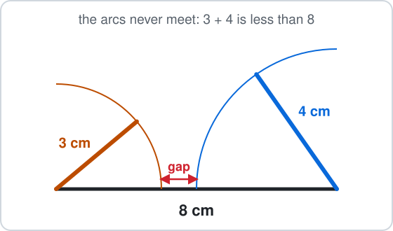

- **A.** 3 cm, 4 cm, 8 cm
- **B.** 2 cm, 3 cm, 6 cm
- **C.** 4 cm, 5 cm, 7 cm
- **D.** 1 cm, 2 cm, 5 cm

## 32. Ch 16 Constructions · Angle bisector

An angle of $70^\circ$ is bisected.

What is each smaller angle?

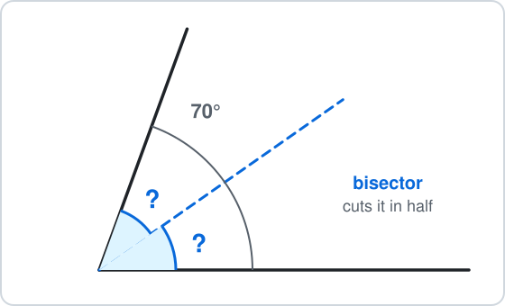

Answer: ______

## 33. Ch 17 Transformations · Reflection

Reflect the point $P(3, 2)$ in the $y$-axis.

Where is its image?

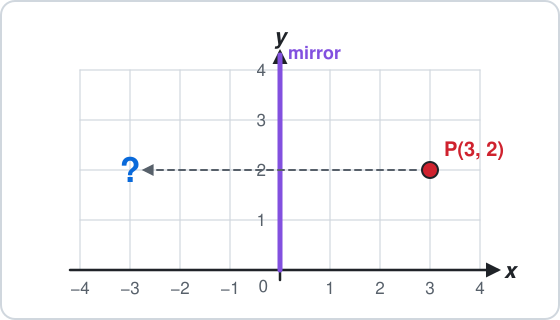

- **A.** $(3, -2)$
- **B.** $(-3, 2)$
- **C.** $(-3, -2)$
- **D.** $(2, 3)$

## 34. Ch 17 Transformations · Translation

Translate the point $(1, 2)$ by $\binom{4}{1}$: 4 right and 1 up.

Where does it go?

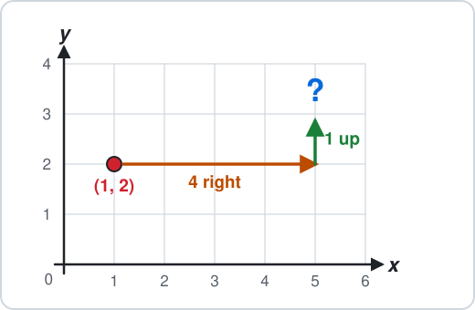

- **A.** $(5, 3)$
- **B.** $(4, 1)$
- **C.** $(5, 1)$
- **D.** $(-3, 1)$

## 35. Ch 18 Real-life Problems · Change

The bill is €6.35.

You pay with a €10 note.

How much change do you get?

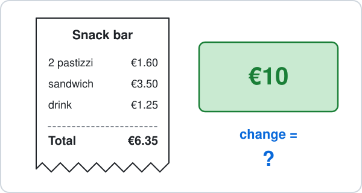

Answer: ______

## 36. Ch 18 Real-life Problems · Journey time

A bus leaves at 09:40 and arrives at 10:15.

How many minutes is the journey?

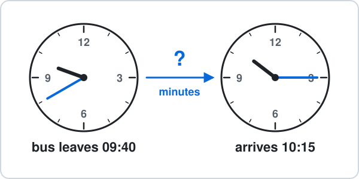

Answer: ______

## 37. Ch 19 Logo · Square turn

Fill the gap: `REPEAT 4 [FD 50 RT ?]` draws a square.

What is the turn?

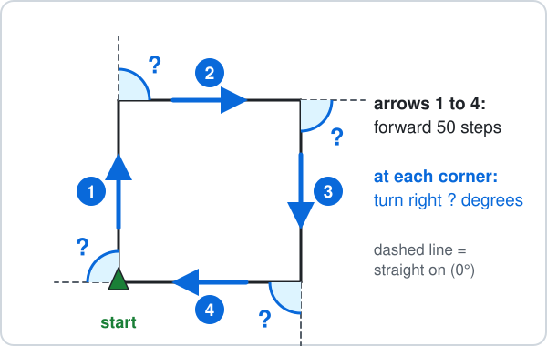

Answer: ______

## 38. Ch 19 Logo · Triangle commands

Which commands draw an equilateral triangle with sides of 60?

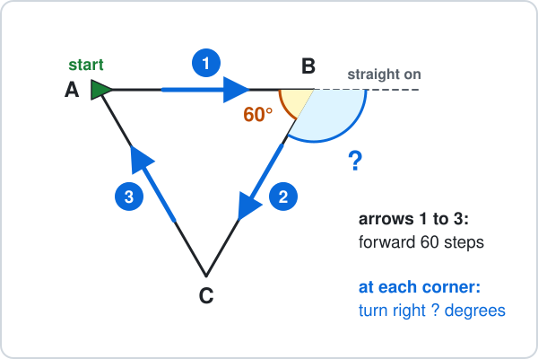

- **A.** `REPEAT 3 [FD 60 RT 60]`
- **B.** `REPEAT 6 [FD 60 RT 60]`
- **C.** `REPEAT 3 [FD 120 RT 60]`
- **D.** `REPEAT 3 [FD 60 RT 120]`

---

<b>Answers</b>

**1. $5$** — Warmer means move **up** the thermometer:

$$
-3 + 8 = \boxed{5}
$$

$-11$ moves 8 the wrong way: warmer is up, not down.

**2. $-9$** — Start at $-4$ and move 5 to the **left**:

$$
-4 - 5 = \boxed{-9}
$$

$1$ adds the 5 instead of taking it away; $-1$ takes 4 from 5 and forgets the start is below zero.

**3. $11$** — BIDMAS: multiply first.

$$
\begin{aligned} 3 + 4\times2 &= 3 + 8 \\ &= \boxed{11} \end{aligned}
$$

$14$ adds first, as if it were $(3 + 4)\times2$.

**4. $36$** — A square number is a square of dots:

$$
\begin{aligned} 6^2 &= 6\times6 \\ &= \boxed{36} \end{aligned}
$$

$12$ is $6\times2$, not $6\times6$.

**5. $50$** — Angles on a straight line add up to $180^\circ$:

$$
180^\circ - 130^\circ = \boxed{50^\circ}
$$

$230^\circ$ uses $360^\circ$, which is for angles around a point.

**6. $45$** — The angles in a triangle add up to $180^\circ$:

$$
180^\circ - 60^\circ - 75^\circ = \boxed{45^\circ}
$$

$225^\circ$ takes them from $360^\circ$; a triangle uses $180^\circ$.

**7. A — Count the slices**

Same size slices, so add the tops:

$$
\frac{3}{8} + \frac{2}{8} = \boxed{\frac{5}{8}}
$$

$\frac{5}{16}$ adds the bottoms too, but the pizza still has 8 slices, not 16.

**8. $15$** — Split 20 into 4 equal groups, then take 3 of them:

$$
20\div4 = 5
$$

$$
5\times3 = \boxed{15}
$$

$5$ is only one quarter; you need three quarters.

**9. €3.80** — Line up the decimal points:

$$
2.50 + 1.30 = \boxed{3.80}
$$

- The answer is €3.80.
- $3.53$ or $2.80$ come from adding digits that are not in the same place.

**10. $3.6$** — Every digit moves one place to the left:

$$
0.36\times10 = \boxed{3.6}
$$

$0.360$ only adds a zero; the value does not change, so it cannot be ten times bigger.

**11. €7** — $10\%$ is one block out of 10:

$$
70\div10 = \boxed{7}
$$

- So $10\%$ of €70 is €7.
- $60$ takes 10 away; a percentage is a part, not a subtraction.

**12. $37$** — - Per cent means out of 100.
- Count: 3 full columns and 7 more.

$$
30 + 7 = 37
$$

$$
\frac{37}{100} = \boxed{37\%}
$$

$63\%$ counts the white squares.

**13. $15$** — There are $1 + 3 = 4$ equal parts:

$$
20\div4 = 5
$$

$$
5\times3 = \boxed{15}
$$

$5$ is the smaller share; $6.67$ splits 20 into 3 parts, but the ratio has 4 parts.

**14. B — Divide both by 4**

The HCF of 12 and 8 is 4:

$$
12\div4 = 3
$$

$$
8\div4 = 2
$$

$$
\boxed{3 : 2}
$$

- $6 : 4$ is the same ratio, but both can still be halved.
- $2 : 3$ swaps the order.

**15. $5$** — Take 7 from both sides, so the scale stays balanced:

$$
x + 7 = 12
$$

$$
x = 12 - 7
$$

$$
x = \boxed{5}
$$

$19$ adds 7 instead of taking it away.

**16. $14$** — Put 4 in place of $x$:

$$
\begin{aligned} 3\times4 + 2 &= 12 + 2 \\ &= \boxed{14} \end{aligned}
$$

$36$ reads $3x$ as 34 — but $3x$ means $3\times x$.

**17. $13$** — Each new square adds 3 sticks:

$$
10 + 3 = \boxed{13}
$$

$16$ counts 4 sticks for the new square, but it shares one side with the square before.

**18. $21$** — Put $n = 10$ into the rule:

$$
\begin{aligned} 2\times10 + 1 &= 20 + 1 \\ &= \boxed{21} \end{aligned}
$$

$12$ reads $2n$ as 2 + n; $2n$ means $2\times n$.

**19. 14 cm** — The diameter goes right across, so it is two radii:

$$
\begin{aligned} d &= 2r \\ &= 2\times7 \\ &= \boxed{14 \text{ cm}} \end{aligned}
$$

$3.5$ halves the radius; the diameter is double, not half.

**20. 31.4 cm** — The circumference is about 3.14 diameters:

$$
\begin{aligned} C &= \pi d \\ &\approx 3.14\times10 \\ &= \boxed{31.4 \text{ cm}} \end{aligned}
$$

$314$ multiplies by 100; $78.5$ is the area $\pi r^2$, not the distance round.

**21. 24 cm²** — Rows of squares:

$$
\begin{aligned} A &= l\times w \\ &= 6\times4 \\ &= \boxed{24 \text{ cm}^2} \end{aligned}
$$

$20$ is the perimeter (the distance round), not the area.

**22. 12 cm²** — A triangle is half of its rectangle:

$$
\begin{aligned} A &= \tfrac{1}{2}bh \\ &= \tfrac{1}{2}\times6\times4 \\ &= \boxed{12 \text{ cm}^2} \end{aligned}
$$

$24$ forgets the half.

**23. 24 cm²** — 6 square faces, each:

$$
\begin{aligned} 2\times2 &= 4 \text{ cm}^2 \\ SA &= 6a^2 \\ &= 6\times4 \\ &= \boxed{24 \text{ cm}^2} \end{aligned}
$$

$8$ is the volume $2\times2\times2$; surface area covers the outside.

**24. 30 cm³** — Count the cubes, layer by layer:

$$
\begin{aligned} V &= lwh \\ &= 5\times3\times2 \\ &= \boxed{30 \text{ cm}^3} \end{aligned}
$$

$10$ adds the edges; volume multiplies them.

**25. C — Across first, then up**

From 0 go 3 across, then 2 up:

$$
\boxed{(3, 2)}
$$

$(2, 3)$ reads up before across.

**26. $7$** — Put $x = 3$ into the rule:

$$
\begin{aligned} y &= 2\times3 + 1 \\ &= 6 + 1 \\ &= \boxed{7} \end{aligned}
$$

$9$ adds before multiplying: multiply first.

**27. $5$** — The mode is the value that appears most often: 5 appears 3 times.

$$
\text{mode} = \boxed{5}
$$

$3$ is how many times 5 appears, not the value itself.

**28. $6$** — Add them, then share equally between the 4 values:

$$
3 + 7 + 8 + 6 = 24
$$

$$
24\div4 = \boxed{6}
$$

$24$ is the total; the mean shares it out.

**29. A — Red out of all**

3 red out of $3 + 5 = 8$ counters:

$$
P(\text{red}) = \boxed{\frac{3}{8}}
$$

$\frac{3}{5}$ compares red with blue; a probability compares with **all** the counters.

**30. C — 1 minus P(blue)**

$$
\begin{aligned} P(\text{not blue}) &= 1 - \frac{3}{8} \\ &= \boxed{\frac{5}{8}} \end{aligned}
$$

- $\frac{3}{8}$ is P(blue) itself.
- $\frac{5}{3}$ is more than 1, and no probability is more than 1.

**31. C — The two short sides must reach**

The two shorter sides together must be longer than the longest:

$$
4 + 5 = 9
$$

$$
9 > 7
$$

- So $\boxed{4 \text{ cm}, 5 \text{ cm}, 7 \text{ cm}}$ works.
- In the others the short sides are too short: $3 + 4 = 7$, $2 + 3 = 5$ and $1 + 2 = 3$, each less than the longest side.

**32. $35$** — Bisect means cut into two equal halves:

$$
70^\circ\div2 = \boxed{35^\circ}
$$

$140^\circ$ doubles instead of halving.

**33. B — Same distance, other side**

The $y$-axis is the mirror: $x$ changes sign, $y$ stays.

$$
(3, 2) \to \boxed{(-3, 2)}
$$

$(3, -2)$ reflects in the $x$-axis instead.

**34. A — Add the moves**

Add 4 to $x$ and 1 to $y$:

$$
(1 + 4,\ 2 + 1) = \boxed{(5, 3)}
$$

$(4, 1)$ is the move itself, not where the point lands.

**35. €3.65** — Change = money paid − cost:

$$
10.00 - 6.35 = \boxed{3.65}
$$

- The change is €3.65.
- $4.75$ subtracts each digit the wrong way round.

**36. 35 minutes** — Count up to the hour, then on:

$$
09{:}40 \to 10{:}00 = 20 \text{ min}
$$

$$
10{:}00 \to 10{:}15 = 15 \text{ min}
$$

$$
20 + 15 = \boxed{35 \text{ min}}
$$

$75$ subtracts 1015 − 940 as ordinary numbers, but an hour has 60 minutes, not 100.

**37. 90°** — The 4 turns go all the way round once:

$$
360^\circ\div4 = \boxed{90^\circ}
$$

$4$ is the number of sides, not the angle; $180^\circ$ would turn back on itself.

**38. D — Turn 360° in 3 turns**

The turtle turns all the way round once in 3 turns:

$$
360^\circ\div3 = \boxed{120^\circ}
$$

`RT 60` uses the inside angle; the turtle turns by the **outside** angle. `REPEAT 6` would draw a hexagon.

- Draw it first: a picture shows which rule to use.
- Check that the answer makes sense in the picture.

