# Malta Year 8 Math Chapter 10 — Circles Practice

**Three levels:**

- Easy: radius and diameter, name a part, one formula
- Medium: circumference from the radius, area from the radius or the diameter, a quarter circle
- Hard: semicircles, a wheel turning, a fence, the most pizza

**Answers:** use $\pi \approx 3.14$ and type the number only (no units).

---

## Easy

### 1. Round mirror

A round mirror has radius 12 cm.

Find its diameter.

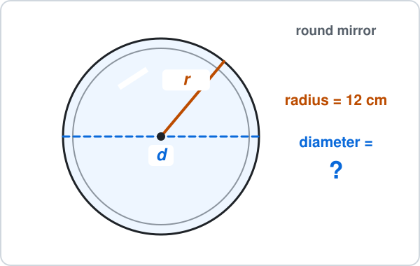

Answer: ______

### 2. Dartboard

A dartboard has diameter 46 cm.

Find its radius.

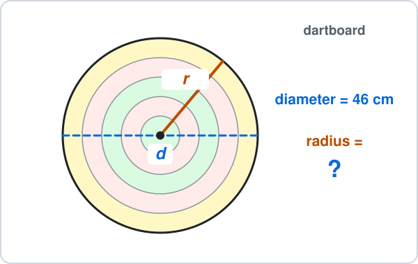

Answer: ______

### 3. Name the part

What is the name of the blue line?

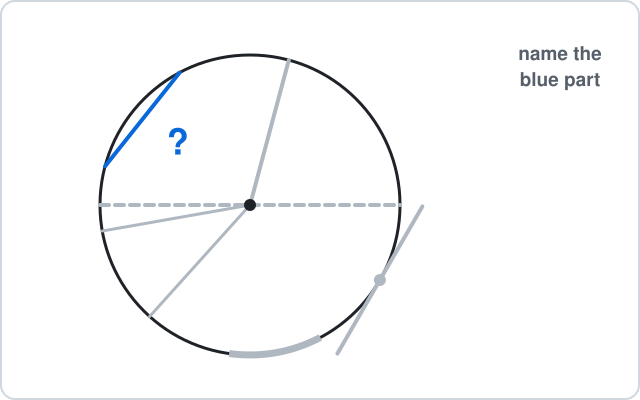

- **A.** Radius
- **B.** Diameter
- **C.** Chord
- **D.** Tangent

### 4. Round biscuit

A round biscuit has diameter 6 cm.

Use $\pi \approx 3.14$.

Find its circumference.

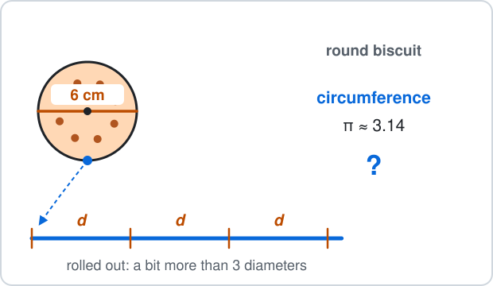

Answer: ______

### 5. Flower bed

A round flower bed has radius 10 m.

Use $\pi \approx 3.14$.

Find its area.

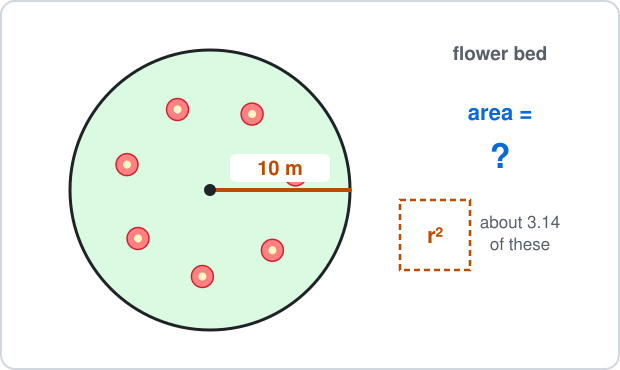

Answer: ______

## Medium

### 6. CD

A CD has radius 6 cm.

Use $\pi \approx 3.14$.

Find its circumference.

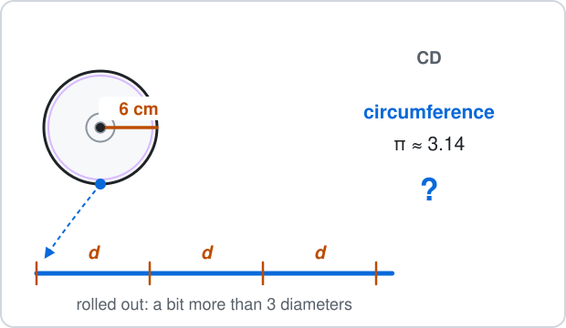

Answer: ______

### 7. Placemat

A round placemat has radius 9 cm.

Use $\pi \approx 3.14$.

Find its area.

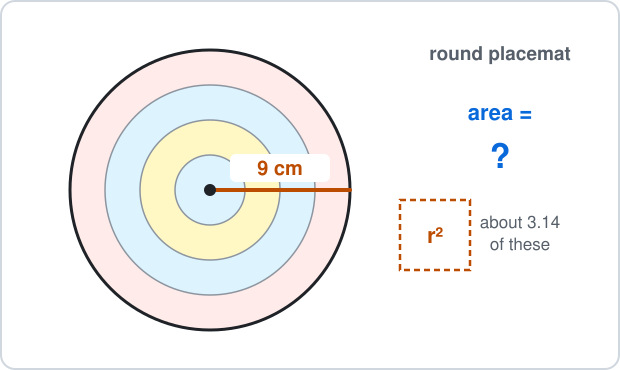

Answer: ______

### 8. Drum

The top of a drum is a circle with diameter 24 cm.

Use $\pi \approx 3.14$.

Find its area.

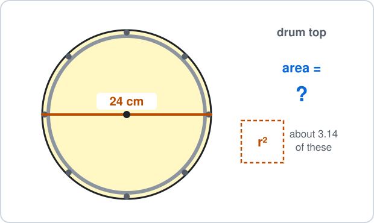

Answer: ______

### 9. Pond

The distance round a round pond is 31.4 m.

Use $\pi \approx 3.14$.

Find its diameter.

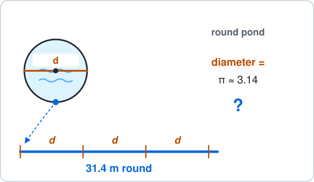

Answer: ______

### 10. Quarter-circle tile

A floor tile is a quarter circle with radius 10 cm.

Use $\pi \approx 3.14$.

Find its area.

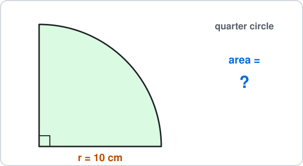

Answer: ______

## Hard

### 11. Semicircle perimeter

A window is a semicircle with diameter 20 cm.

Use $\pi \approx 3.14$.

Find its perimeter (the curved edge plus the straight edge).

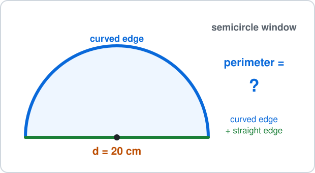

Answer: ______

### 12. Wheelchair wheel

A wheelchair wheel has diameter 0.6 m.

It turns 10 times.

Use $\pi \approx 3.14$.

How far does it go?

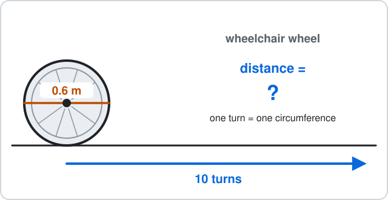

Answer: ______

### 13. Fountain fence

A round fountain has radius 7 m.

A fence goes once round its edge.

Use $\pi \approx 3.14$.

How long is the fence?

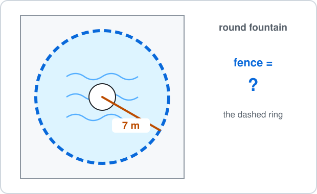

Answer: ______

### 14. Most pizza

Which offer gives the most pizza (the biggest total area)?

Use $\pi \approx 3.14$.

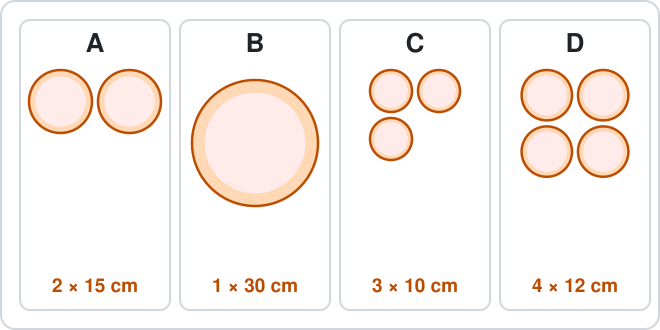

- **A.** 2 pizzas of 15 cm
- **B.** 1 pizza of 30 cm
- **C.** 3 pizzas of 10 cm
- **D.** 4 pizzas of 12 cm

### 15. Semicircle lawn

A lawn is a semicircle with radius 6 m.

Use $\pi \approx 3.14$.

Find its area.

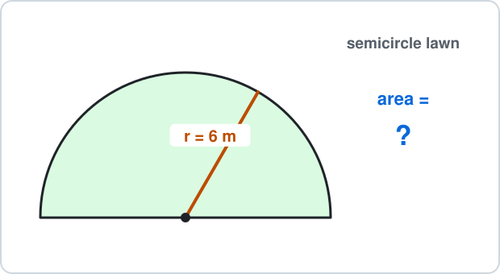

Answer: ______

---

<b>Answers</b>

**1. 24 cm**

$$
\begin{aligned} d &= 2r \\ &= 2\times12 \\ &= \boxed{24} \end{aligned}
$$

$6$ halves the radius; the diameter is **double**.

**2. 23 cm**

$$
\begin{aligned} r &= d\div2 \\ &= 46\div2 \\ &= \boxed{23} \end{aligned}
$$

$92$ doubles; from the diameter, **halve**.

**3. C** — It goes from edge to edge but misses the centre:

$$
\boxed{\text{chord}}
$$

A diameter would go **through** the centre; a radius starts at the centre; a tangent stays outside and touches once.

**4. 18.84 cm**

$$
\begin{aligned} C &= \pi d \\ &= 3.14\times6 \\ &= \boxed{18.84} \end{aligned}
$$

$28.26$ is the area $\pi r^2$, not the distance round.

**5. 314 m²**

$$
\begin{aligned} A &= \pi r^2 \\ &= 3.14\times10\times10 \\ &= 3.14\times100 \\ &= \boxed{314} \end{aligned}
$$

$62.8$ is the circumference $2\pi r$.

**6. 37.68 cm**

$$
\begin{aligned} d &= 2\times6 \\ &= 12 \\ C &= 3.14\times12 \\ &= \boxed{37.68} \end{aligned}
$$

$18.84$ forgets to double the radius.

**7. 254.34 cm²**

$$
\begin{aligned} r^2 &= 9\times9 \\ &= 81 \\ A &= 3.14\times81 \\ &= \boxed{254.34} \end{aligned}
$$

$56.52$ is $3.14\times9\times2$: $r^2$ is $9\times9$, not $9\times2$.

**8. 452.16 cm²**

$$
\begin{aligned} r &= 24\div2 \\ &= 12 \\ r^2 &= 144 \\ A &= 3.14\times144 \\ &= \boxed{452.16} \end{aligned}
$$

$1808.64$ uses the diameter: $24\times24$ is 4 times too big.

**9. 10 m**

$$
\begin{aligned} C &= \pi d \\ 31.4 &= 3.14\times d \\ d &= 31.4\div3.14 \\ &= \boxed{10} \end{aligned}
$$

$98.596$ multiplies by 3.14; to go back from $C$ to $d$, **divide**.

**10. 78.5 cm²**

$$
\begin{aligned} \pi r^2 &= 3.14\times100 \\ &= 314 \\ 314\div4 &= \boxed{78.5} \end{aligned}
$$

$314$ is the whole circle; a quarter circle is $314\div4$.

**11. 51.4 cm**

$$
\begin{aligned} \pi d &= 3.14\times20 \\ &= 62.8 \\ 62.8\div2 &= 31.4 \\ 31.4 + 20 &= \boxed{51.4} \end{aligned}
$$

$31.4$ is only the curved edge; add the straight edge, 20 cm.

**12. 18.84 m**

$$
\begin{aligned} C &= 3.14\times0.6 \\ &= 1.884 \\ 1.884\times10 &= \boxed{18.84} \end{aligned}
$$

$1.884$ is one turn only; 10 turns go 10 circumferences.

**13. 43.96 m**

$$
\begin{aligned} d &= 2\times7 \\ &= 14 \\ C &= 3.14\times14 \\ &= \boxed{43.96} \end{aligned}
$$

$153.86$ is the area of the water; a fence goes **round**.

**14. B** — Area of one pizza: radius = half the diameter, then $3.14\times r^2$.

- A: $2\times3.14\times7.5^2 = 353.25$
- B: $1\times3.14\times15^2 = 706.5$
- C: $3\times3.14\times5^2 = 235.5$
- D: $4\times3.14\times6^2 = 452.16$

$$
\boxed{\text{B: one pizza of 30 cm}}
$$

Doubling the diameter makes the area **4 times** as big, so one 30 cm pizza beats two 15 cm pizzas.

**15. 56.52 m²**

$$
\begin{aligned} \pi r^2 &= 3.14\times36 \\ &= 113.04 \\ 113.04\div2 &= \boxed{56.52} \end{aligned}
$$

$113.04$ is the whole circle; a semicircle is half.

- $d = 2r$ and $r = d\div2$.
- Distance round: $C = \pi d$.
- Space inside: $A = \pi r^2$, with the **radius**.
- A semicircle's perimeter adds the straight edge.

