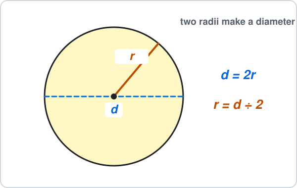
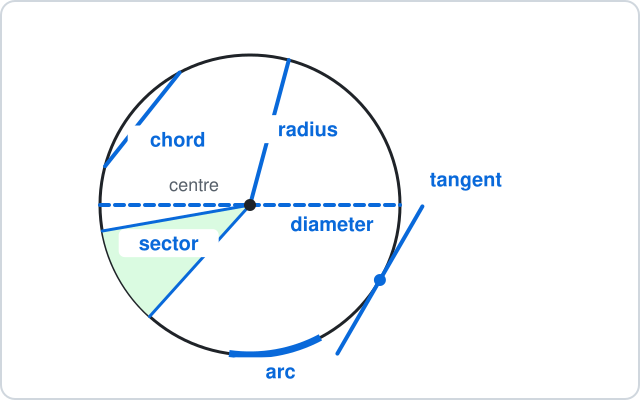
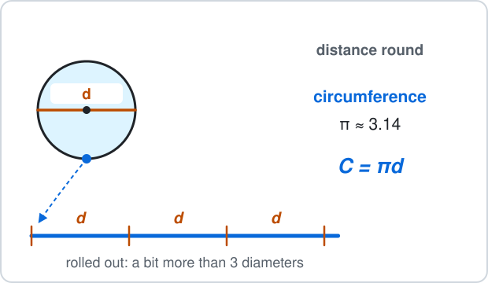
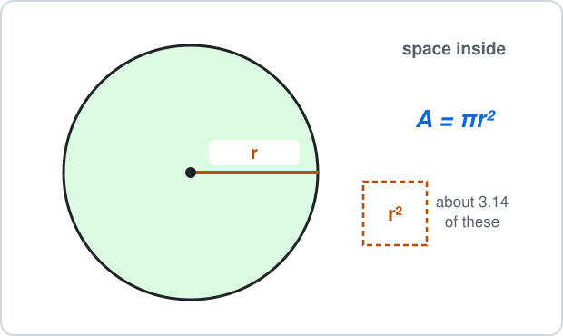
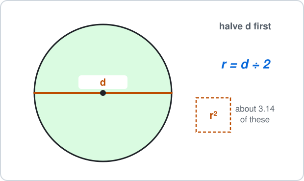
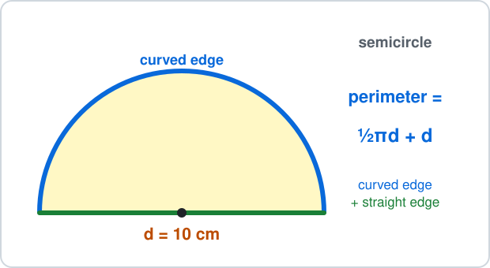
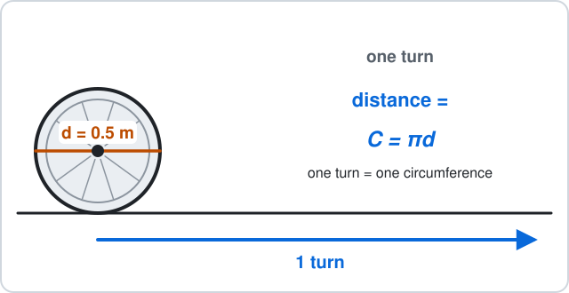

# Malta Year 8 Math Chapter 10 — Circles

- Chapter 10 works with circles.
- Use $\pi \approx 3.14$.

**Chapter 10 has four parts:**

- 10.1 Parts of a circle
- 10.2 Circumference
- 10.3 Area
- 10.4 Semicircles and real life

**By the end of the chapter:**

- name the radius, diameter, chord, arc, sector and tangent
- find the circumference from the diameter or the radius
- find the area from the radius or the diameter
- work with half and quarter circles, and pick the right formula in a real problem

## 10.1 Parts of a Circle

### 1. Radius and diameter

- The **radius** $r$ goes from the centre to the edge.
- The **diameter** $d$ goes right across, through the centre: two radii.

$$
\begin{aligned} d &= 2r \\ r &= d\div2 \end{aligned}
$$

**Examples:**

- **a)** radius 4 cm: find the diameter

- **b)** radius 9 m: find the diameter

- **c)** diameter 18 cm: find the radius

- **d)** diameter 50 cm: find the radius

<b>Working</b>

**a)**

$$
\begin{aligned} d &= 2\times4 \\ &= \boxed{8 \text{ cm}} \end{aligned}
$$

**b)**

$$
\begin{aligned} d &= 2\times9 \\ &= \boxed{18 \text{ m}} \end{aligned}
$$

**c)**

$$
\begin{aligned} r &= 18\div2 \\ &= \boxed{9 \text{ cm}} \end{aligned}
$$

**d)**

$$
\begin{aligned} r &= 50\div2 \\ &= \boxed{25 \text{ cm}} \end{aligned}
$$

Not $100$: from the diameter, **halve**; from the radius, double.

### 2. Name the part

The parts of a circle:

- **centre**: the middle point
- **circumference**: the distance all the way round
- **chord**: a straight line from edge to edge that does **not** go through the centre
- **arc**: a piece of the curved edge
- **sector**: a slice, like a pizza slice (two radii and an arc)
- **tangent**: a straight line outside that touches the circle at **one** point

**Examples:**

- **a)** a straight line across the circle that misses the centre

- **b)** the shape of one pizza slice

- **c)** a straight line that just touches the circle once

- **d)** a piece of the curved edge

<b>Working</b>

**a)** Edge to edge, not through the centre:

$$
\boxed{\text{chord}}
$$

**b)** Two radii and an arc:

$$
\boxed{\text{sector}}
$$

**c)** Touches at one point:

$$
\boxed{\text{tangent}}
$$

**d)** Part of the circumference:

$$
\boxed{\text{arc}}
$$

Not a diameter for a): a diameter goes **through** the centre.

## 10.2 Circumference

### 3. Circumference from the diameter

- Roll a circle out flat: it is a bit more than 3 diameters long.
- That number is $\pi \approx 3.14$.

$$
C = \pi d
$$

**Examples:**

- **a)** diameter 10 cm

- **b)** diameter 5 cm

- **c)** diameter 8 m

- **d)** diameter 100 cm

<b>Working</b>

**a)**

$$
\begin{aligned} C &= 3.14\times10 \\ &= \boxed{31.4 \text{ cm}} \end{aligned}
$$

**b)**

$$
\begin{aligned} C &= 3.14\times5 \\ &= \boxed{15.7 \text{ cm}} \end{aligned}
$$

**c)**

$$
\begin{aligned} C &= 3.14\times8 \\ &= \boxed{25.12 \text{ m}} \end{aligned}
$$

**d)**

$$
\begin{aligned} C &= 3.14\times100 \\ &= \boxed{314 \text{ cm}} \end{aligned}
$$

Times 10 or times 100: move the digits of $3.14$ one or two places.

### 4. Circumference from the radius

Double the radius first to get the diameter, then times $3.14$.

$$
C = 2\pi r
$$

**Examples:**

- **a)** radius 5 cm

- **b)** radius 3 cm

- **c)** radius 10 m

- **d)** radius 1 m

<b>Working</b>

**a)**

$$
\begin{aligned} d &= 10 \\ C &= 3.14\times10 \\ &= \boxed{31.4 \text{ cm}} \end{aligned}
$$

**b)**

$$
\begin{aligned} d &= 6 \\ C &= 3.14\times6 \\ &= \boxed{18.84 \text{ cm}} \end{aligned}
$$

**c)**

$$
\begin{aligned} d &= 20 \\ C &= 3.14\times20 \\ &= \boxed{62.8 \text{ m}} \end{aligned}
$$

**d)**

$$
\begin{aligned} d &= 2 \\ C &= 3.14\times2 \\ &= \boxed{6.28 \text{ m}} \end{aligned}
$$

Not $3.14\times5 = 15.7$ for a): that forgets to double the radius.

## 10.3 Area

### 5. Area from the radius

- $r^2$ means $r\times r$.
- The area is about 3.14 squares of side $r$.

$$
A = \pi r^2
$$

**Examples:**

- **a)** radius 10 cm

- **b)** radius 5 cm

- **c)** radius 4 m

- **d)** radius 3 cm

<b>Working</b>

**a)**

$$
\begin{aligned} r^2 &= 10\times10 \\ &= 100 \\ A &= 3.14\times100 \\ &= \boxed{314 \text{ cm}^2} \end{aligned}
$$

**b)**

$$
\begin{aligned} r^2 &= 5\times5 \\ &= 25 \\ A &= 3.14\times25 \\ &= \boxed{78.5 \text{ cm}^2} \end{aligned}
$$

**c)**

$$
\begin{aligned} r^2 &= 4\times4 \\ &= 16 \\ A &= 3.14\times16 \\ &= \boxed{50.24 \text{ m}^2} \end{aligned}
$$

**d)**

$$
\begin{aligned} r^2 &= 3\times3 \\ &= 9 \\ A &= 3.14\times9 \\ &= \boxed{28.26 \text{ cm}^2} \end{aligned}
$$

Not $3.14\times3\times2$ for d): $r^2$ is $r\times r$, not $r\times2$.

### 6. Area from the diameter: halve first

- The area formula uses the **radius**.
- Given the diameter, halve it, then use $A = \pi r^2$.

**Examples:**

- **a)** diameter 10 cm

- **b)** diameter 6 cm

- **c)** diameter 20 m

- **d)** diameter 8 cm

<b>Working</b>

**a)**

$$
\begin{aligned} r &= 5 \\ A &= 3.14\times25 \\ &= \boxed{78.5 \text{ cm}^2} \end{aligned}
$$

**b)**

$$
\begin{aligned} r &= 3 \\ A &= 3.14\times9 \\ &= \boxed{28.26 \text{ cm}^2} \end{aligned}
$$

**c)**

$$
\begin{aligned} r &= 10 \\ A &= 3.14\times100 \\ &= \boxed{314 \text{ m}^2} \end{aligned}
$$

**d)**

$$
\begin{aligned} r &= 4 \\ A &= 3.14\times16 \\ &= \boxed{50.24 \text{ cm}^2} \end{aligned}
$$

Not $3.14\times10\times10 = 314$ for a): that uses the diameter, so it is 4 times too big.

## 10.4 Semicircles and Real Life

### 7. Semicircles and quarter circles

A **semicircle** is half a circle; a **quarter circle** is a quarter.

- area: half (or a quarter) of $\pi r^2$
- perimeter of a semicircle: half of $\pi d$, **plus** the straight edge $d$

**Examples:**

- **a)** semicircle, radius 10 cm: area

- **b)** semicircle, diameter 10 cm: perimeter

- **c)** quarter circle, radius 2 m: area

- **d)** semicircle, radius 4 cm: area

<b>Working</b>

**a)**

$$
\begin{aligned} \pi r^2 &= 3.14\times100 \\ &= 314 \\ 314\div2 &= \boxed{157 \text{ cm}^2} \end{aligned}
$$

**b)**

$$
\begin{aligned} \pi d &= 31.4 \\ 31.4\div2 &= 15.7 \\ 15.7 + 10 &= \boxed{25.7 \text{ cm}} \end{aligned}
$$

**c)**

$$
\begin{aligned} \pi r^2 &= 3.14\times4 \\ &= 12.56 \\ 12.56\div4 &= \boxed{3.14 \text{ m}^2} \end{aligned}
$$

**d)**

$$
\begin{aligned} \pi r^2 &= 3.14\times16 \\ &= 50.24 \\ 50.24\div2 &= \boxed{25.12 \text{ cm}^2} \end{aligned}
$$

Not $15.7$ for b): the straight edge is part of the perimeter too.

### 8. Round or cover? Pick the formula

**Distance round** (a fence, a ribbon, a wheel turning once): circumference $C = \pi d$.

**Space inside** (cloth, paint, grass, pizza): area $A = \pi r^2$.

**Examples:**

- **a)** a wheel of diameter 0.5 m turns once: how far does it go?

- **b)** a fence round a round fountain of radius 3 m

- **c)** a round tablecloth of radius 1 m: how much cloth?

- **d)** a pizza of diameter 30 cm: how much pizza?

<b>Working</b>

**a)** Distance round:

$$
\begin{aligned} C &= 3.14\times0.5 \\ &= \boxed{1.57 \text{ m}} \end{aligned}
$$

**b)** Distance round,:

$$
\begin{aligned} d &= 6 \\ C &= 3.14\times6 \\ &= \boxed{18.84 \text{ m}} \end{aligned}
$$

**c)** Cover:

$$
\begin{aligned} A &= 3.14\times1\times1 \\ &= \boxed{3.14 \text{ m}^2} \end{aligned}
$$

**d)** Cover,:

$$
\begin{aligned} r &= 15 \\ A &= 3.14\times225 \\ &= \boxed{706.5 \text{ cm}^2} \end{aligned}
$$

Units: a distance is in cm or m; an area is in $\text{cm}^2$ or $\text{m}^2$.

