# Malta Year 8 Math Chapter 13 — Graphs Practice

**Three levels:**

- Easy: read a point, name a line, one table value
- Medium: a table with a minus, read a line both ways, is a point on the line, a distance on the grid
- Hard: a conversion graph and distance–time graphs

**Answers:** type the number only (no units), use the ± button for a minus, or pick A–D.

---

## Easy

### 1. Buoy

A buoy is at point K on a map of a bay.

What are the coordinates of K?

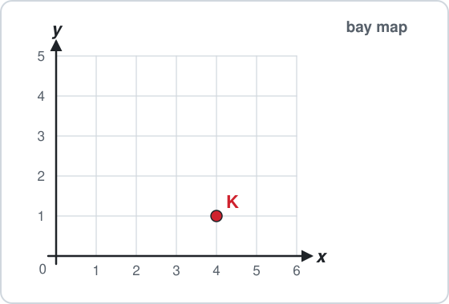

- **A.** $(1, 4)$
- **B.** $(4, 1)$
- **C.** $(4, 0)$
- **D.** $(5, 1)$

### 2. Drone

A drone is at point Q.

What are the coordinates of Q?

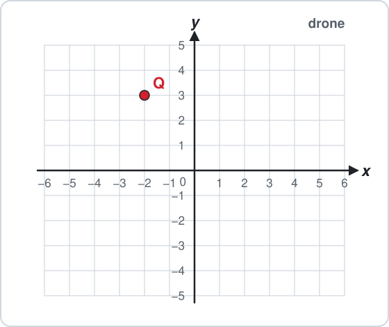

- **A.** $(2, 3)$
- **B.** $(3, -2)$
- **C.** $(-2, 3)$
- **D.** $(2, -3)$

### 3. Name the line

What is the equation of the blue line?

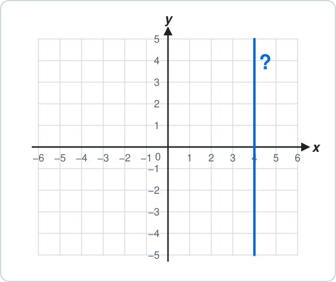

- **A.** $x = 4$
- **B.** $y = 4$
- **C.** $x = -4$
- **D.** $y = 4x$

### 4. On the line y = 4

Which point lies on the line $y = 4$?

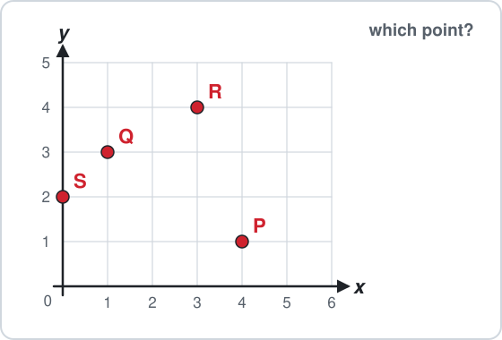

- **A.** P
- **B.** Q
- **C.** R
- **D.** S

### 5. Table value

Fill in the table for $y = 5x + 1$: find $y$ when $x = 2$.

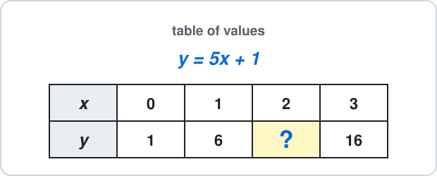

Answer: ______

## Medium

### 6. Table with a minus

Fill in the table for $y = 4x - 3$: find $y$ when $x = 0$.

Use the ± button for a minus.

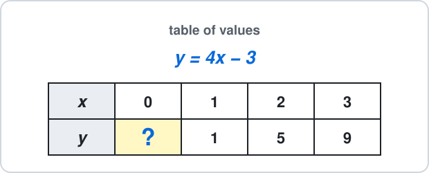

Answer: ______

### 7. y from the graph

Use the graph.

Find $y$ when $x = 4$.

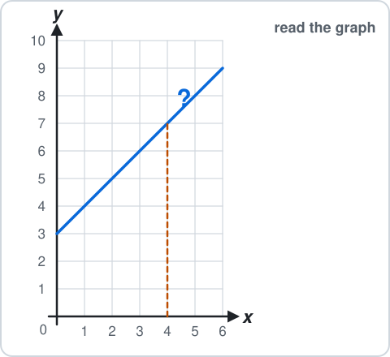

Answer: ______

### 8. x from the graph

Use the graph.

Find $x$ when $y = 6$.

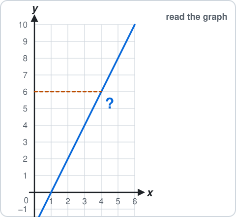

Answer: ______

### 9. Point on y = 3x − 1

Which point lies on the line $y = 3x - 1$?

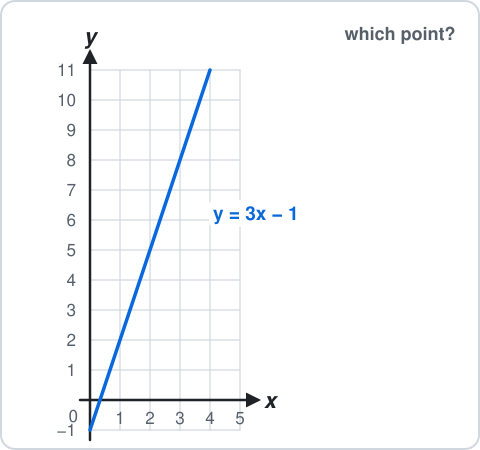

- **A.** $(1, 3)$
- **B.** $(3, 9)$
- **C.** $(0, 1)$
- **D.** $(2, 5)$

### 10. Distance on the grid

A is $(-3, 2)$ and B is $(4, 2)$.

How many units apart are they?

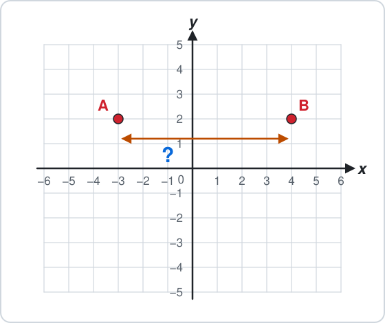

Answer: ______

## Hard

### 11. Miles to km

Use the conversion graph.

Change 30 miles into kilometres.

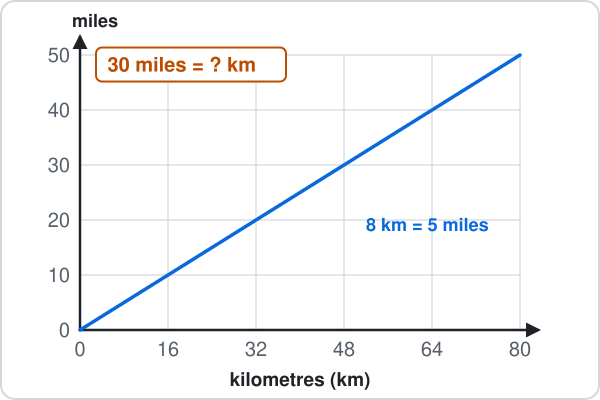

Answer: ______

### 12. Island tour in miles

A bus tour round the island is 64 km.

Use the conversion graph to change it into miles.

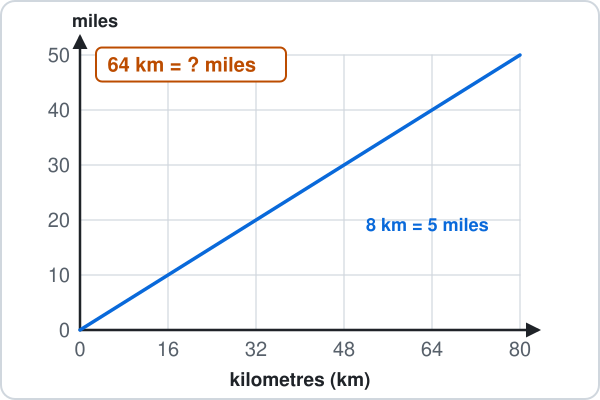

Answer: ______

### 13. Bike ride

The graph shows a bike ride.

How far had the rider gone after 50 minutes? (The thin lines are every 2 km.)

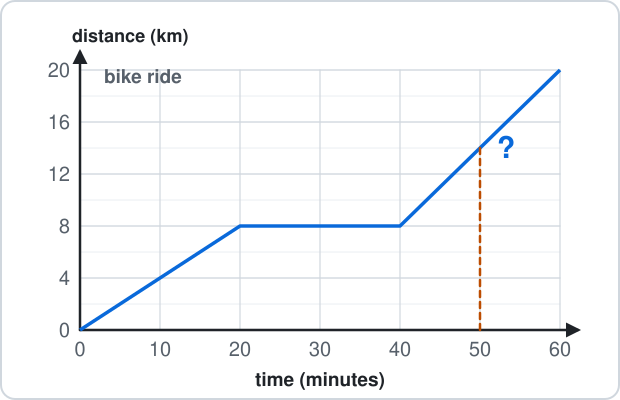

Answer: ______

### 14. Bus stop

The graph shows a bus going to the ferry.

For how many minutes does the bus stop?

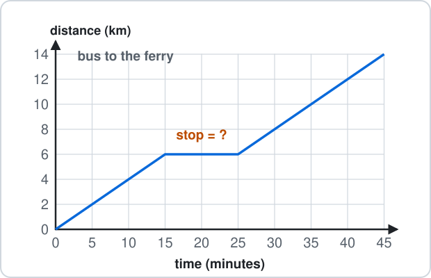

Answer: ______

### 15. Boat trip

A tour boat leaves the harbour and comes back.

The graph shows its distance from the harbour.

How far does the boat travel in total?

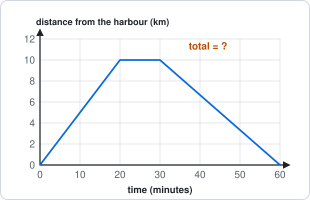

Answer: ______

---

<b>Answers</b>

**1. B** — 4 across, then 1 up:

$$
\boxed{(4, 1)}
$$

$(1, 4)$ goes up before across.

**2. C** — 2 **left** (negative), then 3 up:

$$
\boxed{(-2, 3)}
$$

$(2, 3)$ forgets that left of 0 is negative.

**3. A** — The line stands up and every point on it has:

$$
\begin{aligned} x &= 4 \\ & \boxed{x = 4} \end{aligned}
$$

$y = 4$ would be a flat line, 4 up.

**4. C** — - On $y = 4$ the point is 4 **up**.
- R is $(3, 4)$:

$$
\boxed{\text{R}}
$$

P is $(4, 1)$: its $x$ is 4, not its $y$.

**5. $11$**

$$
\begin{aligned} y &= 5\times2 + 1 \\ &= 10 + 1 \\ &= \boxed{11} \end{aligned}
$$

$15$ adds before multiplying ($5\times3$): times first.

**6. $-3$**

$$
\begin{aligned} y &= 4\times0 - 3 \\ &= 0 - 3 \\ &= \boxed{-3} \end{aligned}
$$

$1$ reads $4\times0$ as 4; anything times 0 is 0.

**7. $7$**

$$
\text{up from } 4 \text{ to the line, across: } y = \boxed{7}
$$

Check: the line goes through $(0, 3)$ and up 1 each step: $3 + 4 = 7$.

**8. $4$**

$$
\text{across from } 6 \text{ to the line, down: } x = \boxed{4}
$$

$6$ reads the $y$ again; go **down** to the $x$-axis.

**9. D** — Put each $x$ in: $3\times2 - 1 = 5$.

$$
\boxed{(2, 5)}
$$

- $(3, 9)$: $3\times3 - 1 = 8$, not 9.
- $(0, 1)$: $3\times0 - 1 = -1$, not 1.

**10. 7 units**

$$
\begin{aligned} & \text{same } y\text{: count across } \\ 4 - (-3) &= 4 + 3 \\ &= \boxed{7} \end{aligned}
$$

$1$ is $4 - 3$: the 3 is **minus** 3, and taking away a minus adds.

**11. 48 km**

$$
\text{across from } 30 \text{ miles, down: } \boxed{48} \text{ km}
$$

- Check: $30 = 6\times5$, so $6\times8 = 48$ km.
- $19$ changes the wrong way (km to miles).

**12. 40 miles**

$$
\text{up from } 64 \text{ km, across: } \boxed{40} \text{ miles}
$$

- Check: $64 = 8\times8$, so $8\times5 = 40$ miles.
- $102.4$ changes the wrong way.

**13. 14 km**

$$
\text{up from } 50 \text{ to the line, across: } \boxed{14} \text{ km}
$$

Check: from 40 to 60 minutes the rider goes 12 km; 50 is halfway, so $8 + 6 = 14$.

**14. 10 minutes**

$$
\text{flat from } 15 \text{ to } 25 \text{: } 25 - 15 = \boxed{10} \text{ minutes}
$$

$6$ is the distance where it stops, not the time: read the time axis.

**15. 20 km**

$$
\text{out } 10 \text{ km, back } 10 \text{ km: } 10 + 10 = \boxed{20} \text{ km}
$$

$10$ is only the trip out; the line coming down is the trip back.

- $(x, y)$: across first, then up.
- $x = a$ stands up; $y = b$ lies flat.
- Read a graph: up from one axis to the line, then across.
- Distance–time: a flat part means stopped.

