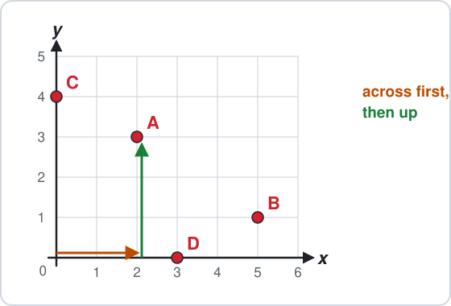
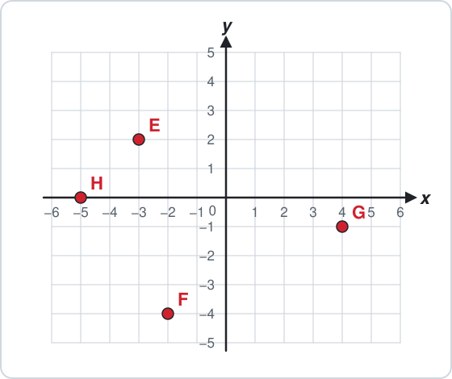
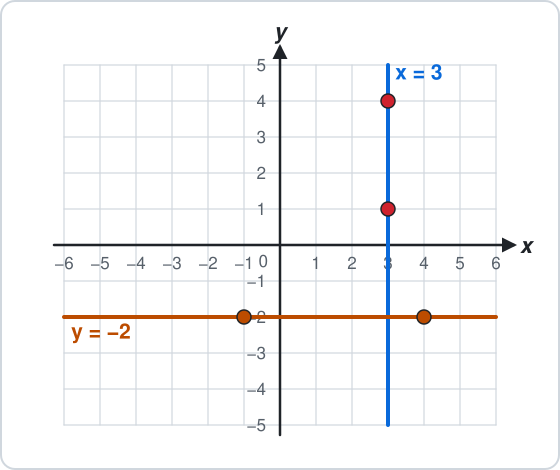
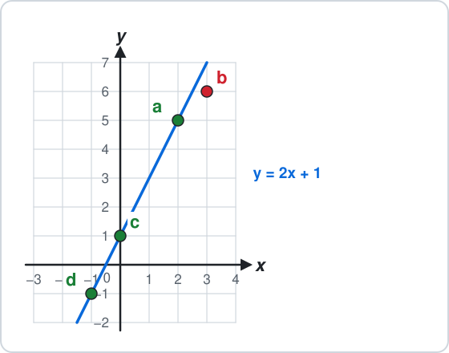
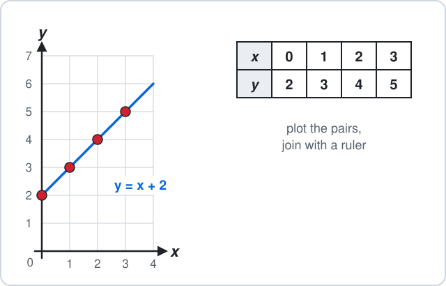
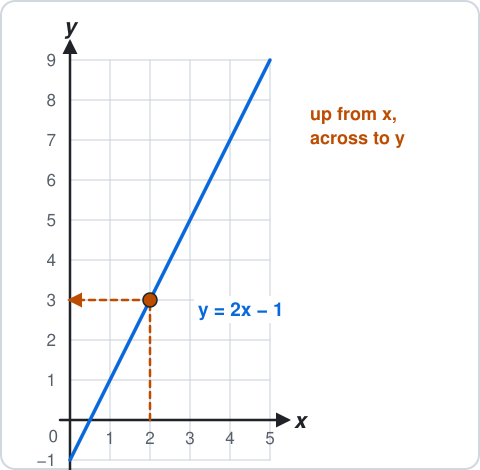
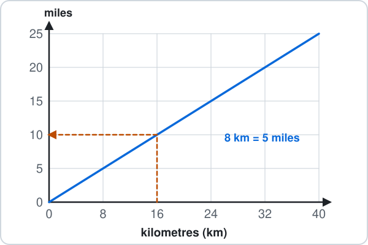
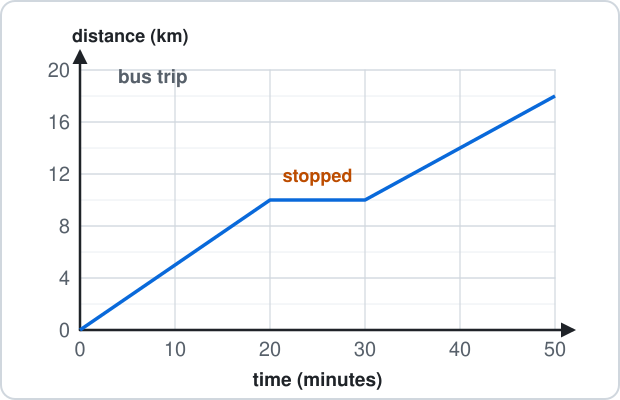

# Malta Year 8 Math Chapter 13 — Graphs

Chapter 13 works with coordinates and graphs.

**Chapter 13 has four parts:**

- 13.1 Coordinates
- 13.2 Horizontal and vertical lines
- 13.3 Straight-line graphs
- 13.4 Real-life graphs

**By the end of the chapter:**

- read and plot points in all four quarters
- name a line $x = a$ or $y = b$
- make a table of values and draw the line
- read a conversion graph and a distance–time graph

## 13.1 Coordinates

### 1. Read a point: across, then up

- A point is written $(x, y)$.
- Start at 0.
- Go **across** $x$, then **up** $y$.

**Examples:**

- **a)** point A

- **b)** point B

- **c)** point C

- **d)** point D

<b>Working</b>

**a)** 2 across, 3 up:

$$
\boxed{(2, 3)}
$$

**b)** 5 across, 1 up:

$$
\boxed{(5, 1)}
$$

**c)** 0 across, 4 up:

$$
\boxed{(0, 4)}
$$

**d)** 3 across, 0 up:

$$
\boxed{(3, 0)}
$$

Not $(3, 2)$ for A: across comes first.

### 2. Four quarters: negative coordinates

- Left of 0, $x$ is **negative**.
- Below 0, $y$ is **negative**.

**Examples:**

- **a)** point E

- **b)** point F

- **c)** point G

- **d)** point H

<b>Working</b>

**a)** 3 left, 2 up:

$$
\boxed{(-3, 2)}
$$

**b)** 2 left, 4 down:

$$
\boxed{(-2, -4)}
$$

**c)** 4 right, 1 down:

$$
\boxed{(4, -1)}
$$

**d)** 5 left, 0 up:

$$
\boxed{(-5, 0)}
$$

Not $(2, -3)$ for E: still across first, then up or down.

## 13.2 Horizontal and Vertical Lines

### 3. Vertical x = …, horizontal y = …

- On a **vertical** line every point has the same $x$: the line is $x = \ldots$.
- On a **horizontal** line every point has the same $y$: the line is $y = \ldots$.

**Examples:**

- **a)** the line through $(3, 1)$ and $(3, 4)$

- **b)** the line through $(-1, -2)$ and $(4, -2)$

- **c)** the $y$-axis

- **d)** the line through $(-4, 5)$ and $(2, 5)$

<b>Working</b>

**a)** $x$ is 3 both times:

$$
\boxed{x = 3}
$$

**b)** $y$ is $-2$ both times:

$$
\boxed{y = -2}
$$

**c)** every point on it has:

$$
\begin{aligned} x &= 0 \\ & \boxed{x = 0} \end{aligned}
$$

**d)** $y$ is 5 both times:

$$
\boxed{y = 5}
$$

Not $y = 3$ for a): the 3 is the $x$ that stays the same, so $x = 3$ (and the line stands up).

### 4. Is the point on the line?

- Put the $x$ of the point into the rule.
- If you get its $y$, the point is **on** the line.

**Examples:**

- **a)** $(2, 5)$ and $y = 2x + 1$

- **b)** $(3, 6)$ and $y = 2x + 1$

- **c)** $(0, 1)$ and $y = 2x + 1$

- **d)** $(-1, -1)$ and $y = 2x + 1$

<b>Working</b>

**a)**

$$
2\times2 + 1 = 5
$$ It gives 5: $\boxed{\text{on the line}}$

**b)**

$$
2\times3 + 1 = 7
$$ 7, not 6: $\boxed{\text{not on the line}}$

**c)**

$$
2\times0 + 1 = 1
$$ $\boxed{\text{on the line}}$

**d)**

$$
2\times(-1) + 1 = -1
$$ $\boxed{\text{on the line}}$

Times first, then add.

## 13.3 Straight-Line Graphs

### 5. Table of values, then plot

Pick some $x$ values, work out each $y$ with the rule, then plot the pairs $(x, y)$ and join them: a straight line.

**Examples:**

- **a)** $y = x + 2$ at $x = 0$

- **b)** $y = x + 2$ at $x = 1$

- **c)** $y = x + 2$ at $x = 2$

- **d)** $y = x + 2$ at $x = 3$

<b>Working</b>

**a)**

$$
\begin{aligned} y &= 0 + 2 \\ &= \boxed{2} \end{aligned}
$$ plot $(0, 2)$

**b)**

$$
\begin{aligned} y &= 1 + 2 \\ &= \boxed{3} \end{aligned}
$$ plot $(1, 3)$

**c)**

$$
\begin{aligned} y &= 2 + 2 \\ &= \boxed{4} \end{aligned}
$$ plot $(2, 4)$

**d)**

$$
\begin{aligned} y &= 3 + 2 \\ &= \boxed{5} \end{aligned}
$$ plot $(3, 5)$

If one point is off the straight line, check that $y$ again.

### 6. Read the line: y from x, x from y

- To find $y$: go **up** from $x$ to the line, then **across** to the $y$-axis.
- To find $x$: go across from $y$ to the line, then down.

**Examples:**

- **a)** $y$ when $x = 2$

- **b)** $y$ when $x = 4$

- **c)** $x$ when $y = 5$

- **d)** $x$ when $y = 1$

<b>Working</b>

**a)** up from 2, across:

$$
y = \boxed{3}
$$ Check: $2\times2 - 1 = 3$

**b)** up from 4, across:

$$
y = \boxed{7}
$$ Check: $2\times4 - 1 = 7$

**c)** across from 5, down:

$$
x = \boxed{3}
$$ Check: $2\times3 - 1 = 5$

**d)** across from 1, down:

$$
x = \boxed{1}
$$ Check: $2\times1 - 1 = 1$

## 13.4 Real-Life Graphs

### 7. Conversion graph

- A straight line through 0 changes one unit into another.
- Go up from one axis to the line, then across.

**Examples:**

- **a)** 16 km in miles

- **b)** 32 km in miles

- **c)** 15 miles in km

- **d)** 5 miles in km

<b>Working</b>

**a)** up from 16, across:

$$
\boxed{10 \text{ miles}}
$$

**b)** up from 32, across:

$$
\boxed{20 \text{ miles}}
$$

**c)** across from 15, down:

$$
\boxed{24 \text{ km}}
$$

**d)** across from 5, down:

$$
\boxed{8 \text{ km}}
$$

Check with $8 \text{ km} = 5 \text{ miles}$: 16 km is twice 8, so twice 5.

### 8. Distance–time graph

- Time goes across, distance goes up.
- A **flat** part means the bus is **stopped**: time passes, the distance stays.

**Examples:**

- **a)** how far after 20 minutes?

- **b)** how long is the stop?

- **c)** how far is the whole trip?

- **d)** how long does the whole trip take?

<b>Working</b>

**a)** up from 20, across:

$$
\boxed{10 \text{ km}}
$$

**b)** flat from 20 to 30:

$$
30 - 20 = \boxed{10 \text{ minutes}}
$$

**c)** the top of the graph:

$$
\boxed{18 \text{ km}}
$$

**d)** the end of the graph:

$$
\boxed{50 \text{ minutes}}
$$

Not 30 km for c): the flat part adds no distance.

