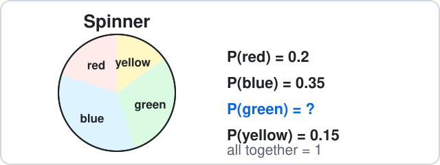

# Malta Year 8 Math Chapter 15 — Probability

- Six ideas, each with four worked examples.
- Each card builds on the one before.
- By the end you can work out a probability, find the chance that something does not happen, add for one or the other, use real results, and list every pair for two things at once.

## 15.1 How likely is it? Words and numbers

### 1. How likely is it? Words and numbers

- A probability tells you how likely something is to happen.
- It is always a number from 0 to 1.
- 0 means it can never happen (impossible). 1 means it will surely happen (certain).
- ½ means half and half (even chance). Below ½ is unlikely, above ½ is likely.
- You can write the same probability as a fraction, a decimal or a percentage.

**Examples:**

**a)** You roll a normal dice with the numbers 1 to 6.

Which word best describes your chance of getting a number less than 7?

---

**b)** A bag has 3 red counters and 7 blue counters.

You take out one counter without looking.

Which word best describes your chance of getting a red one?

---

**c)** The probability that something happens is $\dfrac{3}{4}$.

Write this probability as a decimal.

---

**d)** The probability that something happens is $\dfrac{3}{5}$.

Write this probability as a percentage.

Type the number only.

The probability that something happens is $\dfrac{11}{20}$.

Write it as a percentage.

| Question | Answer |
|---:|---:|
| $\text{Percentage}$ | ? |

<b>Working</b>

**a)**

$$
\text{Numbers that work: 1, 2, 3, 4, 5, 6}
$$

$$
\text{Probability} = \frac{6}{6}
$$

6 of the 6 numbers work, so the chance is **certain**.

Remember: 0 = impossible (it can never happen), less than ½ = unlikely, ½ = even chance (half and half), more than ½ = likely, 1 = certain (it will surely happen).

**b)**

$$
\text{Probability of red} = \frac{3}{10}
$$

3 out of 10 counters are red.

That is less than half of them, so the chance is **unlikely**.

**c)**

$$
\frac{3}{4} = 3 \div 4
$$

$$
\boxed{0.75}
$$

Divide the top number by the bottom number.

A probability written as a decimal is always between 0 and 1.

**d)**

$$
\frac{3}{5} \times 100\%
$$

$$
\boxed{60}\%
$$

Multiply by 100 to get a percentage.

A probability as a percentage is between 0% and 100%.

## 15.2 Probability = results you want ÷ all results

### 2. Probability = results you want ÷ all results

- Count how many results give what you want.
- Count how many results there are altogether.
- Probability = results you want ÷ all results.
- This works when every result has the same chance: a normal dice, or taking one out without looking.
- Simplify the fraction.

**Examples:**

**a)** You roll a normal dice with the numbers 1 to 6.

What is the probability of getting an even number?

---

**b)** A bag has 4 red, 5 blue and 3 green counters.

You take out one counter without looking.

What is the probability that it is blue?

---

**c)** A box has 20 cards with the numbers 1 to 20.

You take out one card without looking.

What is the probability that its number is a multiple of 5?

---

**d)** Each letter of the word MATHEMATICS is written on its own card.

You take out one card without looking.

What is the probability that it shows the letter A?

A bag has 6 red counters and 9 blue counters.

You take out one counter without looking.

What is the probability that it is red?

Give it as a decimal.

| Question | Answer |
|---:|---:|
| $\text{Red}$ | ? |

<b>Working</b>

**a)**

$$
\text{Numbers you want: 2, 4, 6}
$$

$$
\text{Probability} = \frac{3}{6}
$$

$$
\boxed{\frac{1}{2}}
$$

Count the results you want.

Count all the results.

Divide the first by the second, then simplify the fraction.

**b)**

$$
\begin{aligned} \text{All counters} &= 4 + 5 + 3 \\ &= 12 \end{aligned}
$$

$$
\text{Probability of blue} = \frac{5}{12}
$$

$$
\boxed{\frac{5}{12}}
$$

Count the results you want.

Count all the results.

Divide the first by the second, then simplify the fraction.

**c)**

$$
\text{Numbers you want: 5, 10, 15, 20}
$$

$$
\text{Probability} = \frac{4}{20}
$$

$$
\boxed{\frac{1}{5}}
$$

Count the results you want.

Count all the results.

Divide the first by the second, then simplify the fraction.

**d)**

$$
\text{Letters in MATHEMATICS} = 11
$$

$$
\text{Times A appears} = 2
$$

$$
\text{Probability} = \frac{2}{11}
$$

$$
\boxed{\frac{2}{11}}
$$

Count the results you want.

Count all the results.

Divide the first by the second, then simplify the fraction.

## 15.3 The chance that something does not happen

### 3. The chance that something does not happen

- Something either happens or it does not happen.
- These two probabilities always add up to 1.
- So: probability it does not happen = 1 − probability it happens.
- With percentages, use 100% instead of 1.

**Examples:**

**a)** The probability that the bus is late is $\dfrac{2}{7}$.

What is the probability that the bus is not late?

---

**b)** The probability that it rains tomorrow is 0.3.

What is the probability that it does not rain tomorrow?

---

**c)** The probability that a light bulb is broken is 4%.

What is the probability that the light bulb is not broken?

Type the percentage as a number only.

---

**d)** You roll a normal dice with the numbers 1 to 6.

What is the probability that you do not get a 4?

The probability that a train is late is 0.12.

What is the probability that the train is not late?

| Question | Answer |
|---:|---:|
| $\text{Not late}$ | ? |

<b>Working</b>

**a)**

$$
1 - \frac{2}{7} = \frac{7}{7} - \frac{2}{7}
$$

$$
\boxed{\frac{5}{7}}
$$

Something either happens or does not happen, so the two probabilities always add up to 1 (or to 100% with percentages).

**b)**

$$
1 - 0.3
$$

$$
\boxed{0.7}
$$

Something either happens or does not happen, so the two probabilities always add up to 1 (or to 100% with percentages).

**c)**

$$
100\% - 4\%
$$

$$
\boxed{96}\%
$$

Something either happens or does not happen, so the two probabilities always add up to 1 (or to 100% with percentages).

**d)**

$$
\text{Probability of a 4} = \frac{1}{6}
$$

$$
\text{Probability of not} = 1 - \frac{1}{6}
$$

$$
\boxed{\frac{5}{6}}
$$

Something either happens or does not happen, so the two probabilities always add up to 1 (or to 100% with percentages).

## 15.4 One or the other, and everything adds up to 1

### 4. One or the other, and everything adds up to 1

- Some results cannot happen together. One roll of a dice cannot show a 1 and a 2 at the same time. The book calls these *mutually exclusive*.
- For these, the probability of one **or** the other = add the two probabilities.
- All the possible results together always add up to 1.
- So a missing probability = 1 − all the others.

**Examples:**

**a)** You roll a normal dice with the numbers 1 to 6.

You roll it once.

What is the probability of getting a 1 or a 2?

---

**b)** A spinner has four colours.

The probability of red is 0.25, and the probability of blue is 0.4.

What is the probability that it lands on red or blue?

---

**c)** A spinner always lands on one of four colours.

The table shows the probability of each colour.

| Colour | Probability |
|---|---|
| red | 0.2 |
| blue | 0.35 |
| green | ? |
| yellow | 0.15 |

What is the probability of green?

---

**d)** A spinner is red, blue or green.

The probability of red is 0.4.

Blue and green have the same probability.

What is the probability of blue?

A spinner is red, blue, green or yellow.

The probability of red is 0.3, of blue 0.25 and of green 0.1.

What is the probability of yellow?

| Question | Answer |
|---:|---:|
| $\text{Yellow}$ | ? |

<b>Working</b>

**a)**

$$
\text{Probability of a 1} = \frac{1}{6}
$$

$$
\text{Probability of a 2} = \frac{1}{6}
$$

$$
\frac{1}{6} + \frac{1}{6}
$$

$$
\boxed{\frac{1}{3}}
$$

One roll cannot give both at the same time, so add the two probabilities.

**b)**

$$
0.25 + 0.4
$$

$$
\boxed{0.65}
$$

The spinner can only land on one colour at a time, so add the two probabilities.

**c)**

$$
0.2 + 0.35 + 0.15 = 0.7
$$

$$
1 - 0.7
$$

$$
\boxed{0.3}
$$

All the colours together must add up to 1.

Add the ones you know, then take that away from 1.

**d)**

$$
\begin{aligned} \text{Blue and green together} &= 1 - 0.4 \\ &= 0.6 \end{aligned}
$$

$$
\text{Blue} = 0.6 \div 2
$$

$$
\boxed{0.3}
$$

First find what is left for blue and green together.

Then split it into two equal parts.

## 15.5 Working it out, or trying it many times

### 5. Working it out, or trying it many times

- **Worked out:** you use the numbers without doing anything. A normal dice gives a 6 with probability 1/6. The book calls this *theoretical* probability.
- **From real results:** do it many times and count. Probability = times it happened ÷ number of tries. The book calls this *experimental* probability.
- **Expected number** = probability × number of tries. It is a good guess, not an exact result.

**Examples:**

**a)** You toss a coin 50 times.

It lands on heads 28 times.

Using these results, what is the probability of heads?

Give it as a decimal.

---

**b)** You roll a normal dice 60 times.

About how many times would you expect to get a 6?

---

**c)** A drawing pin landed point up 20 times out of 50 drops.

About how many times would it land point up in 400 drops?

---

**d)** You roll a normal dice 120 times and get a 6 on 40 of them.

The chance of a 6 on each try is $\dfrac{1}{6}$.

How many times would you expect a 6, and what is the difference between that and what you got?

A spinner lands on blue with probability 0.2.

You spin it 150 times.

About how many times would you expect blue?

| Question | Answer |
|---:|---:|
| $\text{Blues}$ | ? |

<b>Working</b>

**a)**

$$
\frac{28}{50} = 28 \div 50
$$

$$
\boxed{0.56}
$$

From real results: probability = number of times it happened ÷ number of tries.

**b)**

$$
\frac{1}{6} \times 60
$$

$$
\boxed{10}
$$

Expected number = probability × number of tries.

It is a good guess, not an exact result.

**c)**

$$
\text{Probability from the results} = \frac{20}{50}
$$

$$
\frac{20}{50} \times 400
$$

$$
\boxed{160}
$$

Use the results to get a probability, then multiply by the new number of tries.

**d)**

$$
\begin{aligned} \text{Expected} &= \frac{1}{6} \times 120 \\ &= 20 \end{aligned}
$$

$$
\text{Difference} = 40 - 20
$$

$$
\boxed{20}
$$

The worked-out chance tells you what should happen.

Real results only come close, and they usually get closer when you try more times.

## 15.6 Two things at once: list every pair

### 6. Two things at once: list every pair

- When you do two things (toss a coin **and** roll a dice), write down every possible pair of results, or draw a grid.
- Number of pairs = results of the first thing × results of the second thing.
- Probability = pairs you want ÷ all pairs.

**Examples:**

**a)** You toss a coin and roll a normal dice with the numbers 1 to 6.

How many different pairs of results are possible altogether?

For example, heads and 3 is one pair.

---

**b)** You toss a coin and roll a normal dice with the numbers 1 to 6.

What is the probability of getting heads and an even number?

---

**c)** You roll two normal dice and add the two numbers.

What is the probability that the total is 7?

---

**d)** Spinner A has the numbers 1, 2, 3.

Spinner B has the numbers 1, 2, 3, 4.

You spin both and add the two numbers.

What is the probability that the total is 5?

You toss a coin and roll a normal dice with the numbers 1 to 6.

What is the probability of heads and a number less than 4?

Give it as a decimal.

| Question | Answer |
|---:|---:|
| $\text{Probability}$ | ? |

<b>Working</b>

**a)**

$$
2 \times 6
$$

$$
\boxed{12}
$$

Every result of the first thing can go with every result of the second, so multiply.

You can also draw a grid and count the boxes.

**b)**

$$
\text{All pairs: H1, …, H6, T1, …, T6} = 12
$$

$$
\text{Pairs you want: } H2, H4, H6
$$

$$
\text{Probability} = \frac{3}{12}
$$

$$
\boxed{\frac{1}{4}}
$$

Write out the 12 pairs (or draw the grid), then count the pairs that match both parts.

**c)**

$$
\text{Pairs you want: } (1,6), (2,5), (3,4), (4,3), (5,2), (6,1)
$$

$$
\text{Probability} = \frac{6}{36}
$$

$$
\boxed{\frac{1}{6}}
$$

A 6 by 6 grid of totals has 36 boxes.

Count the boxes with the total you want.

**d)**

$$
\begin{aligned} \text{All pairs} &= 3 \times 4 \\ &= 12 \end{aligned}
$$

$$
\text{Pairs you want: } (1,4), (2,3), (3,2)
$$

$$
\text{Probability} = \frac{3}{12}
$$

$$
\boxed{\frac{1}{4}}
$$

Draw the grid of all pairs, then count the pairs with the total you want.

