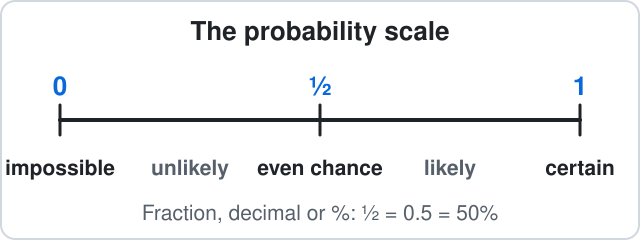
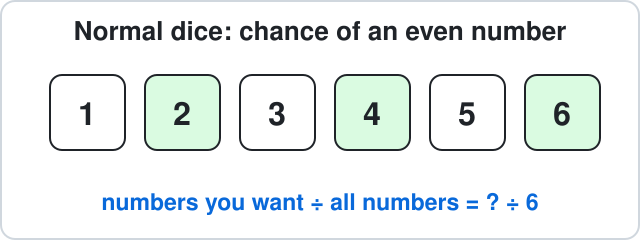
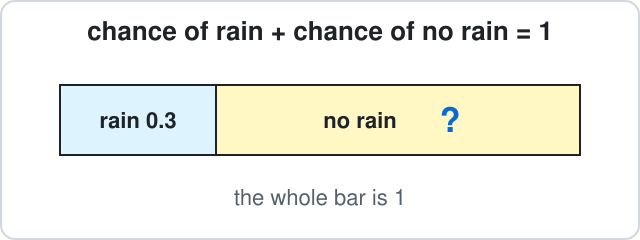
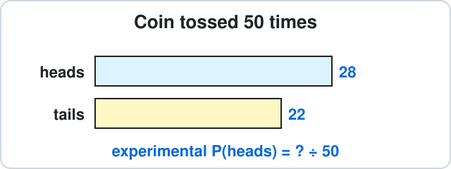
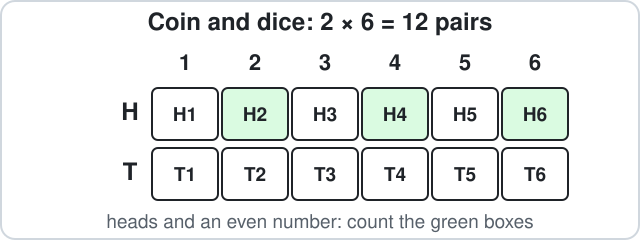

# Malta Year 8 Math Chapter 15 — Probability

- Six ideas, from the basic one to two events, with four worked examples on each card.
- Each card builds on the one before.
- By the end: find a probability, use 1 − P, add for “or”, estimate from experiments and use a sample space.

## 15.1 Probability scale: words and numbers

### 1. Probability scale: words and numbers

- Every probability is between **0** and **1**.
- 0 = impossible, less than ½ = unlikely, ½ = even chance, more than ½ = likely, 1 = certain.
- The same probability can be a fraction, a decimal or a percentage.

**Examples:**

- **a)** A fair dice is rolled.

Which word describes getting a number less than 7?

- **b)** A bag has 3 red and 7 blue counters.

- One counter is picked without looking.
- Which word describes picking red?

- **c)** A probability is $\dfrac{3}{4}$.

Write it as a decimal.

- **d)** A probability is $\dfrac{3}{5}$.

Write it as a percentage.

Write the probability $\dfrac{11}{20}$ as a percentage.

| Question | Answer |
|---:|---:|
| $\text{Percentage (number only)}$ | ? |

<b>Working</b>

**a)**

$$
\begin{aligned} P &= \frac{6}{6} \\ &= 1 \end{aligned}
$$

6 of the 6 outcomes give a number less than 7, so the event is **certain**.

0 = impossible, below ½ = unlikely, ½ = even chance, above ½ = likely, 1 = certain.

**b)**

$$
P(\text{red}) = \frac{3}{10}
$$

Compare with ½: 3 out of 10 is less than half, so picking red is **unlikely**.

**c)**

$$
\frac{3}{4} = 3 \div 4
$$

$$
\boxed{0.75}
$$

A probability as a decimal is always between 0 and 1.

**d)**

$$
\frac{3}{5} \times 100\%
$$

$$
\boxed{60}\%
$$

- A probability as a percentage is between 0% and 100%.
- Enter the number only.

## 15.2 Simple probability: wanted ÷ total

### 2. Simple probability: wanted ÷ total

- **P(event) = number of wanted outcomes ÷ total number of outcomes**.
- The outcomes must be equally likely: a fair dice, a random pick.
- Write the answer as a fraction in its simplest form.

**Examples:**

- **a)** A fair dice is rolled.

Find P(an even number).

- **b)** A bag has 4 red, 5 blue, 3 green counters.

- One counter is picked at random.
- Find P(blue).

- **c)** Cards are numbered 1 to 20.

- One card is picked at random.
- Find P(a multiple of 5).

- **d)** Each letter of the word MATHEMATICS is written on a card.

- One card is picked at random.
- Find P(the letter A).

- A bag has 6 red and 9 blue counters.
- One is picked at random.

Find P(red) as a decimal.

| Question | Answer |
|---:|---:|
| $P(\text{red})$ | ? |

<b>Working</b>

**a)**

$$
\text{Wanted: } 2, 4, 6
$$

$$
P = \frac{3}{6}
$$

$$
\boxed{\frac{1}{2}}
$$

Count the outcomes you want, divide by all the equally likely outcomes, then simplify.

**b)**

$$
\begin{aligned} \text{Total} &= 4 + 5 + 3 \\ &= 12 \end{aligned}
$$

$$
P(\text{blue}) = \frac{5}{12}
$$

$$
\boxed{\frac{5}{12}}
$$

Count the outcomes you want, divide by all the equally likely outcomes, then simplify.

**c)**

$$
\text{Wanted: } 5, 10, 15, 20
$$

$$
P = \frac{4}{20}
$$

$$
\boxed{\frac{1}{5}}
$$

Count the outcomes you want, divide by all the equally likely outcomes, then simplify.

**d)**

$$
\text{MATHEMATICS has 11 letters; A appears 2 times}
$$

$$
P(A) = \frac{2}{11}
$$

$$
\boxed{\frac{2}{11}}
$$

Count the outcomes you want, divide by all the equally likely outcomes, then simplify.

## 15.3 Complement: P(not A) = 1 − P(A)

### 3. Complement: P(not A) = 1 − P(A)

- An event either **happens** or **does not happen**.
- So P(not A) = 1 − P(A).
- With percentages: P(not A) = 100% − P(A).

**Examples:**

- **a)** P(the bus is late) = $\dfrac{2}{7}$.

Find P(not the bus is late).

- **b)** P(rain tomorrow) = 0.3.

Find P(not rain tomorrow).

- **c)** P(a faulty bulb) = 4%.

Find P(not a faulty bulb) as a percentage.

- **d)** A fair dice is rolled.

Find P(not a 4).

P(a train is late) = 0.12.

Find P(the train is not late).

| Question | Answer |
|---:|---:|
| $P(\text{not late})$ | ? |

<b>Working</b>

**a)**

$$
P(\text{not}) = 1 - \frac{2}{7}
$$

$$
= \frac{7}{7} - \frac{2}{7}
$$

$$
\boxed{\frac{5}{7}}
$$

An event either happens or does not happen, so the two probabilities add up to 1 (or 100%).

**b)**

$$
P(\text{not}) = 1 - 0.3
$$

$$
\boxed{0.7}
$$

An event either happens or does not happen, so the two probabilities add up to 1 (or 100%).

**c)**

$$
P(\text{not}) = 100\% - 4\%
$$

$$
\boxed{96}\%
$$

- An event either happens or does not happen, so the two probabilities add up to 1 (or 100%).
- Enter the number only.

**d)**

$$
P(\text{a 4}) = \frac{1}{6}
$$

$$
P(\text{not}) = 1 - \frac{1}{6}
$$

$$
\boxed{\frac{5}{6}}
$$

An event either happens or does not happen, so the two probabilities add up to 1 (or 100%).

## 15.4 Mutually exclusive: add for “or”; all outcomes add to 1

### 4. Mutually exclusive: add for “or”; all outcomes add to 1

- **Mutually exclusive** events cannot happen at the same time (one roll shows one number).
- For them: P(A or B) = P(A) + P(B).
- The probabilities of **all** the outcomes add up to 1, so a missing one is 1 − (the rest).

**Examples:**

- **a)** A fair dice is rolled once.

Find P(a 1 or a 2).

- **b)** A spinner has four colours. P(red) = 0.25 and P(blue) = 0.4.

Find P(red or blue).

- **c)** A spinner lands on one of four colours.

| Colour | Probability |
|---|---|
| red | 0.2 |
| blue | 0.35 |
| green | ? |
| yellow | 0.15 |

Find P(green).

- **d)** A spinner is red, blue or green. P(red) = 0.4.

- Blue and green are equally likely.
- Find P(blue).

A spinner: P(red) = 0.3, P(blue) = 0.25, P(green) = 0.1, and the rest is yellow.

Find P(yellow).

| Question | Answer |
|---:|---:|
| $P(\text{yellow})$ | ? |

<b>Working</b>

**a)**

$$
P(\text{a 1}) = \frac{1}{6}
$$

$$
P(\text{a 2}) = \frac{1}{6}
$$

$$
P(\text{a 1 or a 2}) = \frac{1}{6} + \frac{1}{6}
$$

$$
\boxed{\frac{1}{3}}
$$

The two events cannot happen together on one roll, so add their probabilities.

**b)**

$$
P(\text{red or blue}) = 0.25 + 0.4
$$

$$
\boxed{0.65}
$$

The spinner lands on one colour only, so the events are mutually exclusive: add.

**c)**

$$
0.2 + 0.35 + 0.15 = 0.7
$$

$$
P(\text{green}) = 1 - 0.7
$$

$$
\boxed{0.3}
$$

All the outcomes together have probability 1, so subtract the known ones from 1.

**d)**

$$
\begin{aligned} P(\text{blue}) + P(\text{green}) &= 1 - 0.4 \\ &= 0.6 \end{aligned}
$$

$$
P(\text{blue}) = 0.6 \div 2
$$

$$
\boxed{0.3}
$$

First find what is left for blue and green together, then split it into two equal parts.

## 15.5 Experimental and theoretical probability

### 5. Experimental and theoretical probability

- **Theoretical:** worked out from equally likely outcomes, without doing it (fair dice: P(6) = 1/6).
- **Experimental:** from real results, times it happened ÷ number of trials.
- **Expected number** = probability × number of trials (an estimate).

**Examples:**

- **a)** A coin is tossed 50 times and lands heads 28 times.

Find the experimental probability as a decimal.

- **b)** A fair dice is rolled. The event is rolling a 6.

How many times would you expect it in 60 trials?

- **c)** A drawing pin landed point up 20 times in 50 drops.

Estimate how many times this happens in 400 trials.

- **d)** A fair dice is rolled 120 times and shows a 6 40 times.

- The theoretical probability is $\dfrac{1}{6}$.
- By how many does the result differ from the expected number?

- A spinner has P(blue) = 0.2.
- It is spun 150 times.

How many blues do you expect?

| Question | Answer |
|---:|---:|
| $\text{Expected blues}$ | ? |

<b>Working</b>

**a)**

$$
\frac{28}{50} = 28 \div 50
$$

$$
\boxed{0.56}
$$

Experimental probability = number of times it happened ÷ number of trials.

**b)**

$$
\text{Expected} = \frac{1}{6} \times 60
$$

$$
\boxed{10}
$$

- Expected number = probability × number of trials.
- It is an estimate, not a promise.

**c)**

$$
P \approx \frac{20}{50}
$$

$$
\frac{20}{50} \times 400
$$

$$
\boxed{160}
$$

Use the experimental probability as the estimate, then multiply by the new number of trials.

**d)**

$$
\begin{aligned} \text{Expected} &= \frac{1}{6} \times 120 \\ &= 20 \end{aligned}
$$

$$
|40 - 20|
$$

$$
\boxed{20}
$$

- Theoretical probability predicts; an experiment only gets close.
- More trials usually get closer.

## 15.6 Two events: the sample space

### 6. Two events: the sample space

- For two events (a coin **and** a dice), list every pair, or draw a grid.
- Number of outcomes = outcomes of the first × outcomes of the second.
- Then P = wanted pairs ÷ all pairs.

**Examples:**

- **a)** A coin is tossed and a fair dice is rolled.

How many outcomes are in the sample space?

- **b)** A coin is tossed and a fair dice is rolled.

Find P(heads and an even number).

- **c)** Two fair dice are rolled and the scores are added.

Find P(a total of 7).

- **d)** Spinner A shows 1, 2, 3. Spinner B shows 1, 2, 3, 4. Both are spun and the scores are added.

Find P(a total of 5).

A coin is tossed and a fair dice is rolled.

Find P(heads and a number less than 4) as a decimal.

| Question | Answer |
|---:|---:|
| $P$ | ? |

<b>Working</b>

**a)**

$$
2 \times 6
$$

$$
\boxed{12}
$$

Each of the first outcomes can pair with each of the second: multiply, or draw the grid.

**b)**

$$
\text{12 outcomes: H1, …, H6, T1, …, T6}
$$

$$
\text{Wanted: } H2, H4, H6
$$

$$
P = \frac{3}{12}
$$

$$
\boxed{\frac{1}{4}}
$$

List or draw the 12 outcomes, then count the ones that match both parts.

**c)**

$$
\text{Wanted: } (1,6), (2,5), (3,4), (4,3), (5,2), (6,1)
$$

$$
P = \frac{6}{36}
$$

$$
\boxed{\frac{1}{6}}
$$

The sum grid has 6 × 6 = 36 cells; count the cells with the wanted total.

**d)**

$$
\begin{aligned} \text{Outcomes} &= 3 \times 4 \\ &= 12 \end{aligned}
$$

$$
\text{Wanted: } (1,4), (2,3), (3,2)
$$

$$
P = \frac{3}{12}
$$

$$
\boxed{\frac{1}{4}}
$$

Make the grid of all pairs, then count the pairs with the wanted total.

