# Malta Year 8 Math Chapter 3 — Angles Practice

**Three levels:**

- Easy: one angle fact
- Medium: isosceles, three angles on a line, parallel lines, outside angle
- Hard: two facts together, or a little algebra

**Answers:** type the number of degrees only.

---

## Easy

### 1. On a line

Find $x$.

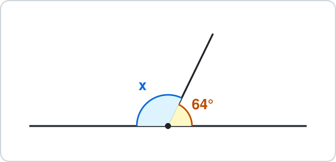

Answer: ______

### 2. Around a point

Find $x$.

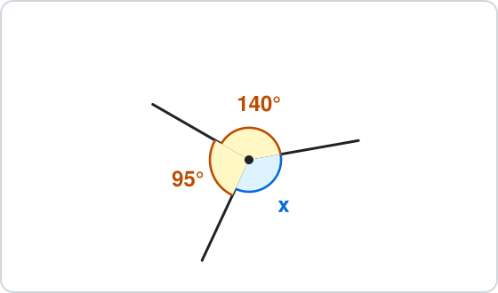

Answer: ______

### 3. In a triangle

Find $x$.

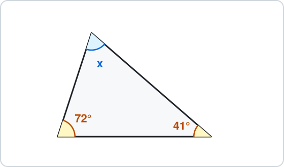

Answer: ______

### 4. Two lines cross

Find $x$.

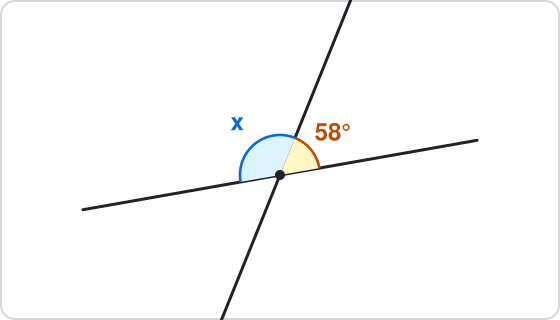

Answer: ______

## Medium

### 5. Isosceles

Find $x$.

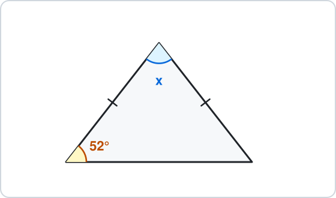

Answer: ______

### 6. Three on a line

Find $x$.

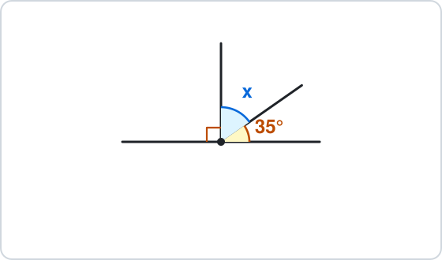

Answer: ______

### 7. Parallel lines

Find $x$.

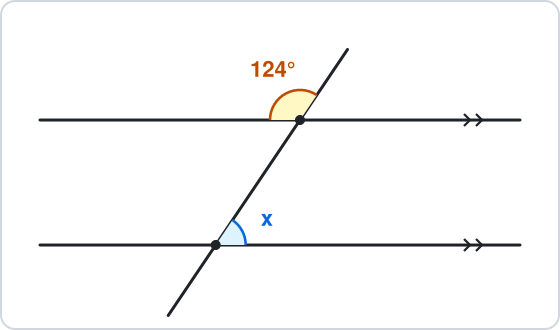

Answer: ______

### 8. Outside the triangle

Find $y$.

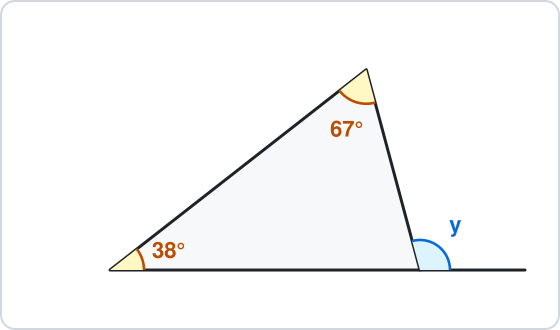

Answer: ______

## Hard

### 9. With algebra

Find $x$.

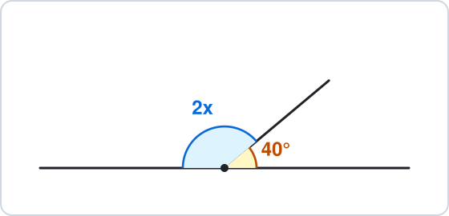

Answer: ______

### 10. Isosceles and outside

Find $x$.

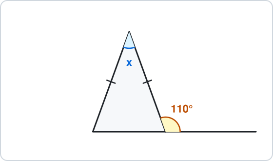

Answer: ______

### 11. Around a point with algebra

Find $x$.

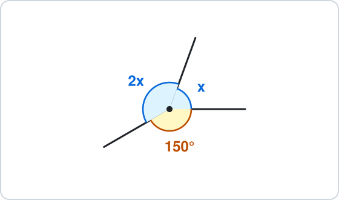

Answer: ______

### 12. Parallel lines with algebra

Find $x$.

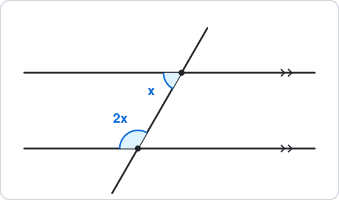

Answer: ______

---

<b>Answers</b>

**1. 116°**

$$
\begin{aligned}x &= 180^\circ - 64^\circ \\ &= \boxed{116^\circ}\end{aligned}
$$

**2. 125°**

$$
\begin{aligned}140^\circ + 95^\circ &= 235^\circ \\ x &= 360^\circ - 235^\circ \\ &= \boxed{125^\circ}\end{aligned}
$$

**3. 67°**

$$
\begin{aligned}72^\circ + 41^\circ &= 113^\circ \\ x &= 180^\circ - 113^\circ \\ &= \boxed{67^\circ}\end{aligned}
$$

**4. 122°**

$$
\begin{aligned}x &= 180^\circ - 58^\circ \\ &= \boxed{122^\circ}\end{aligned}
$$

**5. 76°**

$$
\begin{aligned}52^\circ + 52^\circ &= 104^\circ \\ x &= 180^\circ - 104^\circ \\ &= \boxed{76^\circ}\end{aligned}
$$

**6. 55°**

$$
\begin{aligned}90^\circ + 35^\circ &= 125^\circ \\ x &= 180^\circ - 125^\circ \\ &= \boxed{55^\circ}\end{aligned}
$$

**7. 56°**

$$
\begin{aligned}x &= 180^\circ - 124^\circ \\ &= \boxed{56^\circ}\end{aligned}
$$

**8. 105°**

$$
\begin{aligned}y &= 38^\circ + 67^\circ \\ &= \boxed{105^\circ}\end{aligned}
$$

**9. 70°**

$$
\begin{aligned}2x + 40^\circ &= 180^\circ \\ 2x &= 140^\circ \\ x &= \boxed{70^\circ}\end{aligned}
$$

**10. 40°**

$$
\begin{aligned}\text{base angle} &= 180^\circ - 110^\circ \\ &= 70^\circ \\ x &= 180^\circ - 70^\circ - 70^\circ \\ &= \boxed{40^\circ}\end{aligned}
$$

**11. 70°**

$$
\begin{aligned}x + 2x + 150^\circ &= 360^\circ \\ 3x &= 210^\circ \\ x &= \boxed{70^\circ}\end{aligned}
$$

**12. 60°**

$$
\begin{aligned}x + 2x &= 180^\circ \\ 3x &= 180^\circ \\ x &= \boxed{60^\circ}\end{aligned}
$$

- Straight line: $180^\circ$. Around a point: $360^\circ$. Triangle: $180^\circ$.
- Opposite angles, F angles and Z angles are equal. C angles add up to $180^\circ$.

