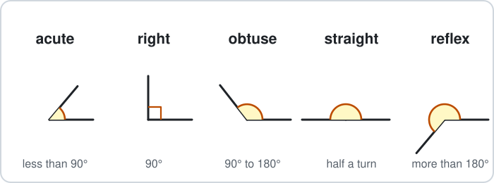
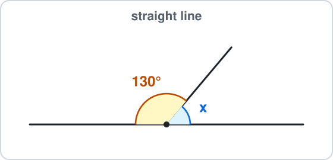
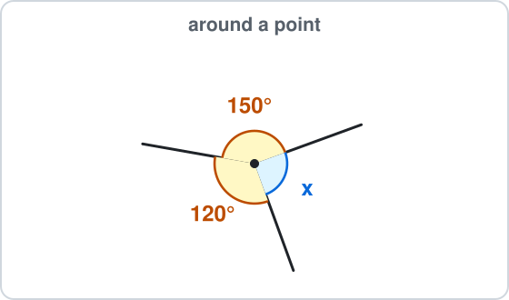
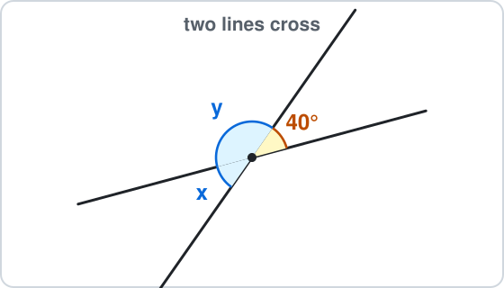
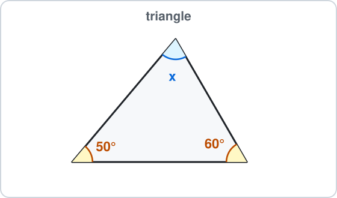
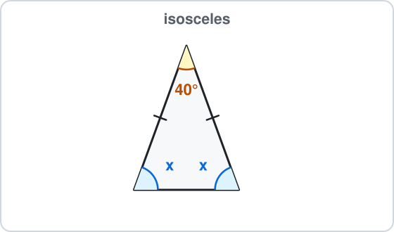
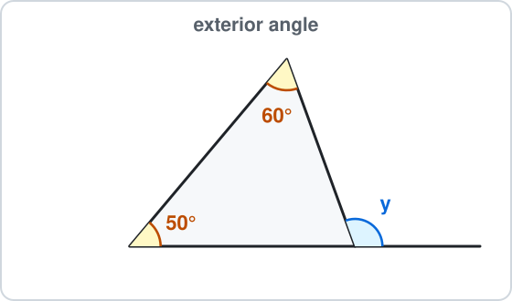
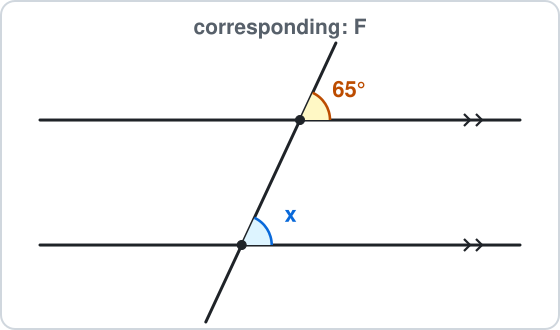
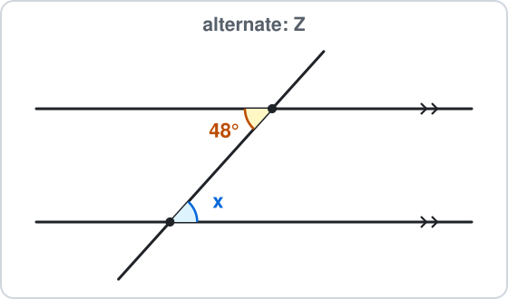
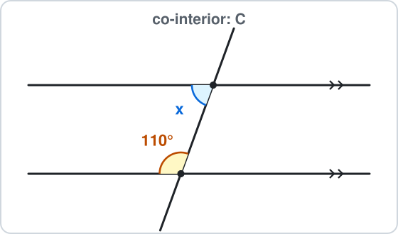

# Malta Year 8 Math Chapter 3 — Angles

**Ten cards, one idea each.**

- Look at the figure.
- Tap **Show working** for the example.
- Type your answer and press **Check**.

**Key facts:**

$$
\begin{aligned} \text{straight line} &= 180^\circ \\ \text{around a point} &= 360^\circ \\ \text{triangle} &= 180^\circ \end{aligned}
$$

## 3.1 Types of angles

### 1. Types of angles

- **acute**: less than $90^\circ$
- **right**: exactly $90^\circ$
- **obtuse**: between $90^\circ$ and $180^\circ$
- **straight**: exactly $180^\circ$
- **reflex**: between $180^\circ$ and $360^\circ$

A reflex angle is less than one full turn.

| Question | Answer |
|---:|---:|
| $\text{One full turn (}^\circ\text{)}$ | ? |

<b>Working</b>

**Example:** an angle of $128^\circ$.

It is more than $90^\circ$ and less than $180^\circ$.

$$
128^\circ \to \boxed{\text{obtuse}}
$$

## 3.2 Angles on a straight line

### 2. Angles on a straight line

- Angles on a straight line **add up to $180^\circ$**.
- Missing angle = $180^\circ$ − the angle you know.

Two angles on a straight line: $72^\circ$ and $x$.

| Question | Answer |
|---:|---:|
| $x\ (^\circ)$ | ? |

<b>Working</b>

**Example:** $130^\circ$ and $x$ on a straight line.

$$
\begin{aligned} x &= 180^\circ - 130^\circ \\ &= \boxed{50^\circ} \end{aligned}
$$

## 3.3 Angles at a point

### 3. Angles around a point

- Angles all the way **around a point add up to $360^\circ$**: one full turn.
- Add the angles you know, then take the total from $360^\circ$.

Two angles around a point: $200^\circ$ and $x$.

| Question | Answer |
|---:|---:|
| $x\ (^\circ)$ | ? |

<b>Working</b>

**Example:** $150^\circ$, $120^\circ$ and $x$ around a point.

$$
\begin{aligned} 150^\circ + 120^\circ &= 270^\circ \\ x &= 360^\circ - 270^\circ \\ &= \boxed{90^\circ} \end{aligned}
$$

### 4. Vertically opposite angles

- Two straight lines cross: **opposite angles are equal**.
- Neighbouring angles sit on a straight line, so they **add up to $180^\circ$**.

- Two lines cross.
- One angle is $115^\circ$.

| Question | Answer |
|---:|---:|
| $\text{Its neighbour (}^\circ\text{)}$ | ? |

<b>Working</b>

**Example:** one angle is $40^\circ$.

$$
\begin{aligned} x &= \boxed{40^\circ} \\ y &= 180^\circ - 40^\circ \\ &= \boxed{140^\circ} \end{aligned}
$$

## 3.4 Angles in a triangle

### 5. Angles in a triangle

- The three angles of any triangle **add up to $180^\circ$**.
- Add the two you know, take the total from $180^\circ$.

A triangle has angles $90^\circ$ and $35^\circ$.

| Question | Answer |
|---:|---:|
| $\text{Third angle (}^\circ\text{)}$ | ? |

<b>Working</b>

**Example:** $50^\circ$, $60^\circ$ and $x$.

$$
\begin{aligned} 50^\circ + 60^\circ &= 110^\circ \\ x &= 180^\circ - 110^\circ \\ &= \boxed{70^\circ} \end{aligned}
$$

### 6. Isosceles triangles

- **Isosceles**: two equal sides (the tick marks).
- The two **base angles** next to the third side are **equal**.

An isosceles triangle has a top angle of $100^\circ$.

| Question | Answer |
|---:|---:|
| $\text{Each base angle (}^\circ\text{)}$ | ? |

<b>Working</b>

**Example:** the top angle is $40^\circ$.

$$
\begin{aligned} x + x &= 180^\circ - 40^\circ \\ 2x &= 140^\circ \\ x &= \boxed{70^\circ} \end{aligned}
$$

### 7. The exterior angle

- Make one side of a triangle longer: the angle outside is the **exterior angle**.
- Exterior angle = the **two opposite inside angles added**.

The two opposite inside angles are $45^\circ$ and $75^\circ$.

| Question | Answer |
|---:|---:|
| $\text{Exterior angle (}^\circ\text{)}$ | ? |

<b>Working</b>

**Example:** the inside angles opposite are $50^\circ$ and $60^\circ$.

$$
\begin{aligned} y &= 50^\circ + 60^\circ \\ &= \boxed{110^\circ} \end{aligned}
$$

## 3.5 Angles on parallel lines

### 8. Corresponding angles (F)

- The arrows mark **parallel** lines.
- Angles in the **same position** at each crossing are **equal**: an **F** shape.

- A corresponding angle is $70^\circ$.
- Find its neighbour on the straight line.

| Question | Answer |
|---:|---:|
| $\text{Neighbour (}^\circ\text{)}$ | ? |

<b>Working</b>

**Example:** the top angle is $65^\circ$.

Same position at the bottom crossing:

$$
x = \boxed{65^\circ}
$$

### 9. Alternate angles (Z)

- Between the parallel lines, on **opposite sides** of the slanted line.
- Alternate angles are **equal**: a **Z** shape.

An alternate angle is $57^\circ$.

| Question | Answer |
|---:|---:|
| $\text{The other one (}^\circ\text{)}$ | ? |

<b>Working</b>

**Example:** $48^\circ$ inside the Z.

$$
x = \boxed{48^\circ}
$$

### 10. Co-interior angles (C)

- Between the parallel lines, on the **same side** of the slanted line.
- Co-interior angles **add up to $180^\circ$**: a **C** shape.

One co-interior angle is $75^\circ$.

| Question | Answer |
|---:|---:|
| $\text{The other one (}^\circ\text{)}$ | ? |

<b>Working</b>

**Example:** one is $110^\circ$.

$$
\begin{aligned} x &= 180^\circ - 110^\circ \\ &= \boxed{70^\circ} \end{aligned}
$$

