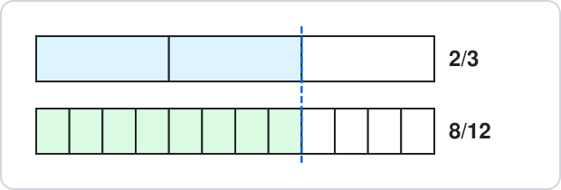
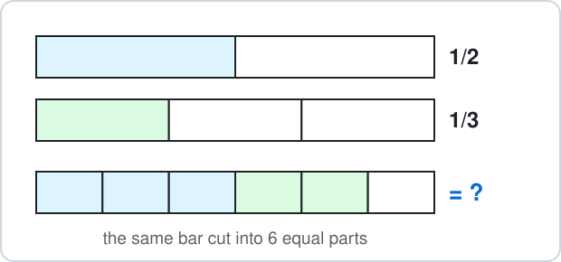

# Malta Year 8 Math Chapter 4 — Fractions

Chapter 4 works with fractions step by step.

**Chapter 4 has six parts:**

- 4.1 Simplify and equivalent fractions
- 4.2 Mixed numbers
- 4.3 Add and subtract
- 4.4 Multiply and divide (Trick 1: cancel before you multiply)
- 4.5 Three and four terms
- 4.6 Fraction of an amount and word problems

**By the end of the chapter:**

- give every answer in its simplest form
- add and subtract with different bottoms
- multiply and divide with Trick 1
- work out 3 and 4 terms in the right order

## 4.1 Simplify and Equivalent Fractions

### 1. Simplify a fraction

- Divide the **top** and the **bottom** by the **same number**.
- Keep going until no number (except 1) divides both.
- That is the **simplest form**.

**Examples:**

- **a)** $\dfrac{6}{8}$

- **b)** $\dfrac{10}{15}$

- **c)** $\dfrac{12}{18}$

- **d)** $\dfrac{20}{24}$

<b>Working</b>

**a)** Both divide by 2:

$$
\begin{aligned} \frac{6}{8} &= \frac{6\div2}{8\div2} \\ &= \boxed{\frac{3}{4}} \end{aligned}
$$

**b)** Both divide by 5:

$$
\begin{aligned} \frac{10}{15} &= \frac{10\div5}{15\div5} \\ &= \boxed{\frac{2}{3}} \end{aligned}
$$

**c)** Both divide by 6:

$$
\begin{aligned} \frac{12}{18} &= \frac{12\div6}{18\div6} \\ &= \boxed{\frac{2}{3}} \end{aligned}
$$

**d)** Both divide by 4:

$$
\begin{aligned} \frac{20}{24} &= \frac{20\div4}{24\div4} \\ &= \boxed{\frac{5}{6}} \end{aligned}
$$

### 2. Equivalent fractions

- **Equivalent** fractions are the same amount.
- Multiply the **top** and the **bottom** by the **same number**.

**Examples:**

- **a)** $\dfrac{2}{3} = \dfrac{?}{12}$

- **b)** $\dfrac{3}{4} = \dfrac{?}{20}$

- **c)** $\dfrac{5}{6} = \dfrac{?}{18}$

- **d)** $\dfrac{1}{5} = \dfrac{4}{?}$

<b>Working</b>

**a)** $3\times4 = 12$, so the top is also $\times4$:

$$
\begin{aligned} \frac{2}{3} &= \frac{2\times4}{3\times4} \\ &= \frac{\boxed{8}}{12} \end{aligned}
$$

**b)** $4\times5 = 20$, so the top is also $\times5$:

$$
\begin{aligned} \frac{3}{4} &= \frac{3\times5}{4\times5} \\ &= \frac{\boxed{15}}{20} \end{aligned}
$$

**c)** $6\times3 = 18$, so the top is also $\times3$:

$$
\begin{aligned} \frac{5}{6} &= \frac{5\times3}{6\times3} \\ &= \frac{\boxed{15}}{18} \end{aligned}
$$

**d)** $1\times4 = 4$, so the bottom is also $\times4$:

$$
\begin{aligned} \frac{1}{5} &= \frac{1\times4}{5\times4} \\ &= \frac{4}{\boxed{20}} \end{aligned}
$$

## 4.2 Mixed Numbers

### 3. Mixed number to improper fraction

- A **mixed number** such as $2\dfrac{1}{3}$ is a whole number and a fraction.
- New top = whole × bottom + top.
- The bottom stays the same.

**Examples:**

- **a)** $2\dfrac{1}{3}$

- **b)** $1\dfrac{3}{4}$

- **c)** $3\dfrac{2}{5}$

- **d)** $4\dfrac{1}{2}$

<b>Working</b>

**a)**

$$
\begin{aligned} 2\times3 + 1 &= 7 \\ 2\tfrac{1}{3} &= \boxed{\frac{7}{3}} \end{aligned}
$$

**b)**

$$
\begin{aligned} 1\times4 + 3 &= 7 \\ 1\tfrac{3}{4} &= \boxed{\frac{7}{4}} \end{aligned}
$$

**c)**

$$
\begin{aligned} 3\times5 + 2 &= 17 \\ 3\tfrac{2}{5} &= \boxed{\frac{17}{5}} \end{aligned}
$$

**d)**

$$
\begin{aligned} 4\times2 + 1 &= 9 \\ 4\tfrac{1}{2} &= \boxed{\frac{9}{2}} \end{aligned}
$$

### 4. Improper fraction to mixed number

- Divide the top by the bottom.
- The answer is the whole number and the **remainder** is the new top.

**Examples:**

- **a)** $\dfrac{11}{4}$

- **b)** $\dfrac{17}{5}$

- **c)** $\dfrac{13}{6}$

- **d)** $\dfrac{9}{2}$

<b>Working</b>

**a)** $11\div4 = 2$ remainder $3$:

$$
\frac{11}{4} = \boxed{2\tfrac{3}{4}}
$$

**b)** $17\div5 = 3$ remainder $2$:

$$
\frac{17}{5} = \boxed{3\tfrac{2}{5}}
$$

**c)** $13\div6 = 2$ remainder $1$:

$$
\frac{13}{6} = \boxed{2\tfrac{1}{6}}
$$

**d)** $9\div2 = 4$ remainder $1$:

$$
\frac{9}{2} = \boxed{4\tfrac{1}{2}}
$$

## 4.3 Add and Subtract

### 5. Same bottom

- When the bottoms are the **same**, add or subtract the **tops** only.
- The bottom stays the same.
- Then simplify.

**Examples:**

- **a)** $\dfrac{2}{9} + \dfrac{5}{9}$

- **b)** $\dfrac{7}{10} - \dfrac{3}{10}$

- **c)** $\dfrac{3}{8} + \dfrac{1}{8}$

- **d)** $\dfrac{5}{6} - \dfrac{1}{6}$

<b>Working</b>

**a)**

$$
\frac{2}{9} + \frac{5}{9} = \boxed{\frac{7}{9}}
$$

**b)**

$$
\begin{aligned} \frac{7}{10} - \frac{3}{10} &= \frac{4}{10} \\ &= \boxed{\frac{2}{5}} \end{aligned}
$$

**c)**

$$
\begin{aligned} \frac{3}{8} + \frac{1}{8} &= \frac{4}{8} \\ &= \boxed{\frac{1}{2}} \end{aligned}
$$

**d)**

$$
\begin{aligned} \frac{5}{6} - \frac{1}{6} &= \frac{4}{6} \\ &= \boxed{\frac{2}{3}} \end{aligned}
$$

### 6. Different bottoms

- First make the bottoms the **same**: find a number both bottoms go into.
- Change each fraction to that bottom.
- Then add or subtract the tops.

**Examples:**

- **a)** $\dfrac{1}{2} + \dfrac{1}{3}$

- **b)** $\dfrac{2}{5} + \dfrac{1}{4}$

- **c)** $\dfrac{3}{4} - \dfrac{1}{6}$

- **d)** $\dfrac{5}{8} - \dfrac{1}{4}$

<b>Working</b>

**a)** Both go into 6:

$$
\begin{aligned} \frac{1}{2} + \frac{1}{3} &= \frac{3}{6} + \frac{2}{6} \\ &= \boxed{\frac{5}{6}} \end{aligned}
$$

**b)** Both go into 20:

$$
\begin{aligned} \frac{2}{5} + \frac{1}{4} &= \frac{8}{20} + \frac{5}{20} \\ &= \boxed{\frac{13}{20}} \end{aligned}
$$

**c)** Both go into 12:

$$
\begin{aligned} \frac{3}{4} - \frac{1}{6} &= \frac{9}{12} - \frac{2}{12} \\ &= \boxed{\frac{7}{12}} \end{aligned}
$$

**d)** Both go into 8:

$$
\begin{aligned} \frac{5}{8} - \frac{1}{4} &= \frac{5}{8} - \frac{2}{8} \\ &= \boxed{\frac{3}{8}} \end{aligned}
$$

## 4.4 Multiply and Divide

### 7. Trick 1: cancel before you multiply

- Before you multiply, divide a **top** number and a **bottom** number by the **same number**.
- The numbers stay small, and the answer comes out simplified.

**Examples:**

- **a)** $10\times\dfrac{4}{5}$

- **b)** $\dfrac{3}{5}\times20$

- **c)** $\dfrac{2}{7}\times21$

- **d)** $\dfrac{5}{6}\times30$

<b>Working</b>

**a)** Cancel 10 and 5 by 5 (10 becomes 2, 5 becomes 1):

$$
\begin{aligned} 10\times\frac{4}{5} &= 2\times4 \\ &= \boxed{8} \end{aligned}
$$

**b)** Cancel 20 and 5 by 5:

$$
\begin{aligned} \frac{3}{5}\times20 &= 3\times4 \\ &= \boxed{12} \end{aligned}
$$

**c)** Cancel 21 and 7 by 7:

$$
\begin{aligned} \frac{2}{7}\times21 &= 2\times3 \\ &= \boxed{6} \end{aligned}
$$

**d)** Cancel 30 and 6 by 6:

$$
\begin{aligned} \frac{5}{6}\times30 &= 5\times5 \\ &= \boxed{25} \end{aligned}
$$

### 8. Fraction times fraction

- Multiply **top × top** and **bottom × bottom**.
- Use Trick 1 first: cancel any top with any bottom.

**Examples:**

- **a)** $\dfrac{4}{9}\times\dfrac{3}{8}$

- **b)** $\dfrac{5}{6}\times\dfrac{9}{10}$

- **c)** $\dfrac{2}{3}\times\dfrac{9}{14}$

- **d)** $\dfrac{7}{12}\times\dfrac{8}{21}$

<b>Working</b>

**a)** Cancel 4 and 8 by 4, then 3 and 9 by 3:

$$
\begin{aligned} \frac{4}{9}\times\frac{3}{8} &= \frac{1}{3}\times\frac{1}{2} \\ &= \boxed{\frac{1}{6}} \end{aligned}
$$

**b)** Cancel 5 and 10 by 5, then 9 and 6 by 3:

$$
\begin{aligned} \frac{5}{6}\times\frac{9}{10} &= \frac{1}{2}\times\frac{3}{2} \\ &= \boxed{\frac{3}{4}} \end{aligned}
$$

**c)** Cancel 2 and 14 by 2, then 9 and 3 by 3:

$$
\begin{aligned} \frac{2}{3}\times\frac{9}{14} &= \frac{1}{1}\times\frac{3}{7} \\ &= \boxed{\frac{3}{7}} \end{aligned}
$$

**d)** Cancel 7 and 21 by 7, then 8 and 12 by 4:

$$
\begin{aligned} \frac{7}{12}\times\frac{8}{21} &= \frac{1}{3}\times\frac{2}{3} \\ &= \boxed{\frac{2}{9}} \end{aligned}
$$

### 9. Divide: flip and multiply

- To divide by a fraction, **flip** the second fraction (top and bottom swap) and **multiply**.
- A whole number such as $2$ is $\dfrac{2}{1}$, so it flips to $\dfrac{1}{2}$.

**Examples:**

- **a)** $\dfrac{3}{4}\div\dfrac{1}{2}$

- **b)** $\dfrac{5}{6}\div\dfrac{5}{12}$

- **c)** $\dfrac{4}{5}\div2$

- **d)** $\dfrac{3}{8}\div\dfrac{3}{4}$

<b>Working</b>

**a)**

$$
\begin{aligned} \frac{3}{4}\div\frac{1}{2} &= \frac{3}{4}\times\frac{2}{1} \\ &= \frac{6}{4} \\ &= \boxed{\frac{3}{2}} \end{aligned}
$$

**b)** Flip, then cancel 5 with 5 and 12 with 6:

$$
\begin{aligned} \frac{5}{6}\div\frac{5}{12} &= \frac{5}{6}\times\frac{12}{5} \\ &= \boxed{2} \end{aligned}
$$

**c)**

$$
\begin{aligned} \frac{4}{5}\div2 &= \frac{4}{5}\times\frac{1}{2} \\ &= \boxed{\frac{2}{5}} \end{aligned}
$$

**d)** Flip, then cancel 3 with 3 and 4 with 8:

$$
\begin{aligned} \frac{3}{8}\div\frac{3}{4} &= \frac{3}{8}\times\frac{4}{3} \\ &= \boxed{\frac{1}{2}} \end{aligned}
$$

## 4.5 Three and Four Terms

### 10. Three terms: one bottom for all

- Find **one** bottom that **all** the bottoms go into.
- Change every fraction, then add and subtract the tops from left to right.

**Examples:**

- **a)** $\dfrac{1}{2} + \dfrac{1}{4} + \dfrac{1}{8}$

- **b)** $\dfrac{2}{3} + \dfrac{1}{6} - \dfrac{1}{2}$

- **c)** $\dfrac{3}{4} - \dfrac{1}{3} + \dfrac{1}{6}$

- **d)** $\dfrac{1}{5} + \dfrac{1}{2} - \dfrac{3}{10}$

<b>Working</b>

**a)** All go into 8:

$$
\frac{4}{8} + \frac{2}{8} + \frac{1}{8} = \boxed{\frac{7}{8}}
$$

**b)** All go into 6:

$$
\begin{aligned} \frac{4}{6} + \frac{1}{6} - \frac{3}{6} &= \frac{2}{6} \\ &= \boxed{\frac{1}{3}} \end{aligned}
$$

**c)** All go into 12:

$$
\frac{9}{12} - \frac{4}{12} + \frac{2}{12} = \boxed{\frac{7}{12}}
$$

**d)** All go into 10:

$$
\begin{aligned} \frac{2}{10} + \frac{5}{10} - \frac{3}{10} &= \frac{4}{10} \\ &= \boxed{\frac{2}{5}} \end{aligned}
$$

### 11. With ×: multiply first

- BIDMAS works for fractions too: do the $\times$ (or $\div$) **first**, with Trick 1.
- Then add and subtract.

**Examples:**

- **a)** $\dfrac{1}{2} + \dfrac{1}{4}\times\dfrac{2}{3}$

- **b)** $\dfrac{5}{6} - \dfrac{1}{3}\times\dfrac{3}{4}$

- **c)** $\dfrac{1}{3} + \dfrac{2}{5}\times\dfrac{5}{8} - \dfrac{1}{4}$

- **d)** $\dfrac{3}{4}\times\dfrac{2}{9} + \dfrac{1}{2} - \dfrac{1}{4}$

<b>Working</b>

**a)** $\dfrac{1}{4}\times\dfrac{2}{3} = \dfrac{1}{6}$ first:

$$
\begin{aligned} \frac{1}{2} + \frac{1}{6} &= \frac{3}{6} + \frac{1}{6} \\ &= \frac{4}{6} \\ &= \boxed{\frac{2}{3}} \end{aligned}
$$

**b)** $\dfrac{1}{3}\times\dfrac{3}{4} = \dfrac{1}{4}$ first:

$$
\begin{aligned} \frac{5}{6} - \frac{1}{4} &= \frac{10}{12} - \frac{3}{12} \\ &= \boxed{\frac{7}{12}} \end{aligned}
$$

**c)** $\dfrac{2}{5}\times\dfrac{5}{8} = \dfrac{1}{4}$ first:

$$
\frac{1}{3} + \frac{1}{4} - \frac{1}{4} = \boxed{\frac{1}{3}}
$$

**d)** $\dfrac{3}{4}\times\dfrac{2}{9} = \dfrac{1}{6}$ first:

$$
\begin{aligned} \frac{1}{6} + \frac{1}{2} - \frac{1}{4} &= \frac{2}{12} + \frac{6}{12} - \frac{3}{12} \\ &= \boxed{\frac{5}{12}} \end{aligned}
$$

## 4.6 Fraction of an Amount

### 12. Fraction of an amount

To find $\dfrac{2}{5}$ of an amount: **divide by the bottom**, then **multiply by the top**.

**Examples:**

- **a)** $\dfrac{2}{5}$ of €30

- **b)** $\dfrac{3}{4}$ of 24 sweets

- **c)** $\dfrac{5}{8}$ of 40 km

- **d)** $\dfrac{2}{3}$ of 45 minutes

<b>Working</b>

**a)**

$$
\begin{aligned} 30\div5 &= 6 \\ 6\times2 &= \boxed{12} \end{aligned}
$$

So it is €12.

**b)**

$$
\begin{aligned} 24\div4 &= 6 \\ 6\times3 &= \boxed{18} \end{aligned}
$$

So it is 18 sweets.

**c)**

$$
\begin{aligned} 40\div8 &= 5 \\ 5\times5 &= \boxed{25} \end{aligned}
$$

So it is 25 km.

**d)**

$$
\begin{aligned} 45\div3 &= 15 \\ 15\times2 &= \boxed{30} \end{aligned}
$$

So it is 30 minutes.

### 13. Word problems

- Read slowly and write the fraction sum.
- **The whole is 1.** Check: *of the whole* or *of the rest*?

**Examples:**

- **a)** A pizza: you eat $\dfrac{1}{4}$, a friend eats $\dfrac{3}{8}$. What fraction is left?

- **b)** €60 pocket money: $\dfrac{1}{3}$ on a book, $\dfrac{1}{4}$ of the €60 on a cinema ticket. How much is left?

- **c)** A bus with 40 people: $\dfrac{1}{4}$ get off in Mosta, then $\dfrac{1}{2}$ of the **rest** get off in Naxxar. How many are left?

- **d)** $\dfrac{2}{3}$ of a litre of juice is shared equally into 4 glasses. How much in each glass?

<b>Working</b>

**a)**

$$
\begin{aligned} 1 - \frac{1}{4} - \frac{3}{8} &= \frac{8}{8} - \frac{2}{8} - \frac{3}{8} \\ &= \boxed{\frac{3}{8}} \end{aligned}
$$

**b)**

- Book: $60\div3 = 20$.
- Cinema: $60\div4 = 15$.

$$
60 - 20 - 15 = \boxed{25}
$$

So €25 is left.

**c)**

- Mosta: $40\div4 = 10$ get off, 30 stay.
- Naxxar: half of 30 is 15.

$$
30 - 15 = \boxed{15}
$$

So 15 people are left.

**d)**

$$
\begin{aligned} \frac{2}{3}\div4 &= \frac{2}{3}\times\frac{1}{4} \\ &= \frac{2}{12} \\ &= \boxed{\frac{1}{6}} \end{aligned}
$$

So each glass has $\dfrac{1}{6}$ of a litre.

