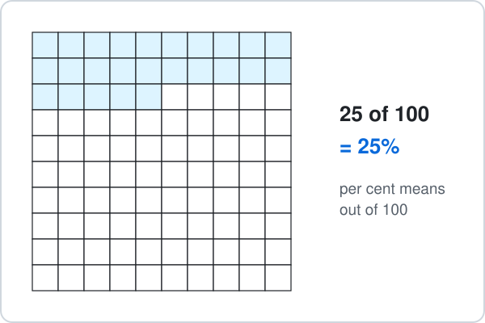
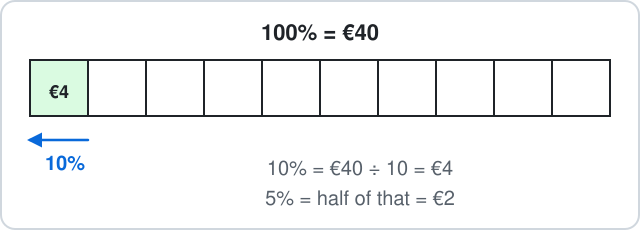

# Malta Year 8 Math Chapter 6 — Percentages

Chapter 6 works with per cent: out of 100.

**Chapter 6 has four parts:**

- 6.1 Percent, fraction and decimal
- 6.2 Percentage of an amount
- 6.3 One amount as a percentage of another
- 6.4 Increase and decrease

**By the end of the chapter:**

- change between percent, fraction and decimal
- find 50%, 25%, 10%, 5% and 1% in your head
- write a score as a percentage
- work out a sale price and a price with VAT

## 6.1 Percent, Fraction and Decimal

### 1. Percent to fraction and decimal

- **Per cent** means **out of 100**: $25\% = \dfrac{25}{100}$.
- For a fraction, write it over 100 and simplify.
- For a decimal, divide by 100 (move the digits two places right).

**Examples:**

- **a)** $50\%$

- **b)** $20\%$

- **c)** $75\%$

- **d)** $5\%$

<b>Working</b>

**a)**

$$
\begin{aligned} 50\% &= \frac{50}{100} \\ &= \boxed{\frac{1}{2}} \end{aligned}
$$ and

$$
50\div100 = \boxed{0.5}
$$

**b)**

$$
\begin{aligned} 20\% &= \frac{20}{100} \\ &= \boxed{\frac{1}{5}} \end{aligned}
$$ and

$$
20\div100 = \boxed{0.2}
$$

**c)**

$$
\begin{aligned} 75\% &= \frac{75}{100} \\ &= \boxed{\frac{3}{4}} \end{aligned}
$$ and

$$
75\div100 = \boxed{0.75}
$$

**d)**

$$
\begin{aligned} 5\% &= \frac{5}{100} \\ &= \boxed{\frac{1}{20}} \end{aligned}
$$ and

$$
5\div100 = \boxed{0.05}
$$

Not $0.5$: $5\%$ is 5 hundredths, so $0.05$.

### 2. Fraction or decimal to percent

- Multiply by $100\%$.
- A fraction: make the bottom 100 first ($\dfrac{3}{5} = \dfrac{60}{100}$).
- A decimal: move the digits two places left.

**Examples:**

- **a)** $\dfrac{3}{5}$

- **b)** $0.35$

- **c)** $\dfrac{9}{25}$

- **d)** $0.8$

<b>Working</b>

**a)** $\times20$ top and bottom:

$$
\begin{aligned} \frac{3}{5} &= \frac{60}{100} \\ &= \boxed{60\%} \end{aligned}
$$

**b)**

$$
0.35\times100 = \boxed{35\%}
$$

**c)** $\times4$ top and bottom:

$$
\begin{aligned} \frac{9}{25} &= \frac{36}{100} \\ &= \boxed{36\%} \end{aligned}
$$

**d)**

$$
0.8\times100 = \boxed{80\%}
$$

Not $8\%$: $0.8 = 0.80$, which is 80 hundredths.

## 6.2 Percentage of an Amount

### 3. Quick percentages: 50%, 25%, 10%, 1%

Four quick ones:

- $50\%$: halve
- $25\%$: halve, then halve again
- $10\%$: divide by 10
- $1\%$: divide by 100

**Examples:**

- **a)** $50\%$ of 36 pastizzi

- **b)** $25\%$ of €48

- **c)** $10\%$ of 70 km

- **d)** $1\%$ of €300

<b>Working</b>

**a)** Halve:

$$
36\div2 = \boxed{18}
$$ pastizzi

**b)** Halve twice:

$$
48\div2 = 24
$$

$$
24\div2 = \boxed{12}
$$ so €12

**c)** Divide by 10:

$$
70\div10 = \boxed{7}
$$ km

**d)** Divide by 100:

$$
300\div100 = \boxed{3}
$$ so €3

### 4. Build it from 10%, 5% and 1%

- Find $10\%$ first.
- Then $5\%$ is half of $10\%$, and $1\%$ is $10\%$ divided by 10.
- Add the pieces you need.

**Examples:**

- **a)** $15\%$ of €40

- **b)** $35\%$ of €60

- **c)** $12\%$ of 50

- **d)** $45\%$ of 80

<b>Working</b>

**a)**

$$
\begin{aligned} 15\% &= 10\% + 5\% \\ 10\% &= 4 \\ 5\% &= 2 \\ 4 + 2 &= \boxed{6} \end{aligned}
$$ so €6

**b)**

$$
\begin{aligned} 35\% &= 3\times10\% + 5\% \\ 10\% &= 6 \\ 30\% &= 18 \\ 5\% &= 3 \\ 18 + 3 &= \boxed{21} \end{aligned}
$$ so €21

**c)**

$$
\begin{aligned} 12\% &= 10\% + 2\times1\% \\ 10\% &= 5 \\ 1\% &= 0.5 \\ 5 + 0.5 + 0.5 &= \boxed{6} \end{aligned}
$$

**d)**

$$
\begin{aligned} 45\% &= 4\times10\% + 5\% \\ 10\% &= 8 \\ 40\% &= 32 \\ 5\% &= 4 \\ 32 + 4 &= \boxed{36} \end{aligned}
$$

### 5. Any percentage: divide by 100, times the percent

$$
p\% \text{ of } A = A\div100\times p
$$With a calculator this works for every percentage. Without one, pick the easier order.

**Examples:**

- **a)** $18\%$ of 50

- **b)** $7\%$ of €200

- **c)** $64\%$ of 25

- **d)** $30\%$ of 45

<b>Working</b>

**a)**

$$
\begin{aligned} 50\div100\times18 &= 0.5\times18 \\ &= \boxed{9} \end{aligned}
$$

**b)**

$$
\begin{aligned} 200\div100\times7 &= 2\times7 \\ &= \boxed{14} \end{aligned}
$$ so €14

**c)** $64\%$ of 25 is the same as $25\%$ of 64:

$$
64\div4 = \boxed{16}
$$

**d)**

$$
\begin{aligned} 45\div10\times3 &= 4.5\times3 \\ &= \boxed{13.5} \end{aligned}
$$

## 6.3 One Amount as a Percentage

### 6. Out of → per cent

Write it as a fraction **part over whole**, then make the bottom 100 (or $\times100$).

**Examples:**

- **a)** 18 out of 25 in a test

- **b)** 12 out of 20 students walk

- **c)** 9 out of 10 goals

- **d)** 21 out of 50 seats taken

<b>Working</b>

**a)** $\times4$ top and bottom:

$$
\begin{aligned} \frac{18}{25} &= \frac{72}{100} \\ &= \boxed{72\%} \end{aligned}
$$

**b)** $\times5$ top and bottom:

$$
\begin{aligned} \frac{12}{20} &= \frac{60}{100} \\ &= \boxed{60\%} \end{aligned}
$$

**c)** $\times10$ top and bottom:

$$
\begin{aligned} \frac{9}{10} &= \frac{90}{100} \\ &= \boxed{90\%} \end{aligned}
$$

**d)** $\times2$ top and bottom:

$$
\begin{aligned} \frac{21}{50} &= \frac{42}{100} \\ &= \boxed{42\%} \end{aligned}
$$

Not $21\%$: the whole is 50, not 100.

## 6.4 Increase and Decrease

### 7. Sale: take the percentage off

Two steps: **find** the percentage, then **take it away** from the price.

**Examples:**

- **a)** €80 jacket, $25\%$ off

- **b)** €45 shoes, $10\%$ off

- **c)** €120 bike, $15\%$ off

- **d)** €36 game, $50\%$ off

<b>Working</b>

**a)**

$$
\begin{aligned} 25\% \text{ of } 80 &= 20 \\ 80 - 20 &= \boxed{60} \end{aligned}
$$ so €60

**b)**

$$
\begin{aligned} 10\% \text{ of } 45 &= 4.5 \\ 45 - 4.5 &= \boxed{40.5} \end{aligned}
$$ so €40.50

**c)**

$$
\begin{aligned} 10\% &= 12 \\ 5\% &= 6 \\ 15\% &= 18 \\ 120 - 18 &= \boxed{102} \end{aligned}
$$ so €102

**d)**

$$
\begin{aligned} 50\% \text{ of } 36 &= 18 \\ 36 - 18 &= \boxed{18} \end{aligned}
$$ so €18

Not €20 for the jacket: $20$ is the money **off**, not the new price.

### 8. Increase: add the percentage on

- Find the percentage, then **add it** to the amount.
- In Malta, VAT is $18\%$.

**Examples:**

- **a)** €50 + VAT $18\%$

- **b)** rent €200 rises by $5\%$

- **c)** 30 festa visitors grow by $20\%$

- **d)** €15 meal + $10\%$ tip

<b>Working</b>

**a)**

$$
\begin{aligned} 10\% &= 5 \\ 8\% &= 4 \\ 18\% &= 9 \\ 50 + 9 &= \boxed{59} \end{aligned}
$$ so €59

**b)**

$$
\begin{aligned} 5\% \text{ of } 200 &= 10 \\ 200 + 10 &= \boxed{210} \end{aligned}
$$ so €210

**c)**

$$
\begin{aligned} 20\% \text{ of } 30 &= 6 \\ 30 + 6 &= \boxed{36} \end{aligned}
$$ visitors

**d)**

$$
\begin{aligned} 10\% \text{ of } 15 &= 1.5 \\ 15 + 1.5 &= \boxed{16.5} \end{aligned}
$$ so €16.50

### 9. One step: multiply by the new percentage

After the change, the new amount is a percentage of the old one:

- up $18\%$: $100\% + 18\% = 118\%$, so $\times1.18$
- down $25\%$: $100\% - 25\% = 75\%$, so $\times0.75$

Multiply once.

**Examples:**

- **a)** €50 up $18\%$

- **b)** €80 down $25\%$

- **c)** €200 up $5\%$

- **d)** €40 down $10\%$

<b>Working</b>

**a)**

$$
\begin{aligned} 100\% + 18\% &= 118\% \\ 50\times1.18 &= \boxed{59} \end{aligned}
$$

**b)**

$$
\begin{aligned} 100\% - 25\% &= 75\% \\ 80\times0.75 &= \boxed{60} \end{aligned}
$$

**c)**

$$
\begin{aligned} 100\% + 5\% &= 105\% \\ 200\times1.05 &= \boxed{210} \end{aligned}
$$

**d)**

$$
\begin{aligned} 100\% - 10\% &= 90\% \\ 40\times0.9 &= \boxed{36} \end{aligned}
$$

Not $40\times0.1 = 4$: that is the money off, not what is left.

