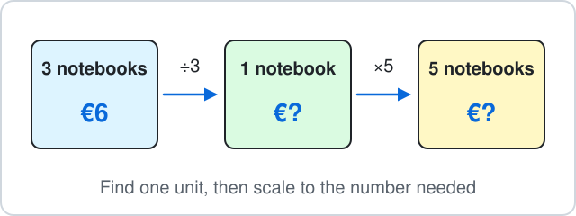
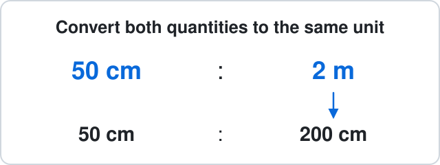
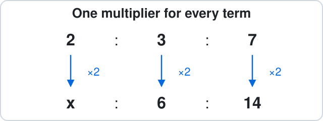
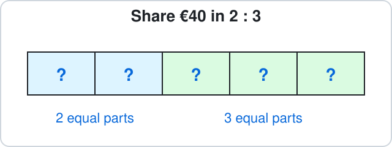
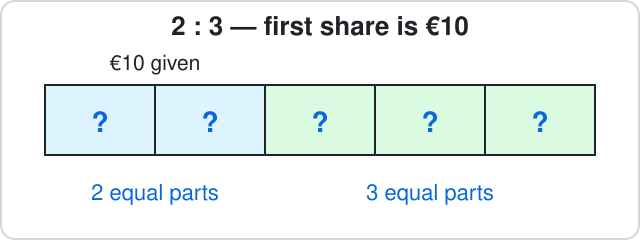
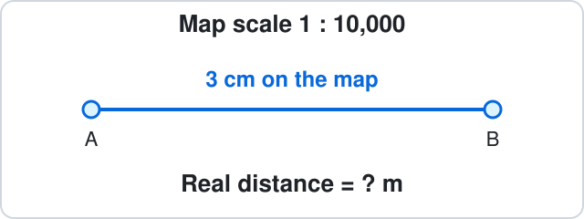

# Malta Year 8 Math Chapter 7 — Ratio

- Six ideas, with four worked examples on each card.
- Includes valid and inconsistent three-term ratios.
- By the end: scale quantities, simplify ratios, find missing shares and use map scales.

## 7.1 Unitary method and recipe scaling

### 1. Unitary method and recipe scaling

- Find the amount for **one** item, person, kilogram or bottle first.
- Then multiply by the number needed.
- Use this when the price per item, recipe per person or capacity per bottle stays the same.

**Examples:**

- **a)** 3 notebooks cost €6.

How much do 5 notebooks cost?

- **b)** A recipe for 4 people uses 300 g of flour.

How many grams of flour are needed for 6 people?

- **c)** 3 kg of apples costs €6.

What is the cost of 5 kg at the same price per kg?

- **d)** 3 identical full bottles hold 1.5 litres altogether.

How many litres do 8 full bottles hold?

6 notebooks cost €15 at a constant price per notebook.

Find the cost of 4 notebooks.

| Question | Answer |
|---:|---:|
| $\text{Cost (euros)}$ | ? |

<b>Working</b>

**a)**

$$
\text{Cost of one notebook}=6\div 3
$$

$$
\text{One unit}=2
$$

$$
2\times 5=10
$$

$$
\boxed{10}\text{ euros}
$$

Find one unit first, then multiply by the number needed; both quantities scale together.

**b)**

$$
\text{Flour for one person}=300\div 4
$$

$$
\text{One unit}=75
$$

$$
75\times 6=450
$$

$$
\boxed{450}\text{ g}
$$

Find one unit first, then multiply by the number needed; both quantities scale together.

**c)**

$$
\text{Cost of one kilogram}=6\div 3
$$

$$
\text{One unit}=2
$$

$$
2\times 5=10
$$

$$
\boxed{10}\text{ euros}
$$

Find one unit first, then multiply by the number needed; both quantities scale together.

**d)**

$$
\text{Capacity of one bottle}=\frac{3}{2}\div 3
$$

$$
\text{One unit}=\frac{1}{2}
$$

$$
\frac{1}{2}\times 8=4
$$

$$
\boxed{4}\text{ litres}
$$

Find one unit first, then multiply by the number needed; both quantities scale together.

## 7.2 Same units first, including decimals

### 2. Same units first, including decimals

- Compare quantities in the **same unit**.
- For decimals, multiply both terms by 10 or 100 to make whole numbers.
- Divide both terms by their HCF; keep the original order.

**Examples:**

- **a)** Write $50$ cm : $2$ m in simplest form.

- **b)** Write $1.5$ kg : $500$ g in simplest form.

- **c)** Write $45$ min : $1.5$ hours in simplest form.

- **d)** Write $2.5$ litres : $4.5$ litres in simplest form.

Simplify 75 cm : 1.5 m to $1:x$.

| Question | Answer |
|---:|---:|
| $\text{Find }x$ | ? |

<b>Working</b>

**a)**

$$
2\text{ m}=200\text{ cm}
$$

$$
50 : 200=50 : 200
$$

$$
\text{HCF}=50
$$

$$
50 : 200=\boxed{1 : 4}
$$

- Use the same units first; clear decimals if needed, then divide both terms by their HCF.
- Keep the order.

**b)**

$$
1.5\text{ kg}=1500\text{ g}
$$

$$
1500 : 500=1500 : 500
$$

$$
\text{HCF}=500
$$

$$
1500 : 500=\boxed{3 : 1}
$$

- Use the same units first; clear decimals if needed, then divide both terms by their HCF.
- Keep the order.

**c)**

$$
1.5\text{ hours}=90\text{ min}
$$

$$
45 : 90=45 : 90
$$

$$
\text{HCF}=45
$$

$$
45 : 90=\boxed{1 : 2}
$$

- Use the same units first; clear decimals if needed, then divide both terms by their HCF.
- Keep the order.

**d)**

$$
2.5 : 4.5=5 : 9
$$

$$
\text{HCF}=1
$$

$$
5 : 9=\boxed{5 : 9}
$$

- Use the same units first; clear decimals if needed, then divide both terms by their HCF.
- Keep the order.

## 7.3 Equivalent ratios and three-term checks

### 3. Equivalent ratios and three-term checks

- **Every term** uses the same multiplier.
- Check the known matching pairs first, especially with three terms.
- If the known pairs need different multipliers, **no solution** exists.

**Examples:**

- **a)** Find $x$:

$$
2:3=8:x
$$

- **b)** Find $x$:

$$
8:12=2:x
$$

- **c)** Find $x$, or decide that no solution exists:

$$
2:3:7=x:6:14
$$

- **d)** Find $x$, or decide that no solution exists:

$$
2:3:7=x:2:3
$$

$3:5:8=x:15:24$.

| Question | Answer |
|---:|---:|
| $\text{Find }x$ | ? |

<b>Working</b>

**a)**

$$
\text{Multiplier}=8\div 2
$$

$$
\text{Multiplier}=4
$$

$$
x=3\times 4
$$

$$
\boxed{12}
$$

Multiply both ratio terms by the same number; adding the same amount does not preserve a ratio.

**b)**

$$
\text{Multiplier}=2\div 8
$$

$$
\text{Multiplier}=\frac{1}{4}
$$

$$
x=12\times \frac{1}{4}
$$

$$
\boxed{3}
$$

Multiply both ratio terms by the same number; adding the same amount does not preserve a ratio.

**c)**

$$
\text{Middle multiplier}=6\div 3
$$

$$
\text{Middle multiplier}=2
$$

$$
\text{Last multiplier}=14\div 7
$$

$$
\text{Last multiplier}=2
$$

$$
x=2\times 2
$$

$$
\boxed{4}
$$

The known pairs agree, so apply their common multiplier to the missing term.

**d)**

$$
\text{Middle multiplier}=2\div 3
$$

$$
\text{Middle multiplier}=\frac{2}{3}
$$

$$
\text{Last multiplier}=3\div 7
$$

$$
\text{Last multiplier}=\frac{3}{7}
$$

$$
\frac{2}{3}\ne \frac{3}{7}
$$

$$
\boxed{\text{No solution}}
$$

- All three terms need one common multiplier.
- A value from just one known pair cannot repair the other pair.

## 7.4 Share a total in a ratio

### 4. Share a total in a ratio

- Add **all the parts** to find how many equal parts make the total.
- Divide the total by that number to find one part.
- Multiply one part by the number of parts in the requested share.
- The same method works for two or three shares.

**Examples:**

- **a)** Share €40 in the ratio $2 : 3$.

How many euros are in the first share?

- **b)** Share €45 in the ratio $4 : 5$.

How many euros are in the second share?

- **c)** Share €72 in the ratio $5 : 7$.

How many euros are in the first share?

- **d)** Share €84 in the ratio $2 : 3 : 7$.

How many euros are in the third share?

Share €63 in the ratio $2:5$.

Find the larger share.

| Question | Answer |
|---:|---:|
| $\text{Share (euros)}$ | ? |

<b>Working</b>

**a)**

$$
\text{Total parts}=2+3
$$

$$
\text{Total parts}=5
$$

$$
\text{One part}=40\div 5
$$

$$
\text{One part}=8
$$

$$
\text{First share}=2\times 8
$$

$$
\boxed{16}\text{ euros}
$$

- Add all the ratio parts before dividing the total.
- A ratio does not mean equal shares.

**b)**

$$
\text{Total parts}=4+5
$$

$$
\text{Total parts}=9
$$

$$
\text{One part}=45\div 9
$$

$$
\text{One part}=5
$$

$$
\text{Second share}=5\times 5
$$

$$
\boxed{25}\text{ euros}
$$

- Add all the ratio parts before dividing the total.
- A ratio does not mean equal shares.

**c)**

$$
\text{Total parts}=5+7
$$

$$
\text{Total parts}=12
$$

$$
\text{One part}=72\div 12
$$

$$
\text{One part}=6
$$

$$
\text{First share}=5\times 6
$$

$$
\boxed{30}\text{ euros}
$$

- Add all the ratio parts before dividing the total.
- A ratio does not mean equal shares.

**d)**

$$
\text{Total parts}=2+3+7
$$

$$
\text{Total parts}=12
$$

$$
\text{One part}=84\div 12
$$

$$
\text{One part}=7
$$

$$
\text{Third share}=7\times 7
$$

$$
\boxed{49}\text{ euros}
$$

- Add all the ratio parts before dividing the total.
- A ratio does not mean equal shares.

## 7.5 One share is known

### 5. One share is known

- The given amount is **one share**, so divide by **its own number of parts**.
- Use one part to find another share or the total.
- Check that the known share comes back correctly.

**Examples:**

- **a)** Amounts are in the ratio $2 : 3$.

The first amount is €10.

Find the second amount in euros.

- **b)** Amounts are in the ratio $3 : 5$.

The second amount is €20.

Find the first amount in euros.

- **c)** Amounts are in the ratio $4 : 7$.

The first amount is €16.

Find the total amount in euros.

- **d)** Amounts are in the ratio $2 : 3 : 5$.

The second amount is €12.

Find the third amount in euros.

The ratio is $3:4$; the first share is €21.

Find the total amount.

| Question | Answer |
|---:|---:|
| $\text{Total (euros)}$ | ? |

<b>Working</b>

**a)**

$$
\text{One part}=10\div 2
$$

$$
\text{One part}=5
$$

$$
\text{Second amount}=3\times 5
$$

$$
\boxed{15}\text{ euros}
$$

- The given amount is one share, not the whole total.
- Divide it by its own number of parts.

**b)**

$$
\text{One part}=20\div 5
$$

$$
\text{One part}=4
$$

$$
\text{First amount}=3\times 4
$$

$$
\boxed{12}\text{ euros}
$$

- The given amount is one share, not the whole total.
- Divide it by its own number of parts.

**c)**

$$
\text{One part}=16\div 4
$$

$$
\text{One part}=4
$$

$$
\text{Total amount}=11\times 4
$$

$$
\boxed{44}\text{ euros}
$$

- The given amount is one share, not the whole total.
- Divide it by its own number of parts.

**d)**

$$
\text{One part}=12\div 3
$$

$$
\text{One part}=4
$$

$$
\text{Third amount}=5\times 4
$$

$$
\boxed{20}\text{ euros}
$$

- The given amount is one share, not the whole total.
- Divide it by its own number of parts.

## 7.6 Map scales in both directions

### 6. Map scales in both directions

- A scale of **1 : 10,000** means 1 cm on the map represents 10,000 cm in real life.
- **Map to real:** multiply by the scale number, then convert units.
- **Real to map:** convert to centimetres first, then divide by the scale number.
- Remember: 100 cm make 1 m, and 100,000 cm make 1 km.

**Examples:**

- **a)** A map has scale $1:10000$.

Two places are $3$ cm apart on the map.

Find the real distance in m.

- **b)** A map has scale $1:10000$.

The real distance is $500$ m.

Find the map distance in cm.

- **c)** A map has scale $1:50000$.

Two places are $4$ cm apart on the map.

Find the real distance in km.

- **d)** A map has scale $1:75000$.

The real distance is $3$ km.

Find the map distance in cm.

A map has scale $1:25{,}000$; the map distance is 6 cm.

Find the real distance in km.

| Question | Answer |
|---:|---:|
| $\text{Distance (km)}$ | ? |

<b>Working</b>

**a)**

$$
\text{Real distance (cm)}=3\times 10000
$$

$$
\text{Real distance (cm)}=30000
$$

$$
\text{Real distance (m)}=30000\div 100
$$

$$
\boxed{300}\text{ m}
$$

- The scale compares matching units: 1 cm on the map represents the scale number of centimetres in real life.
- Convert units carefully.

**b)**

$$
500\text{ m}=50000\text{ cm}
$$

$$
\text{Map distance (cm)}=50000\div 10000
$$

$$
\boxed{5}\text{ cm}
$$

- The scale compares matching units: 1 cm on the map represents the scale number of centimetres in real life.
- Convert units carefully.

**c)**

$$
\text{Real distance (cm)}=4\times 50000
$$

$$
\text{Real distance (cm)}=200000
$$

$$
\text{Real distance (km)}=200000\div 100000
$$

$$
\boxed{2}\text{ km}
$$

- The scale compares matching units: 1 cm on the map represents the scale number of centimetres in real life.
- Convert units carefully.

**d)**

$$
3\text{ km}=300000\text{ cm}
$$

$$
\text{Map distance (cm)}=300000\div 75000
$$

$$
\boxed{4}\text{ cm}
$$

- The scale compares matching units: 1 cm on the map represents the scale number of centimetres in real life.
- Convert units carefully.

