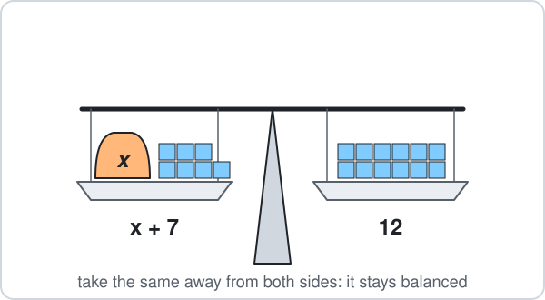

# Malta Year 8 Math Chapter 8 — Algebra

Chapter 8 solves equations step by step.

**Chapter 8 has five parts:**

- 8.1 Like terms
- 8.2 One-step equations
- 8.3 Two-step equations
- 8.4 Unknowns on both sides (Trick 2: the sign flips across =)
- 8.5 Equations with fractions

**By the end of the chapter:**

- keep the equation balanced
- move a term across = and flip its sign
- solve with x on both sides
- solve equations with fractions

## 8.1 Like Terms

### 1. Collect like terms

- **Like terms** have the same letter: $3x$ and $2x$ are like terms, $5$ and $1$ are like terms.
- Add the $x$ terms together and the plain numbers together.

**Examples:**

- **a)** $x + 16 + 2x$

- **b)** $3x + 10 + x$

- **c)** $5 + 2x - 1$

- **d)** $4x - x + 7$

<b>Working</b>

**a)**

$$
\begin{aligned} x + 2x &= 3x \\ x + 16 + 2x &= \boxed{3x + 16} \end{aligned}
$$

**b)**

$$
\begin{aligned} 3x + x &= 4x \\ 3x + 10 + x &= \boxed{4x + 10} \end{aligned}
$$

**c)**

$$
\begin{aligned} 5 - 1 &= 4 \\ 5 + 2x - 1 &= \boxed{2x + 4} \end{aligned}
$$

**d)**

$$
\begin{aligned} 4x - x &= 3x \\ 4x - x + 7 &= \boxed{3x + 7} \end{aligned}
$$

## 8.2 One-Step Equations

### 2. Add or subtract

- An equation is a **balance**: both sides weigh the same.
- Do the **opposite** to get $x$ alone: $+7$ is undone by $-7$.

**Examples:**

- **a)** $x + 7 = 12$

- **b)** $x - 4 = 9$

- **c)** $x + 6 = 2$

- **d)** $x - 3 = -1$

<b>Working</b>

**a)** Take 7 from both sides:

$$
\begin{aligned} x &= 12 - 7 \\ x &= \boxed{5} \end{aligned}
$$

**b)** Add 4 to both sides:

$$
\begin{aligned} x &= 9 + 4 \\ x &= \boxed{13} \end{aligned}
$$

**c)** Take 6 from both sides:

$$
\begin{aligned} x &= 2 - 6 \\ x &= \boxed{-4} \end{aligned}
$$

**d)** Add 3 to both sides:

$$
\begin{aligned} x &= -1 + 3 \\ x &= \boxed{2} \end{aligned}
$$

### 3. Multiply or divide

- $3x$ means $3\times x$, so undo it by **dividing** by 3.
- $\dfrac{x}{4}$ means $x\div4$, so undo it by **multiplying** by 4.

**Examples:**

- **a)** $3x = 21$

- **b)** $5x = 40$

- **c)** $\dfrac{x}{4} = 6$

- **d)** $\dfrac{x}{2} = 9$

<b>Working</b>

**a)** Divide both sides by 3:

$$
\begin{aligned} x &= 21\div3 \\ x &= \boxed{7} \end{aligned}
$$

**b)** Divide both sides by 5:

$$
\begin{aligned} x &= 40\div5 \\ x &= \boxed{8} \end{aligned}
$$

**c)** Multiply both sides by 4:

$$
\begin{aligned} x &= 6\times4 \\ x &= \boxed{24} \end{aligned}
$$

**d)** Multiply both sides by 2:

$$
\begin{aligned} x &= 9\times2 \\ x &= \boxed{18} \end{aligned}
$$

## 8.3 Two-Step Equations

### 4. Two steps

- Two steps, in this order.
- **First** move the plain number (do the opposite of + or −).
- **Then** divide by the number in front of $x$.

**Examples:**

- **a)** $2x + 5 = 17$

- **b)** $3x - 2 = 13$

- **c)** $4x + 1 = 29$

- **d)** $5x - 6 = 14$

<b>Working</b>

**a)**

$$
\begin{aligned} 2x &= 17 - 5 \\ 2x &= 12 \\ x &= 12\div2 \\ x &= \boxed{6} \end{aligned}
$$

**b)**

$$
\begin{aligned} 3x &= 13 + 2 \\ 3x &= 15 \\ x &= 15\div3 \\ x &= \boxed{5} \end{aligned}
$$

**c)**

$$
\begin{aligned} 4x &= 29 - 1 \\ 4x &= 28 \\ x &= 28\div4 \\ x &= \boxed{7} \end{aligned}
$$

**d)**

$$
\begin{aligned} 5x &= 14 + 6 \\ 5x &= 20 \\ x &= 20\div5 \\ x &= \boxed{4} \end{aligned}
$$

### 5. Two steps, negative answers

- The same two steps.
- When the right side gets smaller than the plain number, the answer is **negative**.

**Examples:**

- **a)** $2x + 9 = 3$

- **b)** $5x + 12 = 2$

- **c)** $3x - 4 = -19$

- **d)** $6x + 25 = 1$

<b>Working</b>

**a)**

$$
\begin{aligned} 2x &= 3 - 9 \\ 2x &= -6 \\ x &= -6\div2 \\ x &= \boxed{-3} \end{aligned}
$$

**b)**

$$
\begin{aligned} 5x &= 2 - 12 \\ 5x &= -10 \\ x &= -10\div5 \\ x &= \boxed{-2} \end{aligned}
$$

**c)**

$$
\begin{aligned} 3x &= -19 + 4 \\ 3x &= -15 \\ x &= -15\div3 \\ x &= \boxed{-5} \end{aligned}
$$

**d)**

$$
\begin{aligned} 6x &= 1 - 25 \\ 6x &= -24 \\ x &= -24\div6 \\ x &= \boxed{-4} \end{aligned}
$$

## 8.4 Unknowns on Both Sides

### 6. Trick 2: the sign flips across =

- A term that moves across "=" is multiplied by $(-1)$: **its sign flips**.
- Move the $x$ terms to one side and the plain numbers to the other.

**Examples:**

- **a)** $x + 3 = 2x + 1$

- **b)** $2x + 5 = x + 9$

- **c)** $4x - 1 = x + 8$

- **d)** $5x + 2 = 3x + 10$

<b>Working</b>

**a)** $+1$ moves left as $-1$; $+x$ moves right as $-x$:

$$
\begin{aligned} 3 - 1 &= 2x - x \\ x &= \boxed{2} \end{aligned}
$$

**b)**

$$
\begin{aligned} 2x - x &= 9 - 5 \\ x &= \boxed{4} \end{aligned}
$$

**c)**

$$
\begin{aligned} 4x - x &= 8 + 1 \\ 3x &= 9 \\ x &= \boxed{3} \end{aligned}
$$

**d)**

$$
\begin{aligned} 5x - 3x &= 10 - 2 \\ 2x &= 8 \\ x &= \boxed{4} \end{aligned}
$$

### 7. Two terms = three terms

- Five terms in all.
- Use Trick 2 for every term that moves, then collect like terms on each side.

**Examples:**

- **a)** $6x + 1 = 2x + 13 + x$

- **b)** $4x - 5 = x + 7 + x$

- **c)** $7x + 2 = 3x + 17 + x$

- **d)** $5x + 8 = 2x - 4 + x$

<b>Working</b>

**a)**

$$
\begin{aligned} 6x - 2x - x &= 13 - 1 \\ 3x &= 12 \\ x &= \boxed{4} \end{aligned}
$$

**b)**

$$
\begin{aligned} 4x - x - x &= 7 + 5 \\ 2x &= 12 \\ x &= \boxed{6} \end{aligned}
$$

**c)**

$$
\begin{aligned} 7x - 3x - x &= 17 - 2 \\ 3x &= 15 \\ x &= \boxed{5} \end{aligned}
$$

**d)**

$$
\begin{aligned} 5x - 2x - x &= -4 - 8 \\ 2x &= -12 \\ x &= \boxed{-6} \end{aligned}
$$

### 8. Careful: × moves across as ÷

- Trick 2 is only for terms that are **added or subtracted**.
- A number that **multiplies** $x$ moves across as **÷** and keeps its sign.
- A number that divides $x$ moves across as **×**.

**Examples:**

- **a)** $2x = 8$

- **b)** $5x = -20$

- **c)** $-3x = 12$

- **d)** $\dfrac{x}{3} = 4$

<b>Working</b>

**a)**

$$
\begin{aligned} x &= 8\div2 \\ x &= \boxed{4} \end{aligned}
$$

Not $8 - 2 = 6$: the 2 multiplies, it is not added.

**b)**

$$
\begin{aligned} x &= -20\div5 \\ x &= \boxed{-4} \end{aligned}
$$

**c)**

$$
\begin{aligned} x &= 12\div(-3) \\ x &= \boxed{-4} \end{aligned}
$$

The $-3$ keeps its minus: it is not a + or − term.

**d)**

$$
\begin{aligned} x &= 4\times3 \\ x &= \boxed{12} \end{aligned}
$$

## 8.5 Equations with Fractions

### 9. Simplify the fractions first

- First simplify every fraction ($\dfrac{4x}{4} = x$, $\dfrac{2}{4} = \dfrac{1}{2}$).
- Then solve with Trick 2 as before.
- The answer can be a fraction.

**Examples:**

- **a)** $\dfrac{4x}{4} + \dfrac{2}{4} = 5$

- **b)** $\dfrac{6x}{3} + \dfrac{5}{10} = x + 3$

- **c)** $\dfrac{3x}{3} + \dfrac{2}{8} = \dfrac{9}{4} - x$

- **d)** $\dfrac{10x}{5} - \dfrac{3}{9} = x + \dfrac{5}{3}$

<b>Working</b>

**a)**

$$
\begin{aligned} x + \frac{1}{2} &= 5 \\ x &= 5 - \frac{1}{2} \\ x &= \boxed{\frac{9}{2}} \end{aligned}
$$

**b)**

$$
\begin{aligned} 2x + \frac{1}{2} &= x + 3 \\ 2x - x &= 3 - \frac{1}{2} \\ x &= \boxed{\frac{5}{2}} \end{aligned}
$$

**c)**

$$
\begin{aligned} x + \frac{1}{4} &= \frac{9}{4} - x \\ x + x &= \frac{9}{4} - \frac{1}{4} \\ 2x &= 2 \\ x &= \boxed{1} \end{aligned}
$$

**d)**

$$
\begin{aligned} 2x - \frac{1}{3} &= x + \frac{5}{3} \\ 2x - x &= \frac{5}{3} + \frac{1}{3} \\ x &= \boxed{2} \end{aligned}
$$

### 10. x over a number

- $\dfrac{x}{2}$ is half of $x$.
- Add or subtract them like fractions, with the same bottom: $\dfrac{x}{2} + \dfrac{x}{4} = \dfrac{3x}{4}$.
- Last step: multiply away the bottom.

**Examples:**

- **a)** $\dfrac{x}{2} + \dfrac{x}{4} = 6$

- **b)** $\dfrac{x}{2} + 1 = \dfrac{x}{3} + 3$

- **c)** $\dfrac{x}{3} + \dfrac{x}{6} = 5$

- **d)** $\dfrac{3x}{4} - 2 = \dfrac{x}{4} + 1$

<b>Working</b>

**a)**

$$
\begin{aligned} \frac{3x}{4} &= 6 \\ 3x &= 24 \\ x &= \boxed{8} \end{aligned}
$$

**b)**

$$
\begin{aligned} \frac{x}{2} - \frac{x}{3} &= 3 - 1 \\ \frac{x}{6} &= 2 \\ x &= \boxed{12} \end{aligned}
$$

**c)**

$$
\begin{aligned} \frac{2x}{6} + \frac{x}{6} &= 5 \\ \frac{x}{2} &= 5 \\ x &= \boxed{10} \end{aligned}
$$

**d)**

$$
\begin{aligned} \frac{3x}{4} - \frac{x}{4} &= 1 + 2 \\ \frac{x}{2} &= 3 \\ x &= \boxed{6} \end{aligned}
$$

