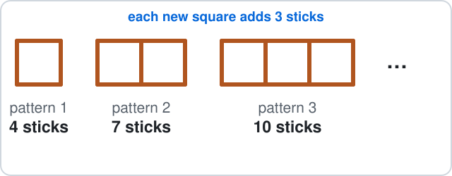

# Malta Year 8 Math Chapter 9 — Sequences

Chapter 9 works with number patterns.

**Chapter 9 has five parts:**

- 9.1 Term-to-term rule
- 9.2 The difference and missing terms
- 9.3 The nth term
- 9.4 Find the nth term rule
- 9.5 Shape patterns

**By the end of the chapter:**

- continue a sequence
- fill in missing terms
- use the nth term to find any term
- find the rule from the difference
- use the rule for matchstick and tile patterns

## 9.1 Term-to-Term Rule

### 1. Add or take away the same number

- A **sequence** is a list of numbers in order.
- Each number is a **term**.

- The **term-to-term rule** says how to get from one term to the next.
- Look at the gap between neighbours. If it is always the same, keep adding it.

**Examples:**

- **a)** $3, 7, 11, 15, \ldots$

- **b)** $20, 17, 14, 11, \ldots$

- **c)** $5, 12, 19, 26, \ldots$

- **d)** $-6, -2, 2, 6, \ldots$

<b>Working</b>

**a)** The rule is add 4:

$$
15 + 4 = \boxed{19}
$$

$$
19 + 4 = \boxed{23}
$$

**b)** The rule is take away 3:

$$
11 - 3 = \boxed{8}
$$

$$
8 - 3 = \boxed{5}
$$

**c)** The rule is add 7:

$$
26 + 7 = \boxed{33}
$$

$$
33 + 7 = \boxed{40}
$$

**d)** The rule is add 4:

$$
6 + 4 = \boxed{10}
$$

$$
10 + 4 = \boxed{14}
$$

### 2. Multiply or halve

- Some sequences **multiply** by the same number each time.
- If the gaps keep growing (or shrinking), try dividing a term by the one before it.

**Examples:**

- **a)** $2, 6, 18, \ldots$

- **b)** $64, 32, 16, \ldots$

- **c)** $1, 10, 100, \ldots$

- **d)** $5, 10, 20, \ldots$

<b>Working</b>

**a)** The rule is $\times3$:

$$
18\times3 = \boxed{54}
$$

**b)** The rule is $\div2$:

$$
16\div2 = \boxed{8}
$$

**c)** The rule is $\times10$:

$$
100\times10 = \boxed{1000}
$$

**d)** The rule is $\times2$:

$$
20\times2 = \boxed{40}
$$

Not 25: the gaps are 5, then 10, so it is not $+5$.

## 9.2 The Difference and Missing Terms

### 3. Find the difference

- The **difference** $d$ is next term minus this term.
- It is the same all the way along in these sequences.
- A sequence that goes down has a **negative** difference.

**Examples:**

- **a)** $4, 9, 14, 19, \ldots$

- **b)** $30, 26, 22, 18, \ldots$

- **c)** $1, 3, 5, 7, \ldots$

- **d)** $-5, -2, 1, 4, \ldots$

<b>Working</b>

**a)**

$$
9 - 4 = \boxed{5}
$$

**b)**

$$
26 - 30 = \boxed{-4}
$$ It goes down, so the difference is negative.

**c)**

$$
3 - 1 = \boxed{2}
$$

**d)**

$$
-2 - -5 = \boxed{3}
$$

### 4. Missing terms

- Find the difference from two terms you know, then fill the gaps.
- If the known terms are not neighbours, share the jump between the steps.

**Examples:**

- **a)** $7, \ \square, \ 15, \ 19$

- **b)** $3, \ \square, \ \square, \ 12$

- **c)** $50, \ 44, \ \square, \ 32$

- **d)** $\square, \ 9, \ 14, \ 19$

<b>Working</b>

**a)** $d = 19 - 15 = 4$:

$$
7 + 4 = \boxed{11}
$$

**b)** From 3 to 12 is 9 in 3 steps, so:

$$
\begin{aligned} d &= 3 \\ 3 + 3 &= \boxed{6} \\ 6 + 3 &= \boxed{9} \end{aligned}
$$

**c)** $d = 44 - 50 = -6$:

$$
44 - 6 = \boxed{38}
$$

**d)** $d = 14 - 9 = 5$; go back one step:

$$
9 - 5 = \boxed{4}
$$

## 9.3 The nth Term

### 5. The nth term gives every term

- The **nth term** is a rule with $n$ in it: $n$ is the position (1st, 2nd, 3rd, …).
- Put $n = 1, 2, 3, 4$ into the rule to get the terms.

**Examples:**

- **a)** $3n + 2$

- **b)** $2n - 1$

- **c)** $4n + 3$

- **d)** $10 - n$

<b>Working</b>

**a)**

$$
\begin{aligned} 3\times1 + 2 &= 5 \\ 3\times2 + 2 &= 8 \\ 3\times3 + 2 &= 11 \end{aligned}
$$

Terms: $\boxed{5, 8, 11, 14}$

**b)**

$$
\begin{aligned} 2\times1 - 1 &= 1 \\ 2\times2 - 1 &= 3 \\ 2\times3 - 1 &= 5 \end{aligned}
$$

Terms: $\boxed{1, 3, 5, 7}$

**c)**

$$
\begin{aligned} 4\times1 + 3 &= 7 \\ 4\times2 + 3 &= 11 \\ 4\times3 + 3 &= 15 \end{aligned}
$$

Terms: $\boxed{7, 11, 15, 19}$

**d)**

$$
\begin{aligned} 10 - 1 &= 9 \\ 10 - 2 &= 8 \\ 10 - 3 &= 7 \end{aligned}
$$

Terms: $\boxed{9, 8, 7, 6}$

### 6. Any term: put n in

- To find the 10th term you do **not** need to write 10 terms.
- Put $n = 10$ straight into the rule.

**Examples:**

- **a)** 10th term of $3n + 2$

- **b)** 20th term of $5n - 4$

- **c)** 50th term of $2n + 7$

- **d)** 10th term of $100 - 3n$

<b>Working</b>

**a)**

$$
\begin{aligned} 3\times10 + 2 &= 30 + 2 \\ &= \boxed{32} \end{aligned}
$$

**b)**

$$
\begin{aligned} 5\times20 - 4 &= 100 - 4 \\ &= \boxed{96} \end{aligned}
$$

**c)**

$$
\begin{aligned} 2\times50 + 7 &= 100 + 7 \\ &= \boxed{107} \end{aligned}
$$

**d)**

$$
\begin{aligned} 100 - 3\times10 &= 100 - 30 \\ &= \boxed{70} \end{aligned}
$$

Times first, then take away (BIDMAS).

## 9.4 Find the nth Term Rule

### 7. Difference × n, then fix the start

For a sequence that adds the same $d$ each time:

- The rule starts with $d\,n$ (the difference times $n$).
- Then add or take away a number so the 1st term comes out right: $\text{first term} - d$.

**Examples:**

- **a)** $5, 8, 11, 14, \ldots$

- **b)** $4, 6, 8, 10, \ldots$

- **c)** $7, 12, 17, 22, \ldots$

- **d)** $1, 5, 9, 13, \ldots$

<b>Working</b>

**a)**

- $d = 3$, so start with $3n$.
- At $n = 1$ that gives 3, but the first term is 5:

$$
5 - 3 = 2
$$ Rule: $\boxed{3n + 2}$

**b)**

- $d = 2$, so start with $2n$.
- At $n = 1$ that gives 2, but the first term is 4:

$$
4 - 2 = 2
$$ Rule: $\boxed{2n + 2}$

**c)**

- $d = 5$, so start with $5n$.
- At $n = 1$ that gives 5, but the first term is 7:

$$
7 - 5 = 2
$$ Rule: $\boxed{5n + 2}$

**d)**

- $d = 4$, so start with $4n$.
- At $n = 1$ that gives 4, but the first term is 1:

$$
1 - 4 = -3
$$ Rule: $\boxed{4n - 3}$

### 8. Which term is it?

- Set the rule equal to the number and solve, like Chapter 8.
- The answer $n$ is the position.

**Examples:**

- **a)** Which term of $3n + 2$ is 47?

- **b)** Which term of $2n + 1$ is 41?

- **c)** Which term of $5n - 3$ is 72?

- **d)** Which term of $4n + 4$ is 60?

<b>Working</b>

**a)**

$$
\begin{aligned} 3n + 2 &= 47 \\ 3n &= 45 \\ n &= \boxed{15} \end{aligned}
$$

47 is the 15th term.

**b)**

$$
\begin{aligned} 2n + 1 &= 41 \\ 2n &= 40 \\ n &= \boxed{20} \end{aligned}
$$

**c)**

$$
\begin{aligned} 5n - 3 &= 72 \\ 5n &= 75 \\ n &= \boxed{15} \end{aligned}
$$

**d)**

$$
\begin{aligned} 4n + 4 &= 60 \\ 4n &= 56 \\ n &= \boxed{14} \end{aligned}
$$

## 9.5 Shape Patterns

### 9. Matchsticks and tiles

Count each pattern, then treat the counts as a sequence:

- the difference tells you what each new pattern adds;
- the nth term tells you any pattern without drawing it.

**Examples:**

- **a)** Squares in a row: 4, 7, 10 sticks. The rule?

- **b)** How many sticks in pattern 10?

- **c)** How many sticks in pattern 20?

- **d)** Which pattern uses 46 sticks?

<b>Working</b>

**a)**

- Each square adds 3 sticks, so start with $3n$.
- Pattern 1 has 4: $4 - 3 = 1$.
- Rule: $\boxed{3n + 1}$

**b)**

$$
3\times10 + 1 = \boxed{31}
$$ sticks

**c)**

$$
3\times20 + 1 = \boxed{61}
$$ sticks

**d)**

$$
\begin{aligned} 3n + 1 &= 46 \\ 3n &= 45 \\ n &= \boxed{15} \end{aligned}
$$

Pattern 15.

