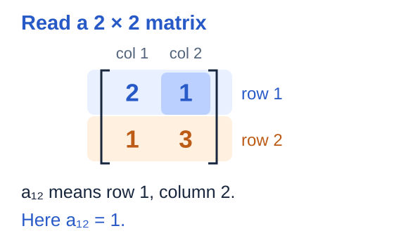
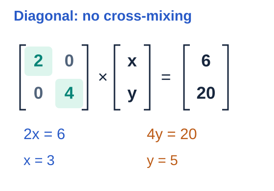
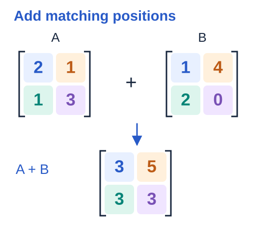
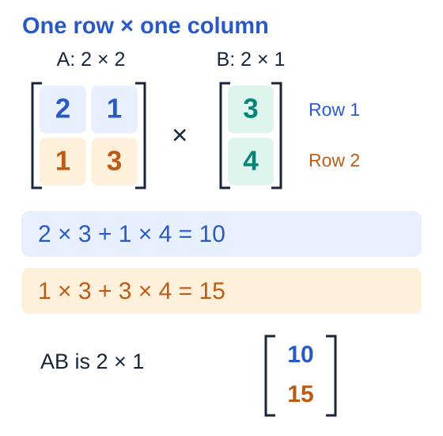
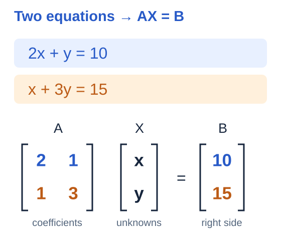
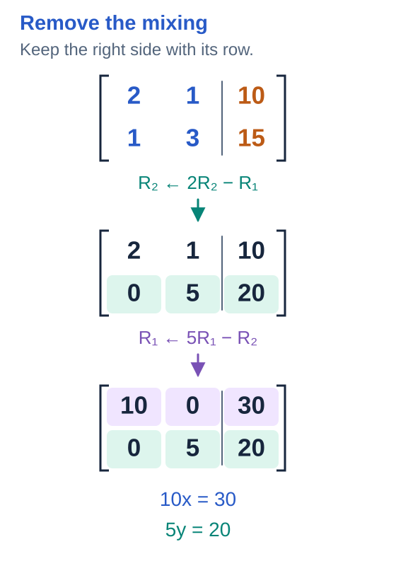

# Math Material — Matrices Part 1

- A matrix keeps numbers in rows and columns.
- Follow the coloured entries to see how it works.
- Three short checks follow each idea.

## 1. Read a 2 × 2 matrix

A **matrix** is a rectangular arrangement of numbers.

- Rows run across.
- Columns run down.
- The size is **rows × columns**.

$$
A=\begin{bmatrix}2 & 1\\1 & 3\end{bmatrix}
$$

The entry $a_{12}$ is in **row 1, column 2**. Use the pictured matrix for the checks.

| Question | Answer |
|---:|---:|
| $\text{Rows?}$ | ? |
| $\text{Columns?}$ | ? |
| $\text{Find }a_{12}$ | ? |

<b>Working</b>

There are two rows and two columns, so the size is $2\times2$.

Read the row number first.

$$
a_{12}=1
$$

## 2. A diagonal matrix separates the two unknowns

In a **diagonal matrix**, the entries off the main diagonal are zero.

$$
D=\begin{bmatrix}2 & 0\\0 & 4\end{bmatrix}
$$

- The first row uses only $x$.
- The second row uses only $y$.
- With nonzero diagonal entries, divide each right-hand value by its diagonal entry.

**Try:**

$$
\begin{bmatrix}3 & 0\\0 & 2\end{bmatrix}\begin{bmatrix}x\\y\end{bmatrix}=\begin{bmatrix}12\\10\end{bmatrix}
$$

| Question | Answer |
|---:|---:|
| $\text{Find }x$ | ? |
| $\text{Find }y$ | ? |
| $\text{Find }d_{12}$ | ? |

<b>Working</b>

$$
2x=6
$$

$$
x=\frac{6}{2}
$$

$$
x=3
$$

$$
y=\frac{20}{4}
$$

$$
y=5
$$

## 3. A + B: add matching entries

Addition needs matrices of the **same size**. Add entries at the same position.

$$
\begin{bmatrix}2 & 1\\1 & 3\end{bmatrix}+\begin{bmatrix}1 & 4\\2 & 0\end{bmatrix}=\begin{bmatrix}3 & 5\\3 & 3\end{bmatrix}
$$

**Try a new pair:**

$$
P=\begin{bmatrix}1 & 2\\3 & 4\end{bmatrix}
$$

$$
Q=\begin{bmatrix}5 & 6\\7 & 8\end{bmatrix}
$$

$$
C=P+Q
$$

| Question | Answer |
|---:|---:|
| $\text{Find }c_{11}$ | ? |
| $\text{Find }c_{12}$ | ? |
| $\text{Find }c_{22}$ | ? |

<b>Working</b>

$$
(A+B)_{11}=2+1
$$

$$
(A+B)_{11}=3
$$

Repeat at each matching position. Keep the same two-row, two-column shape.

## 4. AB: a 2 × 2 matrix times a 2 × 1 column

The number of columns in $A$ must match the number of rows in $B$.

$$
(2\times2)(2\times1)\longrightarrow2\times1
$$

- Multiply the first row by the column, then add: that gives the top entry.
- Do the same with the second row for the bottom entry.

**Try:**

$$
M=\begin{bmatrix}1 & 2\\3 & 1\end{bmatrix}
$$

$$
v=\begin{bmatrix}2\\5\end{bmatrix}
$$

| Question | Answer |
|---:|---:|
| $\text{Find }(Mv)_1$ | ? |
| $\text{Find }(Mv)_2$ | ? |
| $\text{Output rows?}$ | ? |

<b>Working</b>

$$
(AB)_1=2\cdot3+1\cdot4
$$

$$
(AB)_1=10
$$

$$
(AB)_2=1\cdot3+3\cdot4
$$

$$
(AB)_2=15
$$

$$
AB=\begin{bmatrix}10\\15\end{bmatrix}
$$

## 5. Two equations become AX = B

Keep the equations in the same row order and the unknowns in the order $x,y$.

$$
\begin{aligned}
2x+y&=10 \\
x+3y&=15
\end{aligned}
$$

- $A$ contains the coefficients of $x$ and $y$.
- $X$ is the unknown column.
- $B$ contains the right-hand values.

$$
AX=B
$$

**Try writing a matrix system for:**

$$
\begin{aligned}
3x-2y&=7 \\
4x+y&=9
\end{aligned}
$$

| Question | Answer |
|---:|---:|
| $\text{Find }a_{12}$ | ? |
| $\text{Find }a_{21}$ | ? |
| $\text{Find }b_2$ | ? |

<b>Working</b>

$$
A=\begin{bmatrix}2 & 1\\1 & 3\end{bmatrix}
$$

$$
X=\begin{bmatrix}x\\y\end{bmatrix}
$$

$$
B=\begin{bmatrix}10\\15\end{bmatrix}
$$

Multiplying row 1 by $X$ reproduces the first equation. Row 2 reproduces the second.

## 6. Make the system diagonal, then read the solution

Use row operations to remove the off-diagonal entries.

- Apply each row operation to **both sides** of the equations.
- The equations change, but their solution stays the same.

Start from the system above. In the picture, the vertical bar separates the coefficients from the right side.

**Try this diagonal form of another system:**

$$
\begin{bmatrix}3 & 0\\0 & -3\end{bmatrix}\begin{bmatrix}x\\y\end{bmatrix}=\begin{bmatrix}12\\-9\end{bmatrix}
$$

It comes from $x+y=7$ and $2x-y=5$.

| Question | Answer |
|---:|---:|
| $\text{Find }x$ | ? |
| $\text{Find }y$ | ? |
| $\text{Find }2x-y$ | ? |

<b>Working</b>

Replace row 2 by twice row 2 minus row 1.

$$
\begin{aligned}
2(x+3y)-(2x+y)&=2(15)-10 \\
5y&=20
\end{aligned}
$$

Now replace row 1 by five times row 1 minus the new row 2.

$$
\begin{aligned}
5(2x+y)-5y&=5(10)-20 \\
10x&=30
\end{aligned}
$$

$$
x=3
$$

$$
y=4
$$

Check the original equations.

$$
2(3)+4=10
$$

$$
3+3(4)=15
$$

