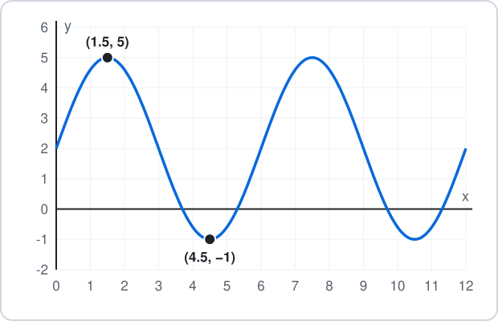

# Math Material — Periodic Phenomena

**A periodic function repeats every period $P$:**

$$
\begin{aligned}
f(x+P) &= f(x)
\end{aligned}
$$

- Ferris wheels, tides and daylight are periodic.
- Midline: the middle level. Amplitude: midline up to a high point.

**Type each answer, then press Check.**

## 1. Period: the length of one full cycle

- A **periodic** function repeats the same pattern again and again.
- The **period** $P$ is the length of one full cycle:

$$
\begin{aligned}
f(x+P) &= f(x)
\end{aligned}
$$

- Measure it from one high point to the next high point (or low to low).

**Practice:** use the graph. For the last one, give the number between $0$ and $6$.

| Question | Answer |
|---:|---:|
| $\text{Period } P$ | ? |
| $\text{Next high: } x=?$ | ? |
| $f(20)=f(\,?\,)$ | ? |

<b>Working</b>

**Example:** a Ferris wheel seat is at the top at $t=3$ min and next at the top at $t=11$ min.

$$
\begin{aligned}
P &= 11-3 \\
&= \boxed{8\text{ min}}
\end{aligned}
$$

## 2. Midline and amplitude

$$
\begin{aligned}
\text{midline} &= \frac{\max+\min}{2} \\
\text{amplitude} &= \frac{\max-\min}{2}
\end{aligned}
$$

- The midline is the middle level.
- The amplitude is the distance from the midline up to a high point.

**Practice:** the first two use the graph. The sea around Malta is about $27^\circ\text{C}$ at its warmest and $15^\circ\text{C}$ at its coolest.

| Question | Answer |
|---:|---:|
| $\text{Midline } y=?$ | ? |
| $\text{Amplitude}$ | ? |
| $\text{Sea amplitude}$ | ? |

<b>Working</b>

**Example:** a Ferris wheel seat goes from $2$ m up to $42$ m.

$$
\begin{aligned}
\text{midline} &= \frac{42+2}{2} \\
&= 22
\end{aligned}
$$

Half of the full height change:

$$
\begin{aligned}
\text{amplitude} &= \frac{42-2}{2} \\
&= \boxed{20\text{ m}}
\end{aligned}
$$

## 3. Predict with the period

- Know one cycle, know them all.
- To find a later value, take away whole periods until you are back in the first cycle.

**Practice:** a wheel turns once every $12$ minutes. A seat is at the top at $t=3$ min. For the last one, give the time between $0$ and $12$.

| Question | Answer |
|---:|---:|
| $\text{Next top}$ | ? |
| $\text{Top after that}$ | ? |
| $t=50\text{ matches } t=?$ | ? |

<b>Working</b>

**Example:** period $8$ min, and the seat is at the top at $t=4$. Where is it at $t=20$?

$$
\begin{aligned}
20-2\cdot8 &= 4 \\
h(20) &= h(4)
\end{aligned}
$$

At $t=4$ the seat is at the top, so at $t=20$ it is:

$$
\begin{aligned}
h(20) &= \boxed{\text{top}}
\end{aligned}
$$

## 4. Rising and falling in one cycle

- From a high point to the next low point the graph **decreases**.
- From a low point to the next high point it **increases**.
- High to low is **half** a period.

**Practice:** in a harbour, high tide is at $2$ h and the next low tide is at $8$ h.

| Question | Answer |
|---:|---:|
| $\text{Next high (h)}$ | ? |
| $\text{Falling (h)}$ | ? |
| $\text{Next low (h)}$ | ? |

<b>Working</b>

**Example:** high tide $03{:}00$, low tide $09{:}12$.

$$
\begin{aligned}
\text{half period} &= 6.2\text{ h} \\
P &= 12.4\text{ h}
\end{aligned}
$$

- $03{:}00$ to $09{:}12$: the level **decreases**.
- $09{:}12$ to $15{:}24$: the level **increases**.

$$
\begin{aligned}
\text{next high} &= \boxed{15{:}24}
\end{aligned}
$$

