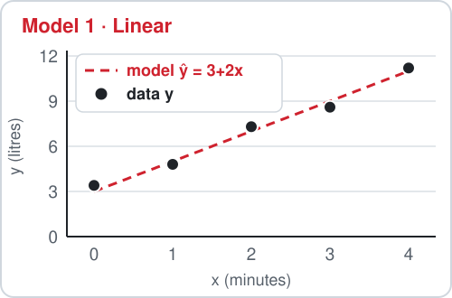
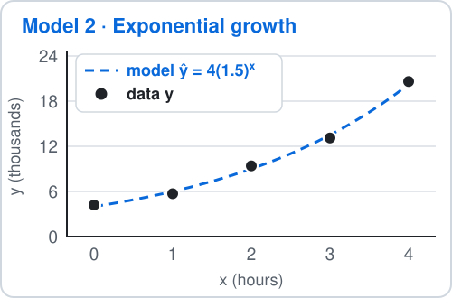
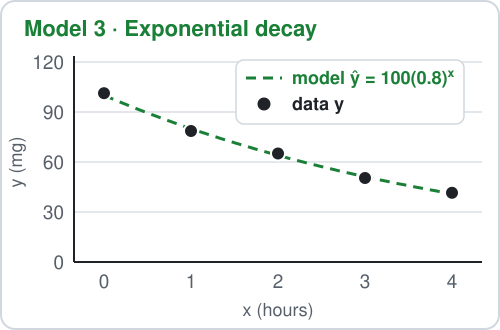

# Math Material — Residuals: Linear, Exponential Growth and Decay

**Residual:**

$$
r=y-\hat y
$$

- $y$ is the actual value, $\hat y$ is the value the model predicts.
- $r>0$: the model **underestimates**.
- $r<0$: the model **overestimates**.
- Three models: linear, exponential growth, exponential decay. Each has five data points.

**A calculator is allowed. Type each residual exactly (up to 2 decimal places), then press Check.**

## 1. Model 1 · Linear: water in a tank

A hose fills a tank. The water in the tank is measured every minute.

- $x$ = minutes, $y$ = litres.
- Model:

$$
\hat y=3+2x
$$

Find each residual:

$$
r=y-\hat y
$$

| $x$ | actual $y$ | $r=y-\hat y$ |
|---:|---:|---:|
| 0 | 3.4 | ? |
| 1 | 4.8 | ? |
| 2 | 7.3 | ? |
| 3 | 8.6 | ? |
| 4 | 11.2 | ? |

<b>Working</b>

**Step 1 — predict.** Put each $x$ into the model:

$$
\begin{aligned}
\hat y(0) &= 3+2(0) \\
&= 3 \\
\hat y(1) &= 3+2(1) \\
&= 5 \\
\hat y(2) &= 3+2(2) \\
&= 7 \\
\hat y(3) &= 3+2(3) \\
&= 9 \\
\hat y(4) &= 3+2(4) \\
&= 11
\end{aligned}
$$

**Step 2 — subtract.** Actual minus predicted:

$$
\begin{aligned}
r_1 &= 3.4-3 \\
&= 0.4 \\
r_2 &= 4.8-5 \\
&= -0.2 \\
r_3 &= 7.3-7 \\
&= 0.3 \\
r_4 &= 8.6-9 \\
&= -0.4 \\
r_5 &= 11.2-11 \\
&= 0.2
\end{aligned}
$$

**Step 3 — read the signs.**

- $r>0$ at points 1, 3, 5: the data point lies above the dashed model, so the model **underestimates**.
- $r<0$ at points 2, 4: the data point lies below the dashed model, so the model **overestimates**.
- The residuals are small and switch sign with no pattern, so this model fits the data.

## 2. Model 2 · Exponential growth: bacteria in a dish

Bacteria grow in a dish. They are counted every hour.

- $x$ = hours, $y$ = thousands.
- Model:

$$
\hat y=4(1.5)^{x}
$$

Find each residual:

$$
r=y-\hat y
$$

| $x$ | actual $y$ | $r=y-\hat y$ |
|---:|---:|---:|
| 0 | 4.2 | ? |
| 1 | 5.7 | ? |
| 2 | 9.4 | ? |
| 3 | 13.1 | ? |
| 4 | 20.6 | ? |

<b>Working</b>

**Step 1 — predict.** Put each $x$ into the model:

$$
\begin{aligned}
\hat y(0) &= 4(1.5)^{0} \\
&= 4 \\
\hat y(1) &= 4(1.5)^{1} \\
&= 6 \\
\hat y(2) &= 4(1.5)^{2} \\
&= 9 \\
\hat y(3) &= 4(1.5)^{3} \\
&= 13.5 \\
\hat y(4) &= 4(1.5)^{4} \\
&= 20.25
\end{aligned}
$$

**Step 2 — subtract.** Actual minus predicted:

$$
\begin{aligned}
r_1 &= 4.2-4 \\
&= 0.2 \\
r_2 &= 5.7-6 \\
&= -0.3 \\
r_3 &= 9.4-9 \\
&= 0.4 \\
r_4 &= 13.1-13.5 \\
&= -0.4 \\
r_5 &= 20.6-20.25 \\
&= 0.35
\end{aligned}
$$

**Step 3 — read the signs.**

- $r>0$ at points 1, 3, 5: the data point lies above the dashed model, so the model **underestimates**.
- $r<0$ at points 2, 4: the data point lies below the dashed model, so the model **overestimates**.
- The residuals are small and switch sign with no pattern, so this model fits the data.

## 3. Model 3 · Exponential decay: medicine in the blood

A patient takes a medicine. The amount left in the blood is measured every hour.

- $x$ = hours, $y$ = mg.
- Model:

$$
\hat y=100(0.8)^{x}
$$

Find each residual:

$$
r=y-\hat y
$$

| $x$ | actual $y$ | $r=y-\hat y$ |
|---:|---:|---:|
| 0 | 101.3 | ? |
| 1 | 78.6 | ? |
| 2 | 65.1 | ? |
| 3 | 50.4 | ? |
| 4 | 41.5 | ? |

<b>Working</b>

**Step 1 — predict.** Put each $x$ into the model:

$$
\begin{aligned}
\hat y(0) &= 100(0.8)^{0} \\
&= 100 \\
\hat y(1) &= 100(0.8)^{1} \\
&= 80 \\
\hat y(2) &= 100(0.8)^{2} \\
&= 64 \\
\hat y(3) &= 100(0.8)^{3} \\
&= 51.2 \\
\hat y(4) &= 100(0.8)^{4} \\
&= 40.96
\end{aligned}
$$

**Step 2 — subtract.** Actual minus predicted:

$$
\begin{aligned}
r_1 &= 101.3-100 \\
&= 1.3 \\
r_2 &= 78.6-80 \\
&= -1.4 \\
r_3 &= 65.1-64 \\
&= 1.1 \\
r_4 &= 50.4-51.2 \\
&= -0.8 \\
r_5 &= 41.5-40.96 \\
&= 0.54
\end{aligned}
$$

**Step 3 — read the signs.**

- $r>0$ at points 1, 3, 5: the data point lies above the dashed model, so the model **underestimates**.
- $r<0$ at points 2, 4: the data point lies below the dashed model, so the model **overestimates**.
- The residuals are small and switch sign with no pattern, so this model fits the data.

