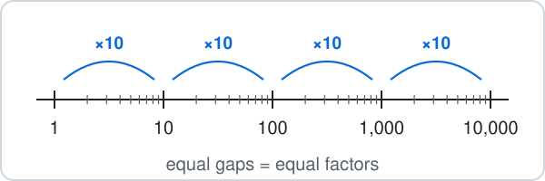
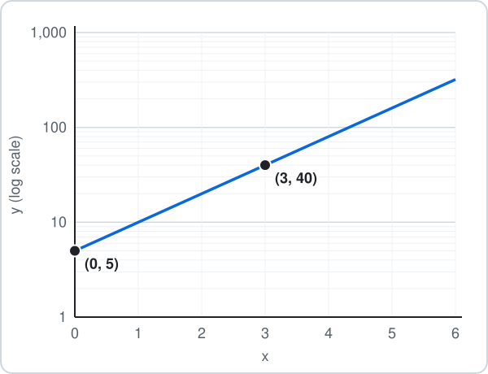

# Math Material — Semi-log Plots

**A semi-log plot draws $\log y$ against $x$:**

$$
\begin{aligned}
y &= a\cdot b^{x} \\
\log y &= \log a+x\log b
\end{aligned}
$$

- Exponential data lies on a **straight line**.
- Slope $=\log b$, intercept $=\log a$.

**A calculator is allowed. Type each answer, then press Check.**

## 1. The log scale: equal gaps, equal factors

- On a **semi-log plot** the $y$-axis is a log scale; the $x$-axis stays ordinary.
- The labels go $1,\ 10,\ 100,\ 1000$: every equal gap is a factor of $10$.
- So the height of a point is really $\log y$.

**Practice:** one gap = one step = $\times10$.

| Question | Answer |
|---:|---:|
| $30\text{, up 1 step}$ | ? |
| $5\text{, up 2 steps}$ | ? |
| $2000\text{, down 1 step}$ | ? |

<b>Working</b>

**Example 1:** one step up from $4$.

$$
\begin{aligned}
4\times10 &= \boxed{40}
\end{aligned}
$$

**Example 2:** halfway between $10$ and $100$ is **not** $55$.

- Halfway in height means halfway in $\log y$: from $1$ to $2$, so $1.5$.

$$
\begin{aligned}
\log y &= 1.5 \\
y &= 10^{1.5} \\
&\approx \boxed{31.6}
\end{aligned}
$$

## 2. Why an exponential becomes a straight line

Take $\log$ of both sides of an exponential:

$$
\begin{aligned}
y &= a\cdot b^{x} \\
\log y &= \log a+x\log b
\end{aligned}
$$

- This is a straight line in $x$.
- **Slope** $=\log b$.
- **Vertical intercept** $=\log a$.

**Practice:** $\log$ means base $10$. Give the last one to 3 decimal places.

- **A:** $y=100\cdot10^{x}$
- **B:** $y=5\cdot2^{x}$

| Question | Answer |
|---:|---:|
| $\text{A: slope}$ | ? |
| $\text{A: intercept}$ | ? |
| $\text{B: slope}$ | ? |

<b>Working</b>

**Example:** $y=3\cdot2^{x}$.

$$
\begin{aligned}
\log y &= \log 3+x\log 2 \\
&\approx 0.477+0.301x
\end{aligned}
$$

- Slope $\approx0.301$: every step of $1$ in $x$ multiplies $y$ by $2$.
- Intercept $\approx0.477$: at $x=0$, $y=3$.

$$
\begin{aligned}
\text{slope} &= \boxed{\log 2}
\end{aligned}
$$

## 3. Straight or not? Test the ratios

- Equal steps in $x$.
- **Same ratio** every step ($\times$ the same number): exponential, **straight** on a semi-log plot.
- **Same difference** every step ($+$ the same number): linear, it **bends** on a semi-log plot.

**Practice:** $x=0,1,2,3$ in each set.

- **A:** $6,\ 12,\ 24,\ 48$
- **B:** $6,\ 12,\ 18,\ 24$
- **C:** $3,\ 12,\ 48,\ 192$

| Question | Answer |
|---:|---:|
| $\text{A: } y(1)\div y(0)$ | ? |
| $\text{B: } y(2)\div y(1)$ | ? |
| $\text{C: } y(3)\div y(2)$ | ? |

<b>Working</b>

**Example:** $5,\ 15,\ 45,\ 135$.

$$
\begin{aligned}
15\div5 &= 3 \\
45\div15 &= 3 \\
135\div45 &= 3
\end{aligned}
$$

- Same ratio $3$: straight on a semi-log plot.

**Example:** $5,\ 10,\ 15,\ 20$.

$$
\begin{aligned}
10\div5 &= 2 \\
15\div10 &= 1.5
\end{aligned}
$$

- The ratio changes (it adds $5$ instead): **not** straight.

$$
\begin{aligned}
\text{test} &= \boxed{\text{same ratio?}}
\end{aligned}
$$

## 4. Read the model off the line

- A straight line on a semi-log plot means $y=a\cdot b^{x}$.
- The point at $x=0$ gives $a$, because $b^{0}=1$.
- A second point gives $b$.

**Practice:** the line in the figure passes through $(0,\,5)$ and $(3,\,40)$.

| Question | Answer |
|---:|---:|
| $b$ | ? |
| $y \text{ at } x=4$ | ? |
| $y \text{ at } x=6$ | ? |

<b>Working</b>

**Example:** a line through $(0,\,3)$ and $(4,\,48)$.

$$
\begin{aligned}
a &= 3 \\
48 &= 3\cdot b^{4} \\
b^{4} &= 16 \\
b &= 2
\end{aligned}
$$

Check with the slope: $\dfrac{\log48-\log3}{4}\approx0.301=\log2$.

So the model is:

$$
\begin{aligned}
y &= \boxed{3\cdot2^{x}}
\end{aligned}
$$

