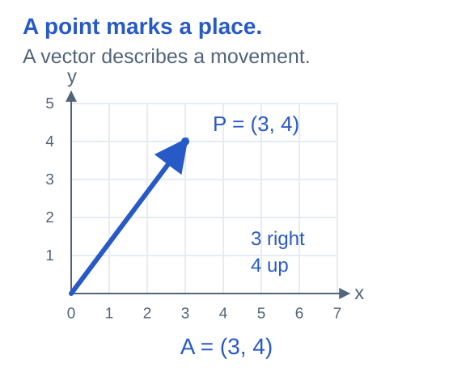
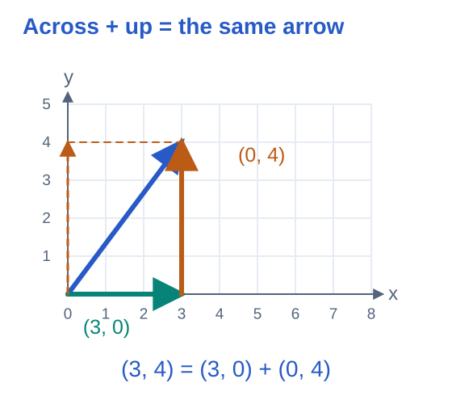
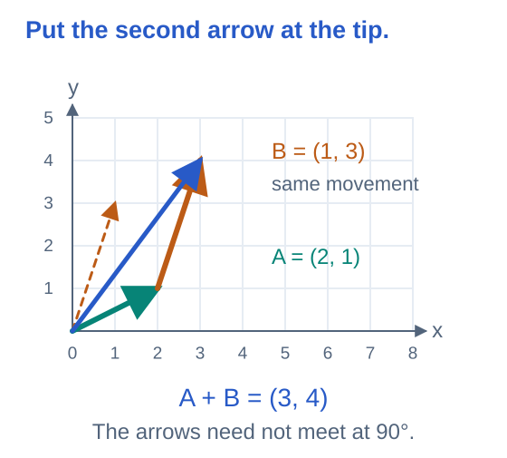
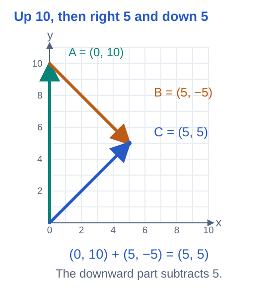
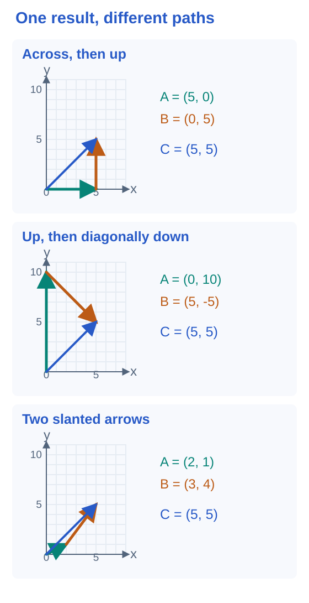

# Math Material — Vectors Part 1

- Points mark places; vectors describe movements.
- Add arrows by following one movement, then the next.
- Three short checks follow each idea.

## 1. From two points to one vector

Start at $O=(0,0)$ and end at $P=(3,4)$.

$$
\vec A=\overrightarrow{OP}
$$

- Move 3 units right.
- Move 4 units up.

$$
\vec A=\begin{bmatrix}3\\4\end{bmatrix}
$$

The pair $(3,4)$ gives the horizontal and vertical movements.

**Try:** first use the arrow from $(0,0)$ to $(2,5)$. For the last check, use $(1,2)$ to $(4,6)$.

| Question | Answer |
|---:|---:|
| $\text{First arrow: }\Delta x$ | ? |
| $\text{First arrow: }\Delta y$ | ? |
| $\text{Last arrow: }\Delta y$ | ? |

<b>Working</b>

Subtract start coordinates from end coordinates.

$$
\Delta x=3-0
$$

$$
\Delta x=3
$$

$$
\Delta y=4-0
$$

$$
\Delta y=4
$$

Sliding an arrow without turning or stretching it preserves the vector. Its movement stays the same.

## 2. Split (3,4) into horizontal and vertical parts

The straight arrow and the two-step route have the same start and finish.

$$
\begin{bmatrix}3\\4\end{bmatrix}=\begin{bmatrix}3\\0\end{bmatrix}+\begin{bmatrix}0\\4\end{bmatrix}
$$

- First follow the horizontal arrow.
- Slide the vertical arrow to the horizontal arrow’s tip.
- The result still ends at $(3,4)$.

**Try the same split for:**

$$
\vec C=\begin{bmatrix}6\\2\end{bmatrix}
$$

| Question | Answer |
|---:|---:|
| $\text{Across: }x$ | ? |
| $\text{Up: }y$ | ? |
| $\text{Up: }x$ | ? |

<b>Working</b>

Add the horizontal movements.

$$
3+0=3
$$

Add the vertical movements.

$$
0+4=4
$$

The dashed vertical arrow and the solid vertical arrow are copies of the same movement.

## 3. Add any two arrows head to tail

The arrows do not need to be horizontal or vertical.

$$
\vec A=\begin{bmatrix}2\\1\end{bmatrix}
$$

$$
\vec B=\begin{bmatrix}1\\3\end{bmatrix}
$$

- Slide $\vec B$ so it starts at the tip of $\vec A$.
- Draw the result from the original start to the final finish.

**Try:** use these two vectors.

| Question | Answer |
|---:|---:|
| $\text{Find }(\vec A+\vec B)_x$ | ? |
| $\text{Find }(\vec A+\vec B)_y$ | ? |
| $\text{Find }(\vec B+\vec A)_x$ | ? |

<b>Working</b>

$$
\vec A+\vec B=\begin{bmatrix}2+1\\1+3\end{bmatrix}
$$

$$
\vec A+\vec B=\begin{bmatrix}3\\4\end{bmatrix}
$$

Reversing the order gives the same final movement.

$$
\vec B+\vec A=\begin{bmatrix}3\\4\end{bmatrix}
$$

## 4. (5,5) can include a downward arrow

Go up 10, then move right 5 and down 5.

$$
\begin{bmatrix}5\\5\end{bmatrix}=\begin{bmatrix}0\\10\end{bmatrix}+\begin{bmatrix}5\\-5\end{bmatrix}
$$

- The second vector has a negative vertical component.
- It starts at $(0,10)$ and ends at $(5,5)$.
- The two component arrows are not perpendicular.

**Checks 1–2:**

$$
\vec C=\begin{bmatrix}0\\9\end{bmatrix}+\begin{bmatrix}6\\-5\end{bmatrix}
$$

**Check 3:**

$$
\begin{bmatrix}6\\2\end{bmatrix}=\begin{bmatrix}0\\9\end{bmatrix}+\vec B
$$

| Question | Answer |
|---:|---:|
| $\text{1. Find }C_x$ | ? |
| $\text{2. Find }C_y$ | ? |
| $\text{3. Find }B_y$ | ? |

<b>Working</b>

Add horizontal components.

$$
0+5=5
$$

Add vertical components.

$$
10+(-5)=5
$$

A vector may be split into components that are not perpendicular. The horizontal/vertical split is one useful choice.

## 5. Choose a first arrow; the second fills the gap

The same vector has many decompositions.

$$
\vec C=\vec A+\vec B
$$

Choose a first movement $\vec A$. The remaining movement is:

$$
\vec B=\vec C-\vec A
$$

The three pictured routes all produce $\vec C=(5,5)$.

**Try:** keep $\vec C=(5,5)$.

- Checks 1–2: use $\vec A=(1,2)$.
- Check 3: use $\vec A=(-2,7)$.

| Question | Answer |
|---:|---:|
| $\text{1. Find }B_x$ | ? |
| $\text{2. Find }B_y$ | ? |
| $\text{3. Find }B_y$ | ? |

<b>Working</b>

$$
\begin{bmatrix}5\\5\end{bmatrix}=\begin{bmatrix}5\\0\end{bmatrix}+\begin{bmatrix}0\\5\end{bmatrix}
$$

$$
\begin{bmatrix}5\\5\end{bmatrix}=\begin{bmatrix}0\\10\end{bmatrix}+\begin{bmatrix}5\\-5\end{bmatrix}
$$

$$
\begin{bmatrix}5\\5\end{bmatrix}=\begin{bmatrix}2\\1\end{bmatrix}+\begin{bmatrix}3\\4\end{bmatrix}
$$

Different paths can share the same total movement. Neither component has to lie along an axis.

