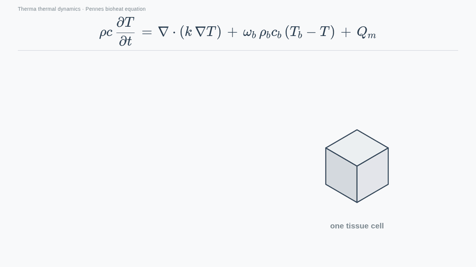

# Pennes Bioheat Equation: Four Terms, One Unit



## What happens

1. One tissue volume cell is drawn, with the Pennes equation above it. Each term is a thermal power per unit volume.
2. Storage: the cell warms, and the temperature inside it rises. The units of $\rho$ , $c$ and $\partial T / \partial t$ multiply to $\mathrm{W/m^3}$ .
3. Conduction: heat enters and leaves through the faces of the cell, exchanged with the neighbouring cells. $k \nabla T$ is a heat flux in $\mathrm{W/m^2}$ , and its divergence is in $\mathrm{W/m^3}$ .
4. Perfusion: blood passes through the cell. It brings heat in when the blood is warmer than the tissue, and takes heat away when it is cooler.
5. Metabolism: the tissue makes heat inside itself, $Q_m$ in $\mathrm{W/m^3}$ .
6. All four terms carry the same unit. Stored energy change equals conduction plus blood perfusion plus metabolism.

## Concept

```math
\rho c\,\frac{\partial T}{\partial t} = \nabla\cdot\left(k\,\nabla T\right) + \omega_b\,\rho_b c_b\,(T_b - T) + Q_m
```

| Term | Meaning | Unit |
|---|---|---|
| $\rho c\,\partial T / \partial t$ | rate of stored thermal energy change | $\mathrm{W/m^3}$ |
| $\nabla\cdot(k\,\nabla T)$ | net heat exchange with neighbouring tissue | $\mathrm{W/m^3}$ |
| $\omega_b\,\rho_b c_b\,(T_b - T)$ | heat exchange between blood and tissue | $\mathrm{W/m^3}$ |
| $Q_m$ | internal heat generation by metabolism | $\mathrm{W/m^3}$ |

Here $\rho$ is the tissue density ( $\mathrm{kg/m^3}$ ), $c$ its specific heat ( $\mathrm{J/(kg \cdot K)}$ ), $k$ its thermal conductivity ( $\mathrm{W/(m \cdot K)}$ ), $\omega_b$ the blood perfusion rate ( $\mathrm{1/s}$ ), $\rho_b c_b$ the volumetric heat capacity of blood and $T_b$ the arterial blood temperature. The perfusion term acts as a conductance $\omega_b \rho_b c_b$ (in $\mathrm{W/(m^3 \cdot K)}$ ) between the tissue and a bath at $T_b$ , so it pulls the tissue towards the blood temperature from either side.

This is the equation solved on a layered skin block with a lesion in [Pennes Skin Cancer Simulator Model](../pennes-skin-cancer-simulator-model/content.md).

## Summary

The Pennes equation is a thermal power balance per unit volume: the rate at which one tissue cell stores heat equals conduction from its neighbours plus heat exchanged with blood plus metabolic heat. Every term is in $\mathrm{W/m^3}$ , which is the check that the equation is written correctly.

### 繁體中文

Pennes 方程式是單位體積的熱功率平衡：一個組織單元儲存熱量的速率，等於來自鄰近組織的傳導，加上與血液交換的熱量，加上代謝產熱。每一項的單位都是 $\mathrm{W/m^3}$ ，這是檢查方程式是否寫對的方法。

### Français

L'équation de Pennes est un bilan de puissance thermique par unité de volume : la vitesse à laquelle une cellule de tissu stocke de la chaleur est égale à la conduction venant de ses voisines, plus la chaleur échangée avec le sang, plus la chaleur métabolique. Chaque terme est en $\mathrm{W/m^3}$ , ce qui permet de vérifier que l'équation est bien écrite.

### Deutsch

Die Pennes-Gleichung ist eine thermische Leistungsbilanz pro Volumeneinheit: Die Rate, mit der eine Gewebezelle Wärme speichert, ist gleich der Wärmeleitung von ihren Nachbarn plus dem Wärmeaustausch mit dem Blut plus der Stoffwechselwärme. Jeder Term hat die Einheit $\mathrm{W/m^3}$ , womit sich prüfen lässt, dass die Gleichung richtig geschrieben ist.

### Русский

Уравнение Пеннеса — это баланс тепловой мощности на единицу объёма: скорость, с которой одна ячейка ткани накапливает тепло, равна теплопроводности от соседних ячеек плюс теплообмен с кровью плюс метаболическое тепло. Каждый член имеет размерность $\mathrm{W/m^3}$ , и это проверка того, что уравнение записано верно.
