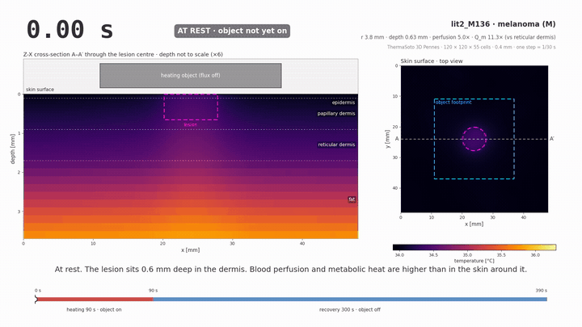
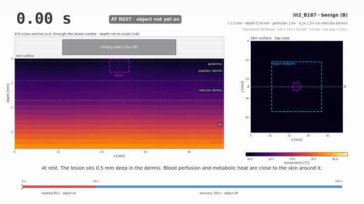

# Pennes Equation of the Monte-Carlo Skin Lesion Simulator: Melanoma and Benign Show-case



*Melanoma case `lit2_M136`: a heating pad on the skin for 90 s, then 300 s of recovery. Left, the cross-section through the lesion centre; right, the skin surface from above; the clock is the simulated time.* Video file: [lit2_M136_melanoma.mp4](media/lit2_M136_melanoma.mp4)



*Benign case `lit2_B187`: the same pad, the same flux, the same colour scale.* Video file: [lit2_B187_benign.mp4](media/lit2_B187_benign.mp4)

## What happens

1. A pad rests on a 26 × 26 mm square of skin and pushes a heat flux of $q = 206.5$ W/m² into the surface. The room air at 21 °C keeps cooling the whole surface, under the pad as well.
2. Conduction carries the heat down through the epidermis and dermis into the fat, and sideways past the edge of the pad.
3. Blood at 37 °C perfuses every layer and carries heat away wherever the tissue is warmer than the blood; the perfusion strength varies from place to place by a smooth random field $m(x,y)$ drawn once per scene.
4. The lesion is a cylinder of radius $r$ and depth $d$ in the dermis. The melanoma has about five times the blood perfusion and ten times the metabolic heat of the reticular dermis, so it is already warmer at rest: 34.33 °C against 34.03 °C for the skin around it. The benign lesion has only 1.4 and 1.5 times, and its rest contrast is 0.09 °C.
5. At 90 s the pad is lifted off. The flux stops at once; only convection, perfusion and conduction remain.
6. The surface cools within seconds while the heat stored in the dermis keeps moving down into the fat, which is still warming when the surface has already fallen.
7. The melanoma stays a warm spot on the surface through the whole recovery; the benign lesion fades into the skin around it. The same equation, the same pad: the difference is only in the lesion's perfusion, metabolism and size.

## Concept

### The equation, term by term

Every point of the tissue obeys the Pennes bioheat balance with the Monte-Carlo perfusion multiplier $m$ :

```math
\rho c\,\frac{\partial T}{\partial t}
= \nabla\cdot\left(k\,\nabla T\right) + m\,\omega_b\,\rho_b c_b\,\left(T_b - T\right) + Q_m .
```

**Storage, $\rho c\,\partial T/\partial t$ .** The tissue of one cubic metre holds $\rho c$ joules per kelvin. When the balance of the three terms on the right is positive, the temperature rises at that rate; when it is negative, it falls. Fat has the smallest $\rho c$ of the layers and so warms and cools fastest per unit of heat.

**Conduction, $\nabla\cdot(k\,\nabla T)$ .** Heat flows from warm to cold at a rate set by the conductivity $k$ . The divergence counts how much more heat flows into a small volume than out of it. This is the term that moves the pad's heat down through the layers and sideways beyond the footprint, and that later drains the dermis into the fat.

**Perfusion, $m\,\omega_b\,\rho_b c_b\,(T_b - T)$ .** Blood enters at the arterial temperature $T_b = 37$ °C and leaves at the tissue temperature. The product $\omega_b\rho_b c_b$ is a conductance to a bath at $T_b$ : above 37 °C perfusion cools, below 37 °C it warms. Skin at rest sits below 37 °C, so perfusion is a heat source there, and the strongly perfused melanoma is warmer than the skin around it for this reason.

**Metabolism, $Q_m$ .** The tissue produces heat on its own. It is a constant source per unit volume, small in normal skin and ten times larger in the melanoma.

All four terms are a power per unit volume, W/m³. The unit check for each term is in [Pennes Bioheat Equation: Four Terms, One Unit](../pennes-bioheat-equation/content.md).

### The surface and the pad

The surface $z = 0$ exchanges heat with the room and receives the pad flux on the footprint $\Sigma$ :

```math
-k\,\frac{\partial T}{\partial z}\Big|_{z=0} = h\left(T_\infty - T_s\right) + q(t)\,\chi_\Sigma(x,y),
\qquad q(t) = q_\nu\,u(t),
```

where $T_s$ is the surface temperature the camera sees, $h$ the convection coefficient, $T_\infty$ the room temperature, $\chi_\Sigma$ the indicator of the footprint and $u(t)$ the switch, 1 while the pad is on and 0 after. Convection acts on the whole surface at all times; the pad only adds the flux. The bottom face, 11.7 mm down, is held at the core temperature $T_{\mathrm{core}} = 37$ °C; the four side faces are insulated. The initial state is the rest state, the steady solution of the same equation with $q = 0$ .

### Every parameter, one by one

| symbol | what it is | value in the show-case | unit |
|---|---|---|---|
| $k$ | thermal conductivity: how fast heat moves through the tissue | epidermis 0.235 · dermis 0.445 · fat 0.185 · muscle 0.51 · lesion 0.558 | W m⁻¹ K⁻¹ |
| $\rho c$ | volumetric heat capacity: heat stored per kelvin of one cubic metre | epidermis 4.31 · dermis 3.96 · fat 2.67 · muscle 3.91 · lesion 3.97 (×10⁶) | J m⁻³ K⁻¹ |
| $\omega_b$ | blood perfusion rate: blood volume exchanged per tissue volume per second | epidermis 0 · papillary dermis 0.18 · reticular dermis 1.26 · fat 0.08 · muscle 2.7 · melanoma M136 6.36 · benign B187 1.82 (×10⁻³) | s⁻¹ |
| $Q_m$ | metabolic heat: power the tissue makes on its own | epidermis 0 · dermis 368 · fat 368 · muscle 684 · melanoma M136 4146 · benign B187 536 | W m⁻³ |
| $\rho_b c_b$ | heat capacity of blood | 1060 × 3770 = 4.00 × 10⁶ | J m⁻³ K⁻¹ |
| $T_b$ | arterial blood temperature | 37 | °C |
| $h$ | surface convection coefficient | 10 | W m⁻² K⁻¹ |
| $T_\infty$ | room temperature | 21 | °C |
| $T_{\mathrm{core}}$ | temperature held at the bottom face | 37 | °C |
| $q_\nu$ , $t_{\mathrm{on}}$ | pad flux at power level $\nu$ , and how long it stays on | level 2 of 5: 206.5 W m⁻² for 90 s; level 5 is set so that the hottest skin column reaches 39 °C, one degree under the 40 °C ceiling of the protocol | W m⁻², s |
| $\Sigma$ | the footprint of the pad | 26 × 26 mm square, centred on the lesion | — |
| $m(x,y)$ | Monte-Carlo perfusion multiplier: a smooth random field with median 1 | $m = e^{\sigma g}$ with $\sigma = 0.15$ , correlation length 2 mm, clipped to $[0.55,\ 1.82]$ ; one draw per scene from the scene's seed | — |
| $r$ , $d$ | lesion radius and depth; the lesion is a cylinder from the surface down to $d$ | M136: 3.83 mm, 0.65 mm · B187: 2.22 mm, 0.55 mm (depth snapped to the model's layer faces) | mm |
| perfusion ratio | lesion $\omega_b$ as a multiple of the reticular dermis value 1.26 × 10⁻³ s⁻¹ | M136 5.05 · B187 1.44 | — |
| metabolic ratio | lesion $Q_m$ as a multiple of the reticular dermis value 368.1 W m⁻³ | M136 11.26 · B187 1.45 | — |

The two ratios and the size are the only things that differ between the two videos. They set the rest contrast (0.30 °C for M136, 0.09 °C for B187), the temperature at the end of heating (lesion 36.01 °C against 35.83 °C for M136; 35.88 °C against 35.84 °C for B187) and the warm spot that remains, or does not remain, during recovery. The ratios of the two cases are draws from literature-based priors for melanoma and for benign naevi; they are research assumptions, not measurements.

The grid (120 × 120 cells of 0.4 mm, 55 depth nodes), the time step of 1/30 s and the camera model are described in [Pennes Skin Cancer Simulator Model](../pennes-skin-cancer-simulator-model/content.md). The videos above are the noise-free model itself, not the camera.

## Summary

One Pennes equation, $\rho c\,\partial T/\partial t = \nabla\cdot(k\nabla T) + m\,\omega_b\rho_b c_b (T_b - T) + Q_m$ , drives both videos: a pad heats the skin for 90 s, conduction spreads the heat down and sideways, blood and room air carry it away. The melanoma, with about five times the perfusion and ten times the metabolic heat of the dermis, is warmer at rest and stays a warm spot through recovery; the benign lesion, with ratios near 1, fades into the skin. Every parameter of the equation is listed with its value, so each frame of the videos can be traced back to a number.

### 繁體中文

同一條 Pennes 方程式 $\rho c\,\partial T/\partial t = \nabla\cdot(k\nabla T) + m\,\omega_b\rho_b c_b (T_b - T) + Q_m$ 驅動了這兩段影片：加熱片在皮膚上加熱 90 秒，傳導把熱向下與向側面擴散，血液與室內空氣把熱帶走。黑色素瘤的血液灌流約為真皮的五倍、代謝熱約為十倍，因此在靜息時就較溫暖，並在整段恢復期間維持一個溫熱的亮點；良性病灶的比值接近 1，便融入周圍皮膚之中。方程式的每一個參數都列出了數值，所以影片的每一幀都可以追溯到一個數字。

### Français

Une seule équation de Pennes, $\rho c\,\partial T/\partial t = \nabla\cdot(k\nabla T) + m\,\omega_b\rho_b c_b (T_b - T) + Q_m$ , pilote les deux vidéos : un patch chauffe la peau pendant 90 s, la conduction répand la chaleur vers le bas et sur les côtés, le sang et l'air de la pièce l'évacuent. Le mélanome, avec environ cinq fois la perfusion et dix fois la chaleur métabolique du derme, est plus chaud au repos et reste une tache chaude pendant toute la récupération ; la lésion bénigne, avec des rapports proches de 1, se fond dans la peau. Chaque paramètre de l'équation est listé avec sa valeur, de sorte que chaque image des vidéos peut être ramenée à un nombre.

### Deutsch

Eine einzige Pennes-Gleichung, $\rho c\,\partial T/\partial t = \nabla\cdot(k\nabla T) + m\,\omega_b\rho_b c_b (T_b - T) + Q_m$ , treibt beide Videos: Ein Pad erwärmt die Haut 90 s lang, die Wärmeleitung verteilt die Wärme nach unten und zur Seite, Blut und Raumluft führen sie ab. Das Melanom mit etwa fünffacher Durchblutung und zehnfacher Stoffwechselwärme der Dermis ist in Ruhe wärmer und bleibt während der gesamten Erholung ein warmer Fleck; die gutartige Läsion mit Verhältnissen nahe 1 verschwindet in der umgebenden Haut. Jeder Parameter der Gleichung ist mit seinem Wert aufgeführt, sodass sich jedes Bild der Videos auf eine Zahl zurückführen lässt.

### Русский

Одно уравнение Пеннеса, $\rho c\,\partial T/\partial t = \nabla\cdot(k\nabla T) + m\,\omega_b\rho_b c_b (T_b - T) + Q_m$ , управляет обоими видео: пластина нагревает кожу 90 с, теплопроводность разносит тепло вглубь и в стороны, кровь и воздух комнаты уносят его. Меланома, у которой перфузия примерно в пять раз, а метаболическое тепло в десять раз больше, чем у дермы, теплее в покое и остаётся тёплым пятном на протяжении всего восстановления; доброкачественное образование с отношениями около 1 сливается с окружающей кожей. Каждый параметр уравнения приведён со своим значением, так что любой кадр видео можно свести к числу.
