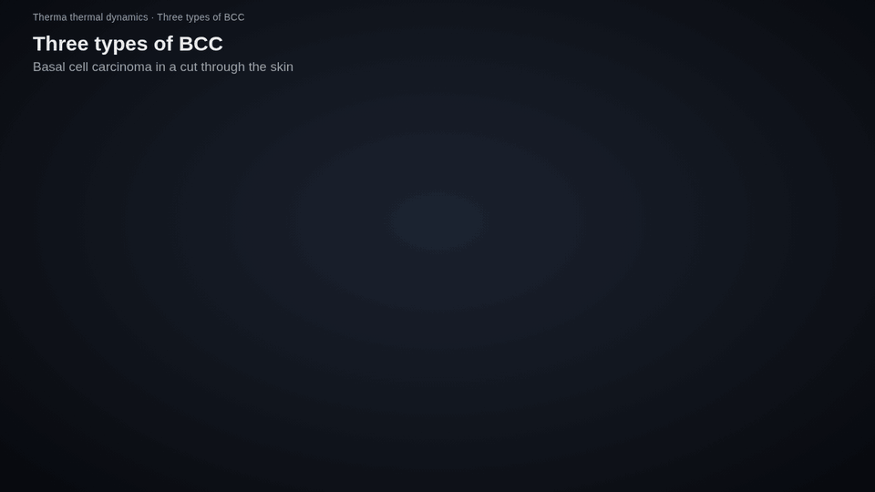
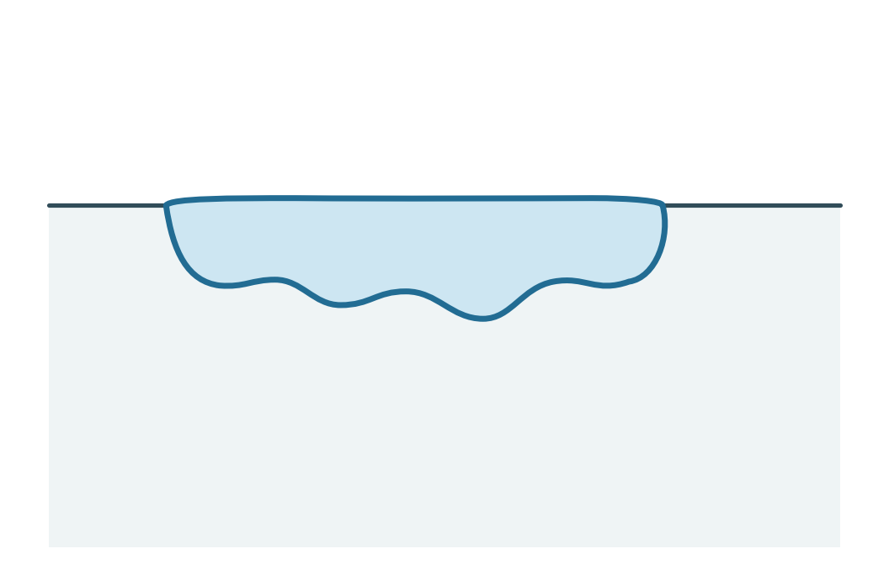
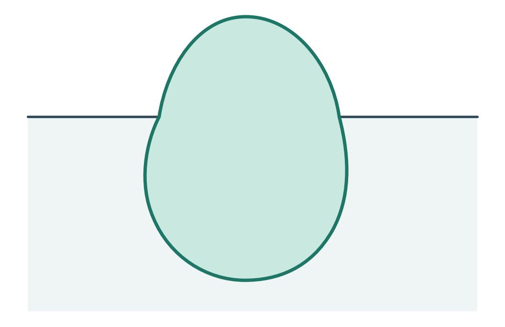
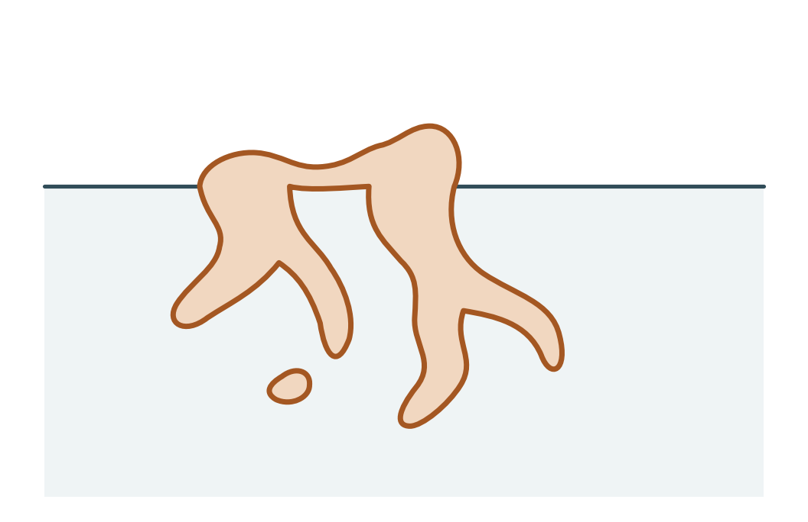

# Three Types of BCC: Superficial, Nodular, Infiltrative

*Basal cell carcinoma (BCC) in a cut through the skin: superficial, nodular and infiltrative growth, then the three side by side on the same skin surface.* Video file: [three-types-of-bcc.mp4](media/three-types-of-bcc.mp4)

## What happens

1. A cut through the skin shows the surface, the thin epidermis, the basement membrane under it and the dermis with its fibres.
2. **Superficial.** Small buds appear along the base of the epidermis and join into one wide, shallow ribbon with a wavy lower edge. The surface over it rises only a little.
3. **Nodular.** A round mass grows from the skin in two directions: a dome rises above the surface, and the body grows down into the dermis. The dermis fibres bend away from it.
4. **Infiltrative.** Thin strands grow down from the surface and branch. A small island appears apart from them. The top rises a little above the skin, and the edge is not clear.
5. The three shapes stand side by side under one skin surface line.

## Concept

### Three shapes, one surface

The three sub-types differ first in shape. A high-frequency ultrasound series of 100 BCCs (Siskou et al., 2023) found the superficial tumours mostly ribbon-shaped, the nodular tumours mostly round and the infiltrative tumours mostly irregular. The same study measured depth twice: once for the whole tumour and once from the skin surface down, after the part above the skin was subtracted. The difference shows where each type sits relative to the surface. The nodular type has the largest part above the skin, the infiltrative type a small one, and the superficial type is almost flat.

*Left to right: superficial, nodular, infiltrative. The pictures show the shape only, not a measured scale.*

| Type | Above the surface | Below the surface | Edge |
|---|---|---|---|
| Superficial | almost flat | a wide, shallow ribbon along the base of the epidermis | clear, wavy |
| Nodular | a raised dome | one round body, the deepest of the three | clear, smooth |
| Infiltrative | a little raised | thin branching strands and separate islands | not clear |

### Why the shape matters for thermal imaging

A thermal camera sees only the skin surface. What lies under it changes how heat moves after a cooling or heating stimulus: a thin, wide ribbon touches a large area close to the surface, a round mass stores heat in one deep block, and branching strands spread into the dermis with no clear boundary. A raised dome also changes the surface itself, because the skin line is no longer flat over the lesion. The [Monte-Carlo skin lesion simulator](../pennes-skin-cancer-simulator-model/content.md) models a lesion as a column under a flat skin surface, so the raised part is not part of that model.

## Summary

Superficial BCC spreads sideways as a wide, shallow ribbon and stays almost flat at the surface. Nodular BCC is one round mass that rises above the skin and grows down. Infiltrative BCC grows down as thin branching strands with small islands, rises a little and has an unclear edge.

**繁體中文：** 表淺型基底細胞癌沿表皮底部向兩側擴展，呈寬而淺的帶狀，表面幾乎平坦。結節型是一個圓形腫塊，既隆起於皮膚表面之上，也向下生長。浸潤型以細長分枝的條索和小島向下生長，表面略微隆起，邊界不清。

**Français :** Le carcinome basocellulaire superficiel s'étend latéralement en un ruban large et peu profond et reste presque plat en surface. Le type nodulaire est une masse ronde qui fait saillie au-dessus de la peau et croît vers le bas. Le type infiltrant croît vers le bas en fins cordons ramifiés avec de petits îlots, se soulève un peu et présente un bord flou.

**Deutsch:** Das superfizielle Basalzellkarzinom breitet sich seitlich als breites, flaches Band aus und bleibt an der Oberfläche fast eben. Der noduläre Typ ist eine runde Masse, die über die Haut hinausragt und nach unten wächst. Der infiltrative Typ wächst als dünne, verzweigte Stränge mit kleinen Inseln nach unten, hebt sich etwas an und hat einen unscharfen Rand.

**Русский:** Поверхностная базальноклеточная карцинома растёт в стороны широкой неглубокой лентой и почти не выступает над поверхностью. Узловая форма — это округлая масса, которая выступает над кожей и растёт вглубь. Инфильтративная форма растёт вглубь тонкими ветвящимися тяжами с мелкими островками, слегка выступает и имеет нечёткий край.

**Source:** Siskou S, Pasquali P, Trakatelli M. High Frequency Ultrasound of Basal Cell Carcinomas: Ultrasonographic Features and Histological Subtypes, a Retrospective Study of 100 Tumors. *J. Clin. Med.* 2023, 12(12):3893. [doi:10.3390/jcm12123893](https://doi.org/10.3390/jcm12123893)
